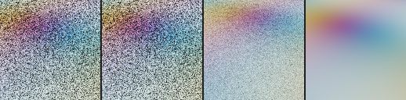

# Native NRD results (black box)

**Round 2 (handoff: ours at HEAD, knot captures, shadows dynamic / boil, SIGMA harness checks): [ROUND2.md](ROUND2.md).**

**Phases 4–5 (ours vs native on the standard set and the real scene, same-GPU cost, P2, P3, jitter): [PHASE4-5.md](PHASE4-5.md).** The rest of this page is the phase 1–3 smoke test.

_NRD v4.18.0 (`e06852b`), default settings, RTX 3060 Laptop, driver 592.00, D3D12 headless,
2026-10-25. Setup and conventions: [../SETUP.md](../SETUP.md). Scores come from
`tools/rt-capture/compare.mjs` (CAPTURE-FORMAT metrics) on outputs in
`C:\dev\nrd-reference\outputs\`. Images, metrics and timings only._

Each capture folder has `compare.md` / `compare.json` (full tables, per-frame PSNR), a folder per
denoiser with `run.json` + `timings.csv` (1080p also has `timings-loops.csv`), and
`crop_f7_<signal>.png`. Crops are frame 7, 128×128 per panel, laid out noisy | outputs… | reference,
Reinhard + gamma 2.2, sky black.

| folder | capture |
|---|---|
| [synthetic-static/](synthetic-static/compare.md) | `gen-synthetic.mjs --static-camera`, 256², 8 frames |
| [synthetic-plane/](synthetic-plane/compare.md) | `gen-synthetic.mjs` (moving camera), 256², 8 frames; plus the P1 probe variant |
| [synthetic-plane-jitter/](synthetic-plane-jitter/compare.md) | same with `--jitter` (Halton sub-pixel jitter) |
| [synthetic-plane-1080p/](synthetic-plane-1080p/compare.md) | `--w 1920 --h 1080`, 8 frames, replayed 8× for timing |

## Smoke test (NATIVE-HARNESS phase 3): passed

On `synthetic-static`, `REFERENCE` scores last-frame PSNR **26.53 / 21.51 / 23.63 dB** (diffuse /
specular / visibility). Expected: 26.5 / 21.5 / 23.6. Its output equals a plain per-pixel running
mean of the noisy inputs to ≤ 7e-7 at every frame. The conventions hold, at least where a static
camera can test them. The moving-camera captures below exercise motion, viewZ and normals through
REBLUR/RELAX/SIGMA, which all converge with small bias.

## P1: does `REFERENCE` reproject? **No.**

| `REFERENCE` on `synthetic-plane` | diffuse | specular | visibility |
|---|---|---|---|
| noisy input (last frame) | 16.64 | 12.86 | 14.34 |
| native, capture's matrices (last frame) | **16.64** | **12.86** | **14.34** |
| native, previous matrices := current (last frame) | 22.88 | 17.31 | 12.94 |
| ours `accumulate` (reprojected), from TASKS P1 | 31.7 | 26.4 | 26.4 |
| ours `accumulate-static`, from TASKS P1 | 25.7 | 18.1 | 13.9 |

| `REFERENCE` on `synthetic-static` | diffuse | specular | visibility |
|---|---|---|---|
| noisy input (last frame) | 16.64 | 12.87 | 14.36 |
| native (last frame) | **26.53** | **21.51** | **23.63** |
| expected (ours `accumulate`) | 26.5 | 21.5 | 23.6 |

- With the capture's real camera (moving every frame), native `REFERENCE` returns the **current
  noisy frame unchanged** on every frame (max |out − in| = 1.2e-7). Nothing accumulates, so on a
  moving camera it doesn't work as ground truth.
- If the harness instead tells it the camera didn't move (previous matrices = current on every
  frame), it accumulates a **plain per-pixel running mean in screen space**, with no reprojection.
  Its output equals that mean to ≤ 2e-7, and it smears: see the strip. So the history drop above is
  triggered by the camera matrices changing.
- Side observation for capture-io: that exact screen-space mean scores 22.88 / 17.31 / 12.94, below
  the `accumulate-static` numbers recorded in TASKS P1 (25.7 / 18.1 / 13.9). So `accumulate-static`
  is probably not a plain screen-space mean on today's `synthetic-plane`, or the capture changed
  since those numbers were taken. Worth a check.

Specular strip, frame 7 ([crop](synthetic-plane/crop_f7_specular_p1-probe.png)): noisy | native
`REFERENCE` | native `REFERENCE` with prev := current | reference.

## Quality, 256² (sequence-mean PSNR dB, noisy → out; last frame in brackets)

8 frames is shorter than the 8-frame settle window, so "settled" is empty. These are
first-8-frames numbers, history still building.

| denoiser | signal | synthetic-static | synthetic-plane | synthetic-plane-jitter |
|---|---|---|---|---|
| REBLUR_DIFFUSE_SPECULAR | diffuse | 16.62 → 52.30 (52.99) | 16.62 → 50.53 (51.54) | 16.62 → 50.60 (51.76) |
| | specular | 12.87 → 25.27 (26.01) | 12.79 → 25.00 (25.37) | 12.79 → 25.01 (25.43) |
| RELAX_DIFFUSE_SPECULAR | diffuse | 16.62 → 54.80 (57.30) | 16.62 → 50.92 (51.69) | 16.62 → 50.98 (51.94) |
| | specular | 12.87 → 24.61 (26.34) | 12.79 → 23.49 (23.97) | 12.79 → 23.51 (23.97) |
| SIGMA_SHADOW | visibility | 14.49 → 26.81 (30.19) | 14.45 → 20.50 (20.98) | 14.46 → 22.19 (20.97) |
| | penumbra PSNR | 20.04 | 15.72 | 16.10 |
| REFERENCE | diffuse | 16.62 → 22.99 (26.53) | 16.62 → 16.62 (16.64) | 16.62 → 16.62 (16.64) |
| | specular | 12.87 → 18.28 (21.51) | 12.79 → 12.79 (12.86) | 12.79 → 12.79 (12.86) |
| | visibility | 14.49 → 20.28 (23.63) | 14.45 → 14.45 (14.34) | 14.46 → 14.46 (14.32) |

Flicker, bias and non-finite counts are in each `compare.md`. Non-finite outputs: 0 everywhere.
Biases: REBLUR/RELAX diffuse about −0.001, specular +0.007 to +0.010; SIGMA +0.011 to +0.015
(slightly lighter than the reference in the penumbra).

## 1080p (`synthetic-plane-1080p`): quality and cost

| denoiser | signal | PSNR noisy → out (last frame) |
|---|---|---|
| REBLUR_DIFFUSE_SPECULAR | diffuse / specular | 16.62 → 51.00 (51.22) / 12.98 → 31.66 (32.45) |
| RELAX_DIFFUSE_SPECULAR | diffuse / specular | 16.62 → 50.84 (50.98) / 12.98 → 28.37 (29.20) |
| SIGMA_SHADOW | visibility | 14.70 → 27.41 (26.78) |
| REFERENCE | all | pass-through on a moving camera (see P1) |

GPU ms per frame at 1920×1080: timestamps around `DenoiseD3D12` (`total`) and submit-to-fence
(`wall`). There are 56 steady frames (8 loops × frames 1–7), and reset frames are reported
separately. NRD memory comes from the integration.

| denoiser | GPU median | p10 | p90 | reset frame (median) | wall median | NRD memory |
|---|---|---|---|---|---|---|
| REBLUR_DIFFUSE_SPECULAR | **5.61** | 5.16 | 8.88 | 6.14 | 5.83 | 148.1 MB (88.9 permanent + 59.2 aliasable) |
| RELAX_DIFFUSE_SPECULAR | **6.74** | 6.33 | 11.37 | 6.91 | 6.97 | 168.9 MB (97.1 + 71.8) |
| SIGMA_SHADOW | **1.09** | 0.98 | 1.84 | 1.32 | 1.41 | 31.8 MB (8.4 + 23.4) |
| REFERENCE ×3 signals | 1.61 (0.53 each) | 1.60 | 1.95 | 2.27 | 2.35 | 3 × 33.8 MB |

Caveats on timings:
- This is a **laptop** GPU, and the harness leaves it idle between frames while it loads the next
  frame from disk. Clocks drift, hence the wide p90.
- A second identical run gave medians within 0.35 ms: REBLUR 5.61 vs 5.61, RELAX 6.74 vs 7.07,
  SIGMA 1.09 vs 1.15.
- Each denoiser runs alone in its own submit, so nothing overlaps.
- Compare with our WGSL on this same machine (phase 5), not with NRD's published RTX 4080 figures.
- At 256², costs are dominated by fixed overhead (REBLUR 0.19–0.25 ms, RELAX 0.24–0.29, SIGMA 0.09,
  REFERENCE 0.02 per signal); don't use those for scaling.

## Crops

| capture | diffuse | specular | visibility |
|---|---|---|---|
| synthetic-static | [crop](synthetic-static/crop_f7_diffuse.png) | [crop](synthetic-static/crop_f7_specular.png) | [crop](synthetic-static/crop_f7_visibility.png) |
| synthetic-plane | [crop](synthetic-plane/crop_f7_diffuse.png) | [crop](synthetic-plane/crop_f7_specular.png) | [crop](synthetic-plane/crop_f7_visibility.png) |
| synthetic-plane-1080p | – | [crop](synthetic-plane-1080p/crop_f7_specular.png) (noisy, REBLUR, RELAX, reference) | – |

Panel order for diffuse and specular: noisy | REFERENCE | REBLUR | RELAX | reference. For
visibility: noisy | REFERENCE | SIGMA | reference.
