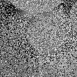
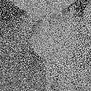
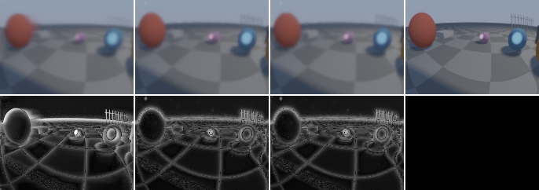
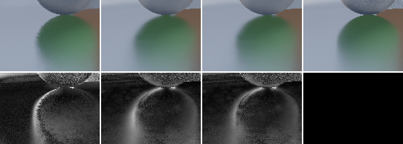
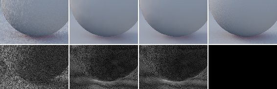
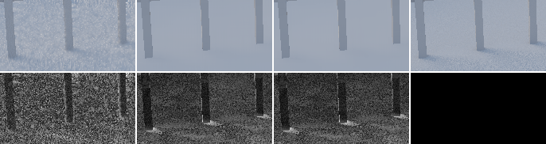
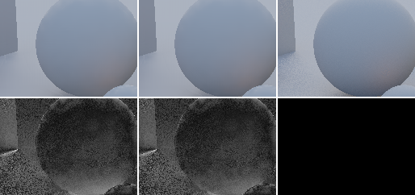

# M1 results: SVGF / A-SVGF baseline (T1.5)

_2026-10-25, results agent (implementer / evaluator, RULES.md rule 8). Everything here was
measured on our own test bed and captures; no NRD code or README was read. Native NRD
numbers quoted in §7 come from the Windows harness's black-box results
([../native/results/README.md](../native/results/README.md))._

**Headline (1080p, mean over the 7 stress paths, live test bed):**

| signal | noisy | accumulate-32 | FFX | SVGF (defaults) | A-SVGF `auto` | SVGF, `feedback: false` | **A-SVGF `auto`, `feedback: false`** |
|---|---|---|---|---|---|---|---|
| diffuse PSNR | 16.16 | 28.65 | – | 37.10 | 37.85 | 39.00 | **39.27** |
| diffuse FLIP | 0.299 | 0.076 | – | 0.055 | 0.049 | 0.036 | **0.033** |
| diffuse flicker | 0.1160 | 0.0265 | – | 0.0035 | 0.0032 | 0.0035 | **0.0032** |
| diffuse energy | 0.0 % | −0.5 % | – | −3.5 % | −2.8 % | −1.2 % | **−0.9 %** |
| specular PSNR | 15.94 | 25.52 | 20.97 (reflections) | 33.70 | 34.88 | 34.09 | **35.32** |
| specular FLIP | 0.200 | 0.107 | 0.162 | 0.054 | 0.050 | 0.051 | **0.047** |
| specular flicker | 0.1239 | 0.0185 | 0.0106 | 0.0042 | 0.0038 | 0.0042 | **0.0037** |
| specular energy | 0.0 % | −3.3 % | −24.1 % | −2.0 % | −1.7 % | −1.3 % | **−1.1 %** |
| shadows PSNR | 20.36 | 28.28 | **33.57** (shadows) | – | – | – | – |
| shadows penumbra PSNR | 8.18 | 18.55 | **23.50** | – | – | – | – |
| GPU ms, diffuse + specular (joint, warmed replay) | | | 1.9–2.0 (spec. only) | 4.53 | 7.58 | 4.20 | 6.31 |

- SVGF beats plain accumulation by 8–10 dB and FFX reflections by 12–14 dB on specular
  (FFX loses 24 % of the specular energy on our demodulated signal). SVGF is not
  registered for shadows; FFX shadows stays the shadow baseline (M4).
- **Recommended SVGF defaults** (§4): `feedback: false` (clear win on every path and
  signal), `antiLag: 'auto'` (better quality everywhere, but +2.1 ms joint), keep
  `kernel: '3x3'`, `atrousIterations: 5`, `temporalAlpha` 0.2 without / 0.1 with anti-lag
  (today's defaults). Not applied to the package (another agent owns it); TASKS has the item.
- **Update (§12, anti-lag v2):** `'auto'` now costs +0.25 ms over `'off'` on the joint
  denoiser (4.24 vs 3.99 ms solo bench; v1 5.61) at equal quality (pooled 39.12 / 35.04 dB),
  and static diffuse regions keep 32–64 frames of history.
- No NaN/Inf in any output (0 non-finite pixels in all 7 × 3 live runs, the sweep, and
  every replay).
- Cost vs PLAN §8 on the M5 Pro at 1080p: diffuse + specular **4.2 ms** with SVGF
  (feedback off; target ≤ 4 ms: 5 % over), **6.3 ms** with A-SVGF `auto` (1.6× the target);
  FFX shadows 0.51 ms (≤ 0.6 ms target, but SVGF has no shadow path). Quality vs native
  awaits the Windows run on the test-bed captures (§7 has the synthetic-capture numbers).

## 1. Setup

| | |
|---|---|
| GPU / OS | Apple M5 Pro (`metal-3`), macOS (Darwin 25.6) |
| Browser | Chrome 155.0.8059.85, headless (`--headless=new --use-angle=metal --enable-unsafe-webgpu`), WebGPU with timestamp queries |
| Resolution | 1920×1080 (`preset=full`) for live runs and costs; standard capture set = 7 × 960×540 + 1 × 1080p |
| Sampler | **blue noise** (new default, §2): void-and-cluster mask + R_n per-frame offsets |
| References | same estimators, 256 spp (16×16 stratified grid, Cranley-Patterson rotated, white noise for secondary dims), every frame |
| Paths | `orbit`, `pan`, `light`, `thin`, `glossy`, `cut`, `object`; 96 frames each (`examples/realtime-denoiser/src/paths.ts`) |
| Metrics | test bed `src/metrics.ts` / `src/flip.ts` ([RESULTS.md](../../../../examples/realtime-denoiser/RESULTS.md) "What is measured"): PSNR on Reinhard-tonemapped values (mean of per-frame dB), settled (skips 8 frames after each reset), per-region pooled PSNR, LDR-FLIP every 12th frame at 41.4 ppd, fixed-pixel flicker, motion-compensated tPSNR, tonemapped bias, linear energy ratio, non-finite counts |
| Denoiser code | `packages/denoiser-realtime` at commit 8858113, frozen via `RT_REALTIME_SRC` (a `git archive` copy) so the recurrent agent's live edits could not leak in. The SVGF shaders are unchanged in e5e3932 (that commit adds the recurrent filter and refactors `denoisers.ts`) |
| Denoiser ids | registry `tools/rt-capture/src/denoisers.ts`: `passthrough`, `accumulate-32`, `ffx-shadows`, `ffx-reflections`, `svgf`, `svgf-auto` (+ `svgf-diffuse` / `svgf-specular` in replay). Live, `svgf` / `svgf-auto` run one instance per signal (the registry's per-signal fallback, i.e. exactly `svgf-diffuse` + `svgf-specular`); replay runs the joint `DiffuseSpecularDenoiser.dispatchBoth` (identical PSNR) |
| Timings | solo bench (`mode=bench`, 100 frames after 20 warm-up, one denoiser per page load), started only when no other headless job ran (checked with `pgrep` before and after each run); joint costs from warmed replays (`warm=50`) of `std1080-orbit`. Eval-mode "GPU ms" in the big tables below were taken while 2–3 other headless jobs ran: **contended, ignore them** |

Commands (from `examples/realtime-denoiser`, test-bed server on :5220):

```sh
RT_REALTIME_SRC=<snapshot>/packages/denoiser-realtime/src node ../../node_modules/vite/bin/vite.js . --port 5220 --strictPort --host 127.0.0.1
node run-headless.mjs --all-paths --json=live.json "signal=all&mode=eval&preset=full&denoiser=passthrough,accumulate-32,ffx-shadows,ffx-reflections,svgf,svgf-auto"
node run-headless.mjs --all-paths --json=white.json "...same...&sampling=white"
node run-headless.mjs --all-paths --json=fb0.json "signal=diffuse,specular&mode=eval&preset=full&denoiser=svgf,svgf-auto&feedback=0"
node run-headless.mjs "signal=diffuse&denoiser=svgf&mode=bench&preset=full&path=orbit"      # one per page load
node run-headless.mjs --set=standard --replay=passthrough,accumulate-32,ffx-shadows,ffx-reflections,svgf,svgf-auto,svgf-diffuse,svgf-specular
node replay-table.mjs --denoisers=passthrough,accumulate-32,ffx-shadows,ffx-reflections,svgf,svgf-auto
node results-table.mjs live.json
```

Raw results (per-frame PSNR included): [data/](data/) (`m1-live-1080p-blue.json`,
`m1-live-1080p-white.json`, `m1-live-1080p-feedback0.json`, `m1-svgf-sweep-1080p.json`,
`m1-bench-1080p.json`).

## 2. Blue-noise sampling in the test bed (`sampling=blue`, default)

Renderers that feed real-time denoisers sample with per-pixel blue noise animated per
frame (renderer contract, `sources/shadows-specular.md`, RTG II ch. 24 §24.7.2). The test
bed used white noise (PCG); it now defaults to spatiotemporal blue noise, built from
public methods only (`examples/realtime-denoiser/src/bluenoise.ts`, generator
`gen-bluenoise.mjs`):

- **Mask:** one 128×128 dither array from Ulichney's void-and-cluster method (1993),
  toroidal Gaussian energy σ = 1.5, 10 % initial pattern; stored as 16-bit ranks
  (`src/bluenoise-128.bin`, 32 KB). Its radial power spectrum (white = 1) is 0.000 /
  0.000 / 0.003 / 0.019 / 0.16 / 0.83 / 1.60 / 1.64 from DC to Nyquist in 8 bands.
- **Per sample dimension** (diffuse 4, specular 4, shadows 2): a fixed toroidal shift of
  the mask (R2 points) plus a constant Cranley-Patterson rotation.
- **Per frame:** value += frame · α_d mod 1, with α from the R_n sequence (Roberts 2018:
  R4 for the 4-D diffuse/specular samples, R2 for shadows). RTG II's scalar recurrence is
  the golden ratio (R1); using it on every dimension of a 2-D sample would put a pixel's
  samples over time on a line, R_n makes them a low-discrepancy n-D sequence. All in u32
  fixed point (exact wrap).
- `sampling=white` keeps the old PCG streams **bit for bit** (re-measured: the white
  1080p tables reproduce the old RESULTS.md baseline exactly, e.g. accumulate orbit
  diffuse 28.35 dB). References are unchanged.

**Checks.** Noisy-input PSNR is identical (Δ ≤ 0.01 dB on every path and signal: same
per-pixel variance). The error is visibly blue: radial power spectrum of (noisy − ref),
256² crop of `std540-orbit` frame 0, white noise = 1 per band:

| signal | sampler | 0–⅛ | ⅛–¼ | ¼–⅜ | ⅜–½ | ½–⅝ | ⅝–¾ | ¾–⅞ | ⅞–1 (Nyquist) |
|---|---|---|---|---|---|---|---|---|---|
| shadows | white | 1.06 | 1.04 | 0.95 | 1.05 | 0.96 | 0.96 | 0.99 | 1.03 |
| shadows | **blue** | **0.44** | **0.52** | **0.55** | 0.68 | 0.88 | 1.01 | 1.14 | 1.17 |
| diffuse | white | 4.87 | 1.03 | 1.01 | 0.98 | 0.94 | 0.95 | 0.94 | 0.93 |
| diffuse | **blue** | 3.77 | **0.63** | **0.60** | 0.75 | 0.97 | 1.10 | 1.06 | 1.04 |
| specular | white | 15.1 | 1.02 | 0.88 | 0.81 | 0.83 | 0.84 | 0.81 | 0.81 |
| specular | **blue** | 14.7 | **0.61** | **0.43** | 0.48 | 0.68 | 0.90 | 0.99 | 0.96 |

(The lowest band of diffuse/specular is dominated by the error's spatially varying
variance, not by the sampler. The shading integrand is nonlinear in the 4 sample
dimensions, so the error is less blue than the mask; shadows, one 2-D sample through a
near-binary function, keep most of it.) Error crops (128², mid-grey = 0):

| | white | blue |
|---|---|---|
| shadows |  |  |
| diffuse |  |  |

**Effect on the denoisers** (1080p live, 7 paths, blue − white):

| signal | denoiser | ΔPSNR mean (min … max) | ΔFLIP | Δflicker |
|---|---|---|---|---|
| diffuse | passthrough | 0.00 | −0.020 | +5 % |
| diffuse | accumulate-32 | **+1.35** (+0.27 … +4.54) | −0.018 | +1 % |
| diffuse | svgf | −0.01 (−0.10 … +0.07) | +0.001 | **−12 %** |
| diffuse | svgf-auto | −0.10 (−0.25 … 0.00) | +0.002 | **−10 %** |
| specular | accumulate-32 | +0.45 (+0.07 … +1.75) | −0.005 | 0 % |
| specular | ffx-reflections | −0.09 (−0.20 … −0.03) | +0.001 | −4 % |
| specular | svgf / svgf-auto | +0.05 / +0.03 | −0.001 / 0.000 | −8 % / −10 % |
| shadows | accumulate-32 | +0.28 (+0.11 … +0.54) | −0.002 | +2 % |
| shadows | ffx-shadows | +0.20 (−0.02 … +0.39) | 0.000 | −9 % |

- Temporal accumulation gains most, on the static-camera paths (`light` +4.5 dB, `object`
  +3.2 dB diffuse): the R_n sequence makes each pixel's samples over time low-discrepancy.
- SVGF's PSNR doesn't move (its 5-iteration à-trous footprint averages far beyond the
  mask's correlation length), but its flicker drops 8–12 %. FFX shadows gains 0.2 dB.
- Noisy-input FLIP improves (0.30 → 0.28 diffuse) and fixed-pixel flicker of the raw
  input rises 5 % (consecutive golden-ratio steps are anti-correlated); neither matters
  for the denoised rows.
- All M1 numbers below use blue noise; the standard capture set was regenerated with it
  (old white-noise captures and outputs deleted, `capture.json` → `extra.testbed.sampling`).

## 3. Live test bed, 1080p, all paths × all signals

`signal=all&mode=eval&preset=full`, 96 frames per path, blue-noise sampling, package
defaults (`svgf` = SVGF with feedback, `svgf-auto` = the same with `antiLag: 'auto'`).
Column definitions in [RESULTS.md](../../../../examples/realtime-denoiser/RESULTS.md); the
"GPU ms" column is **contended** (other headless jobs were running) and is superseded by §6.
"–" = region empty (no disocclusion with a static camera, no cut).

_1920x1080, 96 frames/path, reference 256 spp, FLIP every 12 frames at 41.38 ppd, disoccluded = < 8 frames of valid history._

#### diffuse

| path | denoiser | PSNR | settled | disocc. | after cut | FLIP | flicker | tPSNR | bias | energy | GPU ms |
|---|---|---|---|---|---|---|---|---|---|---|---|
| orbit | passthrough | 16.49 | 16.50 | 16.20 | – | 0.296 | 0.1055 | 14.53 | -0.0615 | -0.0% | – |
| orbit | accumulate-32 | 28.63 | 29.29 | 20.47 | – | 0.071 | 0.0293 | 29.16 | -0.0049 | -0.5% | – |
| orbit | svgf | 38.23 | 38.21 | 37.78 | – | 0.053 | 0.0030 | 39.30 | -0.0072 | -3.5% | 2.30 |
| orbit | svgf-auto | 39.23 | 39.29 | 37.93 | – | 0.046 | 0.0027 | 39.37 | -0.0057 | -2.8% | 3.06 |
| pan | passthrough | 16.03 | 16.11 | 16.20 | – | 0.305 | 0.1219 | 14.11 | -0.0654 | -0.0% | – |
| pan | accumulate-32 | 24.89 | 25.28 | 19.46 | – | 0.108 | 0.0518 | 25.52 | -0.0098 | -0.3% | – |
| pan | svgf | 37.90 | 37.81 | 37.76 | – | 0.052 | 0.0074 | 37.88 | -0.0065 | -3.2% | 4.52 |
| pan | svgf-auto | 38.64 | 38.61 | 37.83 | – | 0.047 | 0.0071 | 37.91 | -0.0054 | -2.6% | 7.55 |
| light | passthrough | 16.34 | 16.34 | – | – | 0.304 | 0.1055 | 14.01 | -0.0637 | -0.0% | – |
| light | accumulate-32 | 30.09 | 31.08 | – | – | 0.066 | 0.0076 | 32.82 | -0.0043 | -0.4% | – |
| light | svgf | 38.03 | 37.93 | – | – | 0.055 | 0.0013 | 53.32 | -0.0075 | -3.6% | 3.32 |
| light | svgf-auto | 39.11 | 39.10 | – | – | 0.047 | 0.0009 | 55.47 | -0.0058 | -2.8% | 5.35 |
| thin | passthrough | 16.82 | 16.83 | 17.18 | – | 0.276 | 0.1081 | 14.68 | -0.0535 | -0.0% | – |
| thin | accumulate-32 | 28.63 | 29.26 | 21.67 | – | 0.073 | 0.0281 | 28.08 | -0.0036 | -0.6% | – |
| thin | svgf | 33.83 | 33.78 | 37.85 | – | 0.059 | 0.0053 | 31.68 | -0.0062 | -3.3% | 10.76 |
| thin | svgf-auto | 34.12 | 34.10 | 37.99 | – | 0.053 | 0.0050 | 31.70 | -0.0047 | -2.6% | 12.24 |
| glossy | passthrough | 16.64 | 16.64 | 15.72 | – | 0.266 | 0.1205 | 14.39 | -0.0490 | -0.0% | – |
| glossy | accumulate-32 | 32.70 | 33.66 | 19.88 | – | 0.058 | 0.0193 | 31.09 | -0.0034 | -0.7% | – |
| glossy | svgf | 37.91 | 37.83 | 35.77 | – | 0.050 | 0.0025 | 37.58 | -0.0058 | -3.2% | 5.33 |
| glossy | svgf-auto | 38.62 | 38.60 | 35.90 | – | 0.045 | 0.0023 | 37.61 | -0.0047 | -2.5% | 10.89 |
| cut | passthrough | 14.57 | 14.51 | 16.19 | 13.41 | 0.350 | 0.1382 | 12.78 | -0.0895 | -0.0% | – |
| cut | accumulate-32 | 27.39 | 28.80 | 20.48 | 13.41 | 0.080 | 0.0405 | 26.85 | -0.0072 | -0.4% | – |
| cut | svgf | 37.38 | 37.18 | 37.85 | 38.35 | 0.059 | 0.0033 | 38.11 | -0.0083 | -3.8% | 3.52 |
| cut | svgf-auto | 38.15 | 38.09 | 37.98 | 38.35 | 0.052 | 0.0031 | 38.16 | -0.0069 | -3.1% | 5.04 |
| object | passthrough | 16.25 | 16.25 | 15.83 | – | 0.294 | 0.1122 | 13.97 | -0.0615 | -0.0% | – |
| object | accumulate-32 | 28.19 | 29.01 | 18.98 | – | 0.075 | 0.0086 | 32.30 | -0.0062 | -0.9% | – |
| object | svgf | 36.41 | 36.34 | 36.35 | – | 0.059 | 0.0018 | 49.38 | -0.0072 | -3.6% | 5.27 |
| object | svgf-auto | 37.09 | 37.06 | 36.90 | – | 0.052 | 0.0015 | 50.59 | -0.0057 | -2.9% | 7.56 |

#### specular

| path | denoiser | PSNR | settled | disocc. | after cut | FLIP | flicker | tPSNR | bias | energy | GPU ms |
|---|---|---|---|---|---|---|---|---|---|---|---|
| orbit | passthrough | 13.90 | 13.92 | 12.65 | – | 0.228 | 0.1524 | 12.30 | -0.0703 | -0.0% | – |
| orbit | accumulate-32 | 21.43 | 21.27 | 18.28 | – | 0.149 | 0.0242 | 27.36 | 0.0084 | 4.9% | – |
| orbit | ffx-reflections | 17.93 | 17.88 | 15.13 | – | 0.201 | 0.0166 | 30.90 | -0.0676 | -28.6% | 2.01 |
| orbit | svgf | 32.11 | 31.93 | 31.28 | – | 0.060 | 0.0043 | 33.64 | -0.0002 | -0.3% | 2.90 |
| orbit | svgf-auto | 33.45 | 33.37 | 31.84 | – | 0.054 | 0.0043 | 33.63 | -0.0009 | -0.6% | 4.18 |
| pan | passthrough | 19.10 | 19.22 | 19.82 | – | 0.141 | 0.0949 | 16.60 | -0.0233 | -0.1% | – |
| pan | accumulate-32 | 26.03 | 26.31 | 24.43 | – | 0.122 | 0.0368 | 28.27 | -0.0062 | -3.6% | – |
| pan | ffx-reflections | 27.44 | 27.79 | 28.96 | – | 0.102 | 0.0247 | 33.52 | -0.0185 | -11.5% | 3.83 |
| pan | svgf | 35.81 | 35.85 | 37.47 | – | 0.053 | 0.0101 | 34.97 | -0.0026 | -2.2% | 7.16 |
| pan | svgf-auto | 37.10 | 37.16 | 38.31 | – | 0.047 | 0.0086 | 35.14 | -0.0020 | -1.7% | 9.92 |
| light | passthrough | 13.79 | 13.78 | – | – | 0.242 | 0.1538 | 11.88 | -0.0742 | -0.0% | – |
| light | accumulate-32 | 28.72 | 29.43 | – | – | 0.064 | 0.0064 | 32.81 | -0.0020 | -0.4% | – |
| light | ffx-reflections | 18.00 | 17.96 | – | – | 0.215 | 0.0014 | 47.84 | -0.0748 | -28.6% | 3.12 |
| light | svgf | 34.44 | 34.46 | – | – | 0.042 | 0.0016 | 48.54 | -0.0024 | -1.5% | 3.93 |
| light | svgf-auto | 34.46 | 34.48 | – | – | 0.041 | 0.0010 | 51.73 | -0.0019 | -1.4% | 5.04 |
| thin | passthrough | 17.05 | 17.08 | 19.96 | – | 0.172 | 0.1046 | 15.10 | -0.0340 | -0.0% | – |
| thin | accumulate-32 | 27.01 | 27.29 | 25.25 | – | 0.090 | 0.0177 | 30.40 | -0.0082 | -6.8% | – |
| thin | ffx-reflections | 21.20 | 21.15 | 26.45 | – | 0.134 | 0.0102 | 33.38 | -0.0344 | -22.0% | 4.03 |
| thin | svgf | 34.82 | 34.78 | 36.65 | – | 0.050 | 0.0038 | 34.70 | -0.0041 | -3.4% | 6.17 |
| thin | svgf-auto | 35.50 | 35.53 | 36.81 | – | 0.048 | 0.0037 | 34.71 | -0.0033 | -2.7% | 9.20 |
| glossy | passthrough | 17.02 | 16.86 | 15.63 | – | 0.200 | 0.1034 | 14.89 | -0.0373 | -0.0% | – |
| glossy | accumulate-32 | 23.40 | 23.19 | 22.59 | – | 0.138 | 0.0129 | 31.25 | -0.0207 | -21.0% | – |
| glossy | ffx-reflections | 21.79 | 21.37 | 20.86 | – | 0.157 | 0.0051 | 32.44 | -0.0369 | -26.4% | 5.24 |
| glossy | svgf | 31.41 | 30.97 | 33.00 | – | 0.073 | 0.0029 | 33.94 | -0.0060 | -5.6% | 8.44 |
| glossy | svgf-auto | 34.32 | 34.12 | 33.69 | – | 0.062 | 0.0030 | 34.01 | -0.0046 | -3.7% | 9.87 |
| cut | passthrough | 16.29 | 16.24 | 13.42 | 19.36 | 0.190 | 0.1198 | 13.76 | -0.0505 | -0.0% | – |
| cut | accumulate-32 | 24.36 | 24.38 | 19.10 | 19.36 | 0.120 | 0.0243 | 27.66 | 0.0016 | 5.3% | – |
| cut | ffx-reflections | 21.16 | 20.93 | 16.18 | 26.63 | 0.161 | 0.0138 | 32.02 | -0.0466 | -26.0% | 3.37 |
| cut | svgf | 33.43 | 33.07 | 31.55 | 37.21 | 0.057 | 0.0044 | 34.28 | -0.0006 | 0.2% | 4.89 |
| cut | svgf-auto | 34.78 | 34.59 | 32.46 | 37.21 | 0.051 | 0.0041 | 34.30 | -0.0011 | -0.3% | 7.17 |
| object | passthrough | 14.46 | 14.46 | 17.99 | – | 0.223 | 0.1382 | 12.48 | -0.0594 | -0.0% | – |
| object | accumulate-32 | 27.66 | 28.29 | 21.97 | – | 0.065 | 0.0070 | 32.71 | -0.0047 | -1.1% | – |
| object | ffx-reflections | 19.28 | 19.25 | 24.42 | – | 0.165 | 0.0025 | 41.88 | -0.0539 | -25.6% | 4.30 |
| object | svgf | 33.92 | 34.03 | 32.67 | – | 0.046 | 0.0022 | 43.87 | -0.0021 | -1.2% | 5.91 |
| object | svgf-auto | 34.52 | 34.57 | 33.64 | – | 0.045 | 0.0017 | 45.68 | -0.0018 | -1.2% | 7.99 |

Specular PSNR by roughness bin (pooled over the path):

| path | denoiser | r<0.15 | r<0.35 | r<0.6 | r≥0.6 |
|---|---|---|---|---|---|
| orbit | passthrough | 28.72 | 15.67 | 11.52 | 13.10 |
| orbit | accumulate-32 | 20.29 | 20.79 | 20.34 | 23.83 |
| orbit | ffx-reflections | 29.05 | 21.24 | 15.23 | 17.52 |
| orbit | svgf | 33.38 | 32.01 | 31.52 | 31.60 |
| orbit | svgf-auto | 34.62 | 34.94 | 32.32 | 31.62 |
| pan | passthrough | 32.08 | 20.92 | 15.88 | 12.54 |
| pan | accumulate-32 | 26.61 | 25.58 | 23.04 | 20.62 |
| pan | ffx-reflections | 37.50 | 30.94 | 21.92 | 17.07 |
| pan | svgf | 42.36 | 35.01 | 31.11 | 28.62 |
| pan | svgf-auto | 43.02 | 37.84 | 32.70 | 29.95 |
| light | passthrough | 29.00 | 15.45 | 11.43 | 13.37 |
| light | accumulate-32 | 33.30 | 28.47 | 24.80 | 24.18 |
| light | ffx-reflections | 32.30 | 21.65 | 15.21 | 17.36 |
| light | svgf | 37.98 | 36.25 | 32.67 | 31.56 |
| light | svgf-auto | 37.75 | 36.32 | 32.79 | 31.70 |
| thin | passthrough | 31.67 | 18.28 | 13.91 | 14.77 |
| thin | accumulate-32 | 40.91 | 25.98 | 24.12 | 21.62 |
| thin | ffx-reflections | 41.48 | 24.93 | 17.34 | 24.27 |
| thin | svgf | 47.51 | 35.23 | 32.21 | 28.40 |
| thin | svgf-auto | 47.50 | 36.66 | 32.61 | 28.41 |
| glossy | passthrough | 27.91 | 15.97 | 17.43 | 12.94 |
| glossy | accumulate-32 | 24.03 | 18.96 | 27.68 | 26.30 |
| glossy | ffx-reflections | 26.73 | 18.92 | 24.65 | 17.37 |
| glossy | svgf | 33.26 | 28.09 | 34.35 | 29.40 |
| glossy | svgf-auto | 36.05 | 34.66 | 35.39 | 29.49 |
| cut | passthrough | 29.42 | 17.06 | 12.57 | 11.91 |
| cut | accumulate-32 | 22.94 | 22.62 | 21.73 | 22.64 |
| cut | ffx-reflections | 31.48 | 23.69 | 17.00 | 15.01 |
| cut | svgf | 35.46 | 31.74 | 31.34 | 31.42 |
| cut | svgf-auto | 36.86 | 35.78 | 32.51 | 31.47 |
| object | passthrough | 26.65 | 14.80 | 13.22 | 11.02 |
| object | accumulate-32 | 33.02 | 28.37 | 24.46 | 22.62 |
| object | ffx-reflections | 30.43 | 20.54 | 18.43 | 12.71 |
| object | svgf | 36.47 | 37.40 | 31.96 | 30.76 |
| object | svgf-auto | 36.87 | 38.16 | 32.78 | 30.92 |

#### shadows

| path | denoiser | PSNR | settled | penumbra | disocc. | FLIP | flicker | tPSNR | bias | energy | GPU ms |
|---|---|---|---|---|---|---|---|---|---|---|---|
| orbit | passthrough | 18.02 | 17.96 | 8.00 | 17.15 | 0.034 | 0.0476 | 14.88 | 0.0001 | 0.0% | – |
| orbit | accumulate-32 | 28.13 | 28.29 | 19.26 | 23.55 | 0.025 | 0.0125 | 29.93 | -0.0133 | -0.2% | – |
| orbit | ffx-shadows | 30.80 | 30.38 | 22.74 | 34.40 | 0.034 | 0.0083 | 35.95 | -0.0424 | -0.5% | 0.59 |
| pan | passthrough | 36.00 | 37.65 | 8.27 | 16.71 | 0.036 | 0.0530 | 15.00 | 0.0002 | 0.0% | – |
| pan | accumulate-32 | 35.65 | 36.46 | 16.96 | 21.43 | 0.020 | 0.0154 | 27.36 | -0.0029 | -0.0% | – |
| pan | ffx-shadows | 49.09 | 50.46 | 25.79 | 36.28 | 0.033 | 0.0087 | 39.35 | -0.0333 | -0.4% | 2.32 |
| light | passthrough | 19.33 | 19.45 | 8.11 | – | 0.029 | 0.0364 | 14.50 | 0.0001 | 0.0% | – |
| light | accumulate-32 | 18.20 | 17.53 | 11.60 | – | 0.151 | 0.0061 | 26.49 | 0.1380 | 6.3% | – |
| light | ffx-shadows | 28.49 | 27.91 | 19.77 | – | 0.047 | 0.0016 | 39.62 | -0.0008 | -0.1% | 0.90 |
| thin | passthrough | 16.08 | 16.09 | 8.41 | 16.63 | 0.054 | 0.0641 | 13.07 | 0.0003 | 0.0% | – |
| thin | accumulate-32 | 27.48 | 27.79 | 20.24 | 23.26 | 0.030 | 0.0137 | 28.70 | -0.0135 | -0.3% | – |
| thin | ffx-shadows | 30.00 | 29.64 | 24.19 | 33.05 | 0.051 | 0.0087 | 34.39 | -0.0358 | -0.7% | 1.09 |
| glossy | passthrough | 18.05 | 17.93 | 7.96 | 16.04 | 0.038 | 0.0484 | 14.86 | 0.0000 | 0.0% | – |
| glossy | accumulate-32 | 37.23 | 38.01 | 24.65 | 22.48 | 0.014 | 0.0040 | 35.62 | -0.0033 | -0.1% | – |
| glossy | ffx-shadows | 32.82 | 32.61 | 23.85 | 28.43 | 0.030 | 0.0019 | 43.10 | -0.0487 | -0.8% | 1.77 |
| cut | passthrough | 18.26 | 18.23 | 8.06 | 16.98 | 0.034 | 0.0447 | 15.24 | 0.0001 | 0.0% | – |
| cut | accumulate-32 | 29.01 | 29.50 | 19.08 | 23.18 | 0.018 | 0.0110 | 29.77 | -0.0069 | -0.2% | – |
| cut | ffx-shadows | 32.30 | 31.81 | 23.76 | 34.71 | 0.031 | 0.0060 | 37.49 | -0.0408 | -0.6% | 0.98 |
| object | passthrough | 16.80 | 16.79 | 8.46 | 14.74 | 0.050 | 0.0543 | 12.80 | 0.0001 | 0.0% | – |
| object | accumulate-32 | 22.29 | 22.27 | 18.03 | 18.80 | 0.036 | 0.0058 | 30.75 | 0.0056 | -0.6% | – |
| object | ffx-shadows | 31.47 | 31.21 | 24.41 | 30.61 | 0.040 | 0.0017 | 41.08 | -0.0386 | -0.8% | 1.32 |


The same paths with `feedback: false` are in §4; white-noise numbers in
`data/m1-live-1080p-white.json` (§2 has the deltas).

## 4. SVGF parameter decisions on real signals

One setting changed at a time from the package defaults (`feedback: true`, `kernel:
'3x3'`, `atrousIterations: 5`, `temporalAlpha` 0.2 / 0.1 with anti-lag, `antiLag: 'off'`),
each run with both `svgf` and `svgf-auto` in the same page (shared references), 1080p,
paths `orbit` (steady motion), `pan` (disocclusion every frame), `light` (static camera,
light flip at 48 and shrink at 72). Then the winning change was confirmed on all 7 paths.
Full table: `data/m1-svgf-sweep-1080p.json`; condensed (Δ vs the same denoiser's default,
mean of the 3 paths; PSNR in dB, FLIP and flicker absolute):

| change | denoiser | Δ diffuse PSNR | Δ diffuse FLIP | Δ diffuse flicker | Δ specular PSNR | Δ specular FLIP | cost (solo bench, per signal) |
|---|---|---|---|---|---|---|---|
| `feedback: false` | svgf | **+2.42** (+2.23 … +2.59) | **−0.021** | −0.0001 | +0.34 (+0.09 … +0.68) | −0.003 | diffuse 2.11 vs 2.17–2.36 ms (one history write less) |
| | svgf-auto | **+1.83** | **−0.017** | −0.0001 | +0.44 | −0.003 | ≈ same |
| `kernel: '5x5'` (B3) | svgf | +0.09 | −0.001 | 0.0000 | +0.02 | 0.000 | diffuse **4.36** ms (+2.0 ms: 0.65 vs 0.28 ms per iteration) |
| | svgf-auto | +0.14 | −0.001 | 0.0000 | +0.04 | −0.001 | |
| `atrousIterations: 4` | svgf | −0.12 (−0.25 … −0.03) | −0.001 | **+0.0009 (+16…54 %)** | +0.04 | 0.000 | diffuse 1.94 ms (−0.3 ms) |
| | svgf-auto | −0.08 | −0.001 | +0.0007 (+15…56 %) | +0.04 | 0.000 | |
| `temporalAlpha: 0.1` | svgf | **+1.23** | −0.010 | −0.0004 | **−1.52** (orbit −2.82) | +0.010 | – |
| `temporalAlpha: 0.05` | svgf | +1.24 | −0.010 | −0.0006 | **−2.73** (orbit −5.22) | +0.020 | – |
| `temporalAlpha: 0.05 / 0.1` | svgf-auto | 0.00 | 0.000 | 0.0000 | −0.02 | 0.000 | – |
| `temporalAlpha: 0.2` | svgf-auto | **−1.19** | +0.009 | +0.0004 | +0.11 | −0.001 | – |
| `antiLag: 'auto'` (svgf → svgf-auto) | | +0.94 (+0.74 … +1.08) | −0.007 | −0.0003 | +0.88 (+0.02 … +1.34) | −0.004 | +0.7–0.9 ms diffuse, +1.0–1.6 ms specular |

Confirmation of `feedback: false` on all 7 paths (1080p):

| | orbit | pan | light | thin | glossy | cut | object |
|---|---|---|---|---|---|---|---|
| svgf diffuse PSNR | 38.23 → 40.68 | 37.90 → 40.12 | 38.03 → 40.62 | 33.83 → 34.41 | 37.91 → 39.50 | 37.38 → 39.77 | 36.41 → 37.89 |
| svgf diffuse FLIP | 0.053 → 0.032 | 0.052 → 0.034 | 0.055 → 0.031 | 0.059 → 0.045 | 0.050 → 0.035 | 0.059 → 0.034 | 0.059 → 0.039 |
| svgf diffuse energy | −3.5 → −1.2 % | −3.2 → −1.3 % | −3.6 → −1.1 % | −3.3 → −1.2 % | −3.2 → −1.3 % | −3.8 → −1.2 % | −3.6 → −1.3 % |
| svgf-auto diffuse PSNR | 39.23 → 41.01 | 38.64 → 40.46 | 39.11 → 40.99 | 34.12 → 34.47 | 38.62 → 39.72 | 38.15 → 40.07 | 37.09 → 38.17 |
| svgf specular PSNR | 32.11 → 32.37 | 35.81 → 35.90 | 34.44 → 35.11 | 34.82 → 35.41 | 31.41 → 31.65 | 33.43 → 33.80 | 33.92 → 34.37 |
| svgf-auto specular PSNR | 33.45 → 33.80 | 37.10 → 37.24 | 34.46 → 35.29 | 35.50 → 35.93 | 34.32 → 34.63 | 34.78 → 35.21 | 34.52 → 35.10 |

Flicker is unchanged by `feedback: false` on every path (within ±0.0003; the synthetic dev
page had suggested +4 %), and there are no NaNs.

**Decisions (recommended defaults; the package is not edited here):**

1. **`feedback: false`.** +0.6 to +2.6 dB diffuse on every path (least on `thin`), FLIP −24…−44 %, energy
   loss cut from −3.5 % to −1.2 %, specular +0.1…+0.8 dB, no flicker cost, slightly
   cheaper. Feedback compounds the spatial blur into the history: with a static view
   SVGF's PSNR falls frame after frame (cut path, frames 48 → 59 after the reset: 39.2 →
   36.8 dB with feedback, 39.1 → 39.7 without). This settles the open "Questions for
   Dennis" item in favour of the measured answer.
2. **`kernel: '3x3'`** stays. B3 5×5 buys ≤ 0.15 dB for +2 ms (2.3× per iteration).
3. **`atrousIterations: 5`** stays. 4 iterations save 0.3 ms per signal but lose up to
   0.26 dB and raise diffuse flicker 15–56 %.
4. **α_min (`temporalAlpha`): keep 0.2 without anti-lag, 0.1 with.** Without anti-lag,
   diffuse wants 0.1 (+1.2 dB) but specular loses 1.5 dB on average and 2.8 dB on
   `orbit` (lag and ghosting of view-dependent reflections under surface-motion
   reprojection), so a shared 0.1 is worse for the joint denoiser; a per-signal value
   (diffuse 0.1, specular 0.2) would be best, but differing per-signal options are not
   structural, so it costs nothing: worth exposing as the default if `antiLag` stays
   'off'. With `antiLag: 'auto'`, α_min ≤ 0.1 is inert (identical results for 0.05 and
   0.1, within 0.02 dB): the auto gradient's λ keeps shortening the history length, so 1/n ≥ ~0.1 and
   `max(α_min, 1/n)` never picks α_min; 0.2 costs 1.2 dB diffuse.
5. **`antiLag: 'auto'` as the default** on quality: +0.9 dB diffuse and specular on the
   sweep paths (specular only +0.02 on `light`) (+0.27 dB diffuse / +1.23 dB specular with feedback off over all 7 paths),
   lower FLIP and flicker everywhere, much faster recovery from lighting changes
   (`light`, frame 48, feedback off: specular drops to 30.3 dB and needs ~9 frames to get
   within 0.5 dB with 'off', 33.0 dB and ~3 frames with 'auto'), and it caps specular lag
   (`glossy` specular 31.4 → 34.3 dB, r < 0.35 bin 28.1 → 34.7 dB). The cost is real:
   +0.9 ms diffuse and +1.0…1.6 ms specular at 1080p, taking the joint denoiser from
   4.2 to 6.3 ms (PLAN §8 target ≤ 4 ms). Quality decides by the brief's rule; a
   budget preset could keep 'auto' for specular only (most of the gain) and 'off' for
   diffuse (+0.27 dB for 0.9 ms), at the price of two pipelines (`antiLag` is structural).

So the recommended configuration is `{ feedback: false, antiLag: 'auto' }` with today's
other defaults: **39.27 dB diffuse / 35.32 dB specular** mean over the 7 paths (vs 37.10 /
33.70 for today's defaults), FLIP 0.033 / 0.047, energy −0.9 % / −1.1 %.

## 5. Standard capture set, replayed

The regenerated (blue-noise) standard set (CAPTURES.md: 7 × 960×540 windows of 16–24
frames + 8 frames of orbit at 1080p) through `replay()`, scored by
`tools/rt-capture/compare.mjs` (CAPTURE-FORMAT metrics: settled = ≥ 8 frames after a reset,
so the 16-frame captures settle over their last 8 frames, the 1080p capture never does).
These are the exact inputs the Windows harness will replay. Cells: sequence PSNR /
settled PSNR / flicker (`compare.mjs`'s per-frame-mean definition). `svgf` here is the
joint `dispatchBoth` (identical to `svgf-diffuse` + `svgf-specular` to the last digit);
no non-finite outputs anywhere.

#### diffuse (PSNR / settled / flicker)

| capture | passthrough | accumulate-32 | svgf | svgf-auto |
|---|---|---|---|---|
| std540-orbit | 16.42 / 16.41 / 0.1041 | 24.07 / 26.90 / 0.0600 | 37.21 / 37.36 / 0.0042 | 37.51 / 37.90 / 0.0040 |
| std540-pan | 15.34 / 15.47 / 0.1334 | 23.19 / 25.73 / 0.0692 | 37.08 / 37.07 / 0.0070 | 37.29 / 37.46 / 0.0069 |
| std540-light | 16.31 / 16.25 / 0.1065 | 23.98 / 26.38 / 0.0166 | 37.58 / 37.22 / 0.0019 | 38.19 / 38.11 / 0.0016 |
| std540-thin | 16.69 / 16.70 / 0.1109 | 24.35 / 27.06 / 0.0551 | 33.80 / 33.77 / 0.0058 | 33.90 / 33.95 / 0.0056 |
| std540-glossy | 16.65 / 16.65 / 0.1139 | 25.69 / 29.10 / 0.0475 | 37.38 / 37.40 / 0.0028 | 37.60 / 37.83 / 0.0026 |
| std540-cut | 14.28 / 13.06 / 0.1433 | 22.48 / 26.69 / 0.0777 | 37.26 / 36.25 / 0.0036 | 37.49 / 36.84 / 0.0035 |
| std540-object | 16.26 / 16.23 / 0.1128 | 21.72 / 24.25 / 0.0220 | 36.14 / 36.14 / 0.0025 | 36.36 / 36.49 / 0.0023 |
| std1080-orbit | 16.43 / – / 0.1040 | 21.31 / – / 0.0835 | 38.51 / – / 0.0042 | 38.59 / – / 0.0042 |

#### specular (PSNR / settled / flicker)

| capture | passthrough | accumulate-32 | ffx-reflections | svgf | svgf-auto |
|---|---|---|---|---|---|
| std540-orbit | 13.66 / 13.64 / 0.1512 | 24.78 / 26.52 / 0.0376 | 18.49 / 18.53 / 0.0152 | 31.74 / 31.30 / 0.0050 | 32.05 / 31.88 / 0.0050 |
| std540-pan | 17.98 / 18.26 / 0.0964 | 23.62 / 24.37 / 0.0455 | 24.13 / 25.00 / 0.0229 | 33.70 / 33.26 / 0.0101 | 34.45 / 34.05 / 0.0092 |
| std540-light | 13.75 / 13.70 / 0.1541 | 24.83 / 26.80 / 0.0158 | 18.00 / 17.94 / 0.0036 | 32.20 / 32.11 / 0.0026 | 32.09 / 32.09 / 0.0020 |
| std540-thin | 16.74 / 16.77 / 0.1118 | 26.46 / 29.07 / 0.0367 | 21.35 / 21.29 / 0.0104 | 33.62 / 33.49 / 0.0048 | 33.66 / 33.60 / 0.0048 |
| std540-glossy | 18.82 / 18.78 / 0.0875 | 27.86 / 30.03 / 0.0259 | 25.74 / 25.47 / 0.0048 | 34.53 / 33.95 / 0.0027 | 35.02 / 34.74 / 0.0027 |
| std540-cut | 17.56 / 19.24 / 0.1016 | 25.48 / 29.39 / 0.0397 | 23.28 / 25.16 / 0.0136 | 33.71 / 34.77 / 0.0048 | 34.10 / 35.52 / 0.0046 |
| std540-object | 14.40 / 14.37 / 0.1378 | 23.20 / 25.66 / 0.0192 | 19.40 / 19.35 / 0.0058 | 32.22 / 32.88 / 0.0032 | 32.74 / 33.11 / 0.0028 |
| std1080-orbit | 13.68 / – / 0.1505 | 23.15 / – / 0.0554 | 18.42 / – / 0.0170 | 34.08 / – / 0.0042 | 34.39 / – / 0.0042 |

#### visibility (PSNR / settled / flicker / penumbra)

| capture | passthrough | accumulate-32 | ffx-shadows |
|---|---|---|---|
| std540-orbit | 18.81 / 18.96 / 0.0365 / 8.29 | 26.97 / 28.07 / 0.0150 / 17.91 | 31.35 / 30.19 / 0.0077 / 23.16 |
| std540-pan | 17.82 / 17.76 / 0.0563 / 8.42 | 27.84 / 29.42 / 0.0176 / 19.94 | 31.51 / 30.90 / 0.0106 / 24.20 |
| std540-light | 17.74 / 17.19 / 0.0479 / 8.27 | 17.34 / 12.92 / 0.0174 / 13.43 | 29.78 / 28.66 / 0.0030 / 23.44 |
| std540-thin | 15.98 / 16.00 / 0.0649 / 8.35 | 25.78 / 27.67 / 0.0228 / 19.04 | 30.40 / 28.91 / 0.0086 / 24.32 |
| std540-glossy | 19.28 / 19.20 / 0.0350 / 7.96 | 32.07 / 35.35 / 0.0077 / 21.53 | 31.76 / 30.87 / 0.0022 / 22.35 |
| std540-cut | 18.03 / 18.00 / 0.0474 / 7.94 | 28.22 / 32.21 / 0.0157 / 19.31 | 31.92 / 31.04 / 0.0051 / 23.55 |
| std540-object | 16.62 / 16.39 / 0.0571 / 8.45 | 22.26 / 21.99 / 0.0097 / 15.59 | 30.77 / 29.49 / 0.0039 / 23.88 |
| std1080-orbit | 18.66 / – / 0.0376 / 8.30 | 26.32 / – / 0.0181 / 16.37 | 35.40 / – / 0.0049 / 25.69 |

## 6. Cost (1080p, Apple M5 Pro, solo)

Solo bench, path `orbit`, median of 100 frames after 20 warm-up, one denoiser per page
load, no other headless job running. Two runs ~20 min apart; both medians shown where
re-measured (run-to-run spread up to ±15 %, e.g. FFX shadows 0.73 then 0.51 ms: treat the
second decimal as noise).

| signal | denoiser | GPU ms (median) | passes (median ms, run 1) |
|---|---|---|---|
| diffuse | svgf | 2.36 / 2.17 | prepass 0.18 · temporal 0.40 · variance 0.23 · atrous 0.33 + 4 × 0.28 |
| specular | svgf | 2.83 / 3.01 | prepass 0.17 · temporal 0.39 · variance 0.66 · atrous 0.34 + 0.31 + 0.32 + 0.31 + 0.29 |
| diffuse | svgf, `feedback: false` | 2.11 | atrous 0.27 + 4 × 0.26 |
| specular | svgf, `feedback: false` | 2.99 | atrous 0.34 × 4 + 0.32 |
| diffuse | svgf-auto | 3.02 | gradient passes 0.82 (create 0.46, 5 à-trous 0.32, λ 0.04) · temporal 0.39 · variance 0.23 · atrous 1.30 |
| specular | svgf-auto | 3.97 | gradient 0.82 · temporal 0.40 · **variance 0.95** · atrous 1.50 |
| diffuse | svgf-auto, `feedback: false` | 2.97 / 3.11 | |
| specular | svgf-auto, `feedback: false` | 3.93 / 4.63 | |
| diffuse | svgf, `kernel: '5x5'` | 4.36 | atrous 0.88 + 0.68 + 0.65 + 0.65 + 0.62 |
| diffuse | svgf, `atrousIterations: 4` | 1.94 | |
| shadows | ffx-shadows | 0.73 / 0.51 | prepare 0.08 · tile_classification 0.22 · filter 0.15 + 0.14 + 0.14 (run 1) |
| specular | ffx-reflections | 1.94 / 1.99 | prepare 0.07 · reproject 0.78 · prefilter 0.42 · resolve_temporal 0.61 |
| any | accumulate-32 | (no timestamps; 0.6 ms wall) | 1 pass |

Joint diffuse + specular (`DiffuseSpecularDenoiser.dispatchBoth`, both signals per thread),
warmed replay of `std1080-orbit` (7 timed frames, 50 ms GPU warm-up each):

| denoiser | GPU ms | vs the two single-signal benches |
|---|---|---|
| svgf | 4.53 | 5.2 (−13 %) |
| svgf, `feedback: false` | **4.20** | 5.1 |
| svgf-auto | 7.58 | 7.0–7.7 |
| svgf-auto, `feedback: false` | **6.31** | 6.9–7.7 |

Notes: the specular `variance` pass costs 0.66 ms (0.95 with anti-lag) vs 0.23 for
diffuse (the package README measured 0.37 on its synthetic dev scene). A guess, not
profiled: anti-lag shortens histories, so more pixels take the spatial 7×7 variance
fallback (n < 4), and the specular weights are costlier per tap. The package README's joint numbers (3.98 / 5.45 ms) are from
its synthetic dev page; on the test bed's signals the joint path is 4.2–4.5 / 6.3–7.6 ms.

## 7. Against native NRD (what can be compared today)

The native harness has not yet replayed the test-bed captures (`std540-*`, `std1080-orbit`
were regenerated with blue noise tonight: the Windows side should copy the new set). What
exists is the synthetic textured-plane captures, scored by the same `compare.mjs`
(256², 8 frames, white-noise synthetic inputs; native = NRD v4.18 defaults on an RTX 3060
Laptop; ours replayed here):

| capture | signal | ours svgf | ours svgf-auto | native RELAX | native REBLUR |
|---|---|---|---|---|---|
| synthetic-static | diffuse | 53.18 (flicker 0.0010) | 53.13 | **54.80** (0.0008) | 52.30 (0.0012) |
| | specular | **29.37** (0.0052) | 29.24 | 24.61 (0.0040) | 25.27 (0.0056) |
| synthetic-plane | diffuse | **52.47** (0.0014) | 52.41 | 50.92 (0.0029) | 50.53 (0.0029) |
| | specular | **28.70** (0.0160) | 28.62 | 23.49 (0.0205) | 25.00 (0.0230) |

(sequence-mean PSNR dB; noisy 16.62 diffuse / 12.8 specular.) On this easy scene SVGF is
within 1.6 dB of RELAX on static diffuse and above both native denoisers elsewhere,
with lower flicker on the moving plane. Caveats: one flat textured plane, 8 frames (no
settled window), native defaults untuned, and native specular may suffer from a
convention gap (hit distance or roughness handling) rather than filtering: the
specular gap is too large to take at face value until the test-bed captures run
natively. **Cost** cannot be compared: native timings are on the RTX 3060 Laptop (RELAX
diffuse+specular 6.74 ms, REBLUR 5.61, SIGMA 1.09 at 1080p), ours on the M5 Pro; the
PLAN §8 "≤ 2× native on the same GPU" check needs our WGSL on the Windows machine
(NATIVE-HARNESS phase 5).

## 8. Where SVGF fails (observations)

Crops: frame 15 of the 960×540 standard captures (replay outputs), top row the
denoised images and reference, bottom row |output − reference| × 4 (tonemapped; the
reference panel's error row is empty). The 256-spp reference itself still shows grain on
rough surfaces (PSNR ceiling ≈ 35–45 dB).

1. **Mirror and near-mirror reflections are over-blurred** (specular r < 0.15: 33–48 dB
   but visibly soft). The reflected checker and spheres in the 0.06-roughness sphere lose
   their edges in every denoiser, FFX included: the à-trous weights only see the primary
   surface's guides (depth / normal / roughness), not the reflected content. M3's
   lobe-sized kernels and virtual-motion reprojection are the fix, not SVGF tuning.
   
   _`std540-glossy`, specular: ffx-reflections | svgf | svgf-auto | reference._
2. **Specular lag / ghosting under camera motion.** Surface-motion reprojection of a
   view-dependent signal: on `cut`, after the reset plain SVGF specular *falls* from 37.9 to
   36.3 dB over 11 frames as history builds (svgf-auto holds 37.7); on `glossy` plain SVGF
   specular is 31.4 dB vs 34.3 with `auto`, worst at r 0.15–0.35 (28.1 vs 34.7 dB); lower
   α_min makes it much worse (§4). Contact reflections under the spheres smear on the
   glossy floor: 
   _`std540-glossy`, specular: ffx-reflections | svgf | svgf-auto | reference._
3. **Energy loss.** Diffuse −3.5 % with the default feedback (−1.2 % without), specular
   −2 % (−5.6 % on `glossy`). Two sources: feedback re-blurring the history (fixed by
   `feedback: false`), and the luminance edge-stopping weights, which give bright outliers
   less weight than dark neighbours (a known SVGF bias at 1 spp). Still far better than
   FFX reflections (−24 %).
4. **Contact shadows / AO washed out in diffuse GI**: bright rims under spheres and at the
   base of the fence slats, where the indirect signal darkens over a few pixels and the
   5-iteration à-trous (up to 31 px radius) averages it with the lit floor. Also blotchy
   low-frequency mottling on large smooth surfaces (the classic SVGF look).
   
   _`std540-glossy`, diffuse: accumulate-32 | svgf | svgf-auto | reference._
5. **Thin geometry stays noisy.** `thin` is the weakest diffuse path (33.8 dB vs ~38 on the
   others, tPSNR 31.7, and only +0.6 dB from `feedback: false`): the 4 cm slats are 2–6 px
   wide, edge-stopping keeps their pixels from borrowing from the floor, and the slat
   bases lose their contact darkening. 
   _`std540-thin`, diffuse: accumulate-32 | svgf | svgf-auto | reference._
6. **Lighting changes lag** without anti-lag: `light` flip (frame 48), feedback off:
   specular 35.4 → 30.3 dB and ~9 frames to recover with 'off', → 33.0 dB and ~3 frames
   with 'auto'; diffuse 41.1 → 37.7 vs 41.3 → 38.3. The crop is the frame after the flip
   (`std540-light` local frame 9): 
   _diffuse: svgf | svgf-auto | reference (residual of the old lighting near the box and
   spheres)._
7. **Disocclusion is handled well.** SVGF's disoccluded-pixel PSNR is close to its overall
   PSNR (mean 37.2 vs 37.1 diffuse; worst `glossy` 35.8 vs 37.9; accumulate-32: 20.2 vs
   28.7), because the
   variance estimate falls back to the spatial 7×7 window while n < 4. After a camera cut
   (frame of the reset, spatial only): 38.4 dB diffuse, 37.2 specular.

No denoiser bug found that needs a repro: the two items for the package owner are the
defaults (§4) and the anti-lag/α_min interaction (TASKS).

## 9. Against the PLAN §8 targets

| target | measured here | status |
|---|---|---|
| Quality within ~0.5 dB of native, ≤ native flicker | synthetic captures only (§7): SVGF −1.6 … +5.2 dB vs RELAX | awaits the Windows run on the test-bed captures |
| No new artifact classes in the stress paths | over-blurred mirrors, specular lag on glossy floors, contact AO loss, thin-geometry noise (§8) — all classic SVGF, none new; no NaNs | M2/M3 must remove the first two |
| Diffuse + specular ≤ 4 ms on the M5 Pro at 1080p | SVGF 4.20 ms (feedback off), A-SVGF `auto` 6.31 ms | SVGF ≈ at target; A-SVGF 1.6× over |
| Shadows ≤ 0.6 ms on the M5 Pro | FFX shadows 0.51–0.73 ms (no SVGF shadow path) | baseline at target; ours is M4 |
| ≤ 2× native cost on the same GPU | not measurable here | needs our WGSL on the RTX machine |
| ≤ 100 B/px internal state (diffuse + specular) | SVGF README: ≈ 148 B/px with feedback, ≈ 132 without (+14 with anti-lag) | over; SVGF is not the memory-target filter |

## 10. Provisional / caveats

- Analytic scene only; PLAN §9 asks for a real scene before conclusions.
- 256-spp references cap meaningful PSNR at ≈ 35–45 dB; specular differences above ~38 dB
  are partly reference noise.
- Eval-mode GPU ms in §3 are contended; use §6.
- Timings: one GPU, run-to-run spread ±15 %; the joint replay uses only 7 timed frames.
- The sweep is one-at-a-time from the defaults on 3 paths; interactions beyond
  feedback × anti-lag (confirmed on 7 paths) were not explored.
- The live test bed exercises the per-signal SVGF classes; the joint class was checked in
  replay only (identical PSNR to 0.01 dB on `std1080-orbit`).

## 11. Pooled PSNR re-score (2026-10-25)

_metrics agent (implementer / evaluator, RULES.md rule 8). Definitions: CAPTURE-FORMAT.md
"Metrics for replay outputs" and RESULTS.md "What is measured"._

**Rankings: unchanged on the 7-path means for both signals.** The only per-path flip is
**specular `pan`**: recurrent moves ahead of SVGF on pooled PSNR (34.45 vs 33.91 dB; per-frame
mean had SVGF ahead, 35.90 vs 35.66), and the same pair swaps on specular `glossy`'s
disoccluded region. A-SVGF `auto` stays first everywhere. For diffuse and specular, pooled
reads 0.1–0.6 dB below the per-frame mean for the filters (more on `pan`, `glossy`, `cut`
specular, where a few bad frames carry most of the error) and 1.3–3 dB below for
`accumulate-32` (its post-reset frames). Nothing here scores near 60 dB, so capped = mean.

- **pooled** = 10·log10(1 / mean squared error over every frame and scored pixel),
  `psnrDenPooled`; **capped** = mean of per-frame dB, each frame clipped at 60 dB,
  `psnrDenCapped`; the per-frame mean keeps its old name `psnrDen`. Regions (disocc.) were
  always pooled in the live test bed; their per-frame mean is new (`psnrDenMean`).
- Pooled PSNR weighs the worst frames most (one frame at 10× the MSE counts 10×). The
  per-frame mean weighs the best frames most (a near-exact frame adds up to 120 dB). Read
  pooled as "error over the whole clip".

Run: 1080p live test bed, 96 frames × 7 paths, 256-spp references, blue noise, `flip=0`,
`denoiser/realtime` frozen at commit 1b49e75 (`RT_REALTIME_SRC`; SVGF defaults =
`feedback: false`; recurrent includes T3's committed budget work, not its uncommitted edits):
`signal=diffuse,specular&mode=eval&preset=full&flip=0&denoiser=passthrough,accumulate-32,svgf,svgf-auto,recurrent`.
Raw JSON: [data/m1-pooled-1080p.json](data/m1-pooled-1080p.json).

**7-path means (dB):**

| signal | denoiser | per-frame mean | pooled | capped | settled mean | settled pooled | disocc. mean | disocc. pooled |
|---|---|---|---|---|---|---|---|---|
| diffuse | noisy | 16.16 | 16.12 | 16.16 | 16.17 | 16.12 | 16.28 | 16.22 |
| diffuse | accumulate-32 | 28.65 | 26.63 | 28.65 | 29.48 | 29.00 | 20.28 | 20.16 |
| diffuse | SVGF | 39.00 | 38.88 | 39.00 | 39.06 | 38.93 | 37.78 | 37.57 |
| diffuse | **A-SVGF `auto`** | **39.27** | **39.13** | **39.27** | **39.35** | **39.21** | **37.92** | **37.72** |
| diffuse | recurrent | 38.44 | 38.26 | 38.44 | 38.55 | 38.40 | 36.73 | 36.41 |
| specular | noisy | 15.94 | 15.74 | 15.94 | 15.94 | 15.74 | 17.39 | 16.58 |
| specular | accumulate-32 | 25.52 | 24.13 | 25.52 | 25.74 | 24.88 | 22.85 | 21.94 |
| specular | SVGF | 34.09 | 33.46 | 34.09 | 33.98 | 33.36 | 35.22 | 34.11 |
| specular | **A-SVGF `auto`** | **35.32** | **34.96** | **35.32** | **35.28** | **34.92** | **35.77** | **34.79** |
| specular | recurrent | 34.41 | 34.10 | 34.41 | 34.40 | 34.10 | 34.53 | 33.60 |

The diffuse/specular per-frame means reproduce §4's `feedback: false` rows (39.00 / 39.27 /
34.09 / 35.32) exactly, so the numbers are comparable with everything above.

**Per path, per-frame mean → pooled (dB):**

| path | diffuse SVGF | diffuse A-SVGF auto | diffuse recurrent | specular SVGF | specular A-SVGF auto | specular recurrent |
|---|---|---|---|---|---|---|
| orbit | 40.68 → 40.65 | 41.01 → 40.97 | 39.90 → 39.79 | 32.37 → 32.29 | 33.80 → 33.78 | 32.85 → 32.83 |
| pan | 40.12 → 39.45 | 40.46 → 39.65 | 39.06 → 38.20 | 35.90 → **33.91** | 37.24 → 35.67 | 35.66 → **34.45** |
| light | 40.62 → 40.57 | 40.99 → 40.95 | 39.99 → 39.90 | 35.11 → 35.02 | 35.29 → 35.27 | 34.40 → 34.35 |
| thin | 34.41 → 34.41 | 34.47 → 34.47 | 34.17 → 34.16 | 35.41 → 35.41 | 35.93 → 35.91 | 35.44 → 35.42 |
| glossy | 39.50 → 39.48 | 39.72 → 39.70 | 39.73 → 39.70 | 31.65 → 30.65 | 34.63 → 34.40 | 34.80 → 34.65 |
| cut | 39.77 → 39.71 | 40.07 → 40.00 | 39.16 → 39.06 | 33.80 → 32.69 | 35.21 → 34.64 | 34.14 → 33.54 |
| object | 37.89 → 37.87 | 38.17 → 38.15 | 37.09 → 37.02 | 34.37 → 34.24 | 35.10 → 35.08 | 33.57 → 33.48 |

Side result for TASKS "Re-measure recurrent diffuse against today's SVGF defaults, in one
page" (owner T2 / results, not ticked here): this run is that page (`feedback: false` SVGF,
recurrent at 1b49e75, same preset). Recurrent − SVGF diffuse, per-frame mean: orbit −0.78,
pan −1.06, light −0.63, thin −0.24, glossy +0.23, cut −0.61, object −0.80 dB (mean 38.44 vs
39.00; A-SVGF auto 39.27); pooled: −0.86, −1.25, −0.67, −0.25, +0.22, −0.65, −0.85 (38.26 vs
38.88). SVGF wins 6 of 7 either way, as SPEC §12 item 1 says. Specular, pooled: recurrent
beats SVGF on 5 of 7 paths (orbit +0.54, pan +0.54, light −0.67, thin +0.01, glossy +4.00,
cut +0.85, object −0.76 dB) and trails A-SVGF auto on every path but `glossy` (+0.25).

## 12. A-SVGF anti-lag v2 (2026-10-25)

_svgf-antilag agent (implementer, RULES.md rule 8; no NRD code or README read). Code:
`packages/denoiser-realtime` 5eb75d4 + f16ffcd (`src/shaders/gradient.ts` `*V2`, `src/svgf.ts`).
Raw JSON: [data/m1-antilag-v2-1080p.json](data/m1-antilag-v2-1080p.json)._

**Headline (1080p live test bed, 7 paths × 96 frames, blue noise, 256-spp references, pooled
PSNR):** anti-lag v2 matches v1's quality (diffuse 39.12 vs 39.13 dB, specular **35.04** vs
34.96 dB, FLIP and flicker equal or lower) and costs **+0.25 ms** over `'off'` on the joint
diffuse + specular denoiser (4.24 vs 3.99 ms, solo bench) instead of +1.6–1.7 ms (v1 5.61–5.74).
Static diffuse regions now keep 32–64 frames of history (v1: ≤ ~13–17). Light-change recovery
is unchanged (4 frames diffuse, 3 specular; `'off'` 5 / 8). Recommendation: make `'auto'` the
default (TASKS, SPEC §12 item 2; not flipped here).

### 12.1 Why `'auto'` capped history at ~10–15 frames

Readback of the accumulated history length n (accum alpha) and λ over every non-sky pixel
(scratch registry wrapper with a histogram compute pass), `light` path, static camera,
before the light flip at frame 48, v1:

| frame | signal | n mean / p50 / p90 | n ≥ 32 | pixels with λ > 0 | λ mostly in |
|---|---|---|---|---|---|
| 20 | diffuse | 11.9 / 11 / 13 | 0 % | 82 % | 0.003–0.03 |
| 47 | diffuse | 13.6 / 13 / 17 | 0 % | 84 % | 0.003–0.03 |
| 47 | specular | 14.4 / 13 / 22 | 1.4 % | 79 % | 0.003–0.1 |

Two causes, both in how λ is formed and applied:

1. **The noise floor was ~4.5× too low.** λ = max(0, |δ̂| − k·σ_δ̂)/Δ̂ with σ_δ̂ from the
   reconstruction's variance propagation, Σw²·var/(Σw)² per iteration (S3
   `AtrousGradient.frag`). That formula assumes independent taps; after the first iteration
   neighbouring strata share inputs, so over 5 equal-weight iterations it shrinks var by
   9⁵ ≈ 59 000 while the composite kernel only averages ~2 900 strata (Gaussian estimate):
   σ ~4.5× too small, k = 2 acted like k ≈ 0.45. λ > 0 almost everywhere, from noise alone.
2. **A persistent small λ caps n at 1/√λ.** n ← 1/lerp(1/n, 1, λ) (S3's histlen = 1/α) runs
   every frame; its fixed point with n+1 accumulation is n·(1 + λ·n) = n + 1, i.e. n = 1/√λ.
   λ = 0.005 → n ≈ 14, matching the table. Since α = max(α_min, 1/n), α_min ≤ 0.1 was inert.

### 12.2 v2

- **Noise floor from the composite kernel** (our design): the reconstruction filters var δ
  with linear weights (local mean; strata without history count as 0, like their δ) and
  carries 1 + v, the per-axis spatial variance of the composite kernel so far (weighted
  mixture of the taps' v plus this iteration's offset spread). The λ pass uses
  σ² = var δ · ΣK², ΣK² ≈ 1/(4πv), clamped ≤ 1 (one 3×3 box iteration: 0.119 vs exact 0.111).
- **Per-signal floor:** diffuse k = 2, specular k = 1. Compounding (n = 1/α) is kept: once
  noise no longer triggers λ it only shortens history where a real drift persists.
- **Cheaper passes:** one thread and one reprojection per 3×3 stratum (history mean of the
  stratum = 4 hardware-bilinear taps, exact for uniform motion), gradient state packed as
  8 × f16 in one rgba32uint (σ, not var), 4 reconstruction iterations, and a 3×3 (not 7×7 /
  5×5) young-history variance estimate for specular when anti-lag is on (`spatialVarianceRadius`).
- `antiLagVersion: 1` keeps the M1 passes (bit-identical to before); `'off'` is bit-identical
  (all 7 paths × 2 signals identical to 4 decimals).

History length with v2 (same readback; v1 orbit numbers from a 960×540 run):

| path, frame | diffuse n mean / p50 / p90, ≥ 32 | specular n mean / p50 / p90 | v1 diffuse | v1 specular |
|---|---|---|---|---|
| light 47 (static) | 34.7 / 36 / 47, 62 % | 15.9 / 14 / 26 | 13.6 / 13 / 17, 0 % | 14.4 / 13 / 22 |
| light 95 | 42.8 / 43 / 64, 69 % (22 % at the cap) | 17.3 / 15 / 28 | 13.9 / 13 / 18 | 15.3 / 13 / 23 |
| orbit 47 / 59 | 31.4 / 34 / 46, 56 % | 6.0 / 4 / 11 | 12.8 / 13 / 16 (f59) | 5.3 / 4 / 9 (f59) |

λ = 0 on 88–93 % of diffuse pixels (v1: 7–18 %). Specular histories stay short under camera
motion in both versions: there the gradient sees real view-dependent change.

### 12.3 Results (pooled PSNR per path, dB)

| signal | config | orbit | pan | light | thin | glossy | cut | object | **mean** | FLIP | flicker |
|---|---|---|---|---|---|---|---|---|---|---|---|
| diffuse | `'off'` | 40.65 | 39.45 | 40.57 | 34.41 | 39.48 | 39.71 | 37.87 | 38.88 | 0.036 | 0.0035 |
| diffuse | `'auto'` v1 | 40.97 | 39.65 | 40.95 | 34.47 | 39.70 | 40.00 | 38.15 | **39.13** | 0.033 | 0.0032 |
| diffuse | `'auto'` v2 | 40.97 | 39.65 | 40.93 | 34.47 | 39.71 | 40.00 | 38.08 | 39.12 | 0.033 | 0.0031 |
| specular | `'off'` | 32.29 | 33.91 | 35.02 | 35.41 | 30.65 | 32.69 | 34.24 | 33.46 | 0.051 | 0.0042 |
| specular | `'auto'` v1 | 33.78 | 35.67 | 35.27 | 35.91 | 34.40 | 34.64 | 35.08 | 34.96 | 0.047 | 0.0037 |
| specular | `'auto'` v2 | 33.93 | 35.80 | 35.27 | 35.93 | 34.48 | 34.81 | 35.11 | **35.04** | 0.046 | 0.0037 |

v2 − v1: diffuse −0.01 (only `object` −0.07, `light` −0.02), specular +0.08 (+0.00…+0.17,
every path ≥ 0). The v1 rows reproduce §11's pooled numbers exactly.

**Light change** (`light` path, flip at frame 48; frames until per-frame PSNR is within 0.5 dB
of its mean over frames 60–71; dip = worst of frames 48–51):

| config | diffuse: before / dip / settled / frames | specular: before / dip / settled / frames |
|---|---|---|
| `'off'` | 40.92 / 37.67 / 40.85 / 5 | 35.38 / 30.27 / 35.35 / 8 |
| `'auto'` v1 | 41.26 / 38.27 / 41.19 / 4 | 35.42 / 32.96 / 35.40 / 3 |
| `'auto'` v2 | 41.27 / 38.19 / 41.19 / 4 | 35.41 / 32.91 / 35.39 / 3 |

### 12.4 Cost (1080p, M5 Pro, joint diffuse + specular)

Solo bench (test bed `mode=bench`, path `orbit`, 100 frames after 20 warm-up, one denoiser
per page load, `DiffuseSpecularDenoiser` via a scratch registry entry), 3 rounds alternating
the configs. Rounds 1–2 ran while 2–5 other agents' headless jobs were active (**contended**);
round 3 was uncontended. Medians in ms:

| config | round 1 / 2 / 3 | gradient (create + à-trous + λ) | temporal | variance | à-trous ×5 |
|---|---|---|---|---|---|
| `'off'` (HEAD) | 4.01 / 4.03 / **3.99** | — | 0.59 | 0.76 | 2.35 |
| `'off'` (f16ffcd) | 3.93 / 4.04 / **3.82** | — | 0.59 | 0.73 | 2.32 |
| `'auto'` v1 | 5.85 / 5.74 / **5.61** | 1.27 (0.57 + 0.63 + 0.07) | 0.63 | 1.10 | 2.32 |
| `'auto'` v2 | 4.26 / 4.23 / **4.24** | 0.50 (0.28 + 0.14 + 0.07) | 0.61 | 0.51 | 2.33 |

What each lever bought (from the per-pass times): stratum-level create 0.57 → 0.28 ms; packed
f16 + 4 iterations 0.63 → 0.14 ms; specular 3×3 young-history variance 1.10 → 0.51 ms (below
`'off'`'s 0.76, because `'off'` keeps the 7×7). The 8-frame `std1080-orbit` replay that M1 §6
used overweights young histories (frames 0–3 all take the spatial variance path), so its
v1 6.31 ms is not comparable with these benches.

### 12.5 Sweep (same preset, `flip=0`, pooled 7-path means; diffuse / specular)

| variant (v2 unless noted) | diffuse | specular | note |
|---|---|---|---|
| v1 | 39.13 | 34.96 | |
| floor fix + n capped at 1/λ (no compounding), k = 2 | 39.10 | 34.41 | long histories everywhere, specular lags |
| … k = 1 / 0.5 | 39.10 / 39.10 | 34.51 / 34.56 | |
| … α_min 0.05 / 0.03 / 0.02 (orbit, pan, light, glossy) | −0.02 / −0.08 / −0.12 vs v1 | −0.69 … −0.71 | longer history does not help diffuse here |
| floor fix + compounding, k = 2 | 39.12 | 34.85 | |
| floor fix + compounding, k = 1 | 39.12 | 34.96 | |
| … k = 1.5 | 39.12 | 34.91 | |
| … gradient iterations 3 / 4 | 39.08 / 39.12 | 34.98 / 34.97 | 4 adopted |
| … diffuse k = 2, specular k = 1 | 39.12 | 34.97 | adopted |
| … diffuse α_min 0.05 | 39.11 | 34.97 | α_min per signal: keep 0.1 |
| … specular variance radius 2 / 1 / 0 | 39.12 | 34.99 / **35.04** / 31.49 | 1 adopted |
| … diffuse variance radius 2 / 1 (specular 1) | 39.11 / 39.09 | 35.04 | diffuse keeps 3 |
| `'off'` + specular variance radius 1 | 38.88 | 33.49 (+0.03) | cheaper too; `'off'` not changed (TASKS) |

The first three rows ran on v1's create/reconstruction passes; the new passes alone (one
reprojection per stratum, packed f16) gave the same numbers (39.10 / 34.40 vs 39.10 / 34.41).

Findings:

- **Longer histories don't buy PSNR on this test bed.** With the cap gone, α_min = 0.1 still
  floors α; lowering it to 0.05–0.02 costs diffuse 0.02–0.12 dB (with jitter, every frame's
  bilinear reprojection adds blur that a longer history keeps; the variance-guided à-trous,
  driven by per-sample variance, removes the rest of the noise either way) and specular
  0.7 dB (view-dependent lag). So the v1 cap was harmless for diffuse, and its "false
  positives" were partly real for specular: under camera motion the gradient detects genuine
  view-dependent change. v2 keeps that sensitivity for specular (k = 1) and only removes the
  noise-driven λ for diffuse.
- **Per-signal α_min with `'auto'`:** keep 0.1 for both (diffuse 0.05: −0.01 dB). The
  `'off'` recommendation of M1 §4 (diffuse 0.1, specular 0.2) is unchanged.
- **Shared gradient for both signals** (one reconstruction on a combined luminance) was not
  built: after the levers above the whole gradient chain is 0.50 ms for both signals; sharing
  would save at most ~0.2 ms and loses the per-signal floor that the quality depends on.
  Merging the λ pass into the temporal pass was not tried for the same reason (λ is 0.07 ms).
- `'gradient'` (renderer samples) runs the same v2 reconstruction (4 iterations, packed); the
  test bed doesn't produce gradient samples, so that mode is unmeasured here.
