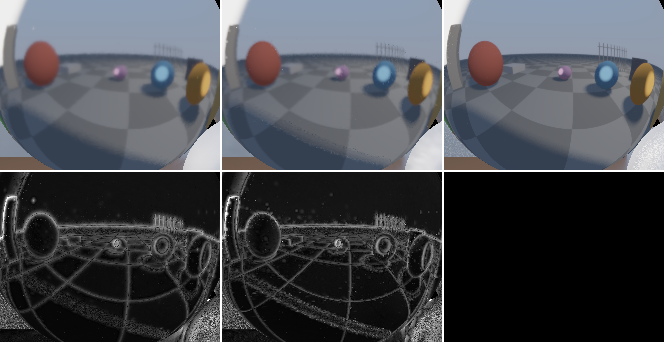
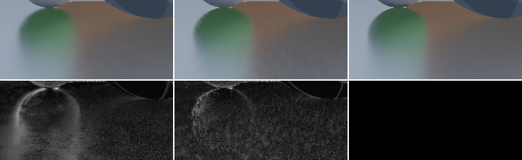
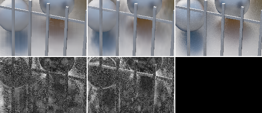
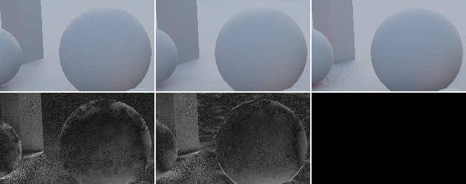

# M2/M3 results: recurrent filter (diffuse + specular)

_2026-10-25, recurrent-spec agent (implementer, RULES.md rule 8: no NRD code or README read).
Everything here was measured on our own test bed, captures and dev page. **Provisional**: built
against SPEC v0 / v0.1, which Dennis has not reviewed._

## Recurrent (M2/M3)

**Headline (1080p, 7 stress paths, live test bed, recurrent / SVGF / A-SVGF `auto` run in the
same page with today's package defaults):**

| | SVGF (`feedback: false`) | A-SVGF `auto` | **recurrent** |
|---|---|---|---|
| diffuse PSNR (mean of per-frame dB / pooled) | 39.00 / 38.88 | **39.27 / 39.13** | 38.44 / 38.26 |
| diffuse paths won (PSNR) | | | 1 / 7 vs SVGF (glossy +0.23), 1 / 7 vs A-SVGF (glossy +0.01) |
| specular PSNR (mean / pooled) | 34.09 / 33.46 | **35.32 / 34.96** | 34.41 / 34.10 |
| specular paths won (PSNR) | | | 4 / 7 vs SVGF, 1 / 7 vs A-SVGF (glossy +0.17) |
| GPU ms, diffuse + specular, 1080p, M5 Pro (dev page, min of 400 frames) | **4.02** | 5.55 | 4.44 (both recurrent, shared dispatches) |
| internal memory, diffuse + specular | ≈ 132 B/px (README) | ≈ 146 B/px | **105.5 B/px** (target ≤ 100) |

**Plainly: recurrent loses.** Against today's SVGF defaults (feedback off, 24ffe6f) the
recurrent diffuse filter is 0.56 dB below SVGF and 0.83 dB below A-SVGF on the mean, wins only
`glossy`, flickers ~10 % more, is weaker in disoccluded regions (−1.2 / −1.3 dB) and costs more
(2.37 vs ~2.1 ms alone). The T2 claim "recurrent diffuse beats A-SVGF on 6/7 paths" compared
against feedback-on SVGF; it does not hold (the spec author's finding, confirmed here in one
page). Recurrent specular (M3, this task) beats plain SVGF on 4/7 paths (+0.32 dB mean) and
A-SVGF `auto` only on `glossy` (+0.17 dB; pooled +0.25); A-SVGF `auto` remains the best
specular filter on 6/7 paths (−0.91 dB mean), most clearly at mid/high roughness and on the
static-camera paths. The recurrent pair is the only configuration near the 4 ms budget with
the best memory, but SVGF (4.02 ms) is cheaper and better on diffuse.

**Default joint config: unchanged.** `DiffuseSpecularDenoiser({ filter: 'recurrent' })` still means
recurrent diffuse + SVGF `antiLag: 'auto'` specular (6.0 ms); both-recurrent is
`specular: { filter: 'recurrent' }` (4.44 ms). Recurrent-for-both does not beat feedback-off
SVGF / A-SVGF at comparable cost, so per the brief the default stays and Dennis decides (SPEC
§12 item 1). Note that the hybrid default is itself dominated by `svgf` + `antiLag: 'auto'` on both
signals (39.27 / 35.32 dB at 5.55 ms vs 38.44 / 35.32 at 6.0 ms).

### 1. Setup

| | |
|---|---|
| GPU / browser | Apple M5 Pro, Chrome 155 headless (`--use-angle=metal`), WebGPU timestamps |
| Test bed | `examples/realtime-denoiser`, 1920×1080, 96 frames per path, blue-noise sampling, 256-spp references, FLIP every 12th frame at 41.4 ppd (as M1) |
| Denoiser code | `packages/denoiser-realtime` at 1b49e75 (frozen `git archive` copy via `RT_REALTIME_SRC`; later commits change docs/comments only) |
| Arms | registry `svgf`, `svgf-auto` (package defaults: `feedback: false`, kernel 3×3, 5 iterations; `svgf-auto` adds `antiLag: 'auto'`), `recurrent` (no URL settings: package defaults). Live, each id runs one instance per signal (`DiffuseDenoiser` / `SpecularDenoiser`); the replay runs the joint classes |
| Metrics | PSNR = mean of per-frame dB on tonemapped demodulated values; **pooled** = PSNR of the mean MSE over all frames and pixels (8b94f8f); region columns (disoccluded, roughness bins) are pooled; settled skips 8 frames after resets |
| Costs | dev page `mode=bench`, 1080p, min of 400 frames after warm-up (median within 5 %), one configuration per page load, no other headless job running (checked with `pgrep`); two runs each, both shown in `data/m23-bench-1080p.json` |

Commands:

```sh
RT_REALTIME_SRC=<snapshot>/packages/denoiser-realtime/src node ../../node_modules/vite/bin/vite.js . --port 5250 --strictPort --host 127.0.0.1
node run-headless.mjs --all-paths --json=m23.json "signal=diffuse,specular&mode=eval&preset=full&denoiser=svgf,svgf-auto,recurrent"
node run-headless.mjs --set=standard --replay=recurrent,svgf,svgf-auto && node replay-table.mjs --denoisers=svgf,svgf-auto,recurrent
node packages/denoiser-realtime/dev/run-headless.mjs "signal=both&mode=bench&filter=recurrent&specularFilter=recurrent"
```

Raw data: [data/m23-live-1080p.json](data/m23-live-1080p.json) (per-frame PSNR included),
[data/m23-bench-1080p.json](data/m23-bench-1080p.json).

### 2. Live test bed, 1080p, all paths (same page)

#### diffuse

| path | denoiser | PSNR | pooled | settled | disocc. | after cut | FLIP | flicker | tPSNR | energy |
|---|---|---|---|---|---|---|---|---|---|---|
| orbit | svgf | 40.68 | 40.65 | 40.82 | 38.20 | – | 0.032 | 0.0030 | 39.29 | -1.2% |
| orbit | svgf-auto | 41.01 | 40.97 | 41.17 | 38.26 | – | 0.029 | 0.0027 | 39.36 | -0.8% |
| orbit | recurrent | 39.90 | 39.79 | 40.14 | 36.83 | – | 0.037 | 0.0037 | 39.29 | -1.1% |
| pan | svgf | 40.12 | 39.45 | 40.16 | 38.14 | – | 0.034 | 0.0071 | 37.87 | -1.3% |
| pan | svgf-auto | 40.46 | 39.65 | 40.53 | 38.18 | – | 0.032 | 0.0069 | 37.91 | -0.9% |
| pan | recurrent | 39.06 | 38.20 | 39.06 | 36.66 | – | 0.039 | 0.0081 | 37.82 | -1.1% |
| light | svgf | 40.62 | 40.57 | 40.71 | – | – | 0.031 | 0.0013 | 53.20 | -1.1% |
| light | svgf-auto | 40.99 | 40.95 | 41.11 | – | – | 0.028 | 0.0008 | 55.73 | -0.7% |
| light | recurrent | 39.99 | 39.90 | 40.12 | – | – | 0.037 | 0.0006 | 55.80 | -1.0% |
| thin | svgf | 34.41 | 34.41 | 34.40 | 38.23 | – | 0.045 | 0.0053 | 31.68 | -1.2% |
| thin | svgf-auto | 34.47 | 34.47 | 34.46 | 38.29 | – | 0.043 | 0.0050 | 31.70 | -0.9% |
| thin | recurrent | 34.17 | 34.16 | 34.21 | 37.64 | – | 0.049 | 0.0058 | 31.68 | -1.1% |
| glossy | svgf | 39.50 | 39.48 | 39.51 | 36.25 | – | 0.035 | 0.0026 | 37.58 | -1.3% |
| glossy | svgf-auto | 39.72 | 39.70 | 39.74 | 36.30 | – | 0.034 | 0.0023 | 37.62 | -1.0% |
| glossy | recurrent | 39.73 | 39.70 | 39.74 | 35.78 | – | 0.038 | 0.0027 | 37.62 | -1.1% |
| cut | svgf | 39.77 | 39.71 | 39.87 | 38.26 | 38.35 | 0.034 | 0.0034 | 38.11 | -1.2% |
| cut | svgf-auto | 40.07 | 40.00 | 40.21 | 38.33 | 38.35 | 0.030 | 0.0031 | 38.17 | -0.8% |
| cut | recurrent | 39.16 | 39.06 | 39.36 | 36.86 | 37.85 | 0.038 | 0.0041 | 38.13 | -1.1% |
| object | svgf | 37.89 | 37.87 | 37.94 | 36.36 | – | 0.039 | 0.0018 | 49.31 | -1.3% |
| object | svgf-auto | 38.17 | 38.15 | 38.22 | 36.98 | – | 0.036 | 0.0014 | 50.71 | -0.9% |
| object | recurrent | 37.09 | 37.02 | 37.22 | 34.73 | – | 0.046 | 0.0013 | 50.09 | -1.2% |

means over the paths:

| denoiser | PSNR | pooled | disocc. | FLIP | flicker | energy | paths won vs svgf / svgf-auto (PSNR) |
|---|---|---|---|---|---|---|---|
| svgf | 39.00 | 38.88 | 37.57 | 0.036 | 0.0035 | -1.2% | – / 0 of 7 |
| svgf-auto | 39.27 | 39.13 | 37.72 | 0.033 | 0.0032 | -0.9% | 7 / – of 7 |
| recurrent | 38.44 | 38.26 | 36.41 | 0.041 | 0.0038 | -1.1% | 1 / 1 of 7 |

#### specular

| path | denoiser | PSNR | pooled | settled | disocc. | after cut | r<.15 | r<.35 | r<.6 | r≥.6 | FLIP | flicker | tPSNR | energy |
|---|---|---|---|---|---|---|---|---|---|---|---|---|---|---|
| orbit | svgf | 32.37 | 32.29 | 32.18 | 31.54 | – | 33.88 | 32.34 | 31.65 | 31.67 | 0.057 | 0.0043 | 33.67 | 0.4% |
| orbit | svgf-auto | 33.80 | 33.78 | 33.72 | 32.05 | – | 35.32 | 35.46 | 32.54 | 31.67 | 0.051 | 0.0042 | 33.66 | -0.1% |
| orbit | recurrent | 32.85 | 32.83 | 32.80 | 30.94 | – | 35.21 | 34.25 | 31.47 | 30.80 | 0.057 | 0.0059 | 33.15 | -0.8% |
| pan | svgf | 35.90 | 33.91 | 35.94 | 37.62 | – | 42.52 | 35.15 | 31.17 | 29.13 | 0.052 | 0.0102 | 34.97 | -1.6% |
| pan | svgf-auto | 37.24 | 35.67 | 37.31 | 38.47 | – | 43.20 | 38.00 | 32.85 | 30.19 | 0.046 | 0.0086 | 35.15 | -1.3% |
| pan | recurrent | 35.66 | 34.45 | 35.69 | 37.11 | – | 39.61 | 37.51 | 31.64 | 29.49 | 0.055 | 0.0099 | 34.83 | -1.6% |
| light | svgf | 35.11 | 35.02 | 35.15 | – | – | 40.38 | 37.11 | 33.09 | 31.77 | 0.036 | 0.0015 | 48.50 | -0.7% |
| light | svgf-auto | 35.29 | 35.27 | 35.34 | – | – | 42.48 | 37.52 | 33.18 | 31.82 | 0.035 | 0.0010 | 51.59 | -0.8% |
| light | recurrent | 34.40 | 34.35 | 34.51 | – | – | 40.82 | 36.53 | 32.31 | 31.10 | 0.043 | 0.0010 | 48.27 | -1.0% |
| thin | svgf | 35.41 | 35.41 | 35.41 | 37.10 | – | 48.48 | 35.85 | 32.82 | 28.42 | 0.046 | 0.0038 | 34.71 | -2.5% |
| thin | svgf-auto | 35.93 | 35.91 | 35.97 | 37.21 | – | 48.60 | 37.08 | 33.06 | 28.42 | 0.045 | 0.0037 | 34.71 | -2.0% |
| thin | recurrent | 35.44 | 35.42 | 35.52 | 36.18 | – | 47.63 | 37.49 | 32.26 | 28.37 | 0.048 | 0.0045 | 34.55 | -2.0% |
| glossy | svgf | 31.65 | 30.65 | 31.21 | 33.36 | – | 33.71 | 28.12 | 34.88 | 29.71 | 0.069 | 0.0030 | 33.95 | -4.6% |
| glossy | svgf-auto | 34.63 | 34.40 | 34.43 | 33.92 | – | 36.96 | 34.80 | 35.68 | 29.71 | 0.059 | 0.0030 | 34.01 | -3.0% |
| glossy | recurrent | 34.80 | 34.65 | 34.66 | 33.64 | – | 37.39 | 35.69 | 35.54 | 29.62 | 0.056 | 0.0036 | 33.88 | -4.2% |
| cut | svgf | 33.80 | 32.69 | 33.45 | 31.87 | 37.21 | 35.92 | 31.94 | 31.52 | 32.00 | 0.054 | 0.0043 | 34.30 | 0.9% |
| cut | svgf-auto | 35.21 | 34.64 | 35.04 | 32.67 | 37.21 | 37.50 | 36.18 | 32.74 | 32.04 | 0.048 | 0.0041 | 34.32 | 0.2% |
| cut | recurrent | 34.14 | 33.54 | 33.92 | 31.41 | 36.64 | 36.99 | 34.95 | 31.54 | 30.83 | 0.056 | 0.0056 | 33.88 | -0.6% |
| object | svgf | 34.37 | 34.24 | 34.51 | 33.19 | – | 38.49 | 37.97 | 32.20 | 30.92 | 0.043 | 0.0021 | 43.87 | -0.8% |
| object | svgf-auto | 35.10 | 35.08 | 35.16 | 34.40 | – | 40.20 | 39.21 | 32.99 | 31.01 | 0.041 | 0.0016 | 45.69 | -0.8% |
| object | recurrent | 33.57 | 33.48 | 33.71 | 32.34 | – | 39.27 | 37.47 | 31.22 | 30.46 | 0.050 | 0.0022 | 42.64 | -1.0% |

means over the paths:

| denoiser | PSNR | pooled | disocc. | FLIP | flicker | energy | paths won vs svgf / svgf-auto (PSNR) |
|---|---|---|---|---|---|---|---|
| svgf | 34.09 | 33.46 | 34.11 | 0.051 | 0.0042 | -1.3% | – / 0 of 7 |
| svgf-auto | 35.32 | 34.96 | 34.79 | 0.047 | 0.0037 | -1.1% | 7 / – of 7 |
| recurrent | 34.41 | 34.10 | 33.60 | 0.052 | 0.0047 | -1.6% | 4 / 1 of 7 |

Observations:

- **Diffuse**: recurrent is below SVGF on 6/7 paths (−0.24 … −1.06 dB) and below A-SVGF on
  6/7; on `glossy` it ties A-SVGF. Disoccluded regions −1.2 dB on average (the 1/(1+A) radius
  on fresh pixels plus mip repair does not match SVGF's spatial-variance fallback). Its
  flicker is lower only on the static-camera paths (`light`, `object`).
- **Specular**: recurrent wins `glossy` (r < 0.35: 35.69 vs 34.80 dB, mirrors 37.39 vs 36.96:
  virtual motion on a flat floor), is close on `thin`, and loses 0.9–1.6 dB on the other five paths (`thin` −0.5). The loss
  is spread over roughness bins and largest at r ≥ 0.35 on static-camera paths (`light`,
  `object`: −0.9 … −1.8 dB at r < 0.6), where A-SVGF's short history plus a 5-level
  variance-guided à-trous wins; no radius, tap, anti-lag, firefly or luminance-weight knob
  moved it more than ±0.2 dB (§5). Flicker is 10–40 % above A-SVGF under camera motion.
- Energy: recurrent −1.1 % diffuse (as SVGF), −1.6 % specular (A-SVGF −1.1 %). No NaN / Inf in
  any output.

### 3. Standard capture set, replayed (joint classes)

`run-headless.mjs --set=standard --replay=recurrent,svgf,svgf-auto` (CAPTURES.md: 7 × 960×540
windows of 16–24 frames + 8 frames of orbit at 1080p), scored by `compare.mjs`; cells: PSNR mean /
pooled. Here `recurrent` is the joint `DiffuseSpecularDenoiser` with both signals recurrent.

| capture | diffuse recurrent | diffuse svgf | diffuse svgf-auto | specular recurrent | specular svgf | specular svgf-auto |
|---|---|---|---|---|---|---|
| std540-orbit | 36.76 / 36.46 | 38.19 / 38.09 | 38.34 / 38.23 | 31.86 / 31.85 | 32.31 / 32.28 | 32.62 / 32.60 |
| std540-pan | 37.93 / 37.74 | 38.11 / 38.04 | 38.24 / 38.16 | 33.92 / 33.89 | 33.87 / 33.83 | 34.71 / 34.69 |
| std540-light | 38.03 / 37.74 | 38.93 / 38.84 | 39.26 / 39.17 | 31.88 / 31.76 | 32.99 / 32.81 | 33.32 / 33.23 |
| std540-thin | 33.35 / 33.25 | 34.11 / 34.10 | 34.14 / 34.13 | 33.51 / 33.43 | 34.20 / 34.18 | 34.20 / 34.18 |
| std540-glossy | **38.76** / 38.67 | 38.43 / 38.36 | 38.54 / 38.45 | 35.32 / 35.31 | 35.01 / 34.97 | 35.56 / 35.55 |
| std540-cut | 37.62 / 37.39 | 38.34 / 38.30 | 38.47 / 38.43 | 34.09 / 33.02 | 34.17 / 33.37 | 34.60 / 33.73 |
| std540-object | 35.33 / 35.07 | 36.68 / 36.63 | 36.81 / 36.76 | 31.63 / 31.55 | 32.85 / 32.76 | 33.57 / 33.50 |
| std1080-orbit | 37.31 / 37.11 | 39.19 / 39.15 | 39.26 / 39.21 | 33.45 / 33.44 | 34.44 / 34.42 | 34.75 / 34.74 |

The short windows (history still building) penalize the recurrent filter more than the 96-frame
live runs; the ranking is the same.

### 4. Cost and memory (1080p, M5 Pro, dev page, min of 400 frames)

| configuration | prepass | pre_blur | temporal | mips | history_fix | blur | post_blur | stabilize | **total** |
|---|---|---|---|---|---|---|---|---|---|
| recurrent diffuse + specular, shared dispatches | 0.10 | 0.75 | 1.20 | 0.11 | 0.47 | 0.87 | 0.46 | 0.48 | **4.44** |
| recurrent diffuse alone | 0.10 | 0.50 | 0.50 | 0.08 | 0.31 | 0.35 | 0.22 | 0.31 | **2.38** |
| recurrent specular alone | 0.10 | 0.34 | 0.92 | 0.08 | 0.31 | 0.40 | 0.26 | 0.38 | **2.79** |
| skeleton (trivial kernels, same bindings), both | 0.10 | 0.23 | 0.15 | 0.09 | 0.09 | 0.05 | 0.06 | 0.09 | 0.85 |
| SVGF joint (feedback off) | 0.18 | temporal 0.66 · variance 0.48 · à-trous 0.55 + 0.55 + 0.54 + 0.54 + 0.49 | | | | | | | **4.02** |
| A-SVGF `auto` joint | 0.18 | gradients 1.41 · temporal 0.70 · variance 0.51 · à-trous 2.67 | | | | | | | **5.55** |
| `filter: 'recurrent'` default (recurrent diffuse + A-SVGF specular, two pipelines) | | | | | | | | | **5.98** |

Joint budget, lever by lever (each measured alone, solo; "before" = previous row):

| step | joint ms | Δ | quality |
|---|---|---|---|
| T2 state (pre-T3, re-measured in the same session) | 5.41–5.45 | | |
| + virtual motion (first version, with dead options compiled in) | 7.00 | +1.55 | specular +1.1…+3.4 dB |
| removed dead ends (luminance weight, stabilization virtual candidate, knobs); virtual taps: linear plane test, 4-neighbour curvature | 6.23 | −0.77 | identical |
| virtual Catmull-Rom → bilinear | 6.07 | −0.16 | −0.03…−0.05 dB specular |
| (d) 10×10 shared tiles: temporal | 5.91 | −0.16 | identical |
| (d) tiles: history fix (0.82 → 0.47), stabilize (−0.04) | 5.47 | −0.44 | identical |
| (a) mip repair out of history fix | — | 0.00 | with tiles the stubbed mip repair saves 0.006 ms: nothing left to move |
| GuidePass `slope: false` (prepass 0.18 → 0.10, −4 B/px) | 5.41 | −0.06 | identical |
| branchless 2×2 history taps (stabilize 0.78 → 0.56) | 5.13 | −0.28 | identical |
| 4-tap post-blur (both signals) | 4.72 | −0.41 | +0.00…+0.06 dB both signals |
| 4-tap pre-blur (specular only) | 4.64 | −0.08 | specular ±0.15 (diffuse would lose 0.5 dB: stays 8) |
| recurrent-only reprojection (no per-tap unproject / pairwise normal) | 4.53 | −0.11 | identical within 0.03 dB |
| bilinear stabilization history for diffuse (specular keeps Catmull-Rom) | **4.45** | −0.08 | diffuse identical; specular bilinear would cost 0.05–0.16 dB |
| (c) `shader-f16` kernel taps | (4.33) | −0.11 | **not kept**: −0.2 dB diffuse on the dev page's HDR direct light; f16 weights with f32 sums were slower |
| 4-tap blur (`blurTaps: 4`) | (4.05) | −0.40 | **not kept**: −0.07 dB diffuse, −0.0…−0.05 specular, +3…5 % flicker |
| (b) fold prepass into pre-blur | — | | not done: prepass is 0.10 ms after `slope: false`; pre-blur taps would need 3 raw guide loads each |
| (e) half-res fast history | — | | not done (memory lever: 105.5 → 93.5 B/px; anti-lag and virtual-ĥ quality risk) |

**4.44 ms vs the ≤ 4 ms target: 11 % over.** The only remaining measured lever that reaches 4 ms
is the 4-tap blur (measured 4.05 ms) at −0.07 dB / +5 % flicker; it is an option (`blurTaps: 4`), not
the default.

**Memory** (internal, per pixel, 1080p): 4 rgba16float rotation buffers per signal (64 B both),
fast history 2 × rgba16float (16), `data` 2 × r32uint (8), packed geometry 2 × rg32uint (16),
depth mip atlas (1.5) = **105.5 B/px** for diffuse + specular (≈ 219 MB), **73.5 B/px**
diffuse only. Target ≤ 100: 5.5 % over; the ready cut is half-resolution fast history
(−12 → 93.5 B/px, SPEC §12), not implemented.

### 5. Recurrent specular (T3): what was built and what it measured

All rows: specular PSNR, 1080p live, `glossy` / `orbit` (+ others where noted), recurrent
specular alone; A-SVGF `auto` = 34.63 / 33.80.

| step | glossy | orbit | notes |
|---|---|---|---|
| T2 interim (surface motion only) | 31.56 | 31.27 | |
| + virtual motion R-9…R-12 as in SPEC | 32.62 | 30.49 | r < 0.35 on glossy +4.8 dB; mirrors (curved sphere) −2.6, rough −2.2 on orbit |
| + curvature (mirror equation, D12c) | 33.60 | 30.37 | glossy mirrors 30.5 → 32.1 |
| − stabilization virtual candidate, m·c_v in `data` | 34.56 | 32.23 | the unvalidated R7 candidate was most of the orbit loss (replay alone: −0.36…−1.5 dB) |
| + virtual clamp always on, window γ(1 + 2c_v)σ, γ = 1 | 34.63 | 32.30 | |
| + specular detector floor A_fast·f_r | 34.66 | 32.40 | |
| + specular R_max 30 px, R_min·f_r | 34.92* | 32.53* | *with the next row |
| + anti-lag / detector mean centred on the pixel as r → 0 | 34.92 | 32.85 | `light` mirrors 34.8 → 40.7 dB: the 3×3-mean clamp blurred every reflected edge |
| final (after the budget work: 4-tap pre/post-blur, bilinear virtual) | 34.80 | 32.85 | live table above |

Verified: virtual motion on vs off in the final design: glossy +2.75, orbit +1.10, light +0.21
dB. Kernel elongation κ_e 0 / 0.75 / 1: ±0.1 dB (0.75 kept). Tried and dropped (each ±0.2 dB
or worse): gate virtual motion by the surface candidate's parallax loss (orbit mirrors +1.4,
glossy r < 0.35 −0.9), m = F_dom², slow history ĥ for the virtual distance, luminance weight
with predicted noise k·f_r/√(1+A) (k = 1…4: ±0.1, rough −1.7 dB at k = 1), radius ∝ (1+A)^−p
(p = 0.5 / 0.75: −0.1…−0.5), larger/smaller R_max, pre-blur 5/20 px, A_cap 15/63, N_stab 3/15,
anti-lag σ 2 / current-detector σ 0/5 / e_max 1, firefly threshold 0/3, input clamp 8 (−1…−2 dB).

M1 failure modes (§8 of results/M1.md):

1. **Near-mirror over-blur**: fixed on the static camera (`light` r < 0.15: 34.4 → 40.8 dB;
   SVGF 40.4, A-SVGF 42.5). Under camera motion the mirror bin is level with A-SVGF on `orbit`
   (35.21 vs 35.32) and above it on `glossy` (37.39 vs 36.96). 
   _`std540-glossy` frame 15, specular: A-SVGF `auto` | recurrent | reference; bottom |error| × 4._
2. **Ghosting under camera motion / glossy floor**: fixed on the flat floor (`glossy` r < 0.35:
   28.1 SVGF → 34.8 A-SVGF → 35.7 recurrent). Contact reflections keep their edge where A-SVGF
   leaves a bright halo, but the recurrent floor is more mottled: 
   _`std540-glossy` frame 15, specular: A-SVGF `auto` | recurrent | reference._ Curved and
   cluttered reflections still smear (fence posts reflected in the floor, `std540-orbit`):
   

### 6. Disocclusion and lighting changes

- **Disocclusion** (pixels with < 8 frames of valid history, pooled): recurrent diffuse 36.41 dB
  mean vs SVGF 37.57 / A-SVGF 37.72; specular 33.60 vs 34.11 / 34.79. After the camera cut
  (`cut`, reset frame): diffuse 37.85 vs 38.35, specular 36.64 vs 37.21. The recurrent filter is
  weakest exactly where SVGF's spatial variance fallback works best.
- **Light switch** (`light` path: the light flips sides at frame 48, shrinks at 72; per-frame
  PSNR from the live run):

| | before (f 47) | f 48 | f 49 | f 51 | f 54 | f 60 | frames until within 0.5 dB of f 47 |
|---|---|---|---|---|---|---|---|
| diffuse svgf | 41.1 | 37.7 | 38.5 | 39.6 | 40.5 | 40.9 | 9 |
| diffuse svgf-auto | 41.3 | 38.3 | 39.5 | 40.5 | 41.0 | 41.2 | 5 |
| diffuse recurrent | 40.5 | 36.8 | 37.5 | 38.7 | 39.6 | 40.0 | 11 |
| specular svgf | 35.4 | 30.3 | 31.4 | 33.2 | 34.6 | 35.3 | 8 |
| specular svgf-auto | 35.4 | 33.0 | 34.2 | 35.0 | 35.3 | 35.4 | 3 |
| specular recurrent | 34.7 | 31.5 | 32.7 | 33.6 | 34.2 | 34.5 | 6 |

  The recurrent filter's anti-lag (fast history + current-frame detector) beats plain SVGF on
  specular but is the slowest on diffuse; A-SVGF `auto` recovers fastest on both.
  
  _`std540-light` local frame 9 (the frame after the flip), diffuse: A-SVGF `auto` | recurrent |
  reference._

### 7. Provisional / caveats

- One analytic scene; 256-spp references cap meaningful specular PSNR near 35–45 dB.
- The dev page (direct lights, hard shadows) and the test bed (path-traced GI) rank filters
  differently; all decisions here come from the test bed.
- Timings: one GPU (M5 Pro), run-to-run spread a few %; ≤ 2× native on the same GPU is not
  measurable here (NATIVE-HARNESS phase 5).
- Deviations from SPEC are listed in TASKS "Found along the way" and in PROVENANCE (M3 rows).
