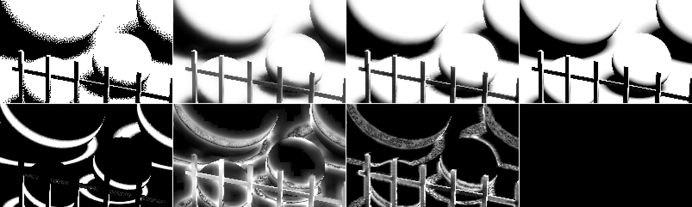
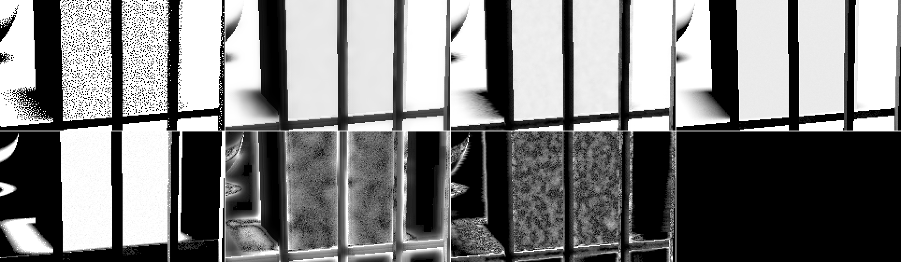
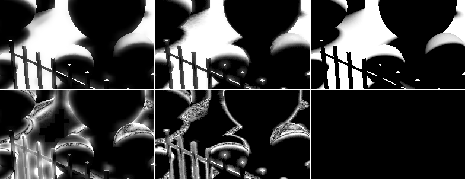
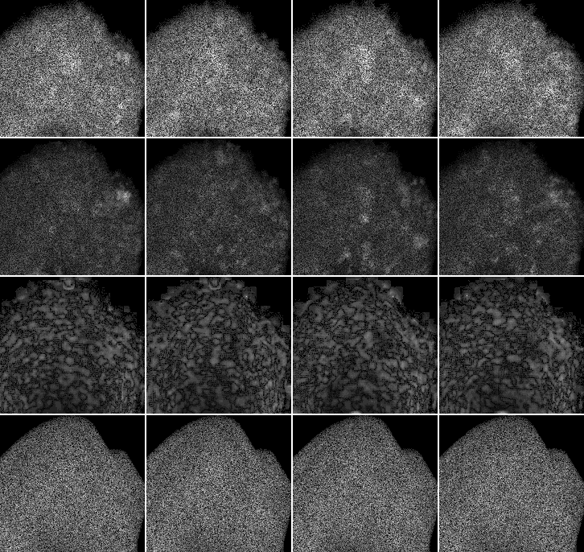
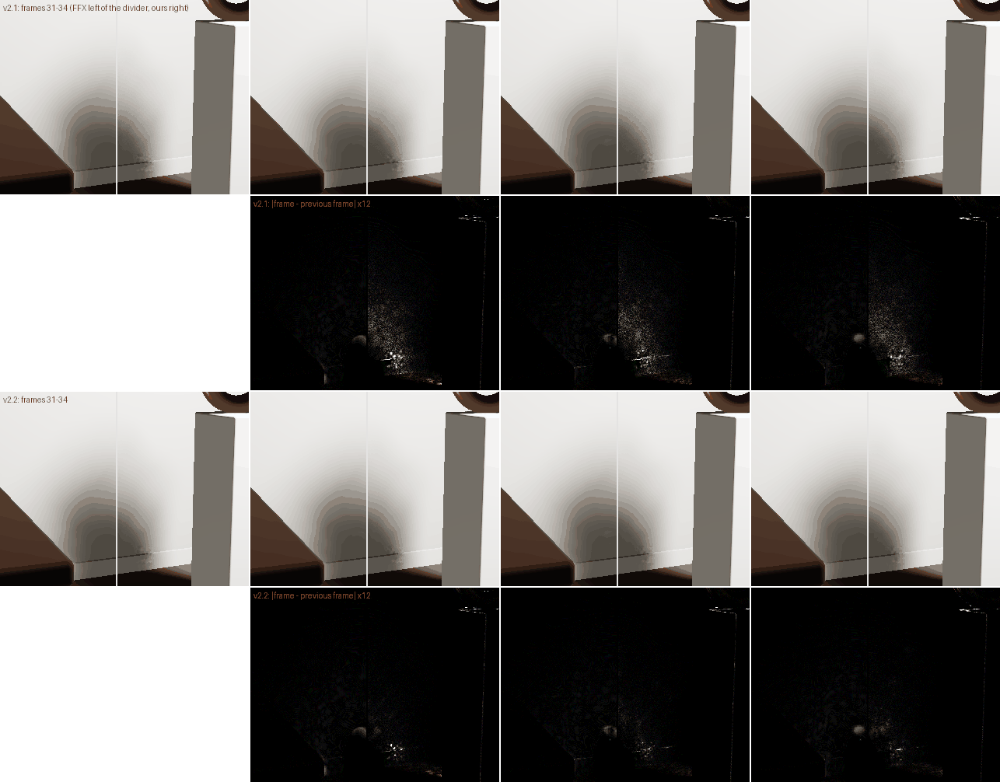

# M4 results: shadows (T4)

_2026-10-25, shadows agent (implementer, RULES.md rule 8: no NRD code, README or port was
opened). Built against SPEC v0 §7, which Dennis has not reviewed yet: **provisional**.
Code: `packages/denoiser-realtime/src/shadow.ts` + `src/shaders/shadow.ts` (`ShadowDenoiser`,
registry id `shadows`). Provenance: [../PROVENANCE.md](../PROVENANCE.md) "Shadows (M4)"._

> **v2 (§10, same night):** the defaults changed. 1080p live, 7 paths, pooled: **37.11 dB**,
> penumbra **28.57**, disoccluded **34.68**, FLIP 0.018 (v1 36.55 / 28.11 / 33.19; FFX 31.20 /
> 23.50 / 32.91). Fresh-history frames now match FFX on the reset replays (std1080-orbit
> 35.42 vs 35.40), and cost is unchanged (0.48–0.59 ms; `thin` 0.59). The sections below
> describe v1.

**Headline (1080p, mean over the 7 stress paths, live test bed, blue-noise sampling):**

| | noisy | accumulate-32 | FFX shadows | **shadows (ours)** |
|---|---|---|---|---|
| PSNR | 20.36 | 28.28 | 33.57 | **38.89** |
| penumbra PSNR | 8.18 | 18.55 | 23.50 | **28.12** |
| disoccluded PSNR (6 paths) | 16.4 | 22.1 | 32.91 | **33.20** |
| FLIP | 0.039 | 0.042 | 0.038 | **0.018** |
| flicker (fixed pixel) | 0.0498 | 0.0098 | 0.0053 | **0.0035** |
| tPSNR | 14.3 | 29.8 | 38.71 | 38.70 |
| non-finite outputs | 0 | 0 | 0 | 0 |
| GPU ms (solo bench, fastest clock state, 7 paths) | – | – | 0.50–0.73 | **0.43–0.64** |

- Ours beats FFX shadows on every path: PSNR +3.5 … +7.5 dB, penumbra PSNR +3.3 … +7.4 dB,
  FLIP halved (0.011–0.027 vs 0.030–0.051), lower flicker on 5 of 7 paths. The two paths
  the brief singles out: `light` 34.74 vs 28.49 dB (penumbra 24.55 vs 19.77), `thin`
  34.78 vs 30.00 (penumbra 28.09 vs 24.19).
- Target "beat FFX on penumbra PSNR and FLIP within ≤ 0.6 ms": **met** on quality
  everywhere; on cost, 6 of 7 paths are ≤ 0.6 ms in the fast clock state (0.43–0.55 ms),
  `thin` (screen mostly penumbra) is 0.64 ms. The M5 Pro alternates between two clock
  states (every pass ×1.3–1.8 in the slow one, FFX too), so medians of repeated runs read
  0.47–0.86 ms for ours and 0.51–0.77 ms for FFX (§5).
- Where FFX is still better: the first frames after a reset / disocclusion on `orbit`, `pan`
  and `cut` (disoccluded PSNR −1.3 … −1.6 dB; `std1080-orbit`, 8 frames from a reset, 34.42 vs
  35.40 dB: frame 0 31.6 vs 34.8, level by frame 7). FFX's variance-boosted à-trous blurs fresh pixels harder; a larger radius for
  young histories did not help ours (§3).
- Fractional visibility is kept end to end (no threshold). No spatial output re-enters
  the history.

## 1. What was built

`ShadowDenoiser implements TemporalDenoiser<ShadowInputs>`; the light comes in through the
new, additive `ShadowInputs.light?: ShadowLight` (`{ type: 'sphere', position, radius }` or
`{ type: 'directional', direction, angularRadius }`, the capture's `lights` fields;
`packages/denoiser-core/src/temporal.ts`). Without a light or without `hitDistance` it falls
back to the noise-driven radius (§4).

| pass | threads | reads | writes |
|---|---|---|---|
| `temporal` | 8×8 per tile, 12×12 shared raw visibility | depth/viewZ, normal, motion, motionZ, visibility, hitDistance, geometry_prev, history_prev | geometry (rg32uint), history (rgba16float: v, g, A, n_g), T and output (r32float: unfiltered copy), tile stats |
| `tiles` | 1 per tile | tile stats (3×3) | nearest-occluder scale per tile, indirect args + tile list |
| `spatial0` | indirect, active tiles | geometry, history, tile scale | T |
| `spatial1` | indirect, active tiles | geometry, history, T, tile scale | output |

- **Temporal** (SPEC SH-4): reprojection with the shared core's rules (bilinear footprint,
  per-tap plane distance, backfacing rejected) in an affine form; Catmull-Rom fetch for
  visibility when all 4 taps are valid. Raw visibility is accumulated with cap `A_cap = 15`,
  further capped at `W_px²` (penumbra width in pixels). History clamped to the 5×5 raw mean
  ± (0.4σ + 0.05); if the clamp moved it, the history restarts at the current frame; if all
  25 samples agree, the history takes their value exactly.
- **Penumbra width** (SH-2): per occluded sample, `g = h/(D − h)` (sphere; `h` for a
  directional light), accumulated over occluded samples (cap 7); `W = R·g` (or `tanθ·g`). The
  3×3-tile minimum ("nearest occluder wins", SH-3) is used for pixels without an estimate
  and also caps pixels with one.
- **Tiles** (SH-3): a tile is active when its 3×3 neighbourhood holds a fractional history
  or raw samples that disagree; only active tiles run the spatial passes (indirect dispatch).
- **Spatial** (SH-5): SPEC's 8-tap disk (R-3) on the receiver's tangent plane, per-pixel
  animated Bayer rotation (D3b, a different angle per pass), radius `0.75·W·lerp(1, 0.5,
  A/A_cap)`, second pass half that, floor 1 px, axes ≤ 48 px; weights plane distance (2 %)
  × normal (30°). Self-shadowing terminators (light partly below the horizon, h = 0) get a
  16-px radius (analytic test n·l < sin θ_light).
- **Memory:** 40 B/px (history 2 × 8, geometry 2 × 8, T 4, output 4) + 12 B per 8×8 tile;
  83 MB at 1080p. SPEC estimated 32 B/px; the difference is our own geometry ping-pong (the
  shared prepass's would be 20 B/px and 0.18 ms).
- **Storage textures per dispatch:** temporal 4, spatial 1. Core WebGPU only.

## 2. Live test bed, 1080p, all 7 paths

`signal=shadows&mode=eval&preset=full&denoiser=passthrough,accumulate-32,ffx-shadows,shadows`,
96 frames per path, references 256 spp, FLIP every 12th frame at 41.4 ppd. Package frozen at
commit 79cba29 via `RT_REALTIME_SRC`. The GPU ms column is contended (3 jobs in parallel):
use §5.

| path | denoiser | PSNR | settled | penumbra | disocc. | FLIP | flicker | tPSNR | bias | energy |
|---|---|---|---|---|---|---|---|---|---|---|
| orbit | accumulate-32 | 28.13 | 28.29 | 19.26 | 23.55 | 0.025 | 0.0125 | 29.93 | -0.0133 | -0.2% |
| orbit | ffx-shadows | 30.80 | 30.38 | 22.74 | **34.40** | 0.034 | 0.0083 | 35.95 | -0.0424 | -0.5% |
| orbit | **shadows** | **36.16** | **36.32** | **27.52** | 33.06 | **0.015** | **0.0042** | **37.27** | 0.0044 | 0.0% |
| pan | accumulate-32 | 35.65 | 36.46 | 16.96 | 21.43 | 0.020 | 0.0154 | 27.36 | -0.0029 | -0.0% |
| pan | ffx-shadows | 49.09 | 50.46 | 25.79 | **36.28** | 0.033 | 0.0087 | **39.35** | -0.0333 | -0.4% |
| pan | **shadows** | **52.61** | **54.13** | **29.05** | 34.87 | **0.016** | **0.0051** | 38.33 | 0.0031 | 0.1% |
| light | accumulate-32 | 18.20 | 17.53 | 11.60 | – | 0.151 | 0.0061 | 26.49 | 0.1380 | 6.3% |
| light | ffx-shadows | 28.49 | 27.91 | 19.77 | – | 0.047 | **0.0016** | 39.62 | -0.0008 | -0.1% |
| light | **shadows** | **34.74** | **34.74** | **24.55** | – | **0.021** | 0.0020 | **39.63** | 0.0232 | 0.3% |
| thin | accumulate-32 | 27.48 | 27.79 | 20.24 | 23.26 | 0.030 | 0.0137 | 28.70 | -0.0135 | -0.3% |
| thin | ffx-shadows | 30.00 | 29.64 | 24.19 | 33.05 | 0.051 | 0.0087 | 34.39 | -0.0358 | -0.7% |
| thin | **shadows** | **34.78** | **34.87** | **28.09** | **34.95** | **0.027** | **0.0050** | **35.73** | 0.0083 | 0.2% |
| glossy | accumulate-32 | 37.23 | 38.01 | 24.65 | 22.48 | 0.014 | 0.0040 | 35.62 | -0.0033 | -0.1% |
| glossy | ffx-shadows | 32.82 | 32.61 | 23.85 | 28.43 | 0.030 | 0.0019 | **43.10** | -0.0487 | -0.8% |
| glossy | **shadows** | **40.36** | **40.60** | **31.27** | **32.68** | **0.011** | **0.0017** | 42.81 | -0.0016 | -0.0% |
| cut | accumulate-32 | 29.01 | 29.50 | 19.08 | 23.18 | 0.018 | 0.0110 | 29.77 | -0.0069 | -0.2% |
| cut | ffx-shadows | 32.30 | 31.81 | 23.76 | **34.71** | 0.031 | 0.0060 | 37.49 | -0.0408 | -0.6% |
| cut | **shadows** | **37.43** | **37.80** | **28.13** | 33.15 | **0.014** | **0.0038** | **37.93** | 0.0024 | 0.0% |
| object | accumulate-32 | 22.29 | 22.27 | 18.03 | 18.80 | 0.036 | 0.0058 | 30.75 | 0.0056 | -0.6% |
| object | ffx-shadows | 31.47 | 31.21 | 24.41 | **30.61** | 0.040 | **0.0017** | **41.08** | -0.0386 | -0.8% |
| object | **shadows** | **36.12** | **36.38** | **28.23** | 30.48 | **0.023** | 0.0027 | 39.23 | 0.0041 | 0.1% |

(Noisy input: PSNR 18.0 / 36.0 / 19.3 / 16.1 / 18.1 / 18.3 / 16.8, penumbra ≈ 8 dB. Bias is
the tonemapped mean signed error: FFX darkens (−0.03 … −0.05, it thresholds visibility and
blurs umbrae into lit areas), ours is within +0.008 except `light` (+0.023: lit lag right
after the flip and the shrink). `pan` PSNR is a mean of per-frame dB and its last 17
frames contain no shadow (exact 120 dB frames): an exact output there decides the mean,
§3 "uniform snap".)

Raw JSON (per-frame PSNR included): [data/m4-live-1080p.json](data/m4-live-1080p.json); every bench run of §5 in [data/m4-bench-1080p.json](data/m4-bench-1080p.json).

### Standard capture set (replay, `compare.mjs`)

The exact inputs the Windows harness replays (CAPTURES.md). Cells: sequence PSNR /
settled / flicker / penumbra.

| capture | accumulate-32 | ffx-shadows | **shadows** |
|---|---|---|---|
| std540-orbit | 26.97 / 28.07 / 0.0150 / 17.91 | 31.35 / 30.19 / 0.0077 / 23.16 | **31.89 / 32.12 / 0.0074 / 23.31** |
| std540-pan | 27.84 / 29.42 / 0.0176 / 19.94 | 31.51 / 30.90 / 0.0106 / 24.20 | **35.11 / 36.32 / 0.0073 / 27.35** |
| std540-light | 17.34 / 12.92 / 0.0174 / 13.43 | 29.78 / 28.66 / **0.0030** / 23.44 | **33.24 / 33.51** / 0.0040 / **25.82** |
| std540-thin | 25.78 / 27.67 / 0.0228 / 19.04 | 30.40 / 28.91 / 0.0086 / 24.32 | **31.86 / 32.36 / 0.0086 / 25.31** |
| std540-glossy | 32.07 / 35.35 / 0.0077 / 21.53 | 31.76 / 30.87 / **0.0022** / 22.35 | **36.90 / 38.14** / 0.0024 / **26.88** |
| std540-cut | 28.22 / 32.21 / 0.0157 / 19.31 | 31.92 / 31.04 / **0.0051** / 23.55 | **34.30 / 36.07** / 0.0056 / **26.46** |
| std540-object | 22.26 / 21.99 / 0.0097 / 15.59 | 30.77 / 29.49 / **0.0039** / 23.88 | **32.09 / 32.91** / 0.0055 / **24.62** |
| std1080-orbit | 26.32 / – / 0.0181 / 16.37 | **35.40** / – / **0.0049** / **25.69** | 34.42 / – / 0.0055 / 25.04 |

The 16-frame windows start at a reset, so early frames weigh more than in §2: ours ramps
from 31.6 (frame 0) to 35.6 dB (frame 7) on `std1080-orbit`, FFX starts at 34.8 and stays
near 35.4; on the 16-frame `std540-orbit` FFX starts higher (31.2 vs 29.0) but drifts down
to 28.6 by frame 15 (blur feedback) while ours holds 32.1.

## 3. How the defaults were chosen (960×540, `orbit light thin object` (+`pan`), mean)

Each row changes one thing from the row above it (or from the stated base). PSNR / penumbra
PSNR in dB. FFX on the same 4 paths: 27.20 / 21.10.

| step | PSNR | penumbra | note |
|---|---|---|---|
| first version: clamp 1σ + 0.05, anti-lag → A = 1 at 1/4 clamp, radius 1·W, bilinear history | 27.80 / 20.30 (orbit only) | | below FFX's 21.29 penumbra on orbit |
| radius 0.5 / 1.5 / 2 / 3 ·W (orbit) | 27.92 / 27.43 / 26.99 / 26.09 | 20.39 / 19.88 / 19.39 / 18.43 | bigger kernels lose: blur bias beats noise |
| history cap 31 instead of 15 (orbit) | −1.3 | −1.5 | longer history *worse*, even for `accumulate-32` vs `-8` (25.8 vs 28.0) |
| + Catmull-Rom history (orbit) | 28.45 | 20.72 | +0.65 |
| + cap A ≤ k·W_px², k = 1 / 0.25 / 0.0625 (orbit) | 28.99 / 29.45 / 29.90 | 21.13 / 21.54 / 22.23 | shorter histories still better: the real problem was lag (next row) |
| clamp window 0.4σ (≈ 2 standard errors of the 5×5 mean), anti-lag 16 | 30.95 | 23.76 | **the big step**: moving shadows (light, object) lagged through the wide 1σ window of binary samples; blue-noise 5×5 means are accurate |
| clamp 0.3σ / 0.5σ | 30.70 / 30.84 | 24.12 / 23.21 | |
| anti-lag 8 / 32 / 64 | 30.47 / 31.11 / 31.18 | 23.38 / 23.92 / 24.00 | 64 = any noticeable clamp restarts |
| radius 0.75·W | 31.64 | 24.47 | |
| + nearest-occluder merge (`mergeMin`) | 31.77 | 24.48 | radius 0.5 / 0.35 / 0.25 with merge: 31.67 / 31.47 / 31.24 |
| radius shrink at full history 1 / 0.25 (default 0.5) | 31.49 / 31.76 | 24.37 / 24.36 | |
| anti-lag restarts at A = 0 (was 1) | **32.65** | **24.93** | the 1/n decay from A = 1 left a visible ~1 % residue after the light flip |
| clamp floor 0.1 / clamp 0.5σ / anti-lag 16 with A = 0 | 32.35 / 32.45 / 32.34 | 24.35 / 24.38 / 24.63 | |
| affine reprojection (−0.1 ms) | 32.62 | 24.90 | |
| + uniform snap (5 paths incl. pan: 34.08 → 36.20) | 36.20 (5 paths) | 25.27 | pan 39.9 → 50.6 (exact no-shadow frames); other paths PSNR −0.00 … −0.06, penumbra −0.06 … −0.12 |
| young-history radius boost ×(1 + k/(1+A)), k = 0.5 / 1 / 2 | −0.01 / −0.05 / −0.18 | ±0.02 / −0.01 / −0.14 | off; also worse on `std1080-orbit` (33.02 / 31.66 vs 34.42) |
| anisotropy 1/(n·l) (cap 4 / with radius 0.5 / cap 2 + radius 0.5) | −2.7 / −1.4 / −0.26 | −2.0 / −1.0 / −0.21 | off (M12 Eq. 12 reading; the extra length only adds blur here) |
| no normal weight (saves ~0.04 ms) | −4.1 | −2.4 | stays on |
| spatial plane tolerance 1 % / normal 20° | ±0.00 | ±0.00 | |
| terminator radius 6 / 32 px (default 16) | +0.04 / −0.7 | −0.02 / −0.6 | 16 kept (6 is within noise) |

What the measurements say about the design:

1. **Lag, not noise, dominated** once a path moves a shadow (`light`, `object`, and every
   moving camera via reprojection resampling). Binary 1-spp samples give a 5×5 σ near 0.5
   in any penumbra, so SPEC's γ = 1 clamp never fires there; using the standard error
   (σ/√25 ≈ 0.2σ, we use 0.4σ) does. The recurrent agent found the same for its fast-history
   clamp (LESSONS).
2. **Spatial radius should stay below the penumbra half-width** (0.75·W, halved at full
   history and in pass 2): the true profile is S-shaped, a disk as wide as the penumbra
   rounds its ends. The analytic width matters less than expected: the noise-driven
   fallback (no hit distance at all) reaches 32.21 / 24.40 vs 32.62 / 24.90 (§4).
3. Long histories hurt sharp shadows under camera motion (resampling blur), hence
   Catmull-Rom and the `W_px²` cap; with the tight clamp the cap matters less (k = 1 is the
   default; 0.0625 was within ±0.1 dB after the clamp change).

## 4. Fallback without occluder distance (H18-style)

`sh.hit=none` (registry switch: the denoiser gets no `hitDistance`): radius = 24 px ×
E, E = the H18 Eq. 29 total variation of raw visibility along 4 lines through the pixel on
the 5×5 tile, accumulated over time. 960×540, 5 paths: 32.21 dB / 24.40 penumbra vs 32.62 /
24.90 with hit distance (12 px: 31.65 / 23.73; 48 px: 32.22 / 24.45). Its first version used
the 3×3-tile minimum like the hit-distance path and lost 0.9 dB: tile minima of E are ~0 at
any penumbra's edge, so the fallback uses the pixel's own E only. Cost: one run read 0.73 ms
vs 0.47 (temporal 0.48 vs 0.31), in the slow clock state; not re-measured.

## 5. Cost (1080p, Apple M5 Pro, solo bench)

`mode=bench&preset=full`, 100 frames after 20 warm-up, one denoiser per page load, started
only when no other headless job ran; 3–7 runs per row, alternating ours / FFX. The GPU has
two clock states during these runs (the tiles pass reads 0.005 ms in the fast one, 0.007–0.009
in the slow one, and every pass scales with it), so both the fastest run and the median are
given.

| path | shadows fastest (median) | passes, fastest run | FFX fastest (median) |
|---|---|---|---|
| orbit | **0.47** (0.66) | temporal 0.31 · tiles 0.005 · spatial 0.08 + 0.08 | 0.51 (0.52) |
| pan | **0.43** (0.47) | 0.27 · 0.005 · 0.08 + 0.08 | 0.67 (0.77) |
| light | 0.53 (0.73) | 0.33 · 0.005 · 0.09 + 0.08 | 0.51 (0.74) |
| thin | 0.64 (0.86) | 0.33 · 0.006 · 0.17 + 0.13 | 0.62 (0.62) |
| glossy | **0.46** (0.47) | 0.31 · 0.005 · 0.07 + 0.07 | 0.50 (0.51) |
| cut | **0.47** (0.47) | 0.31 · 0.005 · 0.08 + 0.07 | 0.73 (0.76) |
| object | **0.52** (0.56) | 0.31 · 0.005 · 0.11 + 0.10 | 0.57 (0.61) |

- Tile skip is worth ~0.5 ms: without it (`sh.tileSkip=false`) each spatial pass costs 0.33
  ms on `orbit`.
- The temporal pass is 2/3 of the cost: shared-memory 5×5 statistics, 4 geometry + 4 history
  taps, a 5-tap Catmull-Rom, and 4 stores (geometry, history, two r32float copies the
  inactive tiles need). The affine reprojection took it from 0.40 to 0.31 ms.
- One spatial pass instead of two: 0.42 ms on `orbit` (quality not measured in full).
- Levers left: fold the two unfiltered copies into one (the second pass could read the
  history for inactive-tile taps), `shader-f16`, half the taps in pass 2.

## 6. Failure cases (crops, 960×540 standard captures)

Top row output, bottom row |output − reference| × 6 (tonemapped).

1. **Penumbrae on the floor** (`std540-orbit`, frame 15): noisy | FFX | ours | reference.
   FFX widens every penumbra and halos the fence; ours keeps the widths, residual grain
   inside the widest penumbrae. 
2. **Thin geometry and terminators** (`std540-thin`, frame 15): ours keeps the slat
   shadows sharp where FFX smears them; the box's side face (light partly below its
   horizon, visibility ≈ 0.9) stays mottled in both, and the box's own soft shadow shows
   short horizontal streaks in ours (tile-minimum radius changing at tile borders).
   
3. **Light flip** (`std540-light`, 3 frames after the light jumps to the other side): FFX |
   ours | reference. Both follow the jump; ours leaves thin bright residue along the slats
   and the sphere silhouettes for a few frames, FFX blurs umbrae into lit areas.
   
4. **Right after a reset or disocclusion** ours is noisier than FFX for ~5 frames
   (`std1080-orbit` frame 0: 31.6 vs 34.8 dB; FFX's à-trous with its variance boost blurs
   fresh pixels hard): only 2 × 9 taps at ≤ W radius see a 1-spp input, and wider kernels for
   young histories lost (§3).

## 7. Against SPEC v0 §7 (deviations, for the spec author)

1. Clamp window 0.4σ + 0.05 instead of γ = 1 (§3, +2 dB); anti-lag restart to A = 0 and
   "uniform snap" added (our design).
2. History cap: `A_cap = 15` plus a per-pixel cap `W_px²`; Catmull-Rom on visibility.
3. History stores `g = h/(D − h)` (light-size free) and its sample count instead of `W_eff`,
   so a light that changes size takes effect at once.
4. `W_eff`: pixels with their own estimate take `min(own, 3×3-tile min)` (SPEC's rule); pixels
   without one take the tile minimum; terminator pixels (h = 0, light partly below the
   horizon) take a fixed 16 px.
5. Kernel radius 0.75·W (SPEC 1·W) × lerp(1, 0.5, A_n), second pass half.
6. Anisotropy implemented but off (worse on every path tried).
7. Order: `temporal` (with the tile statistics folded in) → `tiles` → `spatial` × 2, instead
   of `tiles` first; 4 dispatches as budgeted. Memory 40 B/px instead of ≈ 32 (own geometry
   ping-pong instead of the shared prepass, which would cost 0.18 ms).
8. SH-6 (Heitz fallback) is implemented now, not "later".

## 8. Provisional / caveats

- One analytic scene, one sphere light (radius 0.9, shrinking to 0.25 on `light`); no
  directional-light capture exists yet (the code path is there, untested on images).
- References are 256 spp: penumbra PSNR above ~30 dB is partly reference noise.
- Tuned on the same 4–5 paths it is scored on (960×540 for tuning, 1080p for the tables).
- Timings: one GPU, two clock states, ±30 % between runs.
- Native SIGMA comparison: the harness feeds SIGMA occluder distance with our visibility
  thresholded at 0.5 (LESSONS "Native harness"); the standard set in §2 is what it replays.

## 9. Pooled PSNR re-score (2026-10-25)

_metrics agent (implementer / evaluator, RULES.md rule 8). Definitions: CAPTURE-FORMAT.md
"Metrics for replay outputs" and RESULTS.md "What is measured"._

**What changes:**

1. **Uniform snap flips from a win to a small loss on PSNR.** Per-frame mean: snap on is
   +1.37 dB (38.88 vs 37.51), all of it from `pan` (+10.1 dB). Pooled: snap on is **−0.06 dB**
   (36.55 vs 36.61): worse on 5 of 7 paths (up to −0.25 on `glossy`), better on `light`
   (+0.11) and `object` (+0.01). Penumbra (pooled): worse on all 7 paths (28.12 vs 28.29).
   **FLIP goes the other way:** snap on is better on 6 of 7 paths (mean 0.0183 vs 0.0202;
   `light` 0.021 vs 0.031; `glossy` 0.0113 vs 0.0110 is the one loss).
2. **Ours vs FFX: no change on the live test bed.** Ours still wins every path on pooled
   PSNR (+3.8 … +7.5 dB, mean 36.55 vs 31.20), penumbra PSNR (28.12 vs 23.50, already pooled
   in §2) and FLIP (0.018 vs 0.038). The `pan` gap is +3.8 dB pooled (37.95 vs 34.12), not
   the 52.61 vs 49.09 of the per-frame mean.
3. **One replay cell flips:** `std540-orbit` penumbra, ours 23.31 vs FFX 23.16 as a
   per-frame mean, but **FFX 23.12 vs ours 23.05 pooled**. (`std1080-orbit` already had FFX
   ahead, and still does: 25.69 vs 24.75 pooled.)

The headline's "PSNR 38.89" row should read **36.55 pooled** (FFX 31.20, accumulate-32
25.58, noisy 17.68); its penumbra and disoccluded rows were already pooled.

- **pooled** = 10·log10(1 / mean squared error over every frame and scored pixel)
  (`psnrDenPooled`); **capped** = mean of per-frame dB, each frame clipped at 60 dB
  (`psnrDenCapped`); per-frame mean = the old `psnrDen`. Pooled weighs the worst frames most
  (one frame at 10× the MSE counts 10×); the per-frame mean weighs the best frames most
  (17 frames at 120 dB on `pan`). The 60 dB cap removes most of `pan`'s inflation (shadows
  41.92, FFX 38.47) but not all of it, so it is still a mean of dB and still rewards
  near-empty frames: rank on pooled.

Run: 1080p live test bed, 96 frames × 7 paths, 256-spp references, blue noise, FLIP every 12th
frame at 41.4 ppd, `denoiser/realtime` frozen at 1b49e75 (the shadows code is the same as at
§2's 79cba29; the per-frame means reproduce §2 to 0.01 dB):
`signal=shadows&mode=eval&preset=full&denoiser=accumulate-32,ffx-shadows,shadows`, and
`…&denoiser=shadows&sh.uniformSnap=false` for the snap-off row. Raw JSON:
[data/m4-pooled-1080p.json](data/m4-pooled-1080p.json),
[data/m4-pooled-1080p-nosnap.json](data/m4-pooled-1080p-nosnap.json).

**7-path means:**

| | noisy | accumulate-32 | FFX shadows | **shadows (ours)** | shadows, snap off |
|---|---|---|---|---|---|
| PSNR, per-frame mean (old headline) | 20.36 | 28.28 | 33.57 | **38.88** | 37.51 |
| **PSNR, pooled** | 17.68 | 25.58 | 31.20 | 36.55 | **36.61** |
| PSNR, capped at 60 dB | 18.84 | 27.96 | 32.05 | 37.36 | **37.43** |
| settled, per-frame mean | 20.59 | 28.55 | 33.43 | **39.26** | 37.76 |
| settled, pooled | 17.66 | 26.38 | 30.98 | 36.82 | **36.89** |
| penumbra, per-frame mean | 8.17 | 20.22 | 23.60 | 28.42 | **28.64** |
| penumbra, pooled (§2's column) | 8.18 | 18.55 | 23.50 | 28.12 | **28.29** |
| FLIP | – | 0.042 | 0.038 | **0.018** | 0.020 |
| flicker (fixed pixel) | 0.0498 | 0.0098 | 0.0053 | **0.0035** | **0.0035** |

**Per path (dB; FLIP):**

| path | denoiser | per-frame mean | pooled | capped | settled pooled | penumbra mean | penumbra pooled | FLIP |
|---|---|---|---|---|---|---|---|---|
| orbit | accumulate-32 | 28.13 | 27.78 | 28.13 | 28.24 | 19.76 | 19.26 | 0.025 |
| orbit | ffx-shadows | 30.80 | 30.49 | 30.80 | 30.24 | 22.90 | 22.74 | 0.034 |
| orbit | shadows | 36.16 | 36.09 | 36.16 | 36.29 | 27.58 | 27.52 | 0.015 |
| orbit | shadows, snap off | 36.21 | 36.13 | 36.21 | 36.34 | 27.71 | 27.64 | 0.015 |
| pan | accumulate-32 | 35.65 | 26.42 | 33.41 | 26.71 | 18.72 | 16.96 | 0.020 |
| pan | ffx-shadows | 49.09 | 34.12 | 38.47 | 34.12 | 25.61 | 25.79 | 0.033 |
| pan | shadows | 52.61 | 37.95 | 41.92 | 38.30 | 29.34 | 29.05 | 0.016 |
| pan | shadows, snap off | 42.47 | 38.02 | 41.96 | 38.38 | 29.51 | 29.21 | 0.017 |
| light | accumulate-32 | 18.20 | 14.80 | 18.20 | 14.46 | 12.71 | 11.60 | 0.151 |
| light | ffx-shadows | 28.49 | 27.88 | 28.49 | 27.57 | 20.17 | 19.77 | 0.047 |
| light | shadows | 34.74 | 34.19 | 34.74 | 34.16 | 24.90 | 24.55 | 0.021 |
| light | shadows, snap off | 34.74 | 34.08 | 34.74 | 34.04 | 25.12 | 24.62 | 0.031 |
| thin | accumulate-32 | 27.48 | 26.80 | 27.48 | 27.71 | 21.24 | 20.24 | 0.030 |
| thin | ffx-shadows | 30.00 | 29.82 | 30.00 | 29.58 | 24.27 | 24.19 | 0.051 |
| thin | shadows | 34.78 | 34.73 | 34.78 | 34.86 | 28.17 | 28.09 | 0.027 |
| thin | shadows, snap off | 34.88 | 34.82 | 34.88 | 34.97 | 28.37 | 28.28 | 0.027 |
| glossy | accumulate-32 | 37.23 | 34.31 | 37.23 | 37.78 | 27.95 | 24.65 | 0.014 |
| glossy | ffx-shadows | 32.82 | 32.72 | 32.82 | 32.56 | 23.84 | 23.85 | 0.030 |
| glossy | shadows | 40.36 | 40.17 | 40.36 | 40.57 | 31.38 | 31.27 | 0.011 |
| glossy | shadows, snap off | 40.63 | 40.42 | 40.63 | 40.88 | 31.85 | 31.70 | 0.011 |
| cut | accumulate-32 | 29.01 | 27.14 | 29.01 | 27.95 | 22.13 | 19.08 | 0.018 |
| cut | ffx-shadows | 32.30 | 31.99 | 32.30 | 31.61 | 23.93 | 23.76 | 0.031 |
| cut | shadows | 37.43 | 36.89 | 37.43 | 37.34 | 29.00 | 28.13 | 0.014 |
| cut | shadows, snap off | 37.51 | 36.94 | 37.51 | 37.41 | 29.22 | 28.25 | 0.014 |
| object | accumulate-32 | 22.29 | 21.81 | 22.29 | 21.82 | 19.05 | 18.03 | 0.036 |
| object | ffx-shadows | 31.47 | 31.36 | 31.47 | 31.17 | 24.49 | 24.41 | 0.040 |
| object | shadows | 36.12 | 35.86 | 36.12 | 36.24 | 28.54 | 28.23 | 0.023 |
| object | shadows, snap off | 36.12 | 35.85 | 36.12 | 36.23 | 28.69 | 28.34 | 0.026 |

**Standard capture set, re-scored with `compare.mjs`** (same outputs as §2; cells: per-frame
mean / pooled / capped · settled pooled · penumbra pooled):

| capture | accumulate-32 | ffx-shadows | shadows |
|---|---|---|---|
| std540-orbit | 26.97 / 25.79 / 26.97 · 28.05 · 16.07 | 31.35 / 31.08 / 31.35 · 30.04 · **23.12** | **31.89 / 31.81** / 31.89 · **32.12** · 23.05 |
| std540-pan | 27.84 / 25.96 / 27.84 · 29.38 · 17.15 | 31.51 / 31.41 / 31.51 · 30.82 · 24.20 | **35.11 / 34.63** / 35.11 · **36.30 · 26.53** |
| std540-light | 17.34 / 13.77 / 17.34 · 12.13 · 12.09 | 29.78 / 29.48 / 29.78 · 28.62 · 23.33 | **33.24 / 32.59** / 33.24 · **32.58 · 25.11** |
| std540-thin | 25.78 / 23.89 / 25.78 · 27.66 · 16.63 | 30.40 / 30.04 / 30.40 · 28.74 · 24.20 | **31.86 / 31.67** / 31.86 · **32.36 · 24.97** |
| std540-glossy | 32.07 / 28.48 / 32.07 · 35.32 · 17.32 | 31.76 / 31.60 / 31.76 · 30.78 · 22.32 | **36.90 / 36.45** / 36.90 · **38.13 · 26.22** |
| std540-cut | 28.22 / 25.44 / 28.22 · 32.20 · 15.65 | 31.92 / 31.87 / 31.92 · 30.98 · 23.54 | **34.30 / 33.79** / 34.30 · **36.07 · 25.27** |
| std540-object | 22.26 / 21.83 / 22.26 · 21.92 · 14.92 | 30.77 / 30.51 / 30.77 · 29.39 · 23.73 | **32.09 / 31.84** / 32.09 · **32.91 · 24.31** |
| std1080-orbit | 26.32 / 24.46 / 26.32 · – · 14.26 | **35.40 / 35.40** / 35.40 · – · **25.69** | 34.42 / 34.25 / 34.42 · – · 24.75 |

(§2's replay "penumbra" column is a per-frame mean; the live §2 penumbra column is pooled.
Compare `psnrPenumbraPooled` with the live numbers.)

**Plain answers:**

- *Does the shadows denoiser still beat FFX on pooled PSNR / penumbra / FLIP?* **Yes** on
  the live test bed, on every path, by about as much as before: +5.35 dB pooled PSNR
  (36.55 vs 31.20), +4.6 dB penumbra (28.12 vs 23.50), FLIP halved (0.018 vs 0.038). On the
  16-frame replays that start at a reset, the margin shrinks on `orbit`: FFX is ahead on
  `std540-orbit` penumbra by 0.07 dB pooled and on `std1080-orbit` overall (the
  fresh-history weakness of §6.4, unchanged).
- *Does uniform snap help on pooled PSNR?* **No.** −0.06 dB pooled, −0.17 dB penumbra (7 of
  7 paths worse); its +1.37 dB per-frame-mean gain was the 120 dB `pan` frames. It **does**
  help FLIP (−10 %, 6 of 7 paths; −32 % on `light`), so it removes residual grain a viewer
  can see in flat lit and umbra areas, at a small cost in penumbra accuracy. For SPEC
  §12 item 6(c): keeping it is a FLIP-vs-PSNR call, not a free win; reporting pooled PSNR
  (as now) removes the metric artefact it was tuned against.

## 10. v2 (2026-10-25, night)

_Shadows agent again (implementer, RULES.md rule 8: no NRD code, README or port opened; RTG II
ch. 49 read as prose only, listings skipped). Still **provisional** (SPEC not reviewed). Code at
72abd13 plus the follow-ups listed in TASKS; ranking by pooled PSNR, pooled penumbra PSNR and
FLIP (§9)._

**What changed (defaults):**

1. **Kernel radius = mean of the occluder-sized and the noise-sized radius** (`noiseBlend` 0.5,
   `noiseRadius` 32 px @1080p): R = ½·0.75·W·(shrink) + ½·32 px·E, where E is the H18 Eq. 29
   noise estimate (the fallback's, §4), now computed in the hit-distance path too, accumulated like
   g and stored in the geometry texture's unused 8-bit roughness slot (no memory added). Found by
   accident: the noise-only fallback beat the occluder sizing on the orbit replays (std1080-orbit
   35.06 vs 34.25 dB pooled, frame 0 32.8 vs 31.6).
2. **Fresh pixels (A = 0) get a geometry-weighted 5×5 mean of raw visibility mixed into the
   spatial passes' input** (`youngMean` 0.75, `youngSpan` 1): taps within 2 % of the receiver's
   plane (the spatial passes' affine plane test), gated off where the pass-0 radius is ≤ 1 px
   (hard edges); depths are loaded per fresh pixel, the visibility comes from the temporal pass's
   shared tile; the history stays raw. Idea from the history fix in RTG II §49.5.4 (prose): where
   history was discarded, a pre-averaged neighbourhood stands in for the 1-rpp input.
3. Spatial pass 0 reads the temporal pass's r32float copy instead of the rgba16float history
   (needed by 2; also halves pass 0's tap bytes: `thin` spatial0 0.17 → 0.13 ms).

### 10.1 Live test bed, 1080p, 7 paths

Same preset as §9 (96 frames, 256-spp references, blue noise, FLIP every 12th frame at 41.4 ppd),
package frozen via `RT_REALTIME_SRC` at the v2 code. Pages: `denoiser=ffx-shadows,shadows` (v2
defaults); `denoiser=shadows&sh.youngMean=0&sh.noiseBlend=0&sh.noiseRadius=24` (v1 options:
reproduces §9's 36.55 / 28.12 to 0.01 dB; FFX reproduces §9 exactly); `…&sh.uniformSnap=false`.
Raw JSON: [data/m4-v2-live-1080p.json](data/m4-v2-live-1080p.json).

**7-path means** (disoccluded: 6 paths, `light` has none):

| denoiser | PSNR pooled | penumbra pooled | disocc. pooled | settled pooled | FLIP | flicker | tPSNR | PSNR per-frame mean |
|---|---|---|---|---|---|---|---|---|
| ffx-shadows | 31.20 | 23.50 | 32.91 | 30.98 | 0.0379 | 0.0053 | 38.71 | 33.57 |
| shadows v1 | 36.55 | 28.11 | 33.19 | 36.82 | 0.0183 | 0.0035 | 38.70 | 38.88 |
| **shadows v2** | 37.11 | 28.57 | 34.68 | 37.26 | 0.0182 | 0.0033 | 39.66 | 39.34 |
| shadows v2, snap off | 37.29 | 28.88 | 34.66 | 37.47 | 0.0198 | 0.0033 | 39.68 | 38.12 |

- v2 vs v1: **+0.56 dB pooled, +0.46 penumbra, +1.49 disoccluded**, FLIP equal, flicker −6 %,
  tPSNR +0.96. Better on 6 of 7 paths; `light` −0.10 dB (penumbra −0.07).
- v2 vs FFX: +5.91 pooled, +5.07 penumbra, FLIP halved, flicker −38 %. **Disoccluded regions:
  ahead on average (34.68 vs 32.91)**; per path ahead on `orbit` (+0.21), `thin`, `glossy`,
  `object`, level on `pan` (−0.04) and `cut` (−0.12). In v1 FFX led there by 1.3–1.6 dB.

**Per path:**

| path | denoiser | PSNR pooled | penumbra pooled | disocc. pooled | settled pooled | FLIP | flicker | tPSNR | PSNR per-frame mean | penumbra bias |
|---|---|---|---|---|---|---|---|---|---|---|
| orbit | ffx-shadows | 30.49 | 22.74 | 34.40 | 30.24 | 0.034 | 0.0083 | 35.95 | 30.80 | -0.0424 |
| orbit | shadows v1 | 36.08 | 27.52 | 33.05 | 36.29 | 0.015 | 0.0042 | 37.27 | 36.16 | 0.0045 |
| orbit | **shadows v2** | 36.38 | 27.59 | 34.61 | 36.48 | 0.015 | 0.0039 | 38.26 | 36.40 | 0.0061 |
| orbit | shadows v2, snap off | 36.49 | 27.77 | 34.62 | 36.60 | 0.015 | 0.0040 | 38.28 | 36.51 | 0.0045 |
| pan | ffx-shadows | 34.12 | 25.79 | 36.28 | 34.12 | 0.033 | 0.0087 | 39.35 | 49.09 | -0.0333 |
| pan | shadows v1 | 37.94 | 29.04 | 34.86 | 38.29 | 0.017 | 0.0051 | 38.33 | 52.60 | 0.0033 |
| pan | **shadows v2** | 39.09 | 30.21 | 36.24 | 39.30 | 0.016 | 0.0047 | 39.70 | 53.49 | 0.0041 |
| pan | shadows v2, snap off | 39.25 | 30.47 | 36.24 | 39.48 | 0.016 | 0.0047 | 39.74 | 43.51 | 0.0041 |
| light | ffx-shadows | 27.88 | 19.77 | – | 27.57 | 0.047 | 0.0016 | 39.62 | 28.49 | -0.0008 |
| light | shadows v1 | 34.18 | 24.54 | – | 34.15 | 0.021 | 0.0020 | 39.63 | 34.73 | 0.0233 |
| light | **shadows v2** | 34.08 | 24.47 | – | 34.03 | 0.021 | 0.0019 | 40.50 | 34.58 | 0.0242 |
| light | shadows v2, snap off | 33.99 | 24.55 | – | 33.94 | 0.031 | 0.0020 | 40.34 | 34.62 | 0.0230 |
| thin | ffx-shadows | 29.82 | 24.19 | 33.05 | 29.58 | 0.051 | 0.0087 | 34.39 | 30.00 | -0.0358 |
| thin | shadows v1 | 34.73 | 28.08 | 34.94 | 34.86 | 0.027 | 0.0050 | 35.73 | 34.78 | 0.0085 |
| thin | **shadows v2** | 35.03 | 28.35 | 35.91 | 35.05 | 0.026 | 0.0047 | 36.36 | 35.04 | 0.0095 |
| thin | shadows v2, snap off | 35.22 | 28.65 | 35.87 | 35.26 | 0.026 | 0.0047 | 36.36 | 35.24 | 0.0071 |
| glossy | ffx-shadows | 32.72 | 23.85 | 28.43 | 32.56 | 0.030 | 0.0019 | 43.10 | 32.82 | -0.0487 |
| glossy | shadows v1 | 40.17 | 31.26 | 32.68 | 40.57 | 0.011 | 0.0017 | 42.81 | 40.36 | -0.0015 |
| glossy | **shadows v2** | 41.60 | 32.44 | 34.80 | 41.90 | 0.011 | 0.0016 | 43.52 | 41.73 | -0.0005 |
| glossy | shadows v2, snap off | 42.28 | 33.34 | 34.77 | 42.70 | 0.011 | 0.0016 | 43.56 | 42.45 | -0.0013 |
| cut | ffx-shadows | 31.99 | 23.76 | 34.71 | 31.61 | 0.031 | 0.0060 | 37.49 | 32.30 | -0.0408 |
| cut | shadows v1 | 36.89 | 28.12 | 33.14 | 37.34 | 0.014 | 0.0038 | 37.93 | 37.43 | 0.0026 |
| cut | **shadows v2** | 37.31 | 28.46 | 34.59 | 37.55 | 0.014 | 0.0035 | 39.04 | 37.68 | 0.0041 |
| cut | shadows v2, snap off | 37.46 | 28.70 | 34.60 | 37.74 | 0.014 | 0.0035 | 39.06 | 37.90 | 0.0029 |
| object | ffx-shadows | 31.36 | 24.41 | 30.61 | 31.17 | 0.040 | 0.0017 | 41.08 | 31.47 | -0.0386 |
| object | shadows v1 | 35.86 | 28.22 | 30.48 | 36.23 | 0.023 | 0.0027 | 39.23 | 36.11 | 0.0043 |
| object | **shadows v2** | 36.26 | 28.50 | 31.95 | 36.51 | 0.023 | 0.0025 | 40.23 | 36.47 | 0.0052 |
| object | shadows v2, snap off | 36.34 | 28.69 | 31.89 | 36.59 | 0.025 | 0.0025 | 40.40 | 36.57 | 0.0043 |

### 10.2 Standard capture set (replay, reset windows)

16–24-frame windows starting at a reset (8 frames for std1080-orbit), so fresh-history frames
weigh most. Cells: pooled PSNR / pooled penumbra / flicker / frame-0 PSNR (dB).

| capture | FFX | v1 | **v2** |
|---|---|---|---|
| std540-orbit | 31.08 / 23.12 / 0.0077 / 31.2 | 31.81 / 23.05 / 0.0074 / 29.0 | **32.52 / 24.12 / 0.0067 / 31.8** |
| std540-pan | 31.41 / 24.20 / 0.0106 / 30.8 | 34.63 / 26.53 / 0.0073 / 29.6 | **35.83 / 28.00 / 0.0069 / 33.1** |
| std540-light | 29.48 / 23.33 / **0.0030** / 30.6 | 32.59 / 25.11 / 0.0040 / 30.7 | **32.79 / 25.45** / 0.0037 / **33.5** |
| std540-thin | 30.04 / 24.20 / 0.0086 / 31.4 | 31.67 / 24.97 / 0.0086 / 27.7 | **32.44 / 25.97 / 0.0078** / 31.1 |
| std540-glossy | 31.60 / 22.32 / 0.0022 / 31.1 | 36.45 / 26.22 / 0.0024 / 31.5 | **37.61 / 27.55 / 0.0022 / 33.3** |
| std540-cut | 31.87 / 23.54 / 0.0051 / 31.7 | 33.79 / 25.27 / 0.0056 / 29.8 | **34.46 / 26.34 / 0.0051 / 31.9** |
| std540-object | 30.51 / 23.73 / **0.0039** / 30.8 | 31.84 / 24.31 / 0.0055 / 27.8 | **32.81 / 25.35** / 0.0048 / **32.1** |
| std1080-orbit | 35.40 / 25.69 / 0.0049 / **34.8** | 34.25 / 24.75 / 0.0055 / 31.6 | **35.42 / 26.03 / 0.0048** / 34.3 |
| std540 mean (7) | 30.85 / 23.49 / 0.0059 | 33.25 / 25.06 / 0.0058 | **34.07 / 26.11 / 0.0053** |

The two v1 cells where FFX led (std540-orbit penumbra, std1080-orbit overall) are ours now.
std1080-orbit per frame: v2 34.3 35.1 35.2 35.4 35.6 35.8 35.9 36.2 vs FFX 34.8 35.4 35.4 35.5
35.5 35.6 35.6 35.4: FFX is still ahead on frames 0–2 by 0.2–0.5 dB, ours from frame 3 on.

### 10.3 Fresh-history ideas, each measured alone

Base v1. Replay = std540 set mean (7 captures), pooled PSNR / penumbra; 1080 = std1080-orbit pooled
(frame 0); live = 960×540, paths `orbit pan light thin object`, pooled / penumbra (v1 live:
33.06 / 25.27). "–" = not run.

| idea | replay | 1080 (frame 0) | live | verdict |
|---|---|---|---|---|
| v1 | 33.25 / 25.06 | 34.25 (31.6) | 33.06 / 25.27 | |
| young 5×5 mean, weight k/(1+A), plain box, k = 0.5 / 1 | 32.48 / 25.62, 30.73 / 25.43 | 33.87 (32.0), 32.09 (28.5) | – | box blurs hard edges and flat areas next to them |
| same, into the history too (k = 1) | 29.99 / 25.28 | 31.43 | – | worse |
| + gate by penumbra width (pass-0 radius > 1 px), k = 0.5 | 33.34 / 25.46 | 34.57 (33.1) | – | |
| + plane-distance weights, k = 0.5 / 0.75 | 33.44 / 25.46, 33.42 / 25.54 | 34.61 (33.1), 34.62 (33.3) | – / 32.98 / 25.42 | wins on resets, **loses live** (−0.08): under the W_px² cap narrow penumbrae stay "young" |
| young mean over 7×7 / 9×9 (k = 0.75) | 33.30 / 25.47, 33.16 / 25.39 | 34.47, 34.32 | – | 5×5 best |
| 8 extra spatial taps at half radius where A < 1 / < 3 (with the young mean) | 33.35 / 25.30, 33.16 / 25.05 | 34.59, 34.57 | – | no gain |
| young radius boost ×(1 + k/(1+A)), k = 0.5 / 1 (with the young mean) | 33.28 / 25.36, 33.04 / 25.19 | 34.18 (32.1), 33.68 (31.0) | – | worse, as in v1 (§3) |
| **H18 radius blend** `noiseBlend` 0.25 / **0.5** / 0.75 / 1 | 33.52 / 25.36, **33.78 / 25.68**, 33.82 / 25.68, 33.46 / 25.21 | 35.07, **35.34 (33.7)**, 35.26, 34.77 | 33.19 / 25.41, **33.30 / 25.54**, 33.26 / 25.45, – | **kept** |
| H18 blend for young pixels only (`noiseYoung` 1) | 33.66 / 25.56 | 35.02 | 33.27 / 25.53 | below the constant blend |
| blend 0.5 + young mean k/(1+A) (k = 0.75) | 33.79 / 25.95 | 35.32 (34.4) | 33.13 / 25.57 | live loss again |
| **blend 0.5 + young mean on A = 0 only** (`youngSpan` 1), k = **0.75** / 1 | **33.92 / 25.93**, 33.86 / 25.90 | **35.47 (34.4)**, 35.37 (33.8) | **33.37 / 25.64**, 33.36 / 25.64 | **kept**; span 2 / 3: live 33.06 / 32.91 |
| noise radius in the blend 16 / 24 / **32** / 48 / 64 px | – / – / **34.07 / 26.11** / – | – / – / **35.42 (34.3)** | 33.22, 33.37, **33.45 / 25.73**, 33.46, 33.34 | **32 kept** (blend 0.35 + 48 px: 33.49; flat around blend × radius ≈ 16 px) |

What the measurements say: (1) on 1-spp blue-noise input the frame-0 error was mostly *pixel-scale*
noise (3×3-box-filtered error 37.1 dB vs 33.1 full, FFX's mostly low-frequency), concentrated in
the outer half of penumbrae (reference 0.5–0.9), where lit samples carry no occluder estimate and
the tile minimum sets a small radius; (2) the H18 estimate sizes exactly those regions, and blending
it with the occluder width beats either alone everywhere, also in steady state; (3) anything that
treats "short history" as "young" hurts the 96-frame paths, because the W_px² cap and the anti-lag
restarts keep many penumbra pixels short-lived for good; acting only on truly fresh pixels (A = 0)
keeps the reset-window gains without the steady-state loss.

### 10.4 Cost (1080p, Apple M5 Pro, solo bench)

`mode=bench&preset=full`, 100 frames, one denoiser per page, started only when no other
`run-headless` job used the GPU (another agent had hung, idle pages open: checked by CPU of the
Chrome process tree), 4 rounds alternating v2 / FFX / v1, a throwaway warm-up page first in every
round (the first page of a round otherwise lands in the slow clock state: its `tiles` pass reads
0.007 instead of 0.005 ms). Fastest run, median of runs in brackets. Raw:
[data/m4-v2-bench-1080p.txt](data/m4-v2-bench-1080p.txt).

| path | v2 | passes, fastest v2 run (temporal · tiles · spatial0 · spatial1) | v1 options | FFX |
|---|---|---|---|---|
| orbit | 0.50 (0.60) | 0.342 · 0.005 · 0.079 · 0.077 | 0.52 (0.61) | 0.50 (0.52) |
| pan | 0.49 (0.61) | 0.302 · 0.005 · 0.083 · 0.079 | 0.50 (0.50) | 0.54 (0.65) |
| light | 0.55 (0.71) | 0.373 · 0.005 · 0.085 · 0.083 | 0.54 (0.55) | 0.55 (0.77) |
| thin | **0.59** (0.69) | 0.331 · 0.005 · 0.130 · 0.121 | 0.58 (0.67) | 0.61 (0.66) |
| glossy | 0.48 (0.50) | 0.338 · 0.005 · 0.070 · 0.069 | 0.48 (0.49) | 0.52 (0.74) |
| cut | 0.51 (0.60) | 0.348 · 0.005 · 0.079 · 0.077 | 0.48 (0.50) | 0.50 (0.63) |
| object | 0.54 (0.57) | 0.333 · 0.005 · 0.102 · 0.099 | 0.53 (0.56) | 0.61 (0.73) |

- **`thin` is 0.59 ms**, within the 0.6 target, but only just: v2 costs the same as v1 within
  the run-to-run noise (±0.015 ms; `thin` read 0.56–0.61 over three sessions). The M4 §5 figure
  (0.64) predates change 3 (pass 0 reading the r32float copy).
- `thin` breakdown (4 rounds each, fastest): v2 0.607, without the young mean 0.582, without
  Catmull-Rom 0.585, without E (`noiseBlend` 0) 0.601, FFX 0.609. The young mean costs ~0.025 ms
  (`youngMean: 0` is the lever if a strict ≤ 0.6 matters). A first version with a shared 12×12
  depth tile in every workgroup cost ~0.05 ms; loading the 25 depths per fresh pixel instead is
  bit-identical and halves that.
- Levers tried: **4-tap second pass** (−0.23 dB on the replays) saved **nothing** (spatial1 0.124
  vs 0.124 ms: the pass is bound by its per-pixel setup and centre loads, not by taps); **no normal
  weight in pass 2** saves 0.025 ms but costs −2.5 dB live. Both options were removed.
- **One unfiltered copy instead of two:** not done. The final output needs the unfiltered value in
  inactive tiles, and pass 2's taps need pass 1's output in active tiles plus the unfiltered value
  elsewhere. One copy would need a per-tap tile lookup (one buffer load + a second texture load per
  tap) to save one full-resolution r32float store. On this GPU that trade loses: the spatial passes
  are load-latency bound (see the 4-tap result).
- **`shader-f16`:** not tried. The test bed's device doesn't request the feature, and the
  recurrent agent measured f16 tap math −0.07 ms with a precision cost, and f16 weights with f32
  sums slower (LESSONS). On visibility in [0, 1] precision isn't the problem, but the passes aren't
  ALU bound either.

### 10.5 Uniform snap: evidence with v2

Kept **on** as the default; the case for it is weaker than in §9:

| | pooled PSNR | penumbra pooled | FLIP mean | FLIP per path |
|---|---|---|---|---|
| 1080p, 7 paths: snap on / off | 37.11 / 37.29 (off +0.18, better on 6/7) | 28.57 / 28.88 | **0.0182** / 0.0198 | on better on 4/7 (`light` 0.021 vs 0.031, `object`, `orbit`, `pan`); off better on `thin`, `glossy`, `cut` |
| 960×540, 7 paths: on / off / `'change'` | 34.26 / 34.34 / 34.31 | 26.35 / 26.52 / 26.45 | **0.0286** / 0.0309 / 0.0297 | on better on 7/7 |

`uniformSnap: 'change'` (new option) snaps only where the history sits outside the clamp window,
i.e. after a real change such as the light flip. It lands between on and off on every metric, so it
is no free lunch. With v2 the PSNR cost of the snap is −0.18 dB pooled and −0.31 penumbra
(§9, v1: −0.06 / −0.17), and the FLIP gain comes mostly from `light`. FLIP is the only metric
in favour, so this stays a taste call (SPEC §12 item 6c): on = cleaner flat areas after lighting
changes; off = more accurate penumbrae.

### 10.6 Provenance hygiene: the three constants

Sensitivity on the live 960×540 set (5 paths, v2 defaults 33.448 / 25.729):

| constant | values | pooled / penumbra | rationale now recorded |
|---|---|---|---|
| `maxScaleHistory` (g and E sample cap) | 3 / **7** / 15 | 33.459 / 25.739, 33.448 / 25.729, 33.443 / 25.724 | flat (±0.01); 7 ≈ a 1/√8 standard error on g while still following a moving occluder within 8 frames. Our design |
| `maxRadius` (px @1080p) | 24 / **48** / 96 | 33.448 / 25.728, 33.448 / 25.729, 33.448 / 25.729 | inert on the test bed; a safety cap on the texture-cache footprint of the 8 taps for huge penumbrae. Our design |
| pass-2 rotation offset (`pass1Phase`, turns) | 0 / 0.25 / **0.382** / 0.5 | 33.439 / 25.723, 33.436 / 25.711, 33.448 / 25.729, 33.439 / 25.723 | flat (±0.012). 0.5 equals 0 exactly because the disk is antipodally symmetric. 0.382 = 2 − φ, the golden angle, the same low-discrepancy step as the per-frame φ − 1 animation, so pass 2's angle never repeats pass 1's in this frame or the next. Our choice |

Comment fixes: M12's floor is ~1 px footprint (1/(kµ·Ω_x^max)), our `minRadius` 1 px is ours; H18
σ ∝ E is §4.1; the merged `SF_SNAP`/Catmull-Rom comment line is split.

### 10.7 Directional light (first test on images)

The test bed has a sphere light only. The registry switch `sh.light=directional` hands the
denoiser the sphere light as a **directional** light toward its centre from the world origin,
angular radius asin(R/|p|) (≈ 6° at the default light) × `sh.dirScale`; the visibility is still
the sphere's. Live 960×540, 5 paths, pooled / penumbra:

| light given to the denoiser | v2 defaults | without the H18 blend |
|---|---|---|
| sphere (true) | 33.45 / 25.73 | 33.18 / 25.44 |
| directional, equivalent angular radius | 32.99 / 25.15 | 32.41 / 24.49 |
| directional × 0.5 / × 2 | 32.86 / 24.93, 33.02 / 25.28 | – |
| none (noise-only fallback) | 32.76 / 25.00 | – |

The directional path runs and behaves: no non-finite outputs, kernel axes and the terminator test
follow the constant direction, and quality sits between the noise-only fallback and the true light.
It moves with the angular radius in the expected direction. The −0.46 dB to the sphere is
the geometry, not a bug: a directional light gives W = tan θ · h, while this finite-distance sphere
light (D ≈ 8.6, occluders up to a few units tall) widens penumbrae by D/(D − h). That is why × 2
scores higher. A real directional capture (sun) is still missing (TASKS).

### 10.8 Remaining gaps

- std1080-orbit frames 0–2 are still 0.2–0.5 dB below FFX. FFX's à-trous trades bias for
  variance on fresh pixels; ours stays near-unbiased (penumbra bias +0.005 vs FFX −0.04).
- `light`: v2 −0.10 dB vs v1 (not analysed; likely the H18 blend widening radii right after the light flip).
- `thin` 0.59 ms is within the target by noise only.
- Tuned and scored on the same scene (as before); the directional test is a stand-in.

## 11. v2.1: reset fix (2026-10-25)

_shadows-reset agent (implementer, RULES.md rule 8: no NRD code, README or port opened). Code at
**ff04c8a**; every number below was taken with the package pinned (`git archive` snapshots of
b2e8fe3 = v2 and ff04c8a = v2.1, served side by side through a scratch registry wrapper, so both
versions share each page's references). Still **provisional** (SPEC not reviewed)._

**The bug** (TASKS, found by m6): on the real scene, frame 2 after a reset was worse than frame 1 in
every configuration (−0.8 … −1.3 dB overall, −1.0 … −2.2 dB penumbra). Two causes, found by
splitting the error by reference class (umbra < 0.02 < penumbra < 0.98 < lit) and by neighbourhood:

1. **The young-history mean switched off on frame 2.** Frame 1 (A = 0) mixes a 5×5 mean of raw
   visibility into the spatial input with weight 0.75 (§10, change 2); from frame 2 on the input
   is a 2-sample temporal mean with weight 0 on the 5×5 mean. With `youngMean: 0` frame 1 drops to
   frame 2's level (wide shot 29.60 vs 29.75 dB): the dip was the mean's abrupt exit, mostly in the
   penumbra (−1.2 dB there).
2. **The neighbourhood clamp is biased next to geometry edges and hard edges, from the second frame
   on.** Frame 1 has no history, so nothing is clamped. From frame 2 the history is clamped to the
   5×5 raw mean ± (0.4σ + 0.05), and that window mixes surfaces: a chair or table leg in shadow in
   front of a lit floor gets pulled up toward the floor's visibility, a pixel next to a hard shadow
   edge toward its 5×5 mean (up to ~0.15 off), and the anti-lag restart then keeps that history
   short, so the bias stays. Real scene, wide shot, error split by class (SSE / receiver px × 10⁴):

   | v2 | umbra | lit | penumbra | of the umbra error: px within 3 px of a lit px | umbra bias there |
   |---|---|---|---|---|---|
   | frame 1 | 1.41 | 0.62 | 3.49 | 1.35 (96 %) | +0.048 |
   | frame 2 | 2.24 | 0.49 | 4.97 | | |
   | frame 8 | 2.21 | 0.48 | 2.76 | 2.20 (99 %) | +0.075 |
   | FFX frame 2 / 8 | 0.70 / 0.97 | 0.61 / 0.91 | 5.85 / 5.10 | | |
   | **v2.1** frame 1 / 2 / 8 | 1.32 / 1.35 / 1.20 | 0.54 / 0.47 / 0.37 | 3.55 / 3.25 / 2.58 | 1.27 / 1.32 / 1.20 | +0.045 / +0.047 / +0.042 |

   (Frame-8 rows of v2: measured with the 8-frame young mean already in, same clamp.) Turning the
   clamp off entirely (static camera only) gave 33.6 dB at frame 8 instead of 30.9, umbra 1.02
   instead of 2.21. With v2.1 the umbra error stays at its frame-1 level (what is left
   there at frame 1 comes from the spatial passes at thin geometry, not from the history).

**What changed (defaults; options in `ShadowDenoiserOptions`):**

1. **Normal-tested clamp window** (`clampGeometry: true`, `clampMinTaps: 3`): only the 5×5 taps
   whose normal is within `normalAngle` (30°) of the receiver's count toward the window's mean and
   σ, and the window widens by √(25/n) for n such taps (≈ 2 standard errors of the n-sample
   mean); fewer than 3 → the plain window. The uniform snap now applies when the counted taps
   agree. The normals sit in workgroup memory (pack4x8snorm), loaded only in tiles whose raw
   samples disagree (elsewhere every subset agrees and nothing can change). The young mean's taps
   pass the same normal test.
2. **Hard-edge widening** (`clampEdgePx: 2`): the window grows by saturate(1 − W_px / 2) where the
   pixel's own penumbra width is under 2 px.
3. **Young mean over 8 frames** (`youngFrames: 8`, `youngTaper: 0.25`, replacing `youngSpan`):
   weight 0.75 · (frames left / 8) / (1 + A / 4) on the whole temporal estimate (v2 replaced only
   the raw sample's share). The frame counter rides in the history's A channel above 32 (decoded
   per tap; f16-exact, untouched once it reaches 0), and counts frames since the pixel was new, so
   the history cap and anti-lag don't make a pixel "young" again (the §10.3 lesson).

### 11.1 Real scene, static camera, per frame after a reset

three-temporal `realtime-shadows.html`, `metrics({ checkpoints: 1…12, 16 })`, blue noise, 4096-ray
reference. Raw: [data/m4-v21-real-scene.json](data/m4-v21-real-scene.json).

960×540, wide shot (all receivers / penumbra, dB):

| frame | 1 | 2 | 3 | 4 | 5 | 6 | 7 | 8 | 9 | 16 |
|---|---|---|---|---|---|---|---|---|---|---|
| FFX all | 29.45 | 30.24 | 30.14 | 30.26 | 30.29 | 30.27 | 30.31 | 30.23 | 30.14 | 28.82 |
| FFX pen. | 23.34 | 23.13 | 23.03 | 23.27 | 23.41 | 23.43 | 23.58 | 23.56 | 23.61 | 22.82 |
| v2 all | 30.91 | 29.75 | 30.23 | 30.45 | 30.48 | 30.56 | 30.84 | 30.90 | 30.95 | 31.35 |
| v2 pen. | 24.68 | 23.51 | 24.39 | 24.92 | 24.91 | 25.09 | 25.56 | 25.77 | 25.92 | 26.70 |
| **v2.1** all | 31.12 | 31.54 | 31.77 | 31.93 | 31.96 | 32.04 | 32.28 | 32.33 | 32.42 | 33.00 |
| **v2.1** pen. | 24.63 | 25.21 | 25.48 | 25.74 | 25.73 | 25.80 | 26.11 | 26.25 | 26.34 | 27.20 |

FLIP at frame 16: FFX 0.047, v2 0.0257, v2.1 0.0212

960×540, close-up (all receivers / penumbra, dB):

| frame | 1 | 2 | 3 | 4 | 5 | 6 | 7 | 8 | 9 | 16 |
|---|---|---|---|---|---|---|---|---|---|---|
| FFX all | 27.71 | 28.26 | 28.24 | 28.17 | 28.24 | 28.29 | 28.28 | 28.24 | 28.17 | 27.03 |
| FFX pen. | 24.29 | 24.03 | 23.99 | 23.95 | 24.20 | 24.35 | 24.38 | 24.42 | 24.41 | 23.87 |
| v2 all | 30.38 | 29.14 | 29.86 | 30.24 | 30.05 | 30.24 | 30.53 | 30.82 | 30.83 | 31.41 |
| v2 pen. | 26.62 | 24.47 | 25.67 | 26.34 | 26.02 | 26.31 | 26.83 | 27.36 | 27.40 | 28.41 |
| **v2.1** all | 30.51 | 30.81 | 31.13 | 31.27 | 31.10 | 31.20 | 31.36 | 31.65 | 31.64 | 32.34 |
| **v2.1** pen. | 26.59 | 26.57 | 26.98 | 27.14 | 26.81 | 26.84 | 27.16 | 27.57 | 27.54 | 28.55 |

FLIP at frame 16: FFX 0.066, v2 0.0345, v2.1 0.0295

1920×1080, wide shot (all receivers / penumbra, dB):

| frame | 1 | 2 | 3 | 4 | 5 | 6 | 7 | 8 | 9 | 16 |
|---|---|---|---|---|---|---|---|---|---|---|
| FFX all | 31.47 | 31.92 | 31.83 | 31.89 | 32.00 | 32.03 | 31.97 | 31.96 | 31.87 | 30.61 |
| FFX pen. | 25.07 | 24.56 | 24.48 | 24.60 | 24.82 | 24.93 | 24.94 | 25.02 | 25.02 | 24.40 |
| v2 all | 31.80 | 31.07 | 31.56 | 31.85 | 31.83 | 31.99 | 32.23 | 32.42 | 32.47 | 33.07 |
| v2 pen. | 25.91 | 24.69 | 25.56 | 26.08 | 26.00 | 26.32 | 26.78 | 27.11 | 27.23 | 28.21 |
| **v2.1** all | 31.90 | 32.30 | 32.48 | 32.59 | 32.58 | 32.70 | 32.86 | 33.01 | 33.05 | 33.78 |
| **v2.1** pen. | 25.93 | 26.46 | 26.64 | 26.78 | 26.65 | 26.84 | 27.10 | 27.31 | 27.36 | 28.38 |

FLIP at frame 16: FFX 0.0351, v2 0.019, v2.1 0.0174

1920×1080, close-up (all receivers / penumbra, dB):

| frame | 1 | 2 | 3 | 4 | 5 | 6 | 7 | 8 | 9 | 16 |
|---|---|---|---|---|---|---|---|---|---|---|
| FFX all | 29.95 | 30.52 | 30.36 | 30.43 | 30.57 | 30.56 | 30.51 | 30.52 | 30.42 | 29.21 |
| FFX pen. | 25.66 | 24.98 | 24.78 | 24.89 | 25.12 | 25.17 | 25.16 | 25.27 | 25.27 | 24.84 |
| v2 all | 31.18 | 29.96 | 30.74 | 31.10 | 31.00 | 31.22 | 31.60 | 31.78 | 31.90 | 32.69 |
| v2 pen. | 27.14 | 24.96 | 26.18 | 26.86 | 26.56 | 26.89 | 27.56 | 27.94 | 28.04 | 29.37 |
| **v2.1** all | 31.22 | 31.45 | 31.68 | 31.71 | 31.63 | 31.73 | 32.00 | 32.12 | 32.23 | 33.10 |
| **v2.1** pen. | 27.15 | 27.19 | 27.53 | 27.62 | 27.29 | 27.39 | 27.82 | 28.07 | 28.10 | 29.45 |

FLIP at frame 16: FFX 0.0506, v2 0.0266, v2.1 0.0246

Reading: **frame 2 is now above frame 1 overall in all four configurations** (+0.42, +0.30, +0.40,
+0.23 dB; v2: −1.16, −1.24, −0.73, −1.22) and in the penumbra on three of them (+0.58, −0.02,
+0.53, +0.04; v2: −1.17, −2.15, −1.22, −2.18). v2.1 is ahead of FFX from frame 1 on in every
cell. The curve is monotone except a −0.15 … −0.3 dB step at frame 5 in some cells, in v2 as well:
it is anti-lag restarts in static penumbrae (with `antiLag: 0` the close-up rises 31.25 → 31.50 at
frame 5 and stays monotone), the price of following moving shadows; not addressed here (TASKS).
Steady state gains too: frame 16 +1.65 / +0.93 dB (960, wide / close), +0.71 / +0.41 (1080).

### 11.2 Test bed and real-scene captures, per frame after a reset

Live 1080p `cut` path (resets at frames 0 and 48; same pages as §11.3), PSNR per frame:

| after the reset at frame 0 | 0 | 1 | 2 | 3 | 4 | 5 | 6 | 7 | 8 |
|---|---|---|---|---|---|---|---|---|---|
| FFX | 34.84 | 35.34 | 35.30 | 35.45 | 35.35 | 35.48 | 35.30 | 35.09 | 34.72 |
| v2 | 34.34 | 35.06 | 35.20 | 35.33 | 35.51 | 35.64 | 35.60 | 35.69 | 35.64 |
| **v2.1** | **35.23** | **36.14** | **36.38** | **36.66** | **36.84** | **36.86** | **36.88** | **37.12** | **37.15** |

| after the reset at frame 48 | 0 | 1 | 2 | 3 | 4 | 5 | 6 | 7 | 8 |
|---|---|---|---|---|---|---|---|---|---|
| FFX | 34.09 | 34.01 | 34.14 | 34.16 | 34.25 | 34.35 | 34.41 | 34.44 | 34.33 |
| v2 | 36.37 | 36.71 | 37.40 | 37.81 | 38.16 | 38.39 | 38.63 | 38.78 | 38.94 |
| **v2.1** | **36.94** | **38.07** | **38.58** | **38.99** | **39.37** | **39.61** | **39.81** | **39.99** | **40.14** |

Replays, per frame from the reset (std1080-orbit: 8 frames; `three-orbit` / `three-pan`: the m6
agent's new moving-camera captures of the real scene, 960×540, 1024-ray reference per pose):

| capture | denoiser | frame 0 | 1 | 2 | 3 | 4 | 5 | 6 | 7 |
|---|---|---|---|---|---|---|---|---|---|
| std1080-orbit | FFX | 34.84 | 35.45 | 35.37 | 35.47 | 35.53 | 35.60 | 35.58 | 35.37 |
| std1080-orbit | v2 | 34.34 | 35.13 | 35.23 | 35.43 | 35.57 | 35.77 | 35.92 | 36.23 |
| std1080-orbit | **v2.1** | **35.23** | **36.25** | **36.37** | **36.66** | **36.95** | **37.20** | **37.29** | **37.61** |
| three-orbit | FFX | 29.06 | 29.76 | 29.72 | 29.61 | 29.58 | 29.44 | 29.30 | 29.05 |
| three-orbit | v2 | 30.59 | 29.99 | 30.15 | 30.12 | 30.16 | 30.06 | 30.11 | 30.12 |
| three-orbit | **v2.1** | **30.93** | **31.16** | **31.03** | **31.01** | **31.12** | **30.97** | **30.89** | **30.90** |
| three-pan | FFX | 28.56 | 29.10 | 29.01 | 29.01 | 29.03 | 28.95 | 28.85 | 28.72 |
| three-pan | v2 | 30.05 | 29.24 | 29.45 | 29.46 | 29.57 | 29.58 | 29.65 | 29.71 |
| three-pan | **v2.1** | **30.19** | **30.30** | **30.39** | **30.31** | **30.44** | **30.39** | **30.49** | **30.52** |

The §10.8 gap is closed: v2.1 leads FFX from frame 0 on std1080-orbit (v2 trailed by 0.2–0.5 dB on
frames 0–2) and on the `cut` path. The frame-1 dip of v2 shows on the moving real-scene captures
too (−0.6 / −0.8 dB); v2.1 rises there (+0.23 / +0.11). (Moving camera, so later frames wobble
with the view.)

### 11.3 Live test bed, 1080p, 7 paths

Same preset as §9/§10.1 (96 frames, 256-spp references, blue noise, FLIP every 12th frame at
41.4 ppd). v2 reproduces §10.1 to the last digit. Raw: [data/m4-v21-live-1080p.json](data/m4-v21-live-1080p.json).

| denoiser | PSNR pooled | penumbra pooled | disocc. pooled | settled pooled | FLIP | flicker | tPSNR | frame 0 |
|---|---|---|---|---|---|---|---|---|
| ffx-shadows | 31.20 | 23.50 | 32.91 | 30.98 | 0.0379 | 0.0053 | 38.71 | 34.46 |
| v2 (b2e8fe3) | 37.11 | 28.57 | 34.68 | 37.26 | 0.0182 | 0.0033 | 39.66 | 34.67 |
| **v2.1** | **38.12** | **29.05** | **35.33** | **38.29** | **0.0129** | **0.0027** | **40.58** | **35.18** |
| v2.1, snap off | 38.41 | 29.44 | 35.32 | 38.62 | 0.0141 | 0.0027 | 40.59 | 35.18 |
| v2.1, `clampGeometry: false` | 37.15 | 28.64 | 34.86 | 37.30 | 0.0182 | 0.0032 | 39.76 | 34.67 |

- v2.1 vs v2: **+1.01 dB pooled, +0.48 penumbra, +0.65 disoccluded, FLIP −29 %, flicker −18 %,
  tPSNR +0.92**, better on **all 7 paths** in pooled PSNR, penumbra and FLIP (pooled: orbit +1.28,
  pan +0.54, light +0.46, thin +2.20, glossy +0.63, cut +1.22, object +0.80).
- Nearly all of it is the normal-tested clamp: without it (`clampGeometry: false`, i.e. v2 plus
  hard-edge widening and the 8-frame young mean) the means are v2's ±0.1.
- Snap: off is still +0.29 dB pooled / +0.39 penumbra; mean FLIP favours **on** (0.0129 vs
  0.0141), carried by `light` (0.015 vs 0.025) and `object`; off is better on orbit, thin, glossy
  by 0.001. Default stays on (§10.5's taste call, SPEC §12).

Per path (pooled / penumbra / FLIP): orbit FFX 30.49 / 22.74 / 0.034, v2 36.38 / 27.59 / 0.015,
**v2.1 37.66 / 28.19 / 0.011**; pan 34.12 / 25.79 / 0.033, 39.09 / 30.21 / 0.016,
**39.63 / 30.23 / 0.011**; light 27.88 / 19.77 / 0.047, 34.08 / 24.47 / 0.021, **34.54 / 24.63 /
0.015**; thin 29.82 / 24.19 / 0.051, 35.03 / 28.35 / 0.026, **37.23 / 29.79 / 0.016**; glossy
32.72 / 23.85 / 0.030, 41.60 / 32.44 / 0.011, **42.23 / 32.58 / 0.010**; cut 31.99 / 23.76 /
0.031, 37.31 / 28.46 / 0.014, **38.53 / 29.00 / 0.010**; object 31.36 / 24.41 / 0.040, 36.26 /
28.50 / 0.023, **37.06 / 28.90 / 0.017**.

### 11.4 Standard capture set (replay, reset windows)

Cells: pooled PSNR / pooled penumbra / flicker / frame-0 PSNR (dB). v2 reproduces §10.2.

| capture | FFX | v2 | **v2.1** |
|---|---|---|---|
| std540-orbit | 31.08 / 23.12 / 0.0077 / 31.2 | 32.52 / 24.12 / 0.0067 / 31.8 | **34.92 / 24.98 / 0.0042 / 33.0** |
| std540-pan | 31.41 / 24.20 / 0.0106 / 30.8 | 35.83 / 28.00 / 0.0069 / 33.1 | **36.71 / 28.14 / 0.0056 / 33.1** |
| std540-light | 29.48 / 23.33 / 0.0030 / 30.6 | 32.79 / 25.45 / 0.0037 / 33.5 | **33.92 / 25.64** / 0.0032 / **33.9** |
| std540-thin | 30.04 / 24.20 / 0.0086 / 31.4 | 32.44 / 25.97 / 0.0078 / 31.1 | **34.74 / 27.40 / 0.0054 / 32.7** |
| std540-glossy | 31.60 / 22.32 / 0.0022 / 31.1 | 37.61 / 27.55 / 0.0022 / 33.3 | **38.10 / 27.68 / 0.0019 / 33.4** |
| std540-cut | 31.87 / 23.54 / 0.0051 / 31.7 | 34.46 / 26.34 / 0.0051 / 31.9 | **36.04 / 26.82 / 0.0036 / 32.9** |
| std540-object | 30.51 / 23.73 / **0.0039** / 30.8 | 32.81 / 25.35 / 0.0048 / 32.1 | **33.85 / 25.93** / 0.0042 / **32.5** |
| std1080-orbit | 35.40 / 25.69 / 0.0049 / 34.8 | 35.42 / 26.03 / 0.0048 / 34.3 | **36.64 / 26.83 / 0.0036 / 35.2** |
| three-orbit (real scene) | 26.32 / 22.61 / 0.0077 / 29.1 | 30.04 / 26.68 / 0.0067 / 30.6 | **30.93 / 26.82 / 0.0058 / 30.9** |
| three-pan (real scene) | 27.87 / 23.19 / 0.0099 / 28.6 | 30.31 / 26.47 / 0.0078 / 30.1 | **31.10 / 26.72 / 0.0069 / 30.2** |
| std540 mean (7) | 30.85 / 23.49 | 34.07 / 26.11 | **35.47 / 26.66** |

The reset windows improve on every capture (+1.40 dB pooled on the std540 mean, +1.22 on
std1080-orbit, +0.8 on the real-scene captures).

### 11.5 What else was measured (960×540 live, 7 paths, no FLIP; pooled / penumbra)

v2: 34.26 / 26.35. Steps toward v2.1, each on top of the previous unless noted:

| change | pooled / penumbra | note |
|---|---|---|
| young mean over 8 frames (alone, v2 clamp) | 34.32 / 26.42 (with `clampEdgePx` 2) | the real scene's penumbra dip is gone; overall frame 2 still −0.33 dB below frame 1 (the clamp) |
| clamp: **plane-distance** test only (2 % of view distance, the spatial passes' test) | 34.08 / 25.81 | `thin` −2.4 dB: at a slat's silhouette the side face's plane passes within 2 % of the front-face pixels next to it, so a lit sliver is clamped to the shadowed front face |
| plane test with a depth-relative tolerance (2 % of the plane's distance from the eye) | 34.23 / 25.88 | doesn't separate them either |
| **plane + normal test** | 35.27 / 26.70 → 35.89 / 26.95 with `clampMinTaps` 3 (9 / 7 / 5 / 1: 35.27 / 35.49 / 35.84 / 35.88) | |
| + normal test on the young mean's taps | 35.94 / 26.98 | frame 0 +0.8 dB |
| **normal test only** (no plane test, no depth tile; shipped) | 35.94 / 27.02 | equal on the test bed; on the real scene −0.28 / −0.06 dB at frame 16 (wide / close; presumably parallel surfaces at different depths, e.g. a table top over the floor), for ~0.05–0.1 ms less temporal time |
| `clampEdgePx` 0 / 1 / **2** / 3 / 4 | −0.06 / −0.03 / **0** / −0.02 / −0.10 vs 2 | |
| `youngFrames` 0 / 4 / **8**, `youngTaper` 0 / **0.25** / 0.5 | pooled within ±0.03; `youngFrames` 0 / 4: penumbra −0.04 / −0.01, disoccluded −0.15 / −0.03 | 8 frames for the real scene's frames 2–4 (`youngFrames: 0` puts the penumbra dip back: −1.06 dB at frame 2, wide, measured on the plane + normal build) |

### 11.6 Cost (1080p, Apple M5 Pro, solo bench)

`mode=bench&preset=full`, one denoiser per page, 3 rounds alternating v2 / v2.1 / v2.1 without
`clampGeometry` / FFX after a warm-up page, started only on a quiet GPU. Fastest run, median of
runs in brackets (ms). Raw: [data/m4-v21-bench-1080p.txt](data/m4-v21-bench-1080p.txt).

| path | v2 | **v2.1** | v2.1, `clampGeometry: false` | FFX | v2.1 passes, fastest run (temporal · tiles · spatial0 · spatial1) |
|---|---|---|---|---|---|
| orbit | 0.49 (0.52) | 0.62 (0.74) | 0.55 (0.58) | 0.55 (0.78) | 0.444 · 0.005 · 0.085 · 0.083 |
| pan | 0.51 (0.52) | 0.63 (0.73) | 0.54 (0.80) | 0.53 (0.54) | 0.422 · 0.005 · 0.092 · 0.087 |
| light | 0.55 (0.56) | 0.69 (0.69) | 0.59 (0.59) | 0.52 (0.55) | 0.471 · 0.005 · 0.088 · 0.086 |
| thin | 0.62 (0.64) | 0.69 (0.77) | 0.64 (0.76) | 0.63 (0.66) | 0.447 · 0.005 · 0.127 · 0.116 |
| glossy | 0.51 (0.69) | 0.58 (0.70) | 0.49 (0.53) | 0.51 (0.53) | 0.431 · 0.005 · 0.071 · 0.068 |
| cut | 0.51 (0.53) | 0.58 (0.61) | 0.55 (0.73) | 0.51 (0.52) | 0.424 · 0.005 · 0.075 · 0.073 |
| object | 0.57 (0.60) | 0.67 (0.69) | 0.58 (0.84) | 0.61 (0.71) | 0.447 · 0.005 · 0.108 · 0.106 |

- **v2.1 costs +0.07 … +0.14 ms**, all of it in the temporal pass (fastest runs 0.32–0.37 →
  0.42–0.47 ms); the spatial passes get slightly cheaper (fewer fractional-history tiles after the
  snap). It is **over the 0.6 ms target on 5 of 7 paths** (0.62–0.69; v2 0.49–0.62, FFX 0.51–0.63).
  `clampGeometry: false` is the lever: back to v2's cost, losing ~1 dB pooled (§11.3) and half of
  the real scene's frame-2 fix (the penumbra part stays). A cost/quality call for SPEC §12.
- Where the time goes (variants on orbit / thin, fastest runs, noisy): in the first version the
  workgroup tile loads cost more than the 25-tap test (tile loaded but test skipped: +0.09 … 0.12 ms;
  test on unloaded memory: +0.04); gating the tile to tiles whose raw samples disagree,
  fusing the plain and the tested 5×5 loops and 8-bit normals in workgroup memory took the first
  version's +0.4 ms (f32 vec3 normals plus a depth tile for a plane test) down to +0.1.
  `dot4I8Packed` (WGSL `packed_4x8_integer_dot_product`) was not faster than `unpack4x8snorm` +
  `dot` here (no native 4×8 dot on this GPU). A plane-distance test on top costs another ~0.05–0.1.

### 11.7 Remaining gaps

- Cost over 0.6 ms (above).
- A −0.15 … −0.3 dB step at frame 5 on the real scene's static views (v2 too): anti-lag restarts
  where a 4–5-sample history leaves a window sized for a converged one. A window that also counts
  the history's own uncertainty (σ·√(1/(A+1) + 1/25)) is the obvious candidate, but it would loosen
  the clamp for every short history, the case that lags moving shadows (TASKS).
- Static scenes pay for the clamp: with the clamp off the real scene's wide shot reaches 33.6 dB at
  frame 8 (v2.1 32.3); the clamp is there for moving shadows the motion vectors don't see.
- The plane test (+0.06 … 0.28 dB on the real scene, 0 on the test bed) is left out for cost.

## 12. Moving shadows (v2.2, 2026-10-25)

_moving-shadows agent (implementer / evaluator, RULES.md rule 8: no NRD code, README or port opened;
FFX's MIT shadow denoiser in `packages/denoiser-ffx` read to see how it stays stable). Package pinned:
v2.1 = `git archive` of 7a8b980, v2.2 = the working snapshot committed with this section, served side
by side through a scratch registry wrapper so both share each page's references. Provisional (SPEC not
reviewed)._

**What Dennis saw:** on `realtime-shadows.html` (FFX left, ours right) the shadow of the rotating torus
knot on the back wall boils with ours and looks stable with FFX. None of our metrics showed it: the
real-scene captures froze the knot, the test bed's `object` path is scored over the whole frame, and
flicker measures the change of the *error*, which on a slowly moving soft shadow is dominated by the
reference's own frame-to-frame noise.

### 12.1 Measurement

New captures (examples/three-temporal/CAPTURES.md "The moving-occluder set"): the knot rotates at the
page's rate (0.35/60 rad/frame), per-pose 2048-ray references, object motion on the knot's pixels:
`three-knot-static` (48 f, static close-up on the knot, pedestal and wall shadow), `three-knot-orbit`
(40 f, the orbit's camera), and a control `three-knot-still` (32 f, knot-static's camera, knot frozen).

New metrics (additive; compare.mjs for replays, the test bed's GPU scorer live):

- **dynamic region**: pixels whose reference range over frames t−4..t exceeds 0.05, the older values
  carried along the reprojected history (static camera: the same pixel). Pooled PSNR, flicker
  (mean |e_t − e_t−1|, motion-compensated) and temporal PSNR there, and the same for the static rest
  and the static penumbra (0.02 < ref < 0.98). A per-frame change threshold flagged only 188 px/frame on
  knot-static (the knot's shadow changes by < 0.05 per frame); the 4-frame range flags 761.
- **boil** (compare.mjs, reference-free): RMS of the output's second temporal difference
  x_t − 2x_t−1 + x_t−2 along the history, / √6 (the per-frame noise of a temporally white signal; a
  linear change adds nothing), plus the reference's own boil as its floor.

Confirmed, but not where the dynamic region looks: **in the region the brief defined, v2.1 already beats
FFX** (knot-static dynamic PSNR 19.66 vs 16.59, flicker 0.0238 vs 0.0311; test bed `object` 960×540
22.53 vs 17.95, 0.0436 vs 0.0502). The boil is in the wide, slowly changing penumbra that the 0.05 / 4
frame window calls static. In a 200×190 px rect on the knot's wall shadow (x 380, y 170 on knot-static),
frames ≥ 8:

| knot-static, wall-shadow rect | mean \|x_t − x_t−1\| | RMS | boil | PSNR |
|---|---|---|---|---|
| reference (its own noise) | 0.0040 | 0.0060 | 0.0042 | — |
| FFX | 0.0012 | 0.0018 | **0.0011** | 27.15 |
| ours v2.1 | 0.0056 | 0.0089 | **0.0062** | 35.34 |
| ours v2.2 | 0.0013 | 0.0022 | **0.0013** | 35.61 |
| accumulate-32 | 0.0108 | 0.0178 | 0.0116 | 27.27 |

v2.1's output changes 4.7× as much per frame as FFX's while being 8 dB more accurate: FFX's history is
its spatially filtered output (feedback, ~20 frames, clamped to a 17×17 Gaussian mean), smooth and
stable but blurred and biased. Frame differences (|x_t − x_t−1| × 25, frames 30–33; rows v2.1 / v2.2 /
FFX / reference):

Values of the same frames (contrast-stretched 0.15–0.95): [img/m4-moving-knot-strip.png](img/m4-moving-knot-strip.png);
the frozen control: [img/m4-moving-knotstill-framediff.png](img/m4-moving-knotstill-framediff.png).

### 12.2 Root cause

**The knot's motion is not the cause.** The frozen control boils as much (rect boil 0.0069 frozen vs
0.0062 rotating; static-penumbra boil v2.1 0.0133 vs FFX 0.0117). It is temporal noise in *wide, soft*
penumbrae, which the knot's shadow is the widest of (W ≈ 38 px at 540p, kernel at the 24 px cap): it is
just where it shows. Three sources, measured one at a time on the frozen control (rect boil):

| v2.1 | 0.0069 |
|---|---|
| anti-lag off (`antiLag: 0`) | 0.0050: restarts fire in static penumbrae (the 5×5 mean is noisy), each restart makes a pixel's output jump to a 2-sample mean for a frame |
| + fixed kernel rotation (`rotationStep: 0`, new option) | 0.0030: the per-frame rotation of the 8-tap disk re-samples the spatial noise every frame |
| + 64-frame history cap | 0.0025: what is left is the raw history's update (each frame's 1-ray sample enters with weight 1/(A+1)) |
| v2.2 stabilization (below) | 0.0014 |
| FFX | 0.0012 |

The brief's suspects, measured alone on knot-static (rect boil / rect PSNR; v2.1 0.0062 / 35.34):
restart to A = 3 (`antiLagHistory: 3`) 0.0048 / 36.00, but −1.6 dB on `light` and −1.4 on `object`
(960×540) because old history survives a real change; no radius shrink with A (`historyShrink: 1`)
0.0063 / 35.54; `maxHistory: 31` 0.0060 / 35.15; snap off 0.0062 / 36.44; `noiseBlend: 0` 0.0064 / 35.94;
fixed rotation + restart to 3: 0.0029 / 35.99. None reaches FFX's level alone; a raw history long enough
to do it (~100 frames) would lag every moving shadow.

The public research report (`sources/nrd-public-2022-2026.md` §3.5, written in parallel) guessed that
the clamp restarts the whole moving penumbra every frame. That is not what the frozen control shows:
restarts are one of three sources, and they fire in static wide penumbrae too. Its first suggestion
("never restart to zero, shorten the cap with a floor", ML25 p.35) is the `antiLagHistory: 3` row above:
it helps the knot but loses 1.4–1.6 dB where the shadow really changes (`light`, `object`).

### 12.3 Fix: output stabilization (v2.2)

A fifth pass (`stabilize`, indirect over the penumbra tiles): a short history of the *final* output,
reprojected with the motion vectors, clamped to the 3×3 min / max of this frame's spatial output and
blended with it by `stabilize` = 0.25. The temporal history stays raw visibility; this history never
feeds back. Source: the temporal stabilization pass of RTG II ch. 49 §49.5.7 (prose: an output history
of its own, outside the feedback loop, "logically very close to temporal supersampling with variance
clamping", with anti-lag). Ours: a min / max box instead of a variance box, and two guards found by
measurement:

1. **Box-width gate** (`stabilizeBox` 0.05 at 1080p, scaled by 1080 / height, so 0.1 at 540p): full blend
   where the 3×3 range is below it, none above twice it. Without it the pass cost 5.5 dB on the test bed:
   at sharp edges the box spans 0..1, holds nothing back, and the resampled history blurs the edge (TAA
   blur); the boil lives where the range is narrow. The scale: a penumbra's per-pixel slope halves when
   the resolution doubles (0.1 at 1080p cost `light` −0.45 dB, 0.05 −0.19).
2. **Anti-lag on the clamp distance** (`stabilizeAntiLag` 64): the blend weight rises to
   saturate(64 · |clamped − history|). Gains 8 / 32 / 64 / 128 on std540-object (dynamic PSNR):
   21.76 / 22.14 / 22.24 / 22.29 (no anti-lag 20.99, v2.1 22.46); knot boil unchanged up to 64. An
   anti-lag on the temporal history length (`stabilizeYoung`) lost (std540-object 21.14 at 2).

Options kept but off: `rotationStep` (0 = fixed rotation: rect boil 0.0012 → 0.0010 with stabilization,
pooled ±0.01), `stabilizeYoung`. The pass first ran full screen; restricted to the penumbra tiles (box
from the final spatial output, from T in tiles the spatial passes skipped, via a per-tile flag written by
the `tiles` pass) its outputs are identical on every capture and path checked (knot-static,
std540-object, live 1080p `light`). Memory 40 → 48 B/px (+ 4 B per tile).

### 12.4 Before / after, per region

**Real-scene captures** (replay, compare.mjs; cells: pooled / penumbra / flicker / static-penumbra boil
/ frame-0 PSNR):

| capture | FFX | v2.1 | **v2.2** |
|---|---|---|---|
| three-knot-static | 28.68 / 23.06 / 0.0014 / 0.0094 / 29.4 | 32.36 / 26.53 / 0.0020 / 0.0119 / 30.9 | **32.39 / 26.61 / 0.0014 / 0.0085** / 30.9 |
| three-knot-orbit | 26.34 / 22.67 / 0.0075 / 0.0123 / 29.1 | 30.94 / 26.82 / 0.0057 / 0.0136 / 30.9 | **30.98 / 26.96 / 0.0052 / 0.0103** / 30.9 |
| three-knot-still (control) | 28.88 / 23.34 / 0.0015 / 0.0117 / 29.4 | 32.27 / 26.44 / 0.0022 / 0.0133 / 30.9 | **32.32 / 26.55 / 0.0015 / 0.0096** / 30.9 |
| three-orbit | 26.32 / 22.61 / 0.0077 / 0.0123 / 29.1 | 30.93 / 26.82 / 0.0058 / 0.0135 / 30.9 | **30.97 / 26.96 / 0.0054 / 0.0102** / 30.9 |
| three-pan | 27.87 / 23.19 / 0.0099 / 0.0142 / 28.6 | 31.10 / 26.72 / 0.0069 / 0.0152 / 30.2 | **31.15 / 26.90 / 0.0065 / 0.0115** / 30.2 |

Dynamic region (pooled PSNR / flicker / tPSNR / boil; reference boil in brackets):

| capture (dyn px/frame) | FFX | v2.1 | v2.2 |
|---|---|---|---|
| three-knot-static (761; ref 0.021) | 16.59 / 0.0311 / 24.34 / 0.0395 | **19.66** / 0.0238 / **27.08** / 0.0204 | 19.64 / **0.0237** / 27.06 / **0.0203** |
| three-knot-orbit (6912; ref 0.073) | 15.03 / 0.0653 / 17.32 / 0.0463 | **18.05** / 0.0571 / **18.71** / 0.0491 | **18.05 / 0.0562 / 18.71** / 0.0487 |
| std540-object (7616; ref 0.045) | 19.76 / 0.0436 / **24.77** / **0.0461** | **22.46 / 0.0435** / 24.58 / 0.0488 | 22.24 / 0.0447 / 24.38 / 0.0497 |

**Standard captures** (reset windows; pooled / penumbra / flicker / static-penumbra boil): std540 mean
of 7: FFX 30.85 / 23.49 / 0.0059 / 0.0228, v2.1 35.47 / 26.66 / 0.0040 / 0.0245, **v2.2 35.51 / 26.76 /
0.0036 / 0.0219**; std540-light 33.92 → 33.77 (−0.15), the only capture that loses; std1080-orbit 36.64 /
26.83 → **36.79 / 27.00** (FFX 35.40 / 25.69). Frame-0 PSNR unchanged everywhere (the pass needs a history).

**Live test bed, 1080p, 7 paths** (96 frames, 256-spp references, FLIP every 12th frame; raw:
[data/m4-v22-live-1080p.json](data/m4-v22-live-1080p.json), replays [data/m4-v22-replays.json](data/m4-v22-replays.json)):

| denoiser | pooled | penumbra | disocc. | FLIP | flicker | tPSNR | dynamic PSNR | dynamic flicker | static penumbra | static flicker |
|---|---|---|---|---|---|---|---|---|---|---|
| FFX | 31.20 | 23.50 | 32.91 | 0.0379 | 0.0053 | 38.71 | 19.31 | 0.0351 | 24.42 | 0.0020 |
| v2.1 | 38.12 | 29.05 | 35.33 | **0.0129** | 0.0027 | 40.58 | **24.07** | 0.0313 | 30.32 | 0.0017 |
| **v2.2** | **38.22** | **29.16** | **35.51** | 0.0131 | **0.0024** | **41.09** | 24.03 | **0.0312** | **30.48** | **0.0014** |

Per path (pooled / penumbra / FLIP / dynamic PSNR / dynamic flicker), FFX → v2.1 → v2.2:

| path | FFX | v2.1 | v2.2 |
|---|---|---|---|
| orbit | 30.49 / 22.74 / 0.034 / 17.22 / 0.0450 | 37.66 / 28.19 / 0.0105 / 20.47 / 0.0376 | 37.73 / 28.28 / 0.0106 / 20.47 / 0.0375 |
| pan | 34.12 / 25.79 / 0.033 / 22.03 / 0.0325 | 39.63 / 30.23 / 0.0113 / 26.77 / 0.0293 | 39.92 / 30.57 / 0.0113 / 26.78 / 0.0291 |
| light | 27.88 / 19.77 / 0.047 / 18.18 / **0.0211** | **34.54 / 24.63 / 0.0147 / 23.57** / 0.0216 | 34.35 / 24.42 / 0.0153 / 23.34 / 0.0212 |
| thin | 29.82 / 24.19 / 0.051 / 18.07 / 0.0449 | 37.23 / 29.79 / 0.0164 / 22.73 / 0.0387 | 37.37 / 29.94 / 0.0166 / 22.74 / 0.0385 |
| glossy | 32.72 / 23.85 / 0.030 / 20.96 / 0.0217 | 42.23 / 32.58 / 0.0102 / 30.38 / 0.0195 | 42.44 / 32.82 / 0.0100 / 30.40 / 0.0195 |
| cut | 31.99 / 23.76 / 0.031 / 18.04 / 0.0418 | 38.53 / 29.00 / 0.0103 / 21.32 / 0.0352 | 38.63 / 29.13 / 0.0104 / 21.32 / 0.0351 |
| object | 31.36 / 24.41 / 0.040 / 20.66 / 0.0387 | 37.06 / 28.90 / 0.0171 / 23.23 / 0.0374 | 37.09 / 28.94 / 0.0173 / 23.16 / 0.0377 |

The page itself (realtime-shadows.html?path=knot-static, split view: FFX left of the divider, ours right;
frames 31–34 and |frame − previous| × 12), v2.1 above, v2.2 below:

### 12.5 Against the success criteria

- Dynamic-region flicker ≤ FFX and pooled PSNR ≥ FFX: **met** on three-knot-static, three-knot-orbit, the
  live `object` path at 960×540 (22.34 / 0.0445 vs FFX 17.95 / 0.0502) and 1080p (23.16 / 0.0377 vs 20.66 /
  0.0387). **Missed by 2.5 %** on the 16-frame std540-object replay (flicker 0.0447 vs 0.0436; PSNR 22.24 vs
  19.76; v2.1 was 0.0435), and on live `light` (0.0212 vs 0.0211, v2.1 0.0216).
- But the dynamic region was never where v2.1 lost. The visible problem, boil in wide penumbrae, is
  fixed: FFX level in the knot's shadow (rect 0.0013 vs 0.0011, v2.1 0.0062), below FFX in every
  real-scene capture's static penumbra (0.0085–0.0115 vs FFX 0.0094–0.0142), below the reference's own
  frame-to-frame noise.
- Static region and penumbra: up, not down (1080p: penumbra +0.11, static penumbra +0.16), except `light`
  (pooled −0.19, penumbra −0.21: the stabilizer lags a little while the light orbits and after it flips)
  and std540-light (−0.15). Within the ~0.3 dB budget.
- Cost: see 12.6.

### 12.6 Cost (1080p, Apple M5 Pro, solo bench)

`mode=bench&preset=full`, one denoiser per page, 3 rounds alternating v2.1 / v2.2 / FFX after a warm-up
page, on a quiet GPU (the orchestrator held the other agents' runs; every run in the fast clock state,
`tiles` 0.005 ms). Fastest run, median of runs in brackets (ms). Raw:
[data/m4-v22-bench-1080p.jsonl](data/m4-v22-bench-1080p.jsonl).

| path | v2.1 | **v2.2** | FFX | v2.2 passes, fastest run (temporal · tiles · spatial0 · spatial1 · stabilize) |
|---|---|---|---|---|
| orbit | 0.56 (0.56) | 0.60 (0.60) | 0.50 (0.50) | 0.406 · 0.005 · 0.075 · 0.073 · 0.035 |
| pan | 0.52 (0.52) | 0.56 (0.56) | 0.50 (0.50) | 0.366 · 0.005 · 0.074 · 0.073 · 0.035 |
| light | 0.57 (0.57) | 0.61 (0.61) | 0.50 (0.50) | 0.415 · 0.005 · 0.076 · 0.075 · 0.036 |
| thin | 0.66 (0.66) | 0.72 (0.72) | 0.61 (0.61) | 0.420 · 0.005 · 0.122 · 0.114 · 0.053 |
| glossy | 0.52 (0.52) | 0.55 (0.55) | 0.48 (0.48) | 0.384 · 0.005 · 0.066 · 0.064 · 0.032 |
| cut | 0.55 (0.55) | 0.59 (0.59) | 0.49 (0.49) | 0.408 · 0.005 · 0.072 · 0.070 · 0.034 |
| object | 0.60 (0.61) | 0.65 (0.65) | 0.56 (0.56) | 0.403 · 0.005 · 0.099 · 0.098 · 0.045 |

- **The stabilization pass costs 0.032–0.053 ms** (about half a spatial pass: it runs on the same penumbra
  tiles, one tile load and four history taps per pixel); v2.2 totals **0.55–0.72 ms**, +0.03…0.06 over v2.1
  on this bench (v2.1 read 0.52–0.66 here, 0.58–0.69 in §11.6's noisier session). Within the ~0.7 ms
  budget except `thin` (0.72), the penumbra-heaviest view; FFX 0.48–0.61.
- The first, full-screen version of the pass read about half of the temporal pass under contention
  (every tile, 32 k workgroups at 1080p); the tile restriction gives identical outputs (§12.3).
- `stabilize: 0` returns to v2.1's cost and memory (40 B/px).

### 12.7 Remaining

- `light`: −0.19 dB (lag while the light orbits / after the flip). `stabilizeBox` 0.03 or a larger anti-lag
  gain would trade boil for it; not swept at 1080p.
- The 4-frame / 0.05 dynamic region misses slow soft-shadow motion (761 px/frame on knot-static); boil
  and a fixed rect were needed to see the problem. `--dyn-k` / `--dyn-delta` in compare.mjs widen it.
- Flicker / tPSNR on the error include the reference's noise; boil does not, but it also rewards a
  frozen output. Read the two together with PSNR.
- FFX still beats us at hard moving edges in temporal PSNR on std540-object (24.77 vs 24.38); a pixel
  there switches between 0 and 1 and ours follows the 1-ray samples faster.
