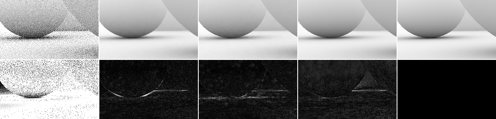
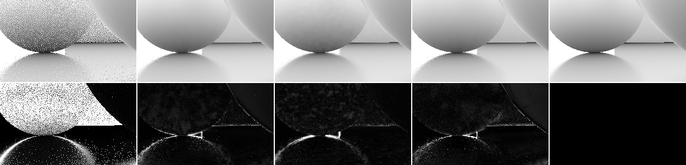

# M5 results: occlusion (AO / SO from the normalized hit distance)

_2026-10-25, occlusion agent (implementer, RULES.md rule 8: no NRD code, README or port read).
Measured on our own test bed. **Provisional**: SPEC v0.1 §8 is an outline Dennis has not
reviewed, and the defaults below were tuned on the scene they are scored on (SPEC §12 item 5)._

## Headline

**1080p, 7 stress paths, live test bed, all filters in the same page** (mean over paths of the
pooled PSNR on ĥ ∈ [0, 1]; "contact" = pixels whose reference ĥ < 0.5):

| | AO PSNR | AO contact | AO FLIP | SO PSNR | SO contact | SO FLIP | GPU ms 1080p AO / SO (fast clock) | B/px AO / AO + SO |
|---|---|---|---|---|---|---|---|---|
| noisy 1 spp | 14.55 | 9.65 | 0.119 | 17.65 | 14.72 | 0.078 | | |
| accumulate-32 (no spatial filter) | 27.25 | 22.55 | 0.034 | 26.48 | 24.23 | 0.048 | | |
| **recurrent** occlusion-only mode | 38.02 | 31.09 | 0.020 | 37.37 | 33.47 | 0.022 | 1.32 / 1.32 | **57.5 / 73.5** |
| **SVGF** on ĥ | 38.93 | 33.53 | **0.019** | 38.76 | 35.66 | 0.020 | 1.37 / 1.92 | 84 / 148 |
| **A-SVGF `auto`** on ĥ | **39.05** | **34.14** | 0.020 | **39.52** | **36.37** | 0.020 | 2.16 / 2.53 | 92 / 163 |
| recurrent **radiance** output alpha ("free") | 35.15 | 27.64 | 0.039 | 35.47 | 32.10 | 0.028 | 0 extra | 0 extra |

**Which filter wins on occlusion: SVGF.** Tuned for the scalar (σ_l 1.5, 3 à-trous iterations,
SO α_min 0.3) it beats the recurrent occlusion mode on **every path for both signals** (AO
+0.91 dB, SO +1.39 dB mean; contact +2.4 / +2.2 dB) at about the same cost for AO and +0.6 ms for
SO; A-SVGF `auto` adds +0.12 / +0.76 dB for ~+0.8 ms. Even with the radiance defaults (σ_l 4,
5 iterations) SVGF AO (38.44) is above recurrent; SO (36.96) is then below it. The recurrent
mode's case is memory (57.5 B/px for AO vs 84) and the lowest flicker on static views (`light`
AO 0.0005 vs 0.0015). This mirrors M2/M3 (radiance): the recurrent blur's fixed-tolerance weights
lose to SVGF's variance-guided luminance weight; the gap is the same at 960×540 (AO −1.0 dB,
SO −1.6 dB vs tuned SVGF) and no recurrent knob moved it (§4).

**"Occlusion nearly free on top of the radiance filter" (PLAN §1) holds for cost only.** The
recurrent radiance denoiser's alpha (the denoised ĥ, SPEC O-1) is 2.9 dB (AO) / 1.9 dB (SO) below
the dedicated recurrent occlusion mode on the same rays, 3.9 / 4.1 dB below A-SVGF, with twice
the AO FLIP (0.039 vs 0.020) and a dark bias (−0.008). Reasons, from the fast-preset sweeps (§4):
no ĥ clamp in the radiance history fix (worth 0.85 dB in the occlusion mode), radii tuned for
radiance (AO wants 20 px, not 45; min 2 px), and a history length shortened by luminance-driven
anti-lag. Making the alpha as good would change the radiance output (ĥ steers the radiance blur's
radius and hit-distance weight), so it stays a cheap preview; a renderer that wants good AO runs
an `OcclusionDenoiser` on the same hit distances (≈ 1.3–1.5 ms at 1080p).

## 1. Setup

| | |
|---|---|
| GPU / browser | Apple M5 Pro, Chrome 155 headless (`--use-angle=metal`), WebGPU timestamps |
| Test bed | `examples/realtime-denoiser`, 1920×1080, 96 frames per path, blue-noise sampling, 256-spp references, FLIP every 12th frame at 41.4 ppd (as M1–M4) |
| Signals | `ao` / `so` = ĥ = h / (h + 1 + 0.05·d) of the existing 1-spp diffuse (cosine) / specular (GGX VNDF) ray, d = −viewZ, miss → 1 (SPEC F-3; scene.ts `OCC_WGSL`) |
| References | `ref_ao` / `ref_so`: 256 stratified samples of the same direction distributions, **each sample's hit distance normalized, then averaged** (the curve is nonlinear; normalizing the mean hit distance would be biased) |
| Metrics | pooled PSNR (PSNR of the mean MSE over frames and pixels) on ĥ clamped to [0, 1]; region **contact** = reference ĥ < 0.5 (scorer region 1, `contact` in the JSON); disoccluded = < 8 frames of ground-truth history; flicker = fixed-pixel |Δ error|; bias = mean signed error |
| Denoiser code | `packages/denoiser-realtime` at 4915d9a (frozen `git archive` copy via `RT_REALTIME_SRC`), registry entries in `tools/rt-capture/src/occlusion-entries.ts`. A-SVGF `auto` here is the committed **anti-lag v1**; the SVGF agent's v2 (uncommitted at the time, README "A-SVGF anti-lag") will change those rows |
| Arms | `occlusion-recurrent`, `occlusion-svgf`, `occlusion-svgf-auto` (OcclusionDenoiser defaults), `occlusion-radiance-alpha` (recurrent `DiffuseDenoiser` / `SpecularDenoiser` on radiance + hit distance, package defaults, alpha copied out), `occlusion-accumulate-32` (ĥ through the accumulate-32 baseline). Live, one instance per signal |
| Costs | test-bed `mode=bench`, 1080p, `orbit`, 200 frames after 20 warm-up, one (signal, filter) per page, two rounds in opposite order, no other agent's runner alive during a page (checked per page; `data/m5-bench-1080p.jsonl`). The M5 Pro runs in two clock states (LESSONS): the fast-clock minimum is the comparable number, medians in §5 |
| Port | 5310 (5300, the brief's, is held by an unrelated project's Vite server) |

Commands (from `examples/realtime-denoiser`):

```sh
git archive 4915d9a packages/denoiser-realtime/src packages/denoiser-core/src | tar -x -C <snap>
RT_REALTIME_SRC=<snap>/packages/denoiser-realtime/src node ../../node_modules/vite/bin/vite.js . --port 5310 --strictPort --host 127.0.0.1
BASE=http://127.0.0.1:5310/ node run-headless.mjs --all-paths --json=m5.json \
  "signal=ao,so&mode=eval&preset=full&denoiser=occlusion-recurrent,occlusion-svgf,occlusion-svgf-auto,occlusion-radiance-alpha,occlusion-accumulate-32"
BASE=http://127.0.0.1:5310/ node run-headless.mjs "signal=ao&mode=bench&preset=full&path=orbit&n=200&denoiser=occlusion-recurrent"
```

Raw data: [data/m5-live-1080p.json](data/m5-live-1080p.json) (per-frame PSNR included),
[data/m5-bench-1080p.jsonl](data/m5-bench-1080p.jsonl).

## 2. Live test bed, 1080p, all paths (same page)

Bold = best denoised PSNR on the path.


### AO

| path | filter | PSNR pooled | contact | disocc. | FLIP | flicker | bias |
|---|---|---|---|---|---|---|---|
| orbit | noisy 1 spp | 15.38 | 9.42 | | 0.099 | 0.1157 | |
| orbit | recurrent | 38.59 | 29.14 | 33.32 | 0.017 | 0.0045 | 0.0011 |
| orbit | SVGF | **39.64** | 32.63 | 35.32 | 0.017 | 0.0046 | -0.0007 |
| orbit | A-SVGF auto | 39.59 | 32.53 | 35.30 | 0.019 | 0.0041 | -0.0020 |
| orbit | radiance alpha (recurrent) | 34.90 | 24.94 | 31.10 | 0.039 | 0.0045 | -0.0085 |
| orbit | accumulate-32 | 26.28 | 21.24 | 18.68 | 0.034 | 0.0203 | -0.0049 |
| pan | noisy 1 spp | 14.61 | 9.76 | | 0.104 | 0.1481 | |
| pan | recurrent | 38.53 | 31.36 | 36.46 | 0.018 | 0.0080 | 0.0000 |
| pan | SVGF | **39.56** | 34.72 | 37.71 | 0.018 | 0.0077 | -0.0011 |
| pan | A-SVGF auto | 39.43 | 34.80 | 37.73 | 0.020 | 0.0075 | -0.0023 |
| pan | radiance alpha (recurrent) | 35.77 | 27.71 | 34.69 | 0.034 | 0.0090 | -0.0066 |
| pan | accumulate-32 | 24.18 | 21.04 | 19.55 | 0.040 | 0.0367 | -0.0037 |
| light | noisy 1 spp | 15.62 | 9.38 | | 0.094 | 0.1062 | |
| light | recurrent | 39.53 | 32.28 | – | 0.015 | 0.0005 | 0.0013 |
| light | SVGF | 40.05 | 33.67 | – | 0.014 | 0.0015 | -0.0004 |
| light | A-SVGF auto | **40.18** | 34.16 | – | 0.015 | 0.0008 | -0.0016 |
| light | radiance alpha (recurrent) | 36.10 | 27.46 | – | 0.037 | 0.0004 | -0.0083 |
| light | accumulate-32 | 30.33 | 24.49 | – | 0.024 | 0.0050 | -0.0032 |
| thin | noisy 1 spp | 14.41 | 9.98 | | 0.126 | 0.1458 | |
| thin | recurrent | 35.15 | 31.33 | 36.82 | 0.025 | 0.0076 | 0.0020 |
| thin | SVGF | 35.58 | 33.78 | 38.17 | 0.024 | 0.0074 | -0.0005 |
| thin | A-SVGF auto | **35.61** | 33.83 | 38.18 | 0.025 | 0.0068 | -0.0021 |
| thin | radiance alpha (recurrent) | 33.72 | 27.66 | 34.77 | 0.041 | 0.0070 | -0.0072 |
| thin | accumulate-32 | 27.49 | 22.07 | 20.34 | 0.037 | 0.0235 | -0.0038 |
| glossy | noisy 1 spp | 12.80 | 10.08 | | 0.171 | 0.2060 | |
| glossy | recurrent | 40.89 | 36.51 | 35.25 | 0.023 | 0.0039 | 0.0010 |
| glossy | SVGF | 41.63 | 37.50 | 36.35 | 0.020 | 0.0043 | -0.0009 |
| glossy | A-SVGF auto | **41.87** | 38.22 | 36.01 | 0.021 | 0.0031 | -0.0026 |
| glossy | radiance alpha (recurrent) | 36.92 | 35.22 | 32.81 | 0.041 | 0.0026 | -0.0098 |
| glossy | accumulate-32 | 29.36 | 27.02 | 19.05 | 0.034 | 0.0179 | -0.0054 |
| cut | noisy 1 spp | 14.75 | 9.60 | | 0.113 | 0.1378 | |
| cut | recurrent | 38.80 | 29.46 | 33.75 | 0.018 | 0.0050 | 0.0011 |
| cut | SVGF | **40.16** | 33.26 | 35.98 | 0.017 | 0.0049 | -0.0008 |
| cut | A-SVGF auto | 40.09 | 33.28 | 35.96 | 0.019 | 0.0044 | -0.0021 |
| cut | radiance alpha (recurrent) | 35.81 | 25.56 | 31.23 | 0.035 | 0.0047 | -0.0062 |
| cut | accumulate-32 | 26.00 | 21.10 | 19.03 | 0.032 | 0.0243 | -0.0039 |
| object | noisy 1 spp | 14.25 | 9.35 | | 0.123 | 0.1425 | |
| object | recurrent | 34.63 | 27.58 | 28.80 | 0.027 | 0.0016 | 0.0014 |
| object | SVGF | 35.87 | 29.19 | 29.81 | 0.023 | 0.0026 | -0.0006 |
| object | A-SVGF auto | **36.57** | 32.15 | 32.69 | 0.024 | 0.0017 | -0.0019 |
| object | radiance alpha (recurrent) | 32.80 | 24.96 | 27.49 | 0.045 | 0.0016 | -0.0077 |
| object | accumulate-32 | 27.10 | 20.86 | 16.87 | 0.041 | 0.0089 | -0.0048 |

### SO

| path | filter | PSNR pooled | contact | disocc. | FLIP | flicker | bias |
|---|---|---|---|---|---|---|---|
| orbit | noisy 1 spp | 18.95 | 15.27 | | 0.059 | 0.0588 | |
| orbit | recurrent | 38.30 | 33.14 | 34.40 | 0.019 | 0.0031 | 0.0001 |
| orbit | SVGF | 40.42 | 35.94 | 37.51 | 0.016 | 0.0032 | -0.0008 |
| orbit | A-SVGF auto | **40.67** | 36.04 | 37.66 | 0.016 | 0.0032 | -0.0008 |
| orbit | radiance alpha (recurrent) | 35.53 | 31.70 | 33.75 | 0.026 | 0.0040 | -0.0008 |
| orbit | accumulate-32 | 25.87 | 23.24 | 21.10 | 0.046 | 0.0141 | -0.0041 |
| pan | noisy 1 spp | 18.12 | 15.06 | | 0.062 | 0.0812 | |
| pan | recurrent | 34.01 | 32.38 | 35.64 | 0.026 | 0.0094 | -0.0003 |
| pan | SVGF | 35.86 | 33.81 | 38.14 | 0.022 | 0.0079 | -0.0005 |
| pan | A-SVGF auto | **37.21** | 35.11 | 39.06 | 0.021 | 0.0071 | -0.0005 |
| pan | radiance alpha (recurrent) | 33.01 | 30.43 | 35.17 | 0.028 | 0.0103 | -0.0018 |
| pan | accumulate-32 | 22.39 | 20.14 | 24.30 | 0.065 | 0.0362 | -0.0027 |
| light | noisy 1 spp | 19.33 | 15.20 | | 0.055 | 0.0513 | |
| light | recurrent | 42.43 | 36.68 | – | 0.013 | 0.0005 | 0.0008 |
| light | SVGF | **43.92** | 38.31 | – | 0.012 | 0.0016 | -0.0002 |
| light | A-SVGF auto | 43.88 | 38.24 | – | 0.012 | 0.0016 | -0.0002 |
| light | radiance alpha (recurrent) | 39.19 | 33.95 | – | 0.020 | 0.0008 | 0.0004 |
| light | accumulate-32 | 33.94 | 29.94 | – | 0.017 | 0.0024 | -0.0019 |
| thin | noisy 1 spp | 15.98 | 13.47 | | 0.100 | 0.1163 | |
| thin | recurrent | 36.71 | 32.16 | 35.64 | 0.026 | 0.0053 | 0.0020 |
| thin | SVGF | 38.07 | 35.28 | 39.07 | 0.023 | 0.0058 | -0.0002 |
| thin | A-SVGF auto | **38.31** | 35.42 | 39.24 | 0.023 | 0.0059 | -0.0002 |
| thin | radiance alpha (recurrent) | 33.99 | 30.26 | 35.30 | 0.032 | 0.0064 | -0.0009 |
| thin | accumulate-32 | 26.12 | 22.49 | 24.80 | 0.050 | 0.0177 | -0.0016 |
| glossy | noisy 1 spp | 15.36 | 13.85 | | 0.123 | 0.1294 | |
| glossy | recurrent | 38.23 | 36.09 | 35.04 | 0.030 | 0.0034 | -0.0012 |
| glossy | SVGF | 38.29 | 38.97 | 38.03 | 0.029 | 0.0045 | -0.0014 |
| glossy | A-SVGF auto | **38.87** | 39.00 | 38.10 | 0.028 | 0.0046 | -0.0016 |
| glossy | radiance alpha (recurrent) | 37.02 | 35.39 | 34.75 | 0.034 | 0.0038 | -0.0024 |
| glossy | accumulate-32 | 24.34 | 26.60 | 22.94 | 0.071 | 0.0121 | -0.0079 |
| cut | noisy 1 spp | 19.39 | 15.88 | | 0.055 | 0.0582 | |
| cut | recurrent | 36.93 | 32.80 | 34.29 | 0.019 | 0.0037 | -0.0002 |
| cut | SVGF | 38.59 | 35.10 | 36.49 | 0.017 | 0.0036 | -0.0012 |
| cut | A-SVGF auto | **39.29** | 35.41 | 36.90 | 0.017 | 0.0036 | -0.0011 |
| cut | radiance alpha (recurrent) | 35.78 | 32.14 | 33.66 | 0.024 | 0.0042 | -0.0010 |
| cut | accumulate-32 | 24.98 | 22.71 | 22.00 | 0.046 | 0.0154 | -0.0052 |
| object | noisy 1 spp | 16.44 | 14.28 | | 0.095 | 0.0992 | |
| object | recurrent | 34.98 | 31.06 | 29.78 | 0.024 | 0.0022 | 0.0005 |
| object | SVGF | 36.18 | 32.19 | 28.21 | 0.022 | 0.0035 | -0.0005 |
| object | A-SVGF auto | **38.41** | 35.35 | 32.50 | 0.021 | 0.0034 | -0.0005 |
| object | radiance alpha (recurrent) | 33.76 | 30.86 | 29.96 | 0.034 | 0.0028 | 0.0009 |
| object | accumulate-32 | 27.74 | 24.53 | 20.94 | 0.037 | 0.0066 | -0.0041 |

### SO by roughness

Pooled PSNR per roughness bin, mean over the 7 paths:

| filter | r < 0.15 | 0.15–0.35 | 0.35–0.6 | ≥ 0.6 |
|---|---|---|---|---|
| recurrent | 38.65 | 38.74 | 36.43 | 38.43 |
| SVGF | 40.56 | 38.41 | 38.58 | 41.00 |
| A-SVGF auto | 41.53 | 39.33 | 39.06 | 41.10 |
| radiance alpha (recurrent) | 39.68 | 36.15 | 33.68 | 36.68 |
| accumulate-32 | 30.10 | 26.52 | 26.35 | 25.65 |

The recurrent occlusion mode is weakest at mid roughness (0.35–0.6: −2.2 dB vs SVGF), where the
specular ray's hit distance mixes near hits and misses. The radiance alpha is best of the
recurrent pair only on near-mirrors (r < 0.15), where the occlusion mode's ĥ clamp costs a little.

## 3. Crops

`glossy`, frame 40, 1080p, 248×150 px at (524, 486): the small sphere's contact on the floor.
Columns: noisy 1 spp | recurrent | SVGF | recurrent radiance alpha | reference; second row
|output − reference| × 8. Display: ĥ with gamma 1/2.2 (the view panels'). Made with
`occlusion-crops.mjs` from an eval with `&dump=40&dumpRect=524,486,248,150`.

AO: 

SO: 

AO: the recurrent mode's largest error is a bright arc along the sphere's lower silhouette (its
blur leaks floor ĥ across the sphere / floor edge), SVGF's is speckle along the contact line on
the floor; the radiance alpha has a uniform grey residual over the sphere (its −0.008 bias) and a
wedge between the two spheres. SO: on the mid-rough sphere SVGF's residual is low-frequency
blotches and the recurrent mode's finer grain, yet SVGF scores higher; the radiance alpha misses
the big sphere's rim.

## 4. Tuning (960×540 fast preset, 7 paths, `flip=0`; mean pooled PSNR AO / SO)

One page per setting (same frames; results are deterministic), all per-path numbers in
[data/m5-sweeps.json](data/m5-sweeps.json); recurrent tuned on the live package, SVGF on the
pinned snapshot.

**Recurrent occlusion mode** (start: first commit 1dd7e70, AO / SO = 36.57 / 34.57):

| change | AO | SO | kept |
|---|---|---|---|
| no ĥ clamp in history fix (`t.occClamp=0`, A shortening only) | 35.72 | 34.23 | clamp kept (+0.85 / +0.35) |
| no virtual motion for SO | – | 33.47 | virtual motion kept |
| history cap 15 / 63 / 7 (Δ vs 31) | −0.05 / +0.00 / −0.27 | −0.18 / +0.08 / −0.61 | 31 kept |
| SO fast ĥ follows the virtual fetch, weight m | – | 34.60 (`pan` +1.2, `orbit` −1.5) | |
| … weight m·c_v | – | **35.46** (`pan` +2.5, `glossy` +1.6) | **yes** |
| AO blur radius 45 → 30 / 20 / 15 px | 36.77 / **36.80** / 36.80 | – | 20 (contact 27.5 → 28.8) |
| + minimum radius 1 → 2 / 3 px | **36.92** / 36.99 | 35.51 / 35.56 | 2 (3: AO contact −0.24) |
| hit-distance tolerance (`hitTolHi`) 0.5 → 0.25 / 0.15 / 0.1 (Δ) | +0.13 / −0.16 / −0.31 | −0.25 / −0.52 / −0.68 | no |
| anti-lag window γ 0.5 / 2, current-σ 4, fast cap 5, history fix 2 / 6 frames, post-blur 8 taps, stabilization 15 | ±0.1 or worse | ±0.1 or worse | no |
| radius clamp by hit distance × 0.5…100 (`pan` SO) | flat | flat | removed |
| **final defaults (4915d9a)** | **36.92** | **35.51** | |

At 1080p the recurrent mode sits on the same plateau (AO blur 10 / 20 / 40 px: 38.03 / 38.02 /
37.72; SO with 10 / 30 / 40 px: 37.03 / 37.37 / 37.33).

**SVGF on ĥ** (start: radiance defaults σ_l 4, 5 iterations, α_min 0.2: 36.12 / 34.78):

| change | AO | SO |
|---|---|---|
| σ_l 8 / 3 / 2 / 1.5 / 1 | 34.62 / 36.68 / 37.29 / 37.57 / 37.62 | 33.29 / 35.30 / 35.85 / 36.08 / 36.13 |
| 4 iterations; σ_l 2 + 4 / 3 / 2 iterations | 36.98; 37.65 / 37.95 / 37.33 | 34.93; 35.91 / 36.10 / 36.06 |
| σ_l 1.5 + 3 iterations | **37.93** | 36.24 |
| … + α_min 0.15 / 0.3 / 0.4 / 0.5 | 37.95 / 37.40 / – / – | 35.40 / **37.15** / 36.89 / 35.40 |
| **final**: σ_l 1.5, 3 iterations, α_min 0.2 AO / 0.3 SO | **37.93** | **37.15** |
| A-SVGF `auto`, same (α_min 0.1 AO / 0.3 SO) | **38.04** | **37.59** |

At 1080p the radiance defaults give 38.44 / 36.96 (tuned: 38.93 / 38.76). Fewer, tighter
iterations win because ĥ is smooth and bounded: the radiance defaults blur contact detail away.

## 5. Cost and memory

GPU ms at 1080p, test-bed `mode=bench` (`orbit`, 200 frames), fastest clock state (min) and the
median of each of the two runs; one signal per page, so AO and SO each pay the guide prepass.
Joint AO + SO in shared dispatches from a warmed replay of `std1080-orbit` (8 frames × 4 rounds,
min / median): recurrent 2.39 / 3.02, SVGF 2.99 / 3.60, A-SVGF `auto` 5.27 / 5.41 ms
([data/m5-replay-joint-1080p.jsonl](data/m5-replay-joint-1080p.jsonl)).

| | AO min | AO medians | SO min | SO medians | passes (AO, fastest run) |
|---|---|---|---|---|---|
| recurrent | **1.32** | 1.85 / 1.74 | **1.32** | 2.34 / 1.99 | prepass 0.10, temporal 0.47, mips 0.08, history fix 0.27, blur 0.33, post-blur 0.21, stabilize 0.27 |
| SVGF | 1.37 | 1.99 / 1.54 | 1.92 | 3.02 / 2.38 | prepass 0.16, normalize 0.07, temporal 0.32, variance 0.18, à-trous 3 × 0.25 (SO variance 0.64) |
| A-SVGF `auto` | 2.16 | 2.47 / 2.29 | 2.53 | 2.77 / 2.77 | + gradient passes 0.78 |
| recurrent radiance (the "free" alpha) | 2.02 | 2.24 / 2.59 | 1.97 | 2.59 / 2.71 | the radiance denoiser itself; AO costs nothing extra |

The occlusion-only mode is only ~35 % cheaper than the recurrent radiance diffuse filter
(1.32 vs 2.02 ms), not the "much cheaper" SPEC §8 hoped for: the per-tap geometry loads and
plane tests dominate every pass, and only the pre-blur disappears. Levers not tried: bilinear
instead of the 16-load Catmull-Rom history (temporal 0.47 ms), 4-tap blur.

Internal memory (B/px; inputs are the caller's):

| | AO | AO + SO | breakdown |
|---|---|---|---|
| recurrent | **57.5** | **73.5** | 4 × r32float rotation buffers per signal (16), fast history rgba16float ×2 (16), `data` r32uint ×2 (8), geometry rg32uint ×2 (16), depth mip atlas (1.5) |
| SVGF | 84 | 148 | per signal: accum rgba16float ×2, moments rg32float ×2, à-trous ×2, output (56) + normalized ĥ rgba16float (8); geometry ×2 + depth slope (20) |
| A-SVGF `auto` | 91.6 | 163.2 | + 7.6 per signal (gradients at 1/9 resolution) |
| radiance alpha | 0 | 0 | inside the radiance filter's 73.5 / 105.5 |

SPEC O-2 estimated ≈ 62 B/px for both signals in one rgba16float pool; core WebGPU has no
r16float / rg16float storage, so we use one r32float per signal (same 8 B per pixel for both
signals, half for AO alone).

## 6. What was built

- `OcclusionDenoiser` (`packages/denoiser-realtime/src/occlusion.ts`), `TemporalDenoiser<{
  hitDistance }>`: `filter: 'recurrent'` (default, SPEC O-2) | `'svgf'`, `signal: 'diffuse' |
  'specular' | 'both'` (`dispatchBoth`), `hitDistanceScale` / `hitDistanceViewScale` (F-3 curve),
  every recurrent / SVGF option. `HitDistanceNormalizer` (the normalization pass alone).
- Recurrent occlusion-only mode: signal kinds `ao` / `so` in `src/shaders/recurrent.ts` (value
  type / load / store per kind; radiance kinds emit exactly the code they did: generated WGSL
  diffed over 6 configurations, only a padding field renamed; a 48-frame `cut` eval of
  `recurrent` and `recurrent-svgfspec` gave identical per-frame PSNR / flicker for both signals).
- Test bed: signals `ao` / `so` (noisy + per-sample references, `contact` region), `&dump=` crops,
  `occlusion-crops.mjs`. Registry (`tools/rt-capture/src/occlusion-entries.ts`):
  `occlusion-recurrent`, `occlusion-svgf`, `occlusion-svgf-auto`, `occlusion-radiance-alpha`,
  `occlusion-accumulate-32`, `occlusion-noisy`. Replay derives `ao` / `so` from `*_hitt` (no new
  capture buffer; CAPTURE-FORMAT unchanged); a replay of `std1080-orbit` with `signals=ao,so` ran
  clean.

## 7. Deviations from SPEC v0.1 §8 and open items

Listed for the spec author in TASKS ("Found along the way"). In short: r32float per signal
instead of the packed rgba16float pool; no pre-blur pass; slow ĥ clamped into the fast window;
SO fast ĥ follows the virtual fetch; AO radius 20 px / min 2 px; O-3 (b = 0, `aoRadius`) not
adopted (the F-3 curve with b = 0.05 is the default, `hitDistanceViewScale: 0` gives O-3);
SVGF added as a second occlusion filter, and it wins.

Open: the default filter (`'recurrent'` per SPEC, `'svgf'` measured better: Questions for
Dennis); native comparison (`REBLUR_DIFFUSE_SPECULAR_OCCLUSION`) needs native's normalization
curve for the references (probe P3 in TASKS); the AO look (SPEC §12 item 9: the rational curve
with a = 1 makes AO soft and mostly white on this scene); O-4 (SO from AO) not built.
