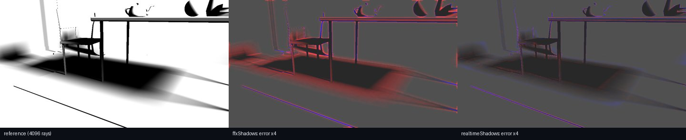

# M6 groundwork: first real-scene numbers (three.js scene, static camera)

_2026-10-25, m6 agent (implementer, RULES.md rule 8: no NRD code, README or port read).
**Provisional / experimental**: the defaults are the classes' own (Dennis decides them, SPEC §12
item 1); nothing here was tuned on this scene. denoiser-realtime served from a `git archive`
snapshot of 19340b3 (later changes up to dda6596 are comment-only)._

This is the first data point outside the analytic test bed (PLAN §9: "add at least one real
scene before drawing conclusions"). The scene is the furnished corner of
`examples/three-temporal/shadows.html` (three r186 WebGPU raster, 20,862 triangles, one
1.62 × 1.2 m area light), traced at 1 ray per pixel with three-mesh-bvh's WebGPU BVH, and
denoised through the new `denoiser/three` nodes.

Pages: `examples/three-temporal/realtime-shadows.html` (ours vs FFX shadows) and
`realtime-gi.html` (diffuse + specular + AO). Runner: `examples/three-temporal/run-realtime.mjs`
(`shadows --metrics`, `gi --metrics`, `bench`). Raw numbers: `data/M6-real-scene.json`.

## How the reference is made

Static camera only. Each page accumulates many independent samples per pixel while the camera
holds still (float32 running mean), then resets the denoisers and runs 64 frames on the same
view; PSNR (pooled MSE) and FLIP are taken against that reference at frames 1, 2, 4, 8, 16, 32
and 64 after the reset. FLIP uses the test bed's viewing condition (image spans 46.4°:
20.7 ppd at 960 px, 41.4 at 1920).

- Shadows: 16 stratified white-noise rays/pixel/frame × 256 frames = **4096 rays/pixel** (the
  1-ray signal uses blue noise by default, `&sampler=white` the PCG white noise of shadows.html).
  Penumbra = pixels with 0.02 < reference < 0.98 (13 % of the wide shot, 21 % of the close-up).
- GI page: diffuse = 4 white-noise cosine rays/pixel/frame × 512 frames = 2048 rays (AO from the
  same rays, normalized per sample with `OcclusionDenoiser`'s default curve h/(h + 1 + 0.05·depth),
  miss = 1); specular = three's stochastic SSR accumulated over 512 frames, i.e. the reference is
  SSR's own expectation (SSR's misses and biases are shared by every denoiser here).

Run-to-run noise is ±0.1 dB (the blue-noise frame index differs between page sessions).

## Shadows: ours (`ShadowDenoiser`) vs FFX, static camera

PSNR on visibility (all receivers / penumbra), frame 64 after a reset, plus FLIP:

| view | res | sampler | noisy | FFX | **ours** | FLIP noisy / FFX / **ours** |
|---|---|---|---|---|---|---|
| wide (shot 0) | 960×540 | blue | 16.56 / 7.78 | 28.46 / 22.22 | **31.67 / 27.42** | 0.094 / 0.044 / **0.024** |
| close-up (shot 1) | 960×540 | blue | 14.42 / 7.68 | 26.22 / 23.26 | **31.65 / 29.29** | 0.152 / 0.063 / **0.031** |
| wide | 960×540 | white | 16.60 / 7.82 | 28.41 / 22.16 | **30.49 / 24.71** | 0.095 / 0.044 / **0.032** |
| close-up | 960×540 | white | 14.44 / 7.70 | 26.19 / 23.19 | **30.11 / 25.92** | 0.153 / 0.064 / **0.045** |
| wide | 1920×1080 | blue | 16.56 / 7.79 | 30.20 / 23.87 | **33.37 / 28.85** | 0.048 / 0.034 / **0.017** |
| close-up | 1920×1080 | blue | 14.41 / 7.67 | 29.97 / 24.32 | **33.15 / 30.29** | 0.073 / 0.049 / **0.023** |

Convergence after a reset (960×540, blue noise; all receivers / penumbra):

| frame | FFX wide | ours wide | FFX close | ours close |
|---|---|---|---|---|
| 1 | 29.37 / 23.22 | **30.93 / 24.76** | 27.77 / 24.37 | **30.32 / 26.42** |
| 2 | **30.23** / 23.14 | 29.78 / **23.64** | 28.21 / 23.95 | **29.14 / 24.41** |
| 4 | 30.13 / 23.06 | **30.37 / 24.80** | 28.20 / 23.97 | **30.17 / 26.19** |
| 8 | 30.27 / 23.63 | **30.85 / 25.78** | 28.22 / 24.37 | **30.79 / 27.32** |
| 16 | 28.82 / 22.84 | **31.36 / 26.67** | 27.02 / 23.86 | **31.31 / 28.35** |
| 64 | 28.46 / 22.22 | **31.67 / 27.42** | 26.22 / 23.26 | **31.65 / 29.29** |

Reading:

- **Ours is ahead on every view, resolution and sampler at frame 64**: +2.1 … +5.4 dB overall
  (+3.2 … +5.4 with blue noise), +5.0 … +6.0 dB in penumbrae with blue noise, FLIP roughly halved. That is the same ranking as
  the test bed (M4: +4.9 … +8.9 dB pooled), with a smaller margin.
- **FFX gets worse as its history grows** (wide 30.27 → 28.46 dB from frame 8 to 64): a dark,
  widening bias in every penumbra (error images below). Ours keeps improving to frame 64.
- **Frame 2 dips below frame 1 for ours** in every configuration (−0.8 … −1.3 dB overall, −1.0 …
  −2.2 dB penumbra), and FFX is ahead overall at frame 2 on the wide shot. The first frame (A = 0,
  spatial-only with the young-history mean) is better than the second (first temporal blend).
  The test bed's reset windows showed ours behind FFX for frames 0–2 (M4 §10); this is the same
  weak spot, seen on a real scene. Filed in TASKS (owner denoiser-realtime).
- **Blue noise matters for ours, not for FFX**: white noise costs ours 1.2 / 2.7 dB (wide /
  penumbra) and 1.5 / 3.4 dB (close), FFX ≤ 0.1 dB. Expected (ours' clamp relies on blue-noise
  light samples, SH-7), but it means our margin depends on the renderer contract: with white noise
  it is +2.1 … +3.9 dB.
- The absolute PSNR (31–33 dB) is lower than the test bed's 37 dB: errors concentrate at thin
  geometry (chair and table legs, the lamp pole, the rug's 1 cm edge, where both denoisers leave
  a lit/shadow fringe) and in the outer, low-contrast half of the big penumbrae.

_Close-up, 64 frames after a reset, signed error ×4 (red = darker than the reference, blue =
brighter). FFX: dark band through every penumbra; ours: mostly neutral, a faint bright haze at the
outer penumbra edge and fringes at thin geometry._

## GI page: `DiffuseSpecularDenoiser`, `OcclusionDenoiser`, vs FFX reflections (960×540, static)

Signals: diffuse = 1 cosine-weighted ray (a miss sees the environment, a hit returns the area light
bounced off a grey 0.5 surface without a secondary shadow ray), demodulated; specular = three's
stochastic SSR (ray length in .a), not demodulated; AO = the diffuse ray's hit distance. Every class
with its defaults (SVGF for diffuse/specular, recurrent for occlusion, antiLag off). Diffuse and
specular PSNR on tonemapped x/(1+x) rgb, AO on ĥ:

| | frame | diffuse noisy / **ours** | specular noisy / FFX / **ours** | AO noisy / **ours** |
|---|---|---|---|---|
| wide | 1 | 16.90 / 37.56 | 34.36 / 39.82 / **43.33** | 12.50 / 29.44 |
| wide | 8 | 16.93 / 41.43 | 34.58 / 43.13 / **49.48** | 12.50 / 33.99 |
| wide | 64 | 16.91 / **41.65** | 34.51 / 44.08 / **50.05** | 12.50 / **35.83** |
| close-up | 64 | 17.51 / **41.73** | 38.91 / 47.75 / **55.23** | 12.09 / **34.08** |

FLIP at frame 64 (wide / close-up): diffuse noisy 0.444 / 0.437, ours **0.036 / 0.036**; specular
noisy 0.144 / 0.083, FFX 0.039 / 0.039, ours **0.029 / 0.020**; AO noisy 0.421 / 0.449, ours
**0.028 / 0.031**.

Reading: no diffuse or AO baseline exists in `denoiser/ffx`, so those rows show the size of the
cleanup only. On specular ours (SVGF) beats FFX reflections by 6–7.5 dB PSNR; part of that is FFX's
known energy loss on HDR input (test bed: ~28 % on demodulated specular, LESSONS) and SSR's
mostly dim specular on this scene (high absolute PSNR); FLIP (−25 … −50 %) is the more telling
number. The `ao` rows of an earlier run were stale (the AO node was not in the render graph during
the measurement; fixed, see LESSONS).

## Cost on the real scene (Apple M5 Pro, Chrome, per-denoiser GPU timestamps)

Two caveats dominate: (1) the realtime-shadows page is light (raster + 1 ray), so the GPU sits in
its slow clock state and every pass reads 2–3× the test bed's ms; (2) per-page medians move
×1.3–1.8 run to run (LESSONS, two clock states). The most comparable numbers:

| | 960×540 | 1920×1080 | notes |
|---|---|---|---|
| shadows, **split view** (FFX and ours in the same frames, same clock) | FFX 0.58–0.79, **ours 0.44–0.58** | FFX 1.85–1.91, ours 1.84–1.85 | medians of 60 frames, 5 / 2 page loads (ours lower in each) |
| shadows, solo page per denoiser, fastest frame of 4 runs | FFX 0.34, ours 0.35 | FFX 0.82, ours 0.97 | per-page medians: FFX 0.81–0.90 / 1.27–2.75, ours 0.82–0.87 / 1.49–2.64 |
| ours shadows on the GI page (GPU kept busy by SSR + the joint denoiser) | 0.57 | **0.59** (temporal 0.37) | matches the test bed's 0.55 / 0.37 measured in the same session |
| test bed (same session, `signal=shadows&mode=bench`, 1080p) | | FFX 1.01, ours 0.55–0.71 | M4: FFX 0.50–0.61, ours 0.48–0.59 |
| `DiffuseSpecularDenoiser` (joint SVGF, defaults), solo | 2.90–2.97 | 3.90–3.94 | 1080p README: 3.98 (dev page) |
| `OcclusionDenoiser` (recurrent AO), solo | 0.95–1.04 | 2.88–3.03 | M5: 1.32 at 1080p (fast clock) |
| FFX reflections on the same SSR, solo | 1.30–1.34 | 3.65–4.12 | |

So: on this scene ours and FFX shadows cost about the same (ours a little cheaper in the
same-clock split view at 960, level at 1080, ~15 % more at the fastest solo frame at 1080). The
1080p shadows target (≤ 0.6 ms) holds when the GPU is busy (0.59 ms on the GI page). Passing a
linear view z guide instead of hardware depth (`&viewz=1`) did not change the cost; neither did
`youngMean: 0`, `catmullRom: false`, `noiseBlend: 0` or `normalWeight: false` (all within the
run-to-run spread).

## What is not measured yet (and what it would take)

- **Moving camera / moving objects.** The reference needs a converged frame per camera pose. Cheap
  path: a deterministic camera path, render each pose's 4096-ray reference once (static camera
  per pose, ~4 s each at 960×540), store them, then replay the path with the denoisers (the test
  bed's capture/replay does exactly this for its own scene; a `mode=capture` for this page would
  reuse `tools/rt-capture`'s writer). Filed in TASKS.
- **Recurrent / A-SVGF variants on the real scene** (only class defaults ran). The pages take the
  options (`realtimeDiffuseSpecular(..., { denoiser: {...} })`; shadows page `&sh.<option>=`).
- **Directional light** (sun) shadows on a real scene.
- The specular reference is SSR's expectation, not ground truth; a BVH-traced specular signal
  (as `reflections-hybrid.html` traces) would allow a true reference.
