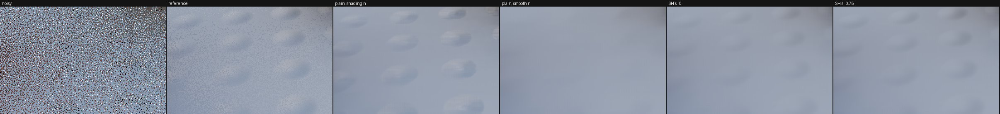
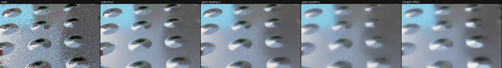
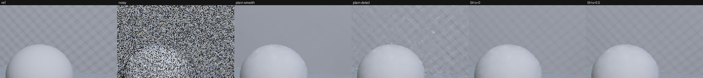
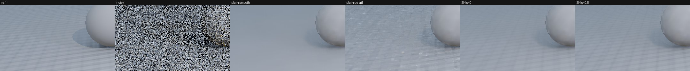

# M7 results: SH directional payload for SVGF (SPEC v0.3 §8.5, steps 2–5)

_2026-10-25, m7-sh implementer (RULES.md rule 8: no NRD code, README, release notes or port read).
Measured on the package dev page (exact analytic truth) and the test bed with the CAPTURE-FORMAT v1
signals (testbed-v1: `sh-diffuse`, `sh-specular`, paths `bumpy` / `bounce`). **Provisional**: SPEC
§8.5 is a spec Dennis has not reviewed, every constant is a guess with a tune range, and the test-bed
numbers are tuned and scored on the same scene._

## Headline

- **Gate passes.** On the 7 standard paths (normal_geom = normal) SH resolved at the guide normal matches plain
  SVGF within **0.013–0.038 dB pooled** at equal f16 rounding, never below it; as shipped it is +0.03…+0.10 dB
  above plain because `rgba16float` stores truncate on this GPU (§1). Plain output is bit-identical when
  `payload` is unset.
- **Diffuse on `bumpy`: SH wins on PSNR**: 38.26 dB (`'auto'`, sharpening 0.75) vs 37.40 for the best plain
  variant (+0.86; bump region +2.1, detail-band PSNR +3.3, lowest flicker), **but it keeps only 25–50 % of the
  bump contrast** and loses on FLIP to plain with the shading normal (0.0439 vs 0.0405). On `bounce` (coloured
  corridor) plain with the shading normal stays ahead by 0.04–0.12 dB.
- **Specular SH does not pay** (−2.1 dB vs plain with the shading normal at best; SPEC's SG ratio with λ_l 8:
  −6.9 dB). Experimental; use plain specular with the shading normal on bumpy glossy surfaces.
- **Cost and memory:** diffuse 2.20 → **2.92 ms** (1.33×), diffuse + specular 3.97 → **5.42 ms** (1.37×) at 1080p (dev-page
  bench), inside SPEC's estimate (2.9–3.4 / 5.4–6.4) and its ≤ 1.5× target; **116 B/px** diffuse (108 fused; plain 76),
  **204 B/px** diffuse + specular with the default resolves (plain 132), exactly SPEC's estimate.
- New defaults from these measurements: `shSharpen` 0.75 (SPEC 0), `shLightSharpness` 2 (SPEC 8).

Crops (test bed `v1-bumpy` replay, frame 31, 960×540 at ×2; left to right: noisy, reference, plain with the
shading normal, plain with the smooth normal, SH s = 0, SH s = 0.75):

Specular (noisy, reference, plain with the shading normal, plain with the smooth normal, SH with SPEC's SG
ratio, λ_l 8):

Dev page (25° bumps on the wall and floor; reference, noisy, plain smooth, plain detail, SH s = 0, SH s = 0.5):

## Setup

| | |
|---|---|
| code | `packages/denoiser-realtime` at d35dab8 for every test-bed number (pinned with `RT_REALTIME_SRC`); later commits change cost only (branchless history taps 151c002, `shPingPacking` a812d82), quality identical to 3 decimals on the dev page |
| defaults since | c15936e: `shSharpen` 0.75, `shLightSharpness` 2 (from §4 / §5); 64a1123: SVGF `antiLag` default `'auto'` (Dennis), the `svgf-sh` registry entry pins `'off'` so its rows keep their meaning |
| GPU | Apple M5 Pro, Chrome 155 headless, Metal |
| test bed | 1920×1080 (`preset=full`), 96 frames per path, 256-spp references, blue-noise sampling, live eval (one denoiser instance per signal) |
| metric | pooled PSNR (LESSONS), tonemapped x/(1+x), demodulated; FLIP where noted |
| contenders | `svgf` / `svgf-auto` (plain, `diffuse` / `specular`); `svgf-plain` (plain on the v1 sample, filter normal = shading normal), `svgf-plain-smooth` (filter normal = `normal_geom`); **`svgf-sh`** / **`svgf-sh-auto`** (payload 'sh', filter normal = `normal_geom`, fused resolve at the shading normal), variants `@m7.<option>` |

## What was built

- `payload: 'sh'` on `DiffuseDenoiser` / `SpecularDenoiser` / `DiffuseSpecularDenoiser` (SVGF only):
  separate SH generators for every SVGF pass (`src/shaders/svgf-sh.ts`, `sh-gradient.ts`), so the
  plain passes are untouched (WGSL byte-identical for every plain configuration, checked by dumping all
  variants; dev-page `perFrame` identical). Payload 8 × f16 in one `rgba32uint` per buffer.
- Inputs: raw (`direction` + `radiance`, encoded on load in the temporal and gradient passes around
  `guides.detailNormal`) or encoded (`sh`). Encoding M7-2 (`'normal-exact'`), with CAPTURE-FORMAT v1's
  β = 2 for c < 0; `'textbook'` as the tune alternative.
- Weights from the payload's 709 luminance at the filter normal (specular: at the guide normal's
  dominant direction), one weight for all six channels; anti-lag v2 through an SH gradient-create pass.
- Output: resolve-ready payload (M7-8: guard, chroma ratio, Y_g) or the fused resolve (M7-9 diffuse with
  sharpening; M7-10 specular ratio, `'sg'` per SPEC or `'l1'`, roughness fade). Per-signal default:
  diffuse 'none', specular 'fused'.
- `ShResolver` (compute pass), `SH_RESOLVE_WGSL` (`shUnpack`, `shResolveDiffuse`, `shResolveSpecular`),
  three.js `realtimeDiffuse` / `realtimeSpecular` SH mode (`direction`, `detailNormal`, fused by default).
- Registry `svgf-sh`, `svgf-sh-auto` (`m7.*` settings), test-only `m7.truncate=1`.
- Tune options: `shGuard`, `shSharpen`, `shEncoding`, `shSpecularRatio`, `shLightSharpness`,
  `shMaxRatio`, `shFadeRoughness`, `shPingPacking: 'u8'` (64-bit à-trous ping-pong).

## 1. Gate: the 7-path regression (SPEC M7-13) — passes

On the 7 standard paths `normal_geom` = `normal`, so SH resolved at the shading normal is the payload at
the guide normal, which SPEC M7-2 / M7-5 make equal to the plain filter in expectation. Pooled PSNR per
path; `svgf` / `svgf-auto` on `diffuse` / `specular`, the SH entries on `sh-diffuse` / `sh-specular`
(the same samples and references) in the same page; "trunc" = `m7.truncate=1` (the SH payload packed
with the plain buffers' rounding, see below).

| diffuse | svgf | svgf-sh | Δ | svgf-sh@m7.truncate=1 | Δ |
|---|---|---|---|---|---|
| orbit | 40.648 | 40.823 | +0.174 | 40.672 | +0.024 |
| pan | 39.450 | 39.587 | +0.138 | 39.473 | +0.023 |
| light | 40.570 | 40.729 | +0.159 | 40.589 | +0.019 |
| thin | 34.410 | 34.441 | +0.030 | 34.414 | +0.004 |
| glossy | 39.480 | 39.629 | +0.149 | 39.520 | +0.041 |
| cut | 39.709 | 39.889 | +0.180 | 39.755 | +0.046 |
| object | 37.866 | 37.958 | +0.092 | 37.875 | +0.009 |
| **pooled 7** | 38.311 | 38.414 | 0.103 | 38.329 | 0.018 |

| diffuse | svgf-auto | svgf-sh-auto | Δ | svgf-sh-auto@m7.truncate=1 | Δ |
|---|---|---|---|---|---|
| orbit | 40.974 | 41.120 | +0.146 | 41.002 | +0.027 |
| pan | 39.650 | 39.766 | +0.116 | 39.675 | +0.025 |
| light | 40.935 | 41.050 | +0.115 | 40.954 | +0.019 |
| thin | 34.469 | 34.488 | +0.019 | 34.473 | +0.004 |
| glossy | 39.713 | 39.849 | +0.136 | 39.750 | +0.037 |
| cut | 39.995 | 40.147 | +0.152 | 40.053 | +0.057 |
| object | 38.083 | 38.162 | +0.079 | 38.094 | +0.010 |
| **pooled 7** | 38.500 | 38.583 | 0.083 | 38.520 | 0.019 |

| specular | svgf | svgf-sh | Δ | svgf-sh@m7.truncate=1 | Δ |
|---|---|---|---|---|---|
| orbit | 32.290 | 32.312 | +0.022 | 32.331 | +0.041 |
| pan | 33.912 | 34.045 | +0.133 | 34.027 | +0.115 |
| light | 35.019 | 35.037 | +0.019 | 35.030 | +0.011 |
| thin | 35.408 | 35.476 | +0.068 | 35.426 | +0.019 |
| glossy | 30.647 | 30.687 | +0.041 | 30.669 | +0.023 |
| cut | 32.685 | 32.721 | +0.036 | 32.735 | +0.049 |
| object | 34.240 | 34.255 | +0.016 | 34.247 | +0.007 |
| **pooled 7** | 33.166 | 33.211 | 0.045 | 33.204 | 0.038 |

| specular | svgf-auto | svgf-sh-auto | Δ | svgf-sh-auto@m7.truncate=1 | Δ |
|---|---|---|---|---|---|
| orbit | 33.928 | 33.957 | +0.029 | 33.957 | +0.030 |
| pan | 35.795 | 35.822 | +0.026 | 35.797 | +0.002 |
| light | 35.269 | 35.277 | +0.008 | 35.268 | -0.001 |
| thin | 35.928 | 35.977 | +0.049 | 35.938 | +0.010 |
| glossy | 34.476 | 34.528 | +0.052 | 34.488 | +0.012 |
| cut | 34.807 | 34.845 | +0.038 | 34.842 | +0.035 |
| object | 35.107 | 35.116 | +0.010 | 35.103 | -0.004 |
| **pooled 7** | 34.994 | 35.025 | 0.031 | 35.007 | 0.013 |

**At equal f16 rounding the SH filter matches plain SVGF within 0.013–0.038 dB pooled (7 paths), never
below it** (worst single path: specular `pan` +0.115, `cut` +0.057 for diffuse `auto`; all positive). As
shipped (pack2x16float, round to nearest) SH is **+0.08…+0.10 dB above plain** for diffuse and
+0.03…+0.05 for specular. The gate's "within 0.05 dB" holds for the like-for-like comparison; the
default's larger gap is in SH's favour and has one cause:

**`rgba16float` storage writes truncate on this GPU.** A 64-texel probe (values between two f16 grid
points written with `textureStore` to rgba16float and with `pack2x16float`) showed the storage write
rounding toward zero and `pack2x16float` rounding to nearest. Every plain SVGF buffer write loses ~½ ulp
(2⁻¹¹ relative) on average, and the EMA history compounds it over ~1/α frames: plain SVGF's energy on
`orbit` is −1.21 %, SH's −0.93 %, SH with the truncating pack −1.21 % exactly. Emulating truncation
(`shPackTruncate`, test only) removes the gap on the dev page too (b ≡ 0: +0.13 → −0.02 dB). That is a
free ~0.1 dB for the plain filters (TASKS item), not an SH effect.

Bit-identity of the plain path when `payload` is unset: every plain pass's WGSL (all signal
combinations, kernels, feedback, anti-lag v1/v2 and gradient variants) dumped before and after the
change is byte-identical; the dev page's `perFrame` arrays (both signals, `'off'` and `'auto'`) are
identical to the pre-M7 snapshot.

## 2. `bumpy`: diffuse (SPEC M7-13 contenders)

Test bed `path=bumpy` (normal-mapped floor, domes in a 0.5 m grid with 10–40° tilt along x, rippled
wall, cyan area light; slow orbit), 1080p, 96 frames, signal `sh-diffuse`. Reference (2) = `diffuse_ref`
(rays around the shading normal: total error incl. L1 truncation); reference (1) = `diffuse_sh_ref`
resolved the same way (`vsShRef`, guard 1, sharpening 0: denoising error only); "bump" = pixels with
angle(n, n_geom) > 5°; detail band = `x − G_2px(x)` in the bump mask, its PSNR and energy ratio vs the
reference's band (1 = detail kept, < 1 smoothed, > 1 noise). `svgf-sh` rows here ran with the SPEC
defaults (sharpening 0); the package default is now 0.75 (§4).

| sh-diffuse, `bumpy` | PSNR (ref 2) | bump region | vs SH ref (1) | detail band PSNR | band energy | FLIP | flicker | bias |
|---|---|---|---|---|---|---|---|---|
| noisy | 16.28 | 15.68 | | 16.44 | 67.5 | 0.266 | | |
| accumulate-32 | 29.10 | 28.48 | 29.09 | 29.20 | 3.14 | | 0.0205 | −0.0032 |
| plain SVGF, filter normal = shading (`svgf-plain`) | 37.20 | 34.00 | 37.18 | 35.24 | 0.93 | **0.0405** | 0.0044 | −0.0018 |
| plain SVGF, filter normal = smooth (`svgf-plain-smooth`) | 36.17 | 32.35 | 36.18 | 35.48 | 0.13 | 0.0486 | 0.0046 | −0.0015 |
| **SH**, s = 0 (`svgf-sh`) | 37.62 | 35.05 | 37.67 | 37.86 | 0.25 | 0.0458 | 0.0037 | −0.0024 |
| SH, s = 0.5 | 38.00 | 35.96 | | 38.54 | 0.35 | 0.0439 | 0.0035 | −0.0026 |
| SH, s = 0.75 (new default) | 38.08 | 36.17 | | 38.79 | 0.41 | | 0.0034 | −0.0027 |
| SH, s = 1 | 38.08 | 36.16 | | 38.97 | 0.49 | | 0.0033 | −0.0029 |
| plain shading normal, `'auto'` | 37.40 | 34.23 | 37.38 | 35.47 | 0.81 | | 0.0040 | −0.0014 |
| plain smooth normal, `'auto'` | 36.19 | 32.27 | 36.20 | 35.47 | 0.13 | | 0.0043 | −0.0011 |
| SH `'auto'`, s = 0 / 0.5 / 0.75 / 1 | 37.76 / 38.17 / **38.26** / **38.26** | 35.12 / 36.08 / 36.32 / 36.32 | 37.81 | 37.87 / 38.56 / 38.81 / 38.98 | 0.25 / 0.35 / 0.42 / 0.50 | | 0.0035 → 0.0030 | −0.0017 … −0.0022 |

**SH wins on PSNR**: +0.42 / +1.44 dB over plain with the shading / smooth normal at s = 0, +0.86 dB over
the best plain variant with `'auto'` and s = 0.75 (38.26 vs 37.40); in the bump region +2.1 dB; detail
band PSNR +2.6…+3.5 dB; lowest flicker. **But it keeps only a quarter to half of the bump contrast**
(band energy 0.25 at s = 0, 0.41 at s = 0.75, vs 0.93 for plain with the shading normal, whose band is
partly noise), and **FLIP prefers plain with the shading normal** (0.0405 vs 0.0439 for SH s = 0.5):
the plain filter's noisier but contrastier bumps look closer to the reference than SH's smoother ones.
`vsShRef` tells the two error sources apart: against the resolved SH reference (no L1 truncation in the
target) SH scores 37.67, barely above its 37.62 against `diffuse_ref`, so most of SH's remaining error is
denoising, not truncation. Our reading: every pixel's payload is exact only for its own sampling
hemisphere; averaging neighbours whose detail normals point elsewhere (40° domes) mixes in
L1 extrapolations from other hemispheres, which flattens the bump response (it moves toward the
neighbourhood mean). Sharpening restores part of it.

**Replay of the standard `v1-bumpy` capture** (960×540, 32 frames, `compare.mjs --sh-k 1 --sh-s 0`; the
testbed-v1 baseline numbers): plain shading normal 35.37 / band energy 1.22 / bump PSNR 31.57;
plain smooth 34.69 / 0.17 / 30.59; **SH s = 0 36.19** / 0.28 / 33.21; **SH s = 0.75 36.65** / 0.44 / 34.19
(+1.28 dB over the best plain). Same ordering as live at 1080p; the margin is larger at the lower resolution.

## 3. `bounce`: coloured bounce (SPEC item 10)

`path=bounce` (bumpy corridor between a red and a green wall), 1080p, 96 frames, `sh-diffuse`:

| sh-diffuse, `bounce` | PSNR | bump region | vs SH ref | detail band PSNR | band energy | flicker |
|---|---|---|---|---|---|---|
| noisy | 14.07 | 14.49 | | 15.40 | 161 | |
| plain, shading normal | 38.91 | 36.43 | 38.86 | 38.29 | 0.76 | 0.0036 |
| plain, smooth normal | 37.25 | 32.88 | 37.26 | 38.41 | 0.14 | 0.0035 |
| SH, s = 0 | 38.45 | 35.42 | 38.51 | 39.94 | 0.23 | 0.0032 |
| SH, s = 0.5 / 0.75 / 1 | 38.82 / **38.87** / 38.81 | 36.52 / 36.68 / 36.50 | 38.89 / 38.94 / 38.88 | 40.34 / 40.49 / 40.60 | 0.30 / 0.34 / 0.40 | 0.0030 |
| plain, shading normal, `'auto'` | **39.21** | **36.92** | 39.17 | 38.73 | 0.63 | 0.0031 |
| SH `'auto'`, s = 0 / 0.75 | 38.62 / 39.09 | 35.47 / 36.84 | 38.68 / 39.16 | 39.94 / 40.49 | 0.22 / 0.34 | 0.0029 / 0.0027 |

Here **plain SVGF with the shading normal is ahead** (−0.04 dB `'off'` and −0.12 dB `'auto'` against SH at
s = 0.75; −0.46 dB against SH at the SPEC default s = 0), although SH again has the best detail-band PSNR
(+1.8 dB) and flicker. The YCoCg-L0 chroma (no coloured directionality) is a candidate cause for the
corridor's coloured walls, so `'sh-rgb'` (item 10) is the experiment to run next; it is not built (§8).

## 4. Tuning on `bumpy` (test bed) and the dev page

| knob (SPEC range) | test bed `bumpy` sh-diffuse, pooled | dev page | choice |
|---|---|---|---|
| encoding: normal-exact / textbook (c floor 0.1) | 37.62 / 34.76 (bias −0.008) | 36.80 / 29.14 | **normal-exact** (SPEC default) |
| guard k: 0.5 / 1 / 2 | 37.29 / 37.62 / 37.62 | 36.38 / 36.80 / 36.80 | **1** (inert at ≥ 1; 0.5 trims real directionality) |
| sharpening s: 0 / 0.25 / 0.5 / 0.75 / 1 | 37.62 / 37.84 / 38.00 / 38.08 / 38.08 (`bounce` 38.45 / – / 38.82 / 38.87 / 38.81) | 36.80 / 37.02 / 37.17 / 37.23 / 37.20 | **0.75** (new default; SPEC: 0) |
| à-trous ping-pong f16 / `'u8'` (64-bit) | – | −0.009 dB diffuse, −0.017 specular, flicker +1.5 % | option; default f16 until §6's cost settles it |

Sharpening is monotone up to 0.75 on all three scenes and costs a little bias (−0.0024 → −0.0027);
k = 1 never trims on these scenes.

## 5. Specular SH (step 5) — does not pay

`path=bumpy`, `sh-specular` (glossy bumpy floor; the payload is encoded around the sampling lobe's
dominant direction D_s, read at the guide normal's D_g, fused ratio resolve), 1080p, 96 frames:

| sh-specular, `bumpy` | PSNR | bump region | r < 0.15 | < 0.35 | < 0.6 | ≥ 0.6 | detail band PSNR | band energy | FLIP | bias |
|---|---|---|---|---|---|---|---|---|---|---|
| noisy | 17.26 | 16.63 | | | | | 17.43 | 9.83 | 0.194 | |
| plain, shading normal | **31.82** | **29.01** | 30.23 | 32.46 | 32.75 | 28.61 | **31.02** | 0.49 | **0.0668** | −0.0009 |
| plain, shading normal, `'auto'` | **32.25** | 29.08 | 31.12 | 33.24 | 32.63 | 28.61 | 30.94 | 0.48 | | −0.0006 |
| plain, smooth normal | 29.80 | 25.76 | 27.16 | 30.63 | 31.45 | 28.61 | 28.55 | 0.15 | 0.0780 | −0.0002 |
| SH, ratio off (`shFadeRoughness` 10: plain value at D_g) | 29.13 | 24.73 | 27.20 | 30.34 | 29.65 | 28.59 | 28.50 | 0.15 | 0.0879 | −0.0028 |
| SH, `'sg'` ratio, λ_l 8 (SPEC) | 24.92 | 19.42 | 27.15 | 24.97 | 23.96 | 28.59 | 27.42 | 0.57 | 0.1131 | +0.0066 |
| SH, `'sg'`, λ_l 2 (new default) / 32 | 29.71 / 21.49 | 25.61 / 15.71 | 27.21 / 26.73 | 30.64 / 21.27 | 31.09 / 20.12 | 28.59 | 28.59 / 24.58 | 0.19 / 1.61 | | −0.0001 / +0.0116 |
| SH, `'sg'`, ρ_max 2 / 8 | 26.81 / 24.23 | | | | | | | | | |
| SH, `'sg'`, fade below r 0.1 / 0.4 | 24.78 / 25.85 | | | | | | | | | |
| SH, `'l1'` ratio | 29.66 | 25.53 | 27.20 | 30.71 | 30.89 | 28.59 | 28.53 | 0.16 | | −0.0017 |
| SH, textbook encoding | 23.37 | | | | | | | | | −0.035 |

Every SH variant loses to plain specular with the shading normal (−2.1 dB at best), and the best ones
(`'sg'` λ_l 2, `'l1'`) only tie plain with the smooth normal. Roughness ≥ 0.6 is identical for every
variant (28.6): there the lobes are wide enough that the guide and detail normals barely differ in what
they see, so neither SH nor the plain weights matter. The SPEC ratio with λ_l 8 overshoots on the test
bed (bias +0.007, band energy 0.57, FLIP 0.11) and darkens on the dev page (−0.034): the extracted light
is the payload's mean direction, which sits near the guide's reflection direction, so the detail/guide
ratio swings far from 1 wherever the guide lobe is on or off that peak. A softer light (λ_l 2) is the
least harmful setting, so it became the default; specular SH stays **experimental**, and for bumpy
glossy surfaces the recommendation is plain specular with the shading normal as `guides.normal`.

## 6. Cost (1080p, dev page `orbit` bench)

Package dev page, `mode=bench`, 1920×1080, 200 frames, Apple M5 Pro; one configuration per page,
alternating, a warm-up page per round, each page started only when no other agent's headless run was
active; **fastest of the two quiet rounds' minima** (a third round was contended and is dropped). Code at
a812d82 (branchless SH history taps, `'u8'` option); quality is identical to the measured d35dab8.

| configuration | plain | SH | SH / plain | SPEC estimate | SH `'u8'` ping |
|---|---|---|---|---|---|
| diffuse alone, `antiLag: 'off'` | 2.20 | **2.92** (fused 2.91) | 1.33× | 2.9–3.4 | 2.77 (1.26×) |
| diffuse alone, `'auto'` | 2.56 | 3.41 | 1.33× | – | – |
| diffuse + specular, `'off'` | 3.97 | **5.42** | 1.37× | 5.4–6.4 | 5.79 (1.46×) |
| diffuse + specular, `'auto'` | 4.41 | 6.13 | 1.39× | – | 6.50 |

Per pass (joint, `'off'`, ms): temporal 0.66 → 0.88, variance 0.50 → 0.76, à-trous 0.47–0.54 → 0.70–0.75
per iteration; with `'auto'` the SH gradient-create pass costs 0.58 vs 0.30 (16 loads of the
unfilterable history and the encode of 9 pixels per stratum). The fused resolve costs nothing measurable
(2.91 vs 2.92). **Within SPEC's estimate and under the ≤ 1.5× target**; ≤ 2× native `*_SH` is unmeasured
(probe P6). The 64-bit ping-pong saves 0.15 ms for diffuse alone but costs 0.4 ms in the joint pipeline:
with two signals per thread the à-trous is ALU-bound and the log2 / exp2 of the shared exponent outweighs
the halved loads (0.70 → 0.79 ms per iteration). It stays an option (memory −16 B/px per signal); default
f16. `ShResolver` (one full-screen pass, 16 B read + 8 B written per pixel) was not timed.

## 6b. Memory (as allocated, B/px at any resolution; 1080p MB = × 2.07)

Per signal, SVGF: `accum` ping-pong, `moments` ping-pong (rg32float, unchanged), à-trous ping-pong,
output; shared: the `G` pair (rg32uint ×2) + depth slope (r32uint) = 20 B/px.

| buffer | plain | SH (`'f16'` ping) | SH (`'u8'` ping) |
|---|---|---|---|
| `accum` ×2 | 2 × 8 | 2 × 16 | 2 × 16 |
| `moments` ×2 | 2 × 8 | 2 × 8 | 2 × 8 |
| à-trous ping-pong ×2 | 2 × 8 | 2 × 16 | 2 × 8 |
| output | 8 | 16 (`resolve: 'none'`) / 8 (`'fused'`) | same |
| **per signal** | **56** | **96 / 88** | **80 / 72** |
| anti-lag `'auto'` v2 (1/9 res) | +4 | +4 | +4 |

| configuration | plain | SH (SPEC estimate) | SH as built, `'f16'` | SH, `'u8'` |
|---|---|---|---|---|
| diffuse alone (+ 20 shared) | 76 | 116 / 108 | **116 / 108** | 100 / 92 |
| diffuse + specular, both payload | 132 | 212 / 196 | 212 (both 'none') / **204** (default: diffuse 'none', specular 'fused') / 196 (both fused) | 164–180 (default 172) |
| same, `antiLag: 'auto'` | 140 | 220 / 204 | 220 / **212** / 204 | 172–188 (default 180) |

The as-built numbers equal SPEC §8.5.5's estimate. `ShResolver` adds its rgba16float output (8 B/px)
when used.

## 7. Dev page (synthetic scene, exact truth)

The package dev page got a directional mode (`dirs=1`): an unbiased directional 1-sample estimate
of its analytic irradiance (pick a point light, next-event toward it, or the sky, a cosine-sampled
direction of an exactly-L1 sky field; times its analytic AO; Exp(1) noise on top), with the ray
direction written out, and `bumps=deg`: procedural detail normals (two octaves of sin·sin bumps,
periods 0.4 and 0.15 world units) on the floor and back wall. The reference is the analytic
irradiance **at the detail normal** (SPEC M7-13 reference (2), exact), so both the denoising error and
the L1 truncation are scored. 960×540, `orbit`, 30 frames, mean of per-frame PSNR (the dev page's
metric), `antiLag: 'off'` unless noted.

**Regression (no bumps, n_s = n_g).**

| | plain SVGF | SH | SH, truncating pack |
|---|---|---|---|
| diffuse, injected noise, direction 0 (b ≡ 0) | 39.967 | 40.093 (+0.13) | 39.948 (−0.02) |
| same, `antiLag: 'auto'` | 39.770 | 39.898 (+0.13) | 39.754 (−0.02) |
| diffuse, directional samples | 39.277 | 39.439 (+0.16) | 39.290 (+0.01) |
| same, `'auto'` | 39.128 | 39.275 (+0.15) | 39.129 (+0.00) |
| specular, directional samples | 41.763 | 41.820 (+0.06) | — |

With b ≡ 0 the SH filter is the plain filter in another colour basis, yet it read +0.13 dB: a probe
showed that `rgba16float` storage writes **truncate** on this GPU (Chrome → Metal) while
`pack2x16float` rounds to nearest, so every plain buffer write loses ~½ ulp and the EMA history
compounds it. Emulating truncation in the SH pack (`shPackTruncate`, test only) brings SH back to
plain within 0.02 dB in all four cases: equal in expectation, as SPEC M7-2/M7-5 intend.

**Bumps 25° (diffuse).**

| contender | PSNR (vs irradiance at n_d) | flicker | bias |
|---|---|---|---|
| noisy | 12.18 | | |
| plain SVGF, filter normal = smooth | 34.41 | 0.0085 | −0.0023 |
| plain SVGF, filter normal = detail | 33.74 | 0.0130 | −0.0026 |
| **SH**, s = 0 | 36.80 | 0.0054 | −0.0053 |
| SH, s = 0.25 / 0.5 / 0.75 / 1 | 37.02 / 37.17 / **37.23** / 37.20 | 0.0050 → 0.0042 | −0.0058 → −0.0074 |
| SH `'auto'`, s = 0 / 0.5 | 36.76 / 37.14 | 0.0051 / 0.0044 | |
| SH guard k = 0.5 / 2 / ∞ | 36.38 / 36.80 / 36.80 | | |
| SH `shEncoding: 'textbook'` | 29.14 | | −0.027 |

SH beats both plain variants by +2.4 / +3.1 dB, with the lowest flicker; the expected ordering of
SPEC M7-13 holds. The guard at k = 1 never trims here (k ≥ 1 identical), 0.5 costs 0.4 dB. The
textbook projection is not exact at the sampling normal and biases dark by 2.7 % on this
light-sampled estimator (−7.7 dB). Sharpening helps on this point-lit scene (+0.4 dB at 0.75) at a
growing negative bias.

**Bumps 25° (specular, directional samples: the sun lobe or the sky along the reflection).**

| contender | PSNR | bias |
|---|---|---|
| plain, filter normal = smooth | 25.06 | +0.0032 |
| plain, filter normal = detail | **26.85** | +0.0019 |
| SH, ratio off (`shFadeRoughness` 10: the plain value at D_g) | 24.99 | −0.0046 |
| SH, `'sg'` ratio (SPEC M7-10, λ_l 8) | 23.10 | −0.034 |
| SH, `'sg'`, λ_l 2 / 32 | 24.67 / 20.52 | −0.016 / −0.054 |
| SH, `'l1'` ratio | 24.60 | −0.010 |
| SH, `'sg'` / `'l1'` only where r ≥ 0.4 (fade 0.8) | 24.18 / 24.59 | |

The SG ratio darkens systematically: the payload's extracted light sits near the guide normal's
reflection direction (sky samples point there, and the sun samples are averaged with them), so
R(n_g) is the lobe's peak and every detail normal gets a ratio < 1, while Y_g is already the
bump-averaged value. The `'l1'` ratio is less biased but still loses to no ratio. Glossy bumps
under a sharp sun need the plain filter with the detail normal; L1 can't hold glints.

## 8. Deviations from SPEC §8.5 (also in TASKS for the spec author)

| SPEC | as built | why |
|---|---|---|
| M7-5: every scalar from the payload at the filter normal | à-trous luminance weight: each tap evaluated at the **centre's** direction (normal / dominant direction); temporal and gradient passes per pixel | like is compared with like, no per-tap dominant-direction ALU; dev page +0.01…+0.02 dB |
| M7-2: c ≥ 0 only | c < 0: β stays 2 (`a = Y(1 − 2c)`, `b = 2Yω`), exact at n_s | CAPTURE-FORMAT v1's rule, so payloads match `*_sh_ref` (specular lobes reaching behind D_s) |
| M7-9: s default 0 | **0.75** | best or within 0.05 dB of best on the dev page, `bumpy` and `bounce` (§4) |
| M7-10: λ_l 8 | **2**, plus an `'l1'` ratio option | λ_l 8 loses 4.8 dB to λ_l 2 on `bumpy`; no SH specular variant beats plain (§5) |
| M7-11: resolve default diffuse 'none', specular 'fused' | the same, per signal **inside one joint pipeline** (per-signal output formats; option value `'auto'`) | `DiffuseSpecularDenoiser` would otherwise need two pipelines for the defaults |
| M7-7: A-SVGF passes unchanged | unchanged reconstruction and λ; a separate SH gradient-create pass (the SH history is unfilterable: 16 loads per stratum instead of 4 bilinear taps; one view direction per stratum); `antiLagVersion: 1` + SH throws | `rgba32uint` history |
| M7-3: Catmull-Rom would take 16 loads | `historyFilter: 'catmull-rom'` ignored in SH mode (bilinear) | not worth it (SVGF's Catmull-Rom gain is +0.03…+0.07 dB) |
| M7-1: `'sh-rgb'` option | **not built** | 12 channels need two rgba32uint per buffer: the temporal pass would write 3 storage textures per signal (6 joint), over the default limit of 4; `bounce` now motivates it (§3) |
| M7-3: 64-bit packing for input / à-trous | à-trous only, `shPingPacking: 'u8'`; σ as an 8-bit log beside an 8-bit quarter-stop exponent (a 6 × 8-bit + f16 magnitude layout leaves no room for σ) | our layout; quality −0.01…−0.02 dB (dev page) |
| M7-4: `sh` input form | built, but `inputs.radiance` stays required by the core type (ignored with `sh`) | additive core change only |
| M7-11: `ShResolver` | diffuse only; it sharpens only when given `guideNormal` | specular needs view and roughness: use the fused resolve or `shResolveSpecular` from `SH_RESOLVE_WGSL` |
| — | `payloads()` hook for the test bed's ringing-guard metric (proposed by testbed-v1) not built | guard k = 1 never trimmed on the scenes (k ≥ 1 identical), so the metric would read ~0 |

## 9. What's left

- **Step 6, native replays (probe P6):** `REBLUR_DIFFUSE_SH` / `RELAX_DIFFUSE_SH` on `v1-bumpy`, `v1-bounce` and
  two standard paths, after colour extraction vs our payload at the guide normal, and native's resolve
  vs ours at the shading normal; native's SH memory and timings.
- **Step 7, recurrent SH (§8.5.6):** only if review items 1 / 12 keep recurrent.
- `'sh-rgb'` on `bounce` (item 10): the only scene where plain beats SH; needs a split temporal pass or the
  adapter's storage limit.
- The bump-contrast loss (band energy 0.25–0.5): candidates are a narrower spatial footprint for b than for
  a (SPEC M7-6 forbids it for consistency; worth one experiment), or encoding with the guide normal's
  hemisphere so neighbours' payloads cover the same directions.
- Plain filters: the f16 truncation fix (≈ +0.1 dB, TASKS).
- A real normal-mapped three.js scene for the SH nodes (`realtimeDiffuse` / `realtimeSpecular` SH mode is
  type-checked, not run in a three.js page yet).
