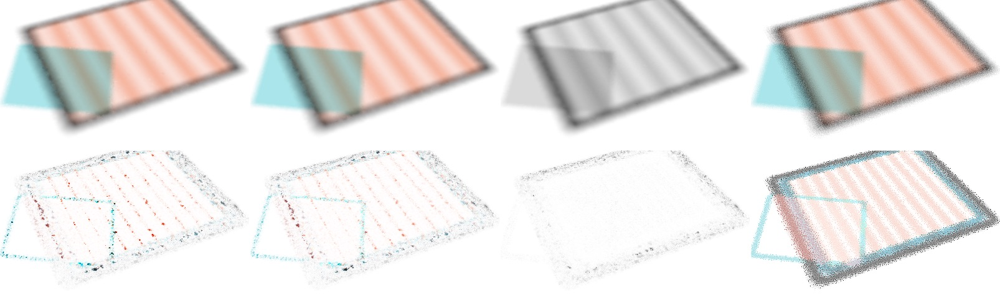
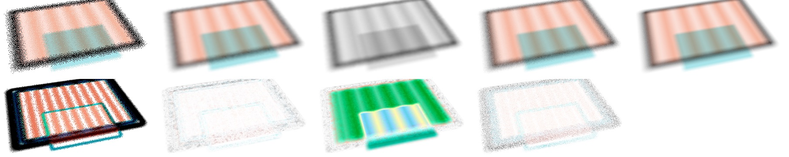
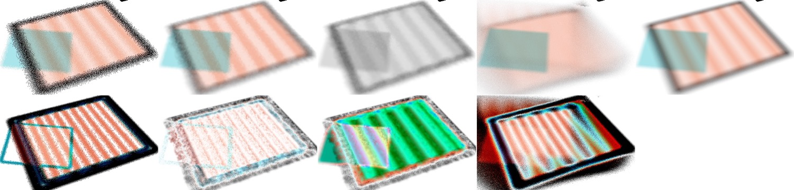
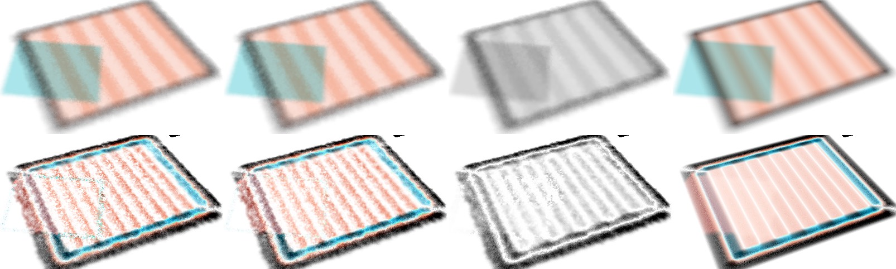
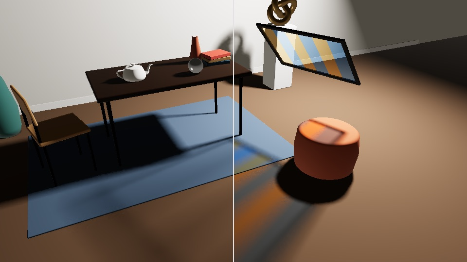

# M8 results: translucent (coloured) shadows

_m8-translucency agent (implementer, RULES.md rule 8: no NRD code, README, release notes or port opened;
not the public researcher). SPEC v0.3 §7.10 steps 2, 3 and 5. Package pinned for every results run
(`git archive` of e83ee1f, served through `RT_REALTIME_SRC` plus a scratch registry wrapper; the gate
compares against a `git archive` of 64613f6 = v2.2). Apple M5 Pro, Chrome 155. Provisional: SPEC not
reviewed; tuned and scored on the same analytic scene._

**What was built.** `new ShadowDenoiser(device, { translucency: true })` (`src/shadow.ts`,
`src/shaders/shadow.ts`), inputs `ShadowInputs.translucency` (rgb T of the 1-ray sample, ignored where
v = 0) and `translucencyHitDistance` (nearest translucent layer, 0 = none), output **rgba16float
(v̂·τ̂ rgb, v̂)**. The opaque visibility v runs through the v2.2 passes unchanged; τ = E[T | v = 1] is
accumulated over the samples that reached the light with its own clamp, restart and snap; translucent
samples feed the footprint from h_τ; τ tiles join the indirect list; the spatial passes weight τ by v; the
stabilization pass blends the colour with v's weight raised by the colour's own anti-lag. Two storage
paths: **wide** (6 storage textures in `temporal`, 80 B/px) and **packed** (4, 88 B/px; picked
automatically when the device offers fewer than 6). `realtimeShadows(..., { translucency, translucencyHitDistance })`
in denoiser/three (`.rgb` coloured shadow, `.visibility` = alpha). Registry id `shadows-translucent`
(signals `shadow-rgb` and `visibility`). Real-scene page `examples/three-temporal/realtime-glass.html` (§5).

## 1. Gate: with T ≡ 1 the opaque output is bit-identical to v2.2

- **Live test bed, 1080p, 7 paths × 96 frames:** `shadows-v22` (snapshot), `shadows-translucent` with no
  transmittance input and with a transmittance texture of ones: every per-frame metric identical on every
  path (pooled 37.73 / 39.92 / 34.35 / 37.37 / 42.44 / 38.63 / 37.09, = results/M4.md §12.4).
- **Replay byte compare** (`visibility.f32` outputs, the r32float v the wide path keeps internally) on
  three-knot-static / -orbit / -still, std540-{orbit, pan, light, thin, glossy, cut, object} and std1080-orbit:
  **0 differing values** of 199 M, with and without a T ≡ 1 texture.
- **The rgba16float output itself:** its rgb (and alpha) equal v2.2's r32float output rounded to f16
  **toward zero** on every value of those 11 captures (0 mismatches; against round-to-nearest 3–14 % differ:
  the M5 Pro's f16 stores truncate, LESSONS).
- `translucency: false`: the generated WGSL of every opaque pipeline variant (5 generators × the option
  combinations, 72 variants) is byte-identical to v2.2's.

Two things were needed for this, both now in LESSONS: the τ sums are written with explicit `fma` (a shared
`w * v` product changed how v's sum compiled: 0.7 % of pixels off by ≤ 24 ULP), and every τ update is exact
for uniform inputs (the truncating f16 store drifted τ below 1 under a clear sky, ≤ 2 f16 ulp in the output).

## 2. Glass paths, 1080p live (96 frames, 256-spp references, FLIP every 12th frame)

`signal=shadow-rgb`, rgb clamped to [0, 1]; penumbra = any reference channel in (0.02, 0.98); tint =
reference chroma > 0.02; chroma error = mean |S/ΣS − R/ΣR| on tint pixels; dynamic = reference range over 4
frames > 0.05 (per channel). Raw: [data/m8-results.json](data/m8-results.json) (`live1080`).

| path | denoiser | pooled | penumbra | tint | chroma err | dynamic | static penumbra | flicker | tPSNR | FLIP |
|---|---|---|---|---|---|---|---|---|---|---|
| glass | **ours** | **38.83** | **30.14** | **37.45** | **0.0017** | **21.38** | **32.68** | 0.0017 | 43.21 | **0.0078** |
| | ours, packed path | 38.79 | 30.11 | 37.39 | 0.0017 | 21.36 | 32.64 | 0.0017 | 43.22 | 0.0078 |
| | shadows on v·lum(T) | 28.42 | 18.41 | 17.18 | 0.0646 | 21.33 | 18.27 | 0.0017 | 43.63 | 0.0278 |
| | FFX on v·lum(T) | 21.86 | 12.07 | 10.74 | 0.0646 | 17.52 | 11.86 | 0.0050 | 37.50 | 0.0639 |
| | accumulate-32 | 31.10 | 25.23 | 29.69 | 0.0032 | 19.09 | 26.14 | 0.0051 | 33.95 | 0.0178 |
| glass-moving | **ours** | **34.21** | **25.47** | **27.94** | **0.0061** | **25.78** | **26.14** | 0.0038 | 36.00 | **0.0185** |
| | ours, packed path | 34.21 | 25.47 | 27.93 | 0.0061 | 25.78 | 26.14 | 0.0038 | 36.00 | 0.0185 |
| | shadows on v·lum(T) | 26.25 | 17.23 | 16.43 | 0.0668 | 17.64 | 17.67 | 0.0041 | 34.68 | 0.0443 |
| | FFX on v·lum(T) | 20.48 | 11.48 | 10.45 | 0.0668 | 11.93 | 11.79 | 0.0087 | 29.22 | 0.0696 |
| | accumulate-32 | 20.04 | 12.51 | 12.63 | 0.0361 | 11.90 | 15.93 | 0.0115 | 27.36 | 0.0786 |
| glass-still | **ours** | **40.61** | **32.75** | **37.24** | **0.0018** | – | **32.75** | 0.0004 | 48.53 | 0.0068 |
| | ours, packed path | 40.60 | 32.72 | 37.21 | 0.0018 | – | 32.72 | 0.0004 | 48.53 | 0.0068 |
| | shadows on v·lum(T) | 26.51 | 17.50 | 16.56 | 0.0679 | – | 17.50 | 0.0003 | 52.36 | 0.0370 |
| | FFX on v·lum(T) | 20.35 | 11.34 | 10.36 | 0.0679 | – | 11.34 | 0.0003 | 52.20 | 0.0677 |
| | accumulate-32 | 36.42 | 27.40 | 29.74 | 0.0038 | – | 27.40 | 0.0012 | 39.68 | **0.0057** |

- The grey baselines are what a caller without M8 gets (right luminance, no colour): 10–14 dB behind, chroma
  error 0.065 (the colour is simply missing). Against `accumulate-32` ours is +7.7 / +14.2 / +4.2 dB pooled.
- `glass-still` (nothing moves): accumulate-32 converges and wins FLIP (0.0057 vs 0.0068) at −4.2 dB; its 32
  frames of exact history are the best case for plain accumulation.
- The packed path costs ≤ 0.04 dB.

## 3. Replays (960×540 v1 captures): boil, the opaque channel, the colour gate

`v1-glass` (16 f), `v1-glass-moving` (40 f), `v1-glass-still` (16 f), compare.mjs after f426142 (per-channel
dynamic split). Boil = RMS of the output's second temporal difference / √6 on the mean of the clamped channels;
reference boil in the last row is its own noise floor (0 on the frozen control: the reference doesn't change).
Raw: `data/m8-results.json` (`replays540`).

| capture | denoiser | pooled | penumbra | tint | chroma | dynamic | dyn. boil | static pen. | static pen. boil |
|---|---|---|---|---|---|---|---|---|---|
| glass | **ours** | **35.18** | **26.64** | **32.03** | **0.0034** | **20.08** | 0.0652 | **28.75** | 0.0113 |
| | ours, colour gate full / off | 35.18 / 35.17 | 26.64 / 26.62 | 32.01 / 31.96 | 0.0035 | 20.08 | 0.0652 | 28.74 / 28.72 | 0.0116 / 0.0107 |
| | shadows on v·lum(T) | 27.98 | 18.17 | 17.16 | 0.0645 | 19.69 | 0.0652 | 18.02 | 0.0093 |
| | FFX on v·lum(T) | 21.74 | 12.04 | 10.75 | 0.0645 | 16.59 | 0.0632 | 11.73 | 0.0146 |
| | accumulate-32 | 28.46 | 19.90 | 23.42 | 0.0093 | 17.03 | 0.0618 | 20.06 | 0.0448 |
| | reference | | | | | | 0.0670 | | 0.0092 |
| glass-moving | **ours** | **33.25** | **24.70** | **27.04** | **0.0071** | **25.23** | 0.0421 | **24.29** | 0.0186 |
| | ours, colour gate full / off | 33.27 / 33.12 | 24.71 / 24.55 | 27.06 / 26.76 | 0.0071 / 0.0077 | 25.25 / 25.05 | 0.0421 / 0.0416 | 24.29 | 0.0193 / 0.0182 |
| | shadows on v·lum(T) | 26.00 | 17.11 | 16.38 | 0.0664 | 17.52 | 0.0399 | 17.34 | 0.0178 |
| | FFX on v·lum(T) | 20.30 | 11.55 | 10.64 | 0.0664 | 11.99 | 0.0498 | 11.66 | 0.0196 |
| | accumulate-32 | 20.39 | 13.03 | 13.43 | 0.0331 | 12.36 | 0.0234 | 15.06 | 0.0348 |
| | reference | | | | | | 0.0461 | | 0.0066 |
| glass-still | **ours** | **36.86** | **28.97** | **31.68** | **0.0039** | – | – | **28.97** | 0.0117 |
| | ours, colour gate full / off | 36.87 / 36.84 | 28.93 / 28.95 | 31.57 / 31.63 | 0.0040 | – | – | 28.93 / 28.95 | 0.0124 / 0.0107 |
| | shadows on v·lum(T) | 26.34 | 17.38 | 16.52 | 0.0679 | – | – | 17.38 | 0.0090 |
| | FFX on v·lum(T) | 20.25 | 11.31 | 10.36 | 0.0679 | – | – | 11.31 | 0.0144 |
| | accumulate-32 | 29.57 | 20.54 | 22.87 | 0.0125 | – | – | 20.54 | 0.0390 |

**Opaque channel on glass** (`visibility` vs `visibility_ref`, the same instance with T present): ours
37.32 / 38.84 static PSNR vs v2.2 (`shadows` on visibility alone) 37.22 / 38.83 and FFX 31.38 / 31.68 on
glass / glass-moving; static-penumbra 26.17 vs 25.99 (translucent hits sizing the footprint help v a little
at the frame's edge); dynamic PSNR 22.44 vs 22.56 on glass-moving (−0.12). The opaque part scores like v2.2.

**Boil — the open point.** In static coloured penumbrae ours boils more than the grey scalar baseline
(still 0.0117 vs 0.0090; moving 0.0186 vs 0.0178; glass 0.0113 vs 0.0093, reference 0.0092) while being
10 dB more accurate: the grey baseline has no colour noise to boil. The frame differences (|x_t − x_t−1| × 12
on `v1-glass-still` frame 12; ours, colour gate off, grey baseline, accumulate-32) show where: speckles along
the stripe edges and the blue panel's outline, i.e. τ's own noise where the colour changes.

The colour gate (`translucencyOwnGate`) trades exactly this: `true` (box-width gate + anti-lag on S) was the
first default; `'antiLag'` (the default now) keeps its PSNR within 0.02 dB and boils 3–6 % less; `false`
boils least (−9 % vs `'antiLag'`) but loses 0.13 dB pooled and 0.28 dB tint on glass-moving (the moving
panel's coloured edge lags). TASKS has the follow-up; Dennis judges the look on `realtime-glass.html`.

**Strips.** `v1-glass` frame 12 (noisy v·T, ours, grey baseline, accumulate-32, reference; second row
|error| × 4, inverted):

`v1-glass-moving` frame 20 (same columns) and its frame differences × 3 at frame 21 (ours, colour gate off,
grey baseline, reference):

## 4. Tuning (960×540 live, 96 frames, all three glass paths; `data/m8-results.json` `sweep540`)

Base = defaults with the colour gate `true` (the default at the time). Pooled PSNR glass / moving / still:

| setting | glass | glass-moving | glass-still | note |
|---|---|---|---|---|
| base (N_τ 7, ε_τ 0.01, window 0.4σ + 0.05, h_τ used) | 36.82 | 33.35 | 38.93 | |
| N_τ 3 / 15 | 36.82 / 36.80 | 33.41 / 33.33 | 38.89 / 38.92 | 7 kept |
| ε_τ 0.002 / 0.05 | 36.82 / 36.82 | 33.35 / 33.35 | 38.93 / 38.93 | flat |
| τ window σ 0.2 / 0.8 | 36.80 / 36.81 | 33.51 / 32.84 | 38.75 / 39.07 | moving vs still trade; v's 0.4 kept |
| τ floor 0.02 / 0.1 | 36.80 / 36.82 | 33.46 / 32.97 | 38.78 / 39.04 | same trade; 0.05 kept |
| colour gate off / box / anti-lag only | 36.78 / 36.82 / 36.79 | 33.17 / 33.24 / 33.30 | 39.04 / 38.95 / 39.01 | anti-lag only chosen with the replay boil (§3) |
| no translucent hit distance (`tr.hit=none`) | 36.81 | 33.39 | 38.24 | h_τ worth +0.7 dB on still (M8-3 holds) |
| packed path | 36.74 | 33.35 | 38.91 | −0.08 … 0.00 |

## 5. Real scene: `examples/three-temporal/realtime-glass.html` (step 5)

The furnished corner with a stained-glass panel (amber / blue stripes, α 0.85, in an opaque frame) between the
area light and the floor. The panel is an analytic quad: each shadow ray costs one extra ray-quad test (T and
h_τ), the frame is ordinary geometry in the three-mesh-bvh BVH, the panel is drawn analytically over the image.
Split view: `realtimeShadows(v·lum(T))` (grey) left, `realtimeShadows(v, { translucency: T, translucencyHitDistance })`
right; `?moving=1` slides the panel. Static camera, 960×540, vs a 4096-ray reference (`__t.metrics`, rgb clamped,
pooled):

| frame after reset | 1 | 2 | 4 | 8 | 16 | 32 |
|---|---|---|---|---|---|---|
| ours: PSNR / penumbra / tint / chroma err | 22.30 / 16.72 / 15.75 / 0.048 | 28.96 / 25.83 / 27.19 / 0.011 | 29.34 / 26.33 / 27.97 / 0.010 | 29.85 / 27.16 / 29.07 / 0.008 | 30.26 / 27.87 / 29.84 / 0.007 | **30.42 / 28.30 / 30.35 / 0.006** |
| grey (v·lum(T)) | 22.20 / 16.58 / 15.60 / 0.068 | 22.24 | 22.30 | 22.35 | 22.40 | 22.41 / 16.77 / 15.67 / 0.068 |
| 1 ray, raw v·T | 16.09 / 10.04 / 10.84 / 0.065 | | | | | 16.09 |

Frame 1 is a single τ sample (no history yet) and scores like the grey baseline; from frame 2 the colour is
there. By eye the coloured shadow matches the reference. Split view after 40 frames (grey left, ours right):

Costs on this page were measured under contention only (other agents' 4096-spp runs): fastest frame ours 0.68 ms,
grey 0.39 ms at 960×540, medians meaningless; see §6 for the test-bed bench.

## 6. Cost and memory

Memory (configure, per pixel; tile buffers +16 B per 8×8 tile as v2.2):

| | B/px | 1080p |
|---|---|---|
| v2.2 (opaque) | 48 | 99.5 MB |
| translucency, wide path (default where ≥ 6 storage textures) | **80** (v2.2 + τ history 2 × 8 + output 2 × 8; τ scratch reuses last frame's histories) | 166 MB |
| translucency, packed path (4 storage textures) | 88 (histories rgba32uint 2 × 16, output 2 × 8, T + out 4 + 4, τ scratch 2 × 8, geometry 2 × 8) | 182 MB |
| `stabilize: 0` | wide 64, packed 80 | |

The SPEC estimate (≈ 80 B/px) holds for the wide path.

Bench: `mode=bench&preset=full`, one denoiser per page, 3 rounds, each page started only on an idle GPU
(`ioreg` device utilization ≤ 12 %, no page contended; `tiles` read 0.005 ms on every page: the fast clock
state). Fastest page median, median of the 3 in brackets (ms); per pass of the fastest page. Package 76c707c
(after the two-list split below). "no T" = `translucency: true` without a transmittance input; "T = 1" =
`signal=shadow-rgb` on the old paths, where the test bed binds a transmittance of ones.
Raw: `data/m8-bench-1080p.jsonl`.

| path | v2.2 (opaque) | translucency, no T | translucency, T = 1 | translucency (glass), wide | packed |
|---|---|---|---|---|---|
| orbit | 0.60 (0.60) | 0.73 (0.73) | 0.77 (0.77) | | |
| pan | 0.56 (0.56) | 0.68 (0.68) | 0.72 (0.72) | | |
| light | 0.61 (0.61) | 0.73 (0.73) | 0.78 (0.78) | | |
| thin | 0.72 (0.72) | 0.84 (0.84) | 0.89 (0.89) | | |
| glossy | 0.55 (0.55) | 0.68 (0.68) | 0.72 (0.72) | | |
| cut | 0.59 (0.59) | 0.72 (0.72) | 0.76 (0.76) | | |
| object | 0.65 (0.65) | 0.77 (0.77) | 0.81 (0.81) | | |
| glass | 0.64 (0.64) | | | **0.97 (0.97)** | 0.97 (0.98) |
| glass-moving | 0.62 (0.62) | | | **0.99 (1.00)** | 1.01 (1.01) |
| glass-still | 0.61 (0.61) | | | **0.98 (0.99)** | 0.98 (0.98) |

Per pass, glass-moving (wide): temporal 0.685 (v2.2 0.461) · tiles 0.005 · spatial0 0.046 + tau tiles 0.068 ·
spatial1 0.045 + 0.075 · stabilize 0.028 + 0.039. On the old paths only the temporal pass grows (0.41 → 0.52 no T,
→ 0.57 with T = 1) and the stabilize pass by ~0.006; the spatial passes cost exactly v2.2's.

- **Over the SPEC estimate**: glass paths 0.97–0.99 ms (estimate 0.70–0.95, M5 Pro guide ≤ 0.9), elsewhere
  +0.12 … +0.17 ms (estimate ≈ +0.1). The excess is the temporal pass: the τ history taps and store and the
  output store run full screen (+0.11 ms with no T), the raw T tile (+0.04), and in tiles with glass the
  per-channel 5×5 statistics and the normal tile (+0.22 on the glass paths). Native's translucency variant is
  +12.5 % over its opaque one (SPEC §7.10.3); ours is +20–30 % on the old paths and +55–60 % on the glass paths.
- **First cut, before the split** (one tile list; e83ee1f, same bench): old paths +0.19 … +0.34 ms, glass
  1.01–1.10 ms: the colour code compiled into the spatial passes cost even in tiles without colour (spatial0
  on `thin` 0.12 → 0.23 ms). Two indirect lists fixed that: v-only tiles run the opaque spatial passes as they
  are (bit identity re-checked), tau tiles run the colour variants.
- The packed path costs the same within 0.02 ms (its 16-load Catmull-Rom is offset by fewer storage writes).

## 7. Deviations from SPEC §7.10 (for the spec author; also in TASKS)

1. **Storage textures (M8-9):** the wide path writes 6 in `temporal`, not 5. Widening v's r32float unfiltered
   copies to rgba16float `(v, τ)` as specified would round v to f16 and break the bit-identical gate, so they stay,
   and the f16 output is written for the unfiltered tiles. Memory still 80 B/px (τ scratch in last frame's
   histories). The packed path (4) makes the output double as v's copy and stabilization history (v in f16 there,
   not bit-identical: −0.04 dB).
2. **Stabilization (M8-7):** the colour's blend weight = max(v's, the colour's own clamp-distance anti-lag)
   (`translucencyOwnGate: 'antiLag'`); v's weight alone lost 0.13–0.15 dB on glass-moving; the colour's box-width gate
   added boil without PSNR. Tau-only tiles pass v through; v-only tiles take S = v̂·τ.
3. **τ temporal (M8-4):** plus v's uniform snap (all lit taps agree → their value) and update forms exact for
   uniform inputs (f16 truncation). The window keeps v2.1's √(25/n) factor.
4. **Footprint (M8-3):** the H18 noise estimate E is taken on v·mean(T), so coloured edges without h_τ get the
   noise-sized radius as the spec intended (E on v alone is 0 inside a glass shadow).
5. **Tile bits (M8-5):** lit sample attenuated (1 − min T > ε_τ) / lit sample clear / τ differs from raw T by
   more than ε_τ; τ-active = (attenuated and clear) or differs, over the 3×3 tiles.

## 8. Note: shadows defaults changed after these runs

Every number above uses the opaque defaults of v2.2 (`uniformSnap: true`). After the M8 runs Dennis decided
SPEC §12 item 5: `uniformSnap` now defaults to `'change'` (255a06a; and `antiLag` is renamed `antiLagGain`).
The gate's statement is unchanged (translucency with T ≡ 1 = the opaque denoiser with the same options); the
glass tables would move by the opaque snap's effect only (M4.md §10.5 / REMEASURE §4 have its size).

## 9. What's left

- Native `SIGMA_SHADOW_TRANSLUCENCY` on the v1 glass captures (probe P7).
- Temporal-pass cost (§6, TASKS): skip the τ history where last frame's tile held no colour, cheaper τ statistics.
- Boil in static coloured penumbrae (§3; TASKS).
- `realtime-glass.html`: listing (examples.json) and a capture set with per-pose references.
- Stained glass with texture-scale colour detail finer than the penumbra and nested layers of the same colour
  were not stressed beyond the test bed's two panels and stripes.
