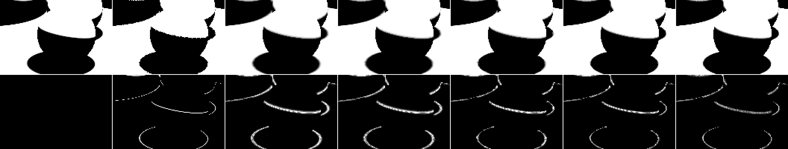
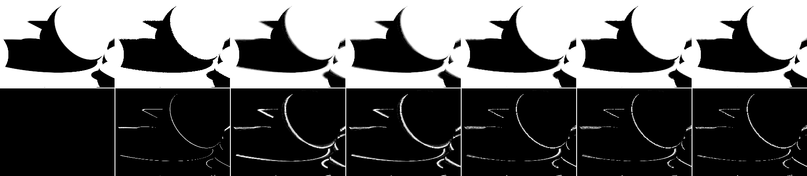
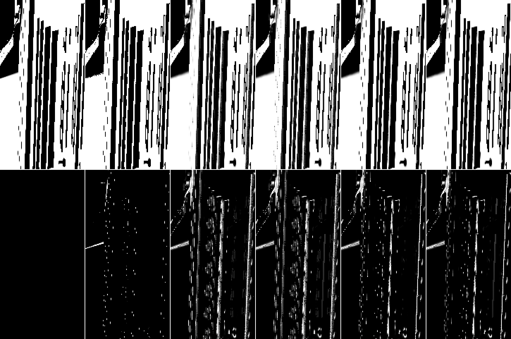

# Shadows follow-ups: contacts, frame 0, moving lights, the q24 boil exception, g learning

_shadows agent (implementer / evaluator, RULES.md rule 8: no NRD code, README, release notes, NRD-Sample or RTG II listing
read; papers read for this doc: Mehta et al. 2012, Heitz et al. 2018, Zeng et al. 2021 (TRMV) from
`rt-denoiser-sources/`). 2026-10-27. Code 52d37cb (three options, default off). Replays served from a pinned snapshot
(HEAD ec12ebf + this doc's two shadow files), 960×540; live test bed 1080p; cost on the 1080p solo bench (GPU lock held,
no other headless job). "Shipped" = the defaults since cc8f1e7 (q21); "q23" = shipped + `stepTest` + `edgeBox` +
`rotationStep: 0` (pending Dennis); "q24" = shipped + `terminatorAnalytic` (pending Dennis). Provisional, like every
shadow default (SPEC §12)._

## Conclusion (plainly)

| item | cause (measured) | what helps | rule 9 | goes to |
|---|---|---|---|---|
| **1. contacts below the raw input** | the spatial kernel straddles a sub-pixel step. At hard contacts the reference is binary (96 % of the contact pixel-frames are ≤ 0.02 or ≥ 0.98) and the raw sample is exact there; shipped leaks +0.07 into the dark side and −0.10 into the lit side. With `stepTest` (q23) the noise radius is gone at clean steps and what is left is the **1-px `minRadius` floor**, applied in both passes (the 3×3-tile minimum is not the cause: `mergeMin: false` ±0) | **`floorE: 0.05`** (new option): the floor scaled by the accumulated noise estimate E, down to half (= no filtering) where E is 0. On top of q23: hard-light contacts 17.88 → **22.62 dB** (raw 21.88), moving camera 16.76 → 19.45, moving occluder 17.53 → 21.53; real captures +0.40 dB over q23 (+0.83 over shipped), FLIP −5 % | passes PSNR / FLIP / cost; **fails the boil clause narrowly** (`bistro-move` dynamic boil +5.6 %, `sponza-orbit` motion-compensated changing boil +7 %, both above the references') | Dennis (question, look change) |
| **2. `bistro-move` frame 0 below raw** | the same floor on sub-pixel lantern penumbrae, plus fresh pixels' noisy windows keeping the noise radius | `floorE` 23.85 → 24.11 (q23), all options together 24.36; raw **25.05**: still 0.7 dB short at frame 0 (pooled over the sequence the combination reaches 24.38 vs raw 24.42) | — | open (smaller) |
| **3. moving hard light: spatial alone beats the denoiser** | reproduced with the shipped defaults: no-history 30.63 vs shipped 27.68 dB (changing region 19.99 vs 14.05). The light moves 1.5 light radii per frame, so every penumbra moves 1.5 penumbra widths per frame; the history cap (≈ W_px²) and the hard-edge clamp widening assume a still shadow, so the history drags | **`lightMotion: 1`** (new option): history capped at 1 penumbra width of the light's motion, dropped at edges where that is under a frame (the motion is known from the light input; M12 geometry). 27.68 → **30.44** (q23 + it: 31.09; `lightMotion: 0.5` 30.89, above the no-history control), trail 0.142 → 0.040; sun +0.06 (0.5: +0.51, lag 2.2 → 1.95 frames); still lights unchanged | passes PSNR / FLIP / cost; **fails the boil clause** (std540-light static-penumbra boil +6.5 %; the moving hard light's edge boil +47 %: it is noisier while the light moves) | Dennis (trade: tracking vs noise while a light moves) |
| **4. q24's boil exception** | **not boil**: 105 % of the +8 % `bistro-move` dynamic-boil increase sits where the reference itself changes (its own second difference ≥ 0.02) and where `terminatorAnalytic` acted; where the reference is steady it *lowers* boil (−5 %). The cause is a jump: surfaces turning away from the moving lantern go from the analytic terminator value (≈ 0, exact) to `backfacePass`'s input, the temporal history, which still holds the lit value and decays over ~15 frames (0.01 → 0.79 → 0.43 on one pixel while the reference is 0). Shipped has the same lagging back faces, only without the jump | **`horizonSnap`** (new option): whole light below the horizon and a 0 sample → history 0. q24 + it: `bistro-move` dynamic boil +8.1 % → **+1.4 %**, its error boil −6 %, umbra 39.09 → 41.67 dB | **q24 + `horizonSnap` passes rule 9** on every clause (1080p 40.00 vs 38.49 dB, worst path +0.95; real +0.90, worst +0.38; FLIP −27 / −23 / −11 %; every counting boil increase ≤ +2.7 %; cost −0.01 / −0.02 ms vs shipped) | Dennis: amend q24 to `terminatorAnalytic` + `horizonSnap` (look change; both trust the renderer's horizon rule, SH-7) |
| **5. slow g learning on a still camera** | reproduced on the pre-q21 defaults (Bistro arrive − hold +0.30 / +0.28 dB window-mean, as DISTANCE-LONG's +0.27); with the shipped (q21) defaults the gap is **+0.05 / +0.06 dB** (edge sharpness 0.775 vs 0.768). The old gap sat in the umbra class (26.36 vs 26.80 dB), which q21 closed | nothing built: the residual is in the lit / penumbra classes (+0.19 / +0.08 dB) and too small to justify a pass change | — | closed (for SPEC §7.2) |

Nothing here is a config flip the orchestrator can apply alone: the one candidate that passes every clause (q24 +
`horizonSnap`) changes the look and amends a question already with Dennis. Three options landed, default off, default
output byte-identical (below). One candidate was built, measured and removed: a per-frame clean-step flag for the floor
(`hardFloor`), which boiled more than a plain `minRadius: 0.5`.

## Setup

| | |
|---|---|
| captures | the 8 motion-separation captures `sm-{hard,sun}-{camera,light,object,frozen}` (SHADOWS-MOTION.md; sun replayed with the directional stand-in), the 7 `std540-*`, the 11 real captures; Bistro hold loops built with `tools/rt-capture/loop-capture.mjs` (`bistro-hold:0:32` held 192 frames, after nothing / after `bistro-orbit`'s 48-frame walk; hold references = window means) |
| controls | raw 1-ray input, no-history (`sh.noHistory=true`, **now on the shipped defaults**: SHADOWS-MOTION's 29.23 dB on the moving hard light ran the pre-q21 defaults), temporal only (`spatialPasses: 0`), frozen captures |
| metrics | `tools/rt-capture/shadow-regions.mjs` (edge / soft / contact / changing / static, motion-compensated boil, trailing), `score-captures.mjs` (pooled, FLIP, boil), `compare.mjs` (dynamic / static-penumbra boil, sharpness), live 1080p eval; new scratch tools in `data/`: `shadows-followups-diag.mjs` (error by reference class / own-g), `-diag-boil.mjs` (compare.mjs's dynamic boil split by "variant acted" and "reference changes", plus the error boil √(mean (b_out − b_ref)²/6)), `-meanpsnr.mjs` (window-mean PSNR, DISTANCE-LONG's measure) |
| raw numbers | [data/shadows-followups/](data/shadows-followups/): region JSON per capture and batch (`regions/`), rule-9 tables and JSON vs shipped and vs q23 (`ab-vs-ab-ship.md/json`, `ab-vs-ab-c3.md/json`), region JSON of the A/B (`regions-ab/`) |

## 1. Contacts below the raw input

**Reproduced** (`sm-hard-frozen`, contact region, pooled dB): raw 21.88, shipped 15.83, q23 17.88, no-history 15.53,
temporal only 29.50. Split by reference class (frames 1–79, `shadows-followups-diag.mjs`):

| | dark (ref ≤ 0.02), 54 % | lit (≥ 0.98), 41 % | mid, 4 % |
|---|---|---|---|
| raw | 45.8 dB | 44.6 | 8.0 |
| shipped | 16.9 (bias **+0.072**) | 15.2 (bias **−0.101**) | 12.5 |
| q23 | 19.3 (+0.049) | 16.9 (−0.075) | 14.4 |
| temporal only | 47.5 | 30.6 | 17.7 |

So the loss is blur across a binary step, on both sides; even the 4 % of true penumbra pixels lose to temporal-only.
Ablations on top of q23 (contact dB; all 31.73 shipped / 33.19 q23):

| q23 + | contact | all | edge boil |
|---|---|---|---|
| — | 17.88 | 33.19 | 0.0153 |
| `minRadius: 0.5` | **22.77** | 35.12 | 0.0215 |
| `spatialPasses: 1` | 19.70 | 34.09 | 0.0195 |
| `noiseBlend: 0` | 18.56 | 33.57 | 0.0160 |
| `maxHistory: 1` | 18.36 | 33.51 | 0.0214 |
| `mergeMin: false` (no 3×3-tile minimum) | 17.87 | 33.09 | 0.0154 |
| `youngMean: 0` / `stabilize: 0` / tighter geometry weights | 17.88 | 33.19–33.20 | 0.0153–0.0154 |
| `clampEdgePx: 0` | 16.69 | 31.92 | 0.0199 |
| `spatialPasses: 0` (temporal only) | 29.50 | 35.67 | 0.0358 |
| shipped + `minRadius: 0.5` (no `stepTest`) | 16.11 | 32.09 | 0.0192 |

The floor is the remaining cause, and it only shows once `stepTest` has removed the noise radius at clean steps. A plain
`minRadius: 0.5` (all taps on the pixel when the occluder says sub-pixel) gets the contacts above raw but raises edge
boil 16 % above shipped's (sun contacts +27 %): noisy narrow-penumbra pixels lose the 1-px floor too and their kernel
size follows the per-frame E.

**Candidates** (our design; sources: M12 Eq. 13 floors the filter width near one pixel footprint, H18 §4.1–4.2 size the
kernel by E; the floor's form is ours):

- `hardFloor` (built, measured, **removed**): this frame's clean-step flag (the `stepTest` test) in the E byte's low bit,
  half floor and no noise radius at flagged pixels. Contacts 22.74 but edge boil 0.0261 (frozen; shipped 0.0186): the flag
  flips from frame to frame on 1-ray samples, and the kernel with it.
- **`floorE`** (kept, option): floor × clamp(E / floorE, 0.5, 1) with E the *accumulated* noise estimate (8-bit, a running
  mean over ≤ 8 frames), so the floor moves slowly. With `stepTest` E decays to 0 at a clean static step. 0.05 / 0.15 /
  0.4 measured; 0.4 equals `minRadius: 0.5`, 0.05 keeps 95 % of its contact gain at a fraction of its boil:

| capture (q23 + `floorE`) | all: shipped / q23 / **0.05** / 0.15 / 0.4 | contact: shipped / q23 / **0.05** | edge boil: shipped / q23 / **0.05** / 0.4 | contact boil: shipped / **0.05** |
|---|---|---|---|---|
| sm-hard-frozen | 31.73 / 33.19 / **34.68** / 34.96 / 35.12 | 15.83 / 17.88 / **22.62** | 0.0186 / 0.0153 / **0.0193** / 0.0215 | 0.0284 / **0.0203** |
| sm-hard-object | 31.17 / 32.69 / **33.99** / 34.23 / 34.36 | 15.51 / 17.53 / **21.53** | 0.0187 / 0.0156 / **0.0195** / 0.0217 | 0.0285 / **0.0212** |
| sm-hard-camera | 30.92 / 31.80 / **32.74** / 33.02 / 33.14 | 15.58 / 16.76 / **19.45** | 0.0182 / 0.0170 / **0.0186** / 0.0197 | 0.0318 / **0.0272** |
| sm-hard-light | 27.68 / 28.55 / **28.85** / 28.89 / 28.90 | 14.75 / 16.02 / **18.12** | 0.0180 / 0.0162 / **0.0189** / 0.0209 | 0.0261 / **0.0177** |
| sm-sun-frozen | 37.51 / 38.01 / **38.09** / 38.12 / 38.10 | 22.38 / 24.12 / **24.45** | 0.0154 / 0.0148 / **0.0153** / 0.0167 | 0.0231 / **0.0250** |
| sm-sun-light | 33.70 / 33.91 / **33.93** / 33.93 / 33.91 | 21.31 / 22.61 / **22.72** | 0.0168 / 0.0162 / **0.0166** / 0.0177 | 0.0224 / **0.0229** |
| bistro-move | 22.98 / 23.45 / **23.86** / 23.93 / 23.98 | 12.81 / 13.35 / **13.72** | 0.0306 / 0.0167 / **0.0182** / 0.0192 | 0.0390 / **0.0154** |



_sm-hard-frozen frame 70, |error| × 4 below: the sphere's contact ring and terminator edge. Shipped and q23 smear the
ring over 2–3 px; with `floorE` it is as thin as in the temporal-only control._

Cost: none (q23 + `floorE` 0.629 / 0.740 ms on `orbit` / `thin` vs q23 0.631 / 0.738; shipped 0.614 / 0.719). The trade it
leaves: frame 0 of the 540p test-bed captures −0.15 … −0.8 dB vs q23 (fresh pixels' one-frame E is often 0 at near-hard
edges; sm-hard 30.88 → 30.07, std540-light 34.24 → 33.78), 1080p frame 0 −0.04 dB; pooled over the sequences it is level.

### Rule-9 A/B: q23 + `floorE: 0.05`

| vs | 1080p (7 paths) | std540 (7) | real (11) | FLIP | boil (score-captures) | static-pen boil | dynamic boil |
|---|---|---|---|---|---|---|---|
| shipped | 38.57 vs 38.49 (worst path −0.00) | 35.67 vs 35.66 (worst −0.08 thin) | **29.69 vs 28.86** (every capture +0.49 … +1.64) | −0 % / −1 % / −7 % | std540 +1 % (worst +3 %), real −13 % | −0 % (worst +2 %), real −3 % | std540 +1 %, real +2 % |
| q23 | 38.57 vs 38.56 (worst −0.02 thin) | 35.67 vs 35.68 (worst −0.05) | 29.69 vs 29.29 (worst +0.11) | −1 % / −5 % | std540 +1 %, real +2 % (worst +9 % bistro-move) | +1 % (worst +6 % bistro-move) | +2 % |

Counted under the amended clause (above both the reference's own boil and the base's): `bistro-move` dynamic boil
(compare.mjs) 0.0664 vs shipped 0.0629, reference 0.0442: **+5.6 %**; `sponza-orbit` motion-compensated changing boil
**+7 %** (shadow-regions; a moving camera over hard sun edges: crisper edges are resampled every frame). Contact boil on
std540 +5 % (worst +13 % std540-light), not a rule-9 region. Sharpness 0.753 → 0.784 (real). **Verdict: fails the boil
clause by 0.6 and 2 points; the rest passes.** It is a look change (contacts and sub-pixel shadows stay sharp), so it goes
to Dennis as a question, not as a flip.

## 2. `bistro-move` frame 0

Frame 0, pooled dB (raw 25.05): shipped 23.44, q23 23.85, q24 23.64, q23 + `floorE` 24.11, q23 + `floorE` + q24 +
`horizonSnap` 24.36. Over the whole sequence that combination scores 24.38 against the raw input's 24.42 (shipped 22.98).
What is left at frame 0 was not decomposed further: fresh pixels whose 5×5 window is not a clean step (1-ray noise at the
lantern's sub-pixel edges) keep the noise-sized radius from a one-frame E, which `floorE` doesn't touch. Left open in TASKS.

## 3. Moving hard light: the spatial filter alone beats the denoiser

Reproduced with the shipped defaults (`sm-hard-light`, pooled / changing region dB, trail): shipped 27.68 / 14.05 / 0.142,
q23 28.55 / 14.71 / 0.132, **no-history 30.63 / 19.99 / 0.027**, temporal only (q23 + `spatialPasses: 0`) 28.12 / 13.73.
History is the problem, not the kernel. Ablations on q23: `maxHistory: 1` 28.92, `maxHistory: 3` 28.71, `clampEdgePx: 0`
29.54 (changing 16.71, trail 0.102; but −1.3 dB on the frozen capture and −0.55 on `bistro-move`), `minRadius: 0.5` 28.90.

Cause: shadows don't follow the motion vectors, and a moving light moves them. Each shadow feature moves by g × the light's
displacement (similar triangles; M12 Eq. 4's slope s = d1/d2 − 1 = h/(D − h) = g), i.e. by ρ = |ΔL| / R penumbra
widths per frame, whatever its size. Here ρ = 6 cm / 4 cm = 1.5: every penumbra is somewhere else next frame. The history
cap (≈ W_px²) and the hard-edge clamp widening (`clampEdgePx`) assume a still shadow, so near edges the history keeps
1/2–2/3 of the old value.

**Candidate `lightMotion: k`** (our design from M12's geometry; TRMV, Zeng et al. 2021 §4.1, moves the history *along*
shadow motion vectors computed from the blocker and light positions, Eq. 3; we only shorten it): ρ from the previous and
this frame's light (sphere: |ΔL| / radius; directional: angle / angular radius); in the temporal pass the cap becomes
min(cap, k · max(W_px, 1) / (W_px · ρ)) (k penumbra widths, or pixels below a 1-px penumbra), and where that is under one
frame and the raw 5×5 window holds an edge (σ > 0), the history is dropped (the pixel starts over like a disocclusion;
uniform windows still snap). With a still light ρ = 0 and the output equals the shipped one to 2·10⁻⁶ (not byte-identical:
the extra branch changes how the cap compiles).

| capture | shipped | `lightMotion` 0.5 / **1** / 2 | q23 / q23 + `lightMotion: 1` | no-history |
|---|---|---|---|---|
| sm-hard-light, all | 27.68 | 30.89 / **30.44** / 27.84 | 28.55 / 31.09 | 30.63 |
| changing | 14.05 | 19.42 / **18.33** / 14.19 | 14.71 / 18.45 | 19.99 |
| trail | 0.142 | 0.031 / **0.040** / 0.139 | 0.132 / 0.037 | 0.027 |
| edge boil (motion-compensated) | 0.0180 | 0.0306 / **0.0264** / 0.0181 | 0.0162 / 0.0292 | 0.0473 |
| static boil | 0.0051 | 0.0080 / **0.0068** / 0.0052 | 0.0042 / 0.0073 | 0.0131 |
| sm-sun-light, all (lag frames) | 33.70 (2.18) | 34.21 (1.95) / **33.76** (2.15) / 33.66 | 33.91 / 33.98 | 33.34 |
| bistro-move, all (soft boil) | 22.98 (0.0412) | 23.29 (0.0779) / **23.08** (0.0420) / 23.03 | 23.45 / 23.57 | 23.15 (0.0810) |



**Rule 9 (`lightMotion: 1` vs shipped):** 1080p 38.56 vs 38.49 (`light` +0.44, the other six paths identical), std540
35.94 vs 35.66 (std540-light +1.97), real 28.87 vs 28.86 (only `bistro-move` has a moving light), FLIP −1 %, cost +0.002 ms
(`orbit`), +0.004 (`light`). Boil: std540-light static-penumbra boil 0.0115 vs 0.0108 (reference 0.0024): **+6.5 %, counts,
fails**; on the moving hard light the edge boil is +47 % (it tracks the light by dropping history, and a 1-ray input is
noisy). Option only. The better fix is TRMV's (reproject the history along the shadow's motion instead of dropping it),
which needs the blocker position per pixel (we have h and the light, so a sphere light's shadow motion is computable per
occluded sample): filed in TASKS.

## 4. q24's boil exception on `bistro-move`

compare.mjs's dynamic boil is the second temporal difference in the region where the reference changes; on a static
camera it is not motion-compensated, so it counts legitimate change too (the reference's own is 0.044 here).
`shadows-followups-diag-boil.mjs` reproduces the exception (shipped 0.0653, q24 0.0709: +8.6 %, reference 0.0468) and
splits it:

| subset of the dynamic region | share | boil shipped → q24 | reference's own | share of the increase | error boil shipped → q24 |
|---|---|---|---|---|---|
| reference steady (\|b_ref\| < 0.02) | 26 % | 0.0576 → 0.0564 | 0.0041 | −5 % | 0.0575 → 0.0564 |
| reference changes, q24 acted | 26 % | 0.0794 → 0.0964 | 0.0658 | **+105 %** | 0.0707 → 0.0680 |
| all | 100 % | 0.0653 → 0.0709 | 0.0468 | 100 % | 0.0636 → **0.0626** |

So the analytic terminators follow the reference's change better (lower error boil), and the increase is in pixels whose
truth changes. The one place they don't follow it (pixel 763, 271, a pilaster of the right façade turning away from the
lantern; per frame from frame 30):

| frame | 31 | 32 | 33 | 34 | 35 | 36 | 37 | 38 | 40 | 45 | 47 |
|---|---|---|---|---|---|---|---|---|---|---|---|
| reference | 0.95 | 0.77 | 0.56 | 0.30 | 0.11 | 0.00 | 0.00 | 0.00 | 0.00 | 0.00 | 0.00 |
| shipped | 1.00 | 0.99 | 0.97 | 0.96 | 0.94 | 0.90 | 0.79 | 0.74 | 0.66 | 0.48 | 0.43 |
| q24 | 0.98 | 0.82 | 0.61 | 0.37 | 0.16 | 0.01 | **0.79** | 0.74 | 0.66 | 0.48 | 0.43 |
| q24 + `horizonSnap` | 0.98 | 0.82 | 0.61 | 0.37 | 0.16 | 0.01 | 0.00 | 0.00 | 0.00 | 0.00 | 0.00 |

Once the whole lantern is below the pilaster's horizon, `backfacePass` passes the *temporal history* through ("the input"),
not the raw sample. That history is lit: the pixel never had an occluded sample (its 0s come from the horizon, h = 0), so
it has no g, takes the full 15-frame cap, and its 5×5 window is not uniform, so neither the clamp nor the snap moves it.
It decays by 15/16 per frame. Shipped shows the same lag (bias into the umbra, the "+0.034 umbra bias" of SHADOWS-LOOK §B
is partly this), q24 adds the jump.

**`horizonSnap`** (our design; the renderer contract SH-7 and H18 Eq. 4 / 12, re-read: the horizon-clipped light belongs to
the analytic term, so the visibility there is known): in the temporal pass, n·l ≤ −sin θ_light and a 0 sample → the
history value is 0. Measured:

| bistro-move | pooled | umbra | dynamic boil (compare) | error boil |
|---|---|---|---|---|
| shipped | 22.98 | 38.82 | 0.0629 | 0.0636 |
| q24 | 23.24 | 39.09 | 0.0680 (+8.1 %) | 0.0626 |
| shipped + `horizonSnap` | 23.10 | 41.24 | 0.0702 (diag) | 0.0702 |
| **q24 + `horizonSnap`** | **23.36** | **41.67** | **0.0638 (+1.4 %)** | **0.0597** |

Alone it is no good (the shipped terminator band still lags, so its pixels now drop from 0.72 to 0 at once); with q24 it
removes the exception.



### Rule-9 A/B: q24 + `horizonSnap` vs shipped

| | 1080p (7 paths) | std540 (7) | real (11) |
|---|---|---|---|
| pooled | **40.00** vs 38.49, worst path +0.95 (thin); q24 alone 39.96 | **37.02** vs 35.66, worst +0.78 | **29.76** vs 28.86, worst +0.38 (bistro-move) |
| FLIP | 0.0090 vs 0.0124 (−27 %) | −23 % | −11 % |
| flicker / tPSNR | 0.0018 vs 0.0024 / 41.96 vs 41.09 | | |
| boil (score-captures) | | −12 % (worst −5 %) | −2 % (worst +2 % three-pan) |
| static-penumbra boil | | −8 % (worst −3 %) | +2 %; counting: three-pan +1 %, bistro-move +2.7 % (bistro-orbit +22 %, sponza-orbit / -pan +8 / +7 %, all below the references' own boil 0.030–0.045) |
| dynamic boil | | +1 % | moving-camera captures +12 … +18 %, all below the references' own; counting: bistro-move +1.4 % |
| regions (motion-compensated, counting) | | contact +9 % (std540-thin; q24 alone +10 %), not a rule-9 region | edge +2 %, soft +2 %, changing +1 %, static +2 %, contact +5 % (three-pan) |
| cost (`orbit` / `thin`) | 0.603 / 0.695 ms vs shipped 0.614 / 0.719 (q24 alone 0.599 / 0.689) | | |

**Passes every clause.** Uncertain: the static-penumbra boil rise on the moving-camera Bistro / Sponza captures (below the
references, so it doesn't count) is new with `horizonSnap`; the likely cause is the SH-7 risk itself (a guide normal that
says "below the horizon" where the renderer's horizon test used another normal, so a 1-ray 0 in a real penumbra gets
snapped). Not verified per pixel.

On top of q23 (q23 + q24 + `horizonSnap`, captures only): std540 37.05, real 30.31 (+0.44 … +1.81 over q23 per capture),
FLIP −11 % vs q23. Everything together (q23 + `floorE` + q24 + `horizonSnap`): 1080p **40.10**, real **30.88** (+2.02 over
shipped), std540 37.03, FLIP −18 % / −24 %, `bistro-move` 24.38; it inherits `floorE`'s two boil excesses.

## 5. Slow g learning on a still camera

Same 32-frame Bistro window held 192 frames from a reset ("hold") or after `bistro-orbit`'s 48-frame walk ("arrive");
hold frames bit-identical between the two; window-mean PSNR (DISTANCE-LONG's measure) on aligned windows:

| defaults | window | hold | arrive | Δ | sharpness hold / arrive | dark class hold / arrive | lit class hold / arrive |
|---|---|---|---|---|---|---|---|
| pre-q21 (`snapHardPx: 0`, `backfacePass: false`) | 2nd | 25.369 | 25.671 | **+0.30** | 0.756 / 0.774 | 26.36 / 26.80 | 24.00 / 24.13 |
| pre-q21 | 6th | 25.396 | 25.673 | **+0.28** | 0.757 / 0.775 | 26.39 / 26.80 | 24.01 / 24.13 |
| **shipped** | 2nd | 25.608 | 25.661 | **+0.05** | 0.768 / 0.775 | 26.87 / 26.83 | 23.93 / 24.13 |
| shipped | 6th | 25.607 | 25.663 | +0.06 | 0.769 / 0.775 | 26.85 / 26.83 | 23.95 / 24.13 |

DISTANCE-LONG's +0.27 dB is reproduced on the defaults it ran (§1 there: its probe predates cc8f1e7). Most of it was in the
dark class, which the q21 defaults fixed (which of the two changes was not separated). What is left is +0.05 dB, in the
lit and penumbra classes (pixels on the lit side of hard sun edges that never see an occluded sample have no g of their
own, so no clamp widening or short cap, until a walk carries one in). Nothing built: a g seed for them (DISTANCE-LONG §5)
would be a temporal-pass change for 0.05 dB.

## Default byte identity

The default WGSL of every existing pipeline variant (46: temporal depth / float × young × clampGeometry × `stepTest` ×
`edgeBox`, the relative normal test, translucency wide / packed, spatial with and without `backfacePass` /
`terminatorAnalytic` / `noiseCap`, tiles, stabilize) dumps text-identical to HEAD's. Replays with the new package, default
options, compared `.f32` for `.f32` with the old package's outputs: std540-orbit / -light / -object, bistro-move,
three-knot-static, sm-hard-object, sm-sun-light (directional), `shadows-translucent` on m8-glass-moving wide + packed, and
existing options (q23 on bistro-move, q24 on std540-light): **all identical**.

## Reproduce

```sh
# pinned server (HEAD + these files), captures and outputs of the worktree
git archive HEAD packages examples/realtime-denoiser examples/_shared tools/rt-capture package.json | tar -x -C $SNAP
RT_CAPTURE_DIR=$PWD/tools/rt-capture node node_modules/vite/bin/vite.js $SNAP/examples/realtime-denoiser --port 5461 --strictPort --host 127.0.0.1
BASE=http://127.0.0.1:5461/ node examples/realtime-denoiser/run-headless.mjs \
  "mode=replay&capture=sm-hard-frozen&denoiser=shadows&output=fe&warm=0&sh.stepTest=true&sh.edgeBox=true&sh.rotationStep=0&sh.floorE=0.05"
BASE=... node examples/realtime-denoiser/run-headless.mjs "mode=replay&capture=bistro-move&denoiser=shadows&output=tahs&warm=0&sh.terminatorAnalytic=true&sh.horizonSnap=true"
BASE=... node examples/realtime-denoiser/run-headless.mjs "mode=replay&capture=sm-hard-light&denoiser=shadows&output=lm1&warm=0&sh.lightMotion=1"
# scores
node tools/rt-capture/shadow-regions.mjs sm-hard-frozen --denoisers fe --json out.json
node docs/research/rt-denoiser/results/data/shadows-followups-diag.mjs sm-hard-frozen fe,noisy --region contact
node docs/research/rt-denoiser/results/data/shadows-followups-diag-boil.mjs bistro-move ab-ship tahs
# g learning: loops, then window-mean PSNR
node tools/rt-capture/loop-capture.mjs sf-bistro-hold --hold=bistro-hold:0:32 --total=192 --avg-refs
node tools/rt-capture/loop-capture.mjs sf-bistro-arrive --head=bistro-orbit:0:48 --hold=bistro-hold:0:32 --total=240 --avg-refs
node docs/research/rt-denoiser/results/data/shadows-followups-meanpsnr.mjs sf-bistro-hold 160 191 <output>
# rule-9 tables (score-captures json, compare.mjs root, shadow-regions dir, live dir)
node docs/research/rt-denoiser/results/data/shadows-motion-ab.mjs --score score.json --cmp <root> --regions <dir> --live <dir> \
  --base ab-ship --variants ab-c3,ab-ta,<variants>
```
