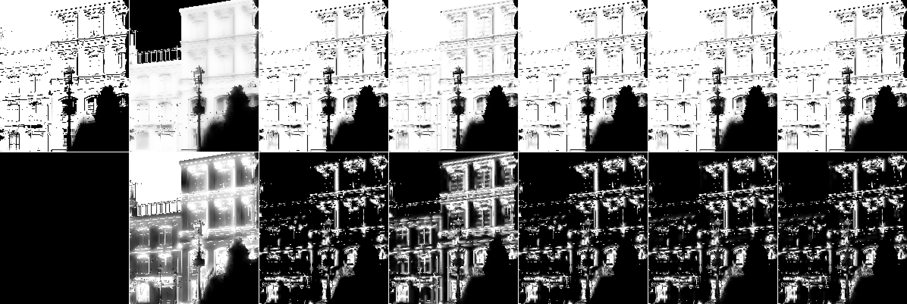
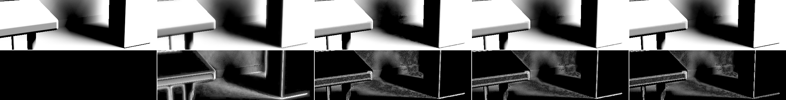
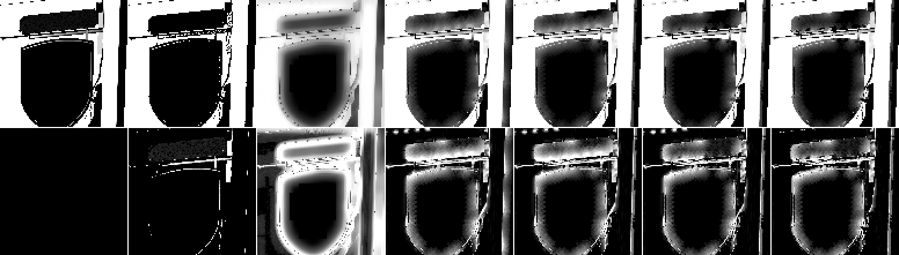
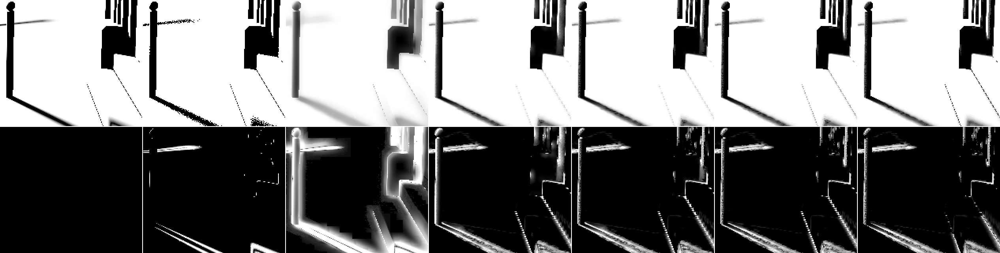

# Shadows: the v2.2 look and the small moving light

_shadows agent (implementer / evaluator, RULES.md rule 8: no NRD code, README, release notes or port read).
2026-10-26. Package pinned at 649be5a (= 546c777 for `packages/`), served from a `git archive` snapshot; the new
options (committed in 1a2861a) ran from a second snapshot with only `shadow.ts` and `shaders/shadow.ts` swapped. Quality on 960×540 replays
(`score-captures.mjs`, `compare.mjs`) and the live test bed at 1080p (7 paths × 96 frames, 256-spp references); cost
on the solo bench. Provisional, like every shadow default (SPEC §12)._

Two reports, one investigation:

- **A. Look** (Dennis, live `realtime-shadows.html`): v2.2 stopped the boil but "the look isn't as good".
- **B. Small moving light** (`bistro-move`, a 12 cm lantern moving every frame): the denoiser scored 22.69 dB
  pooled against 24.42 for the raw 1-ray input, and already lost at frame 0.

## Answers (plainly)

1. **The stabilization pass doesn't cause the softer look.** Switched off on its own (`stabilize: 0`), edge
   sharpness, PSNR and the penumbra profile stay the same on every capture. Only the boil comes back (×5 in
   the knot's shadow).
2. **What changed the look is `uniformSnap: 'change'`.** It became the default in 255a06a, right after v2.2.
   Every v2.2 number in results/M4.md ran with `uniformSnap: true`. With `'change'` and a moving camera, lit and
   umbra areas next to fine shadow detail keep a resampled, fractional history: a grey veil over the detail.
   On Bistro the façades lose 12 % of their edge contrast (sharpness 0.680 → 0.595) and 0.68 dB. With a still
   camera there is no difference, so the knot page only shows it when the view moves. The mechanism: `'change'`
   snaps only when the history sits outside the clamp window, and next to hard edges `clampEdgePx` widens that
   window toward "no clamp" on purpose, so those pixels never snap. `clampEdgePx: 0` restores the edges too
   (0.674).
3. **All v2.x versions soften hard edges.** On a still camera, edges reach 80 % of the reference's gradient (FFX
   64 %). The causes are spatial, and the same ones lose `bistro-move`:
   - the H18 noise-sized half of the radius blend (`noiseBlend` 0.5): E is large at any clean step, so a
     near-hard shadow gets a several-pixel kernel;
   - the terminator radius (16 px at 1080p) on surfaces facing away from the light. Their 1-ray visibility is
     exactly 0, and the filter pulls light in from neighbours (Bistro's hanging sign, the bollard);
   - the 1-px minimum radius (`minRadius`), which blurs edges whose penumbra is narrower than a pixel.
4. **Fixes, as options with the default path byte-identical:**
   - `snapHardPx` (uniformSnap `'change'` also snaps where the pixel's own penumbra is under N px);
   - `backfacePass` (pixels with the whole light below their horizon keep their input);
   - `noiseCap` / `noiseCapSettled` (cap the noise radius at k × the occluder-sized radius, settled pixels only).

   **`backfacePass: true` + `snapHardPx: 2` passes rule 9** on the 1080p test bed, the standard captures and the
   eleven real-scene captures: +0.11 dB pooled at 1080p, FLIP −6 % / −9 % / −14 %, the same cost. It changes the
   look (crisper edges on a moving camera, back faces stay black), so it goes to Dennis as a proposed flip
   (TASKS). Adding `noiseCap` gains a further +0.67 dB on the real scenes and +1.75 dB on `bistro-move`. It
   **fails rule 9's boil clause** on the test bed (boil +6 % mean, static-penumbra boil up to +17 % on one
   capture), so it stays an option, and that trade is a question for Dennis.
5. **`bistro-move` is mostly the spatial filter, not temporal lag.** Temporal accumulation alone
   (`spatialPasses: 0`) scores 28.35 dB, 4 dB above the raw input. The light leaking into the umbra (+0.034
   bias) is spatial blur from lit taps. With the proposed flip it scores 22.98; with `noiseCap` 24.73, above the
   raw input. Frame 0 still loses (23.4 vs 25.0), because fresh pixels keep the noise radius. The variants that
   win frame 0 lose 0.4 dB on the 1080p test bed (below).

## Setup

| | |
|---|---|
| captures | real: `three-knot-static`, `three-knot-still` (frozen knot, control), `three-knot-orbit`, `three-orbit`, `three-pan`, `sponza-orbit` / `-pan` / `-move`, `bistro-orbit` / `-pan` / `-move` (960×540, 32–48 frames, per-pose references); test bed: the 7 `std540-*` reset windows (16 frames) |
| live | test bed `signal=shadows&mode=eval&preset=full&path=<p>`, variants as `shadows@sh.<opt>=<v>` in one page per path (shared references), 7 paths |
| metrics | pooled PSNR (rank on this), penumbra pooled, LDR-FLIP, boil (`score-captures.mjs`; `compare.mjs` dynamic / static-penumbra boil); **edge sharpness** (new, this doc): mean \|∇output\| / mean \|∇reference\| over pixels where the reference gradient exceeds 0.1 per pixel (1 = as crisp as the reference, < 1 = softer, noisy input 1.5–1.8); error bands (box 15 low / box 3 − box 15 mid / rest high) |
| variant names | `v22` = shipped defaults (stabilize 0.25, uniformSnap `'change'`); `v21` = `stabilize: 0, uniformSnap: true` (= v2.1 as measured in M4); `s0` = `stabilize: 0`; `snap` = `uniformSnap: true`; `sh2` = `snapHardPx: 2`; `bf` = `backfacePass`; `bfsh2` = both; `NCs2` = `noiseCap: 2, noiseCapSettled: true`; `rec` = NCs2 + bf + sh2; `cand` = rec + `minRadius: 0.5, mergeMin: false` |
| raw numbers | [data/shadows-look.json](data/shadows-look.json) |

## A. The look

### What the pictures show

Bistro, moving camera (`bistro-orbit` frame 30), far façade; tiles: reference | FFX | v2.1 | **v2.2 as shipped** |
v2.2 `uniformSnap: true` | v2.2 `snapHardPx: 2` | `rec`; second row |error| × 4:



The shipped v2.2 (4th) lays a light-grey veil over the lit façade between the shadow details, and the error row
lights up all over it. v2.1, `uniformSnap: true` and `snapHardPx: 2` keep the façade white and the details
crisp. That is the "less good look": it comes from `'change'`, not from the stabilization.

Knot corner, still camera (`three-knot-static` frame 30): reference | FFX | v2.1 | v2.2 | `rec`:



On a still camera v2.1 and v2.2 can't be told apart (same error bands, same sharpness 0.80). The table's rounded
front edge (a self-shadowing terminator band) and the pedestal's silhouette are softened by every version. `rec`
keeps more of the band.

### Ablation: v2.2's components one at a time

Real captures: pooled PSNR, mean of 9 captures (no `-pan` Bistro / Sponza). Sharpness on a still camera
(knot-still) and on two moving cameras. Boil: the knot's wall shadow (M4 §12.1 rect) on the frozen control.

| variant (vs shipped `v22`) | real pooled | std540 pooled | sharpness knot-still | three-orbit | bistro-orbit | knot rect boil |
|---|---|---|---|---|---|---|
| **v22 (shipped)** | 28.90 | 35.49 | 0.799 | 0.761 | 0.595 | 0.0014 |
| `stabilize: 0` | 28.89 | 35.46 | 0.799 | 0.762 | 0.597 | 0.0068 |
| `uniformSnap: true` | 29.01 | 35.51 | 0.799 | **0.773** | **0.679** | 0.0014 |
| v2.1 (both above) | 28.99 | 35.47 | 0.800 | 0.774 | 0.680 | 0.0069 |
| `clampEdgePx: 0` | 28.87 | 35.49 | 0.794 | 0.768 | 0.674 | 0.0014 |
| `noiseBlend: 0` (radius blend off) | 29.57 | 34.92 | **0.819** | 0.773 | 0.629 | 0.0013 |
| `clampGeometry: false` | 28.45 | 34.01 | 0.746 | 0.676 | 0.567 | 0.0015 |
| `youngMean: 0` | 28.85 | 35.21 | 0.799 | 0.762 | 0.595 | 0.0014 |
| `rotationStep: 0` | 28.91 | 35.48 | 0.799 | 0.761 | 0.595 | 0.0012 |
| `stabilizeBox: 0.03` | 28.90 | 35.50 | 0.799 | 0.762 | 0.596 | 0.0015 |
| FFX | 25.17 | 30.85 | 0.642 | 0.514 | 0.330 | 0.0012 |
| reference (its own boil) | | | 1 | 1 | 1 | 0.0041 |

- **The stabilization** changes sharpness by ±0.002 and PSNR by ≤ 0.03 dB, and takes the boil from 0.0068 to
  0.0014. It is not the softening.
- **`'change'`** costs sharpness only on moving cameras: 1.5 % (corner), 12 % (Bistro), 2 % (Sponza 0.708 →
  0.692). Real-scene pooled −0.11 (Bistro orbit −0.68, pan −0.47). On the test bed it is +0.16 dB at 1080p,
  which is why it was chosen (REMEASURE §4).
- **The radius blend** (`noiseBlend`) costs sharpness everywhere (the H18 radius is large at hard steps), and it
  is +0.57 dB on the test bed's soft shadows. So it should be capped, not switched off.
- **The clamp window** (`clampGeometry`, `clampEdgePx`) is not a softening source on its own: turning it off makes
  edges softer. `clampEdgePx` only matters through its interaction with `'change'`.
- Error bands (knot-still, time-mean error): v2.1 and v2.2 have identical low / mid / high bands (44.1 / 39.2 /
  35.2 dB vs 44.2 / 39.1 / 35.2). v2.2 only removes temporal noise (45.3 → 46.5 dB). Nothing in v2.2 adds
  blotches or low-frequency blur on a still camera.

### Fix A: `snapHardPx`

With `uniformSnap: 'change'`, also snap a uniform 5×5 window to its value where the pixel's own penumbra (W_px,
the same quantity the history cap and `clampEdgePx` use) is narrower than `snapHardPx` pixels. There, a uniform
window means the pixel is outside the penumbra. A fractional history at that spot is only resampling blur from
the nearby edge. Wide, steady outer penumbrae keep `'change'`'s behaviour.

`snapHardPx: 2` (= `clampEdgePx`): edge sharpness 0.771 / 0.679 / 0.707 on three-orbit / bistro-orbit /
sponza-orbit (shipped 0.761 / 0.595 / 0.692, `uniformSnap: true` 0.773 / 0.679 / 0.708). It keeps `'change'`'s
test-bed lead over `true` (1080p 38.39 vs 38.22), and on the real scenes it matches `true` (28.48 vs 28.47).

## B. `bistro-move`

Per reference class (umbra ≤ 0.02, penumbra, lit ≥ 0.98; 105 k / 12 k / 388 k px per frame), pooled dB (bias):

| variant | pooled | umbra | penumbra | lit | frame 0 | frames 45–47 |
|---|---|---|---|---|---|---|
| noisy (1 ray) | 24.42 | 43.52 (0.000) | 8.07 | 47.22 | 25.0 | 24.3 |
| **v22 shipped** | 22.69 | 18.12 (+0.034) | 13.72 (+0.060) | 28.09 | 23.1 | 22.7 |
| `noiseBlend: 0` | 24.67 | 20.95 (+0.025) | 14.44 | 29.27 | 25.2 | 24.6 |
| `noiseBlend: 0, minRadius: 0.5` | 27.23 | 23.96 (+0.014) | 14.10 | 36.82 | 25.6 | 27.3 |
| `noiseBlend: 0, spatialPasses: 0` (temporal only) | 28.35 | 27.68 (+0.007) | 13.72 | 37.69 | 26.1 | 27.8 |
| `backfacePass` | 22.98 | 18.66 (+0.029) | 13.72 | 27.99 | 23.4 | 22.8 |
| `bfsh2` (proposed flip) | 22.98 | 18.68 | 13.63 | 28.01 | 23.4 | 22.9 |
| `NCs2` + bf | 24.74 | 21.33 (+0.021) | 14.32 | 28.98 | 23.4 | 25.0 |
| `rec` | 24.73 | 21.37 (+0.020) | 14.21 | 29.00 | 23.4 | 25.0 |
| `cand` (+ `minRadius: 0.5`, `mergeMin: false`) | 27.05 | 24.20 (+0.011) | 14.36 | 33.57 | 23.4 | 28.2 |
| FFX | 19.65 | 15.75 (+0.066) | 11.13 | 23.40 | 21.7 | 18.3 |

Causes, in order of size:

1. **The noise-sized half of the radius** (+2.0 dB when removed or capped). The lantern (r 0.12 m, 2–10 m away)
   casts sub-pixel penumbrae, but H18's E is large at every clean step, so the kernel blends toward 32 px · E.
   Umbra pixels next to lit ones take in light (umbra bias +0.034) and lit pixels next to shadows darken.
   `noiseCap: 1 / 2 / 4` measured the same (24.68 / 24.67 / 24.67): the cap binds hard where it matters.
2. **The 1-px minimum radius** (another +2.5 dB once the noise radius is capped). An edge narrower than a pixel
   still gets a 1-px disk, and with `minRadius: 0.5` all 8 taps land on the centre pixel. This one doesn't carry
   over to the 1080p test bed (below).
3. **The terminator radius on back faces** (`backfacePass`: +0.3 dB, +1.2 on top of the two above). The hanging
   sign and the bollard face away from the lantern: visibility 0 on every ray, no occluder distance. They took the
   16 px terminator radius and the lit wall bled in:
   
4. **Temporal lag is small.** Temporal accumulation alone keeps the umbra almost exact (bias +0.007). The
   history cap ~W_px² holds hard edges to 1–2 frames, and `clampEdgePx`'s open window lets them follow the raw
   samples. `clampEdgePx: 4` was −0.3 dB, `minHistory: 0` +0.1. The "trailing" in the scenes doc is mostly the
   spatial blur sitting on the moving edge.

Bollard and ground shadow (frame 24): reference | noisy | FFX | v22 | bf | `rec` | `cand`:



**Frame 0** still loses (23.4 vs 25.0) with every variant except `noiseBlend: 0`: `noiseCapSettled` leaves fresh
pixels uncapped, because capping them cost the reset windows 1.5–4.8 dB at frame 0. The capped occluder radius
there comes from one sample and from the 3×3-tile minimum ("nearest occluder wins"), which is near zero next to
contact points. Filed as a follow-up.

### Fixes tried for the noise radius (TASKS rule 8: two failures, then move on)

| try | real (5 caps) | std540-orbit | std540-light | verdict |
|---|---|---|---|---|
| `noiseCap: 2` (every pixel) | +0.54 | −0.45 | 0.00 | young pixels lose: frame 0 of the reset windows 33.0 → 31.5 |
| `noiseCap: 2` + `minRadius: 0.5` | +0.87 | −2.08 | −0.71 | frame 0 28.2 dB |
| … + `mergeMin: false` (own occluder estimate only) | +1.28 | −0.62 | −0.11 | better, still loses |
| **`noiseCap: 2, noiseCapSettled: true`** (+ bf) | +0.83 | +0.09 | +0.12 | kept as the option |
| … + `minRadius: 0.5`, `mergeMin: false` (`cand`) | +1.51 | −0.03 | +0.01 | wins the 16-frame replays, **loses −0.16 dB at 1080p live** (`thin` −0.57, `orbit` −0.12, `pan` −0.29): settled 1080p penumbrae need the 1-px floor |

## Rule-9 A/B

Defaults bit-identical: the default `shadows` output was byte-compared old package vs new on `std540-orbit`,
`std540-light`, `three-knot-static`, `bistro-move`, `std540-object` with `uniformSnap: true, stabilize: 0`, and
`shadows-translucent` on `m8-glass-moving` (wide and packed paths): every `.f32` identical. The default WGSL
differs only by a never-true `|| wPx < 0` in the snap test and the params struct (one row added, translucency
fields moved by 4 floats).

**Live test bed, 1080p, 7 paths × 96 frames** (means of the per-path pooled values; flicker / tPSNR on the error):

| variant | pooled | penumbra | FLIP | flicker | tPSNR | dynamic | static penumbra |
|---|---|---|---|---|---|---|---|
| **shipped** | 38.38 | 29.37 | 0.0132 | 0.0024 | 41.09 | 24.05 | 30.76 |
| `backfacePass` | 38.48 | 29.39 | 0.0124 | 0.0024 | 41.08 | 24.08 | 30.80 |
| `snapHardPx: 2` | 38.39 | 29.37 | 0.0132 | 0.0024 | 41.10 | 24.04 | 30.76 |
| **`backfacePass` + `snapHardPx: 2`** | **38.49** | 29.39 | **0.0124** | 0.0024 | 41.09 | 24.07 | 30.80 |
| `NCs2` | 38.48 | 29.42 | 0.0131 | 0.0024 | 40.92 | 24.34 | 30.71 |
| `NCs2` + bf | 38.58 | 29.45 | 0.0124 | 0.0024 | 40.91 | 24.37 | 30.75 |
| `rec` (`NCs2` + bf + sh2) | **38.60** | 29.44 | **0.0123** | 0.0024 | 40.94 | 24.37 | 30.75 |
| `noiseCap: 2` (not settled) + bf | 38.48 | 29.33 | 0.0124 | 0.0025 | 40.68 | 24.30 | 30.61 |
| `cand` | 38.22 | 29.09 | 0.0126 | 0.0024 | 41.01 | 24.21 | 30.32 |
| `uniformSnap: true` | 38.22 | 29.16 | 0.0131 | 0.0024 | 41.09 | 24.03 | 30.48 |
| FFX | 31.20 | 23.50 | 0.0379 | 0.0053 | 38.71 | 19.31 | 24.42 |

Per path, pooled (shipped → `bfsh2` → `rec`): orbit 37.83 → 37.92 → 38.40, pan 40.07 → 40.19 → 40.09, light
34.35 → 34.64 → 34.94, thin 37.62 → 37.60 → 37.53, glossy 42.92 → 42.99 → 42.89, cut 38.74 → 38.92 → 39.24,
object 37.16 → 37.21 → 37.13. No path loses more than 0.09 dB.

**Captures** (means over captures; boil ratios vs shipped, mean and worst capture):

| | real (11) pooled | penumbra | FLIP | boil | dynamic boil | static-penumbra boil | std540 (7) pooled | FLIP | boil | static-penumbra boil |
|---|---|---|---|---|---|---|---|---|---|---|
| shipped | 28.33 | 22.92 | 0.0362 | 0.0085 | 0.0743 | 0.0197 | 35.49 | 0.0207 | 0.0049 | 0.0219 |
| `bf` | 28.71 | 22.98 | 0.0340 | −2 % | +2 % (max +10 %) | +1 % (max +3 %) | 35.64 | 0.0190 | 0 % | 0 % |
| `sh2` | 28.48 | 22.88 | 0.0334 | +3 % | +13 % (max +38 %) | +3 % (max +8 %) | 35.52 | 0.0206 | 0 % | 0 % |
| **`bfsh2`** | **28.86** | 22.94 | **0.0313** | +1 % (max +8 %) | +15 % (max +38 %) | +3 % (max +8 %) | **35.66** | **0.0189** | 0 % (max +1 %) | 0 % |
| `NCs2` + bf | 29.35 | 23.26 | 0.0331 | −7 % | +4 % | +6 % (max +17 %) | 35.57 | 0.0190 | **+5 % (max +12 %)** | +3 % (max +17 %) |
| `rec` | **29.53** | 23.21 | 0.0303 | −4 % | +17 % (max +39 %) | **+9 % (max +18 %)** | 35.60 | 0.0189 | **+6 % (max +12 %)** | +3 % (max +17 %) |
| `uniformSnap: true` | 28.47 | 22.84 | 0.0333 | +3 % | +13 % | +3 % | 35.51 | 0.0203 | 0 % | 0 % |
| v2.1 | 28.45 | 22.78 | 0.0328 | +9 % | +14 % | +16 % | 35.47 | 0.0195 | +18 % | +12 % |
| FFX | 24.56 | 19.36 | 0.0730 | −20 % | −9 % | +3 % | 30.85 | 0.0521 | +22 % | +4 % |

Reading the boil columns (LESSONS: "boil rewards stillness"; the dynamic region on moving-camera captures is
mostly hard-edge resampling, with the reference's own boil 0.07–0.27, far above every output's):

- The snap variants' +13–17 % dynamic boil on the real scenes comes from the moving-camera captures. A crisp
  edge that is resampled every frame changes more than a blurred one, the same way v2.1 and `uniformSnap: true`
  do. On the captures where the dynamic region is real motion (knot-static, sponza-move, bistro-move,
  std540-object, std540-light), `bfsh2`'s dynamic boil is +0.5 / +0.7 / +4 / 0 / +0.3 %. The one
  regional excess for `bfsh2` is `bistro-move`'s static penumbra: 0.0522 vs 0.0483 (+8 %; FFX 0.0592).
- `NCs2` / `rec` raise the test bed's boil by 5–6 % on average (std540-light +12 %, static penumbra up to
  +17 %), and the real scenes' static-penumbra boil by 6–9 % (sponza-move +17 %). The noise-sized kernel was
  part of what kept wide penumbrae calm. This is rule 9's boil clause failing, and `rec` stays an option for
  that reason.

**Cost** (1080p solo bench, `mode=bench&preset=full`, 3 alternating rounds after a warm-up page, median of
100 frames per run, the three runs listed; this session read the shipped defaults ~0.02 ms above M4 §12.6's
fastest runs):

| path | shipped | `bfsh2` | `rec` |
|---|---|---|---|
| orbit | 0.621 / 0.620 / 0.617 | 0.619 / 0.622 / 0.615 | 0.621 / 0.619 / 0.615 |
| thin | 0.742 / 0.745 / 0.743 | 0.724 / 0.725 / 0.723 | 0.724 / 0.725 / 0.723 |

No cost change. On `thin`, back faces skipping the 8-tap kernel even save 0.02 ms. Memory unchanged (48 B/px).

### Verdict

| change | rule 9 | proposal |
|---|---|---|
| `backfacePass: true` | **passes** (every PSNR up, FLIP −6…−8 %, boil within ±2 % on average) | default flip (look: back faces stay black) |
| `snapHardPx: 2` | **passes** on means (1080p +0.01, real +0.15, FLIP −8 % real); regional: `bistro-move` static-penumbra boil +8 % | default flip, together with the one above (look: crisper edges on a moving camera, the façade veil gone) |
| both (`bfsh2`) | **passes** (1080p +0.11 dB, FLIP −6 %, flicker / tPSNR equal; real +0.53 dB, FLIP −14 %; std540 +0.17, FLIP −9 %), with the `bistro-move` note above | **proposed to Dennis** (TASKS) |
| `noiseCap: 2, noiseCapSettled: true` on top (`rec`) | PSNR / FLIP / flicker pass (1080p +0.22 dB, real +1.20 dB, `bistro-move` +2.0 dB); **boil clause fails** (std540 +6 %, static penumbra up to +17–18 %); tPSNR −0.15 at 1080p | option only; question for Dennis (sharper hard shadows vs calmer wide penumbrae) |
| `minRadius: 0.5`, `mergeMin: false` | fails (1080p −0.16 dB, real penumbra −1.0 dB) | not proposed; follow-up for frame 0 under hard lights |
| `uniformSnap: true` (back to v2.1's snap) | fails (1080p −0.16 dB) | not needed: `snapHardPx` gets its real-scene look and keeps `'change'`'s test-bed lead |

## Static-penumbra boil under the sun (scenes finding 3)

Static-penumbra boil, ours vs FFX on the moving-camera Sponza / Bistro captures (orbit / pan / move): v22 is +9 /
+23 / +10 % (Sponza) and +8 / +19 % (Bistro orbit / pan) above FFX, at +3.7…5.2 dB better static-penumbra PSNR.
`bfsh2` adds 1–3 % to that, and `rec` adds 5–18 % (the noise-sized kernel was averaging there). The stabilization
already brought it down from v2.1's +18…32 % above FFX. Not addressed here. `rotationStep: 0` (fixed kernel
rotation) is the cheapest lever left (knot rect boil 0.0014 → 0.0012, ±0.01 dB), and it is still unmeasured on
the sun captures (TASKS).

## Reproduce

```sh
# pinned server (old package) and the new one (this doc's two files swapped in)
git archive 649be5a packages examples/realtime-denoiser examples/_shared tools/rt-capture package.json | tar -x -C $PIN
ln -s $PWD/node_modules $PIN/node_modules
RT_CAPTURE_DIR=$PWD/tools/rt-capture RT_REALTIME_SRC=$PIN/packages/denoiser-realtime/src \
  node node_modules/vite/bin/vite.js $PIN/examples/realtime-denoiser --port 5420 --strictPort --host 127.0.0.1
# replays: one query per (capture, variant), e.g.
BASE=http://127.0.0.1:5420/ node examples/realtime-denoiser/run-headless.mjs \
  "mode=replay&capture=bistro-move&denoiser=shadows&output=sl-bfsh2&warm=0&sh.backfacePass=true&sh.snapHardPx=2"
node examples/three-temporal/score-captures.mjs bistro-move --denoisers sl-v22,sl-bfsh2 --json out.json
node tools/rt-capture/compare.mjs bistro-move sl-v22 sl-bfsh2 --outputs <scratch root of symlinks> --quiet
# live 1080p A/B, one page per path
BASE=... node examples/realtime-denoiser/run-headless.mjs --json=A-orbit.json \
  "signal=shadows&mode=eval&preset=full&path=orbit&denoiser=shadows,shadows@sh.backfacePass=true@sh.snapHardPx=2"
```

Edge sharpness and the error bands came from scratch scripts (gradient ratio where |∇ref| > 0.1; masked box
filters 3 / 15): see "metrics" in Setup. Folding them into `compare.mjs` is a TASKS item.
