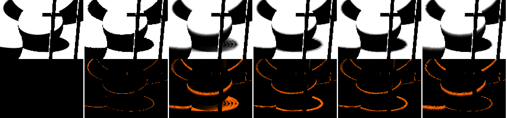
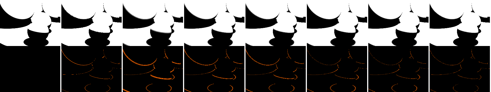
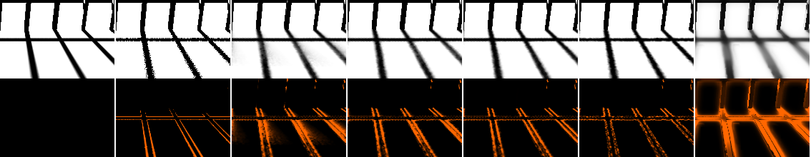

# Shadows in motion: camera, light and occluder separated

_shadows agent (implementer / evaluator, RULES.md rule 8: no NRD code, README, release notes or port read; only the
reviewed audit copies `sources/audit-*.md`, never the originals). 2026-10-26. Review target 4 of the audit handoff +
the SHADOWS-LOOK follow-ups. Packages served from pinned `git archive` snapshots (old defaults = 45d3ac6, the q21
flip = cc8f1e7's `resolveShadowOptions`, candidates = 39a3da1's options); quality on 960×540 replays and the live
1080p test bed; cost on the 1080p solo bench. Provisional, like every shadow default (SPEC §12)._

**Baselines.** Dennis approved q21 (a) during this work: `backfacePass: true` + `snapHardPx: 2` are the defaults since
cc8f1e7. In this doc **"shipped" = the new defaults** (v2.2 + `'change'` + `snapHardPx: 2` + `backfacePass`; replay
names `sm-flip`, `sm-ship`, `ab-ship`, byte-identical to each other). **"v22"** = the defaults before cc8f1e7
(`sm-v22`). `rec` = shipped + `noiseCap: 2, noiseCapSettled: true` (q22: stays an option). Every table says which
rows it holds.

## Conclusion (plainly)

1. **Boil is not caused by motion.** The frozen controls boil exactly as much as the moving sequences (hard-light edge
   boil 0.0186 frozen vs 0.0182–0.0187 moving; sun penumbra 0.0109 vs 0.0110–0.0112), except while the sun moves
   (+50 % in the wide penumbra, anti-lag restarts). The per-frame rotation of the spatial kernel is the biggest boil
   source we can remove for free: `rotationStep: 0` cuts motion-compensated boil by 13 % on the 11 real captures
   (edges −15 %, contacts −17 %, static −14 %) and by 12–30 % at hard edges on the new captures, at ±0.02 dB. The
   references here are frame-to-frame identical on static pixels (boil 0), so any output change there is boil.
2. **The "ripple" Dennis described is real and was trailing, not noise.** Under a hard light, a moving occluder's
   shadow left concentric echo rings with the old defaults (image below): `'change'` never snaps next to hard edges
   and the clamp window is opened there on purpose, so old shadow values decayed over several frames. **The q21 flip
   (`snapHardPx: 2`) already removes the rings** (trail 0.349 → 0.244, changing-region PSNR 8.5 → 10.0 dB). What is
   left is a 1–2 px band that keeps half its history; the new `edgeBox` option (3×3 min / max clamp at hard edges)
   takes it to 0.166 / 12.0 dB and the lag from 0.6 frames to 0. Under a slowly moving sun the output trails by ~2
   frames (0.4 px); FFX trails 4.8.
3. **Blur is spatial, exists before any history, and is worst at hard edges, contacts and terminators.** Temporal
   accumulation alone (`spatialPasses: 0`) beats the full denoiser by 4 dB on the hard-light frozen scene, and at
   contacts the denoiser is *below the raw input* (15.8 vs 21.9 dB; temporal-only 29.5). Causes, measured one at a
   time: the H18 noise-sized kernel at clean steps (E is large at every step: `stepTest` +1.4 dB, contact +2.0), the
   16 px terminator kernel on occluder-free terminators (`terminatorAnalytic` +0.7 dB hard light, +1.0 sun, +1.47 dB
   at 1080p on the test bed) and, still open, the 1-px floor at contacts.
4. **Camera-only motion adds no trailing**; it softens edges in the region that changes (sharpness 0.77 vs 0.89 static)
   through history resampling, and the flip already took most of the grey veil away (SHADOWS-LOOK).
5. **Three new options, default off, default output byte-identical** (39a3da1): `stepTest`, `edgeBox`,
   `terminatorAnalytic`. **Proposed flip (passes rule 9): `stepTest` + `edgeBox` +
   `rotationStep: 0`** = 1080p +0.07 dB (no path below −0.01), FLIP equal; real captures +0.43 dB, FLIP −3 %, boil
   −15 %; std540 +0.02, boil ±0; sharper (0.753 → 0.766 real); cost +2…5 %. **`terminatorAnalytic`** is the biggest single gain we
   have measured on shadows (1080p +1.47 dB, FLIP −24 %, flicker −25 %, every path up; real +0.63, FLIP −4 %; sun
   +0.9–1.1 dB with an exact light direction) but it fails rule 9 on one region of one capture (`bistro-move`
   dynamic boil +8 %, above the reference's) and it relies on the renderer's horizon rule matching the denoiser's
   normal (SH-7): a separate question for Dennis.
6. **`noiseCap` without the boil** (q22 follow-up): gating the cap to narrow penumbrae (`noiseCapPx`, tried, not kept)
   changed nothing, because the cap binds where the occluder estimate is too small (the 3×3-tile minimum next to
   contacts), not in wide penumbrae. `stepTest` is the boil-free alternative: it gets 90 % of `rec`'s PSNR gain on
   the hard captures (+1.42 vs +1.54 dB frozen) with the wide-penumbra boil unchanged (`rec` +39 % on the sun).

## Inventory: what already covered motion before this doc

| question | covered before | where | gap filled here |
|---|---|---|---|
| camera-only motion | test bed `orbit`, `pan`, `thin`, `glossy`, `cut` (one big sphere light, wide penumbrae); real `three-orbit`, `three-pan`, `bistro-orbit` / `-pan`, `sponza-orbit` / `-pan` | M4 §10–12, SHADOWS-LOOK | no stop / hold / reverse, no frozen control of the same view, no hard light on a moving camera |
| light-only motion | test bed `light` (big light orbits, flips, shrinks to r 0.25); `bistro-move` (lantern r 0.12 m, 7 cm/frame, static camera) | M4 §12.7, SHADOWS-LOOK §B | no wide-light (sun) case, no stop / reverse, no frozen lantern |
| occluder-only motion | test bed `object`; `three-knot-static` / `-orbit` (rotating knot, near light); `sponza-move` (knot in the sun) | M4 §12 | no hard-light case, no stop / reverse |
| frozen control | `three-knot-still`, `m8-glass-still`, `v1-glass-still` | M4 §12.2, M8 | none for a hard light or a sun |
| first-frame control | frame-0 PSNR of reset windows | M4 §11, SHADOWS-LOOK | one frame per capture; no "spatial filter alone" over a whole sequence |
| raw input, reference noise | noisy rows; E-1 (256 vs 4096 spp), reference boil as floor | E1, M4 §12.1 | — |
| metrics | pooled PSNR, penumbra, FLIP, flicker / tPSNR, dynamic / static split, boil (compare.mjs, score-captures.mjs); sharpness and error bands in scratch scripts | | no hard-edge / contact regions, no trailing measure, no move / stop / reverse split, sharpness not in a tool |

## Setup

| | |
|---|---|
| captures (new) | 8 test-bed paths `sm-{hard,sun}-{camera,light,object,frozen}` (examples/realtime-denoiser/src/paths.ts, capture set `shadow-motion`, 80 frames, 960×540, shadows only, 256-spp references, 45d3ac6). One mover per path: camera orbit (0.25 rad), light (hard: sphere r 4 cm, 1.4 m travel at 6 cm/frame; sun: sphere r 8 at distance 100 = 0.08 rad, azimuth +0.25 rad), occluder (sphere resting on the floor, 1.4 m at 6 cm/frame), or nothing. Profile: frames 1–24 move, 25–40 hold, 41–64 reverse back, 65–79 hold. Every path equals its frozen control at frame 0 and from frame 64 on, with the same 1-ray samples: the last 15 frames compare the same view reached through different histories |
| sun | replayed with `sh.light=directional` (the registry's stand-in: direction from the world origin, angular radius asin(R / d)), as the real sun scenes use the directional path. Caveat found here: the test bed renders a sphere at distance 100, so per-pixel directions differ from the stand-in's by up to ~0.03 rad (0.4 θ). Filtering doesn't care; `terminatorAnalytic` does, and was re-run with the exact sphere light (§ "terminatorAnalytic") |
| real / standard | the 11 real captures (`three-knot-static` / `-still` / `-orbit`, `three-orbit`, `three-pan`, `sponza-orbit` / `-pan` / `-move`, `bistro-orbit` / `-pan` / `-move`) and the 7 `std540-*` |
| controls | raw 1-ray input (`noisy`); **no-history control** `sh.noHistory=true` (new registry switch: history reset before every frame = the spatial filter alone, `sm-noh`); temporal only (`spatialPasses: 0`, `sm-tonly`); FFX |
| reference noise | on static pixels the 256-spp references are identical from frame to frame (seeded per pose), so their boil is 0 and any output change there is boil; on moving cameras the reference's own boil (resampling) is listed. PSNR ceiling ~49 dB (E-1) |
| metrics (new) | `tools/rt-capture/shadow-regions.mjs`: regions **edge** (reference gradient ≥ 0.2 /px, dilated 1 px), **soft** (other penumbra), **contact** (edge or penumbra with a 5×5 mean occluder distance < 0.25), umbra / lit (bias), **changing** / static (compare.mjs's dynamic region); pooled PSNR, bias, **motion-compensated boil** (second temporal difference along the reprojected history, counted only where the reference's own second difference is < 0.02: legitimate motion is reprojected away, what is left is shape / texture change, the "undulating" Dennis described), **edge sharpness** (Σ\|∇out\| / Σ\|∇ref\| where \|∇ref\| > 0.1), **trailing**: lag = the k minimizing Σ(out_t − ref_t−k)² over changing pixels, and arrive / leave bias (out − ref where the shadow arrives / leaves; trail = (arrive − leave) / 2, > 0 = behind), per motion phase. compare.mjs got the sharpness column (reproduces SHADOWS-LOOK's 0.595 / 0.680 on Bistro within 0.01) |
| raw numbers | [data/shadows-motion/](data/shadows-motion/) (region JSON per capture, A/B JSON); tables by [data/shadows-motion-table.mjs](data/shadows-motion-table.mjs) and [data/shadows-motion-ab.mjs](data/shadows-motion-ab.mjs) |

## Cause / evidence table

Shipped = new defaults unless a row says v22. "Before history" = present in the no-history control. "Frozen" = present
in the frozen control.

| symptom | where (capture, region) | evidence | before history? | frozen? | cause | fix measured | uncertain |
|---|---|---|---|---|---|---|---|
| **echo rings behind a moving hard shadow** | sm-hard-object, changing region | v22 trail 0.349, changing 8.5 dB (raw 15.9, no-history 17.9); temporal-only shows the rings too | no (no-history trail 0.031) | no | `'change'` doesn't snap next to hard edges, and `clampEdgePx` opens the clamp there: old values decay over the 2-frame cap | q21 flip: trail 0.244, 10.0 dB, rings gone; + `edgeBox` 0.166, 12.0 dB, lag 0.6 → 0 | — |
| hard edge lags a moving light | sm-hard-light, changing | shipped trail 0.142, changing 14.1 (no-history 19.3); temporal-only same trail (0.139) | no (0.030) | no | the history keeps ≥ ½ weight at every edge pixel (cap ≥ 1) and the clamp is open there | `edgeBox` 0.133; with `terminatorAnalytic` 0.128 | the 0.03 left in the no-history control is spatial (kernel asymmetry on moving edges) |
| sun shadow lags ~2 frames | sm-sun-light, changing | lag 2.2 frames (0.4 px at 0.19 px/frame), trail 0.071; FFX 4.8 / 0.114; anti-lag off 4.1 / 0.120; stabilization adds 0.1 frame | no | no | the 15-frame cap in wide penumbrae, cut by the clamp-distance anti-lag | `terminatorAnalytic` 1.6 frames (its terminator pixels follow at once) | the post-stop residue (next row) |
| quality after the light stops | sm-sun-light hold, vs frozen control at the same frames | 1–15 frames after returning: 35.46 vs 38.17 dB (sun), 30.83 vs 31.80 (hard); the camera / occluder paths reach the frozen value (≤ 0.15 dB) | n/a | n/a | anti-lag restarts while the light moves leave short histories that need the full cap to re-converge | none tried (an anti-lag v3 item, TASKS) | — |
| **blur at hard edges** | sm-hard-*, edge | shipped edge 21.8 dB / sharpness 0.886 vs temporal-only 25.8 / 1.00 (frozen) | yes (no-history edge 19.4) | yes | the H18 noise-sized half of the radius: E is large at every clean step (SHADOWS-LOOK) | `stepTest`: 23.2 dB, 0.909 (frozen); real +0.42 dB | — |
| **contacts below the raw input** | sm-hard-*, contact | shipped 15.8 dB, raw 21.9, temporal-only 29.5 | yes (15.5) | yes | spatial: noise radius (`stepTest` → 17.9), then the 1-px floor and the tile minimum next to the contact | `stepTest` +2.0 dB | the remaining 4 dB to raw; `minRadius: 0.5` lost at 1080p before (SHADOWS-LOOK) |
| **terminators smeared** | sm-hard-frozen spheres; test bed `orbit`…`object` | 16 px kernel on lit pixels next to occluder-free terminators (image) | yes | yes | `terminatorRadius` (an analytic band filtered as if noisy) | `terminatorAnalytic` +0.7 dB hard, +1.0 sun (exact light), 1080p +1.47 | the renderer's horizon rule must match (SH-7) |
| camera-motion softening | sm-*-camera, changing | sharpness 0.77 (hard) / 0.84 (sun) in the changing region vs 0.89 / 0.95 static; no trail (lag 0) | — | no | history resampling at moving edges (Catmull-Rom helps, the flip removed the veil) | `stepTest` 0.80, `terminatorAnalytic` 0.82 | — |
| **boil** | all; edge and soft regions | edge 0.018 (hard) / 0.015 (sun), soft 0.013 / 0.011, equal frozen and moving; reference 0 on static pixels; FFX 0.013 / 0.009 at −10 dB | yes, ×3 (no-history 0.056 / 0.045) | **yes** | (1) the per-frame kernel rotation re-samples the spatial noise, (2) anti-lag restarts in wide penumbrae, (3) the 1-ray history update | `rotationStep: 0`: edge −27 % hard, −12 % sun, soft −9 / −6 %, real −13 %; anti-lag off halves soft boil but doubles the lag (not usable) | — |
| boil while the sun moves | sm-sun-light, soft | 0.0163 vs 0.0109 frozen (+50 %) | — | no | anti-lag restarts in the moving penumbra (anti-lag off: 0.0096) | `terminatorAnalytic` 0.0152 | the anti-lag v3 candidates (TASKS) |
| frame 0 under the hard light | sm-hard-*, frame 0 | shipped 30.4 vs raw 24.6: **no loss here** (unlike `bistro-move`, 23.4 vs 25.0) | — | — | the test bed's hard light (2–3 px penumbrae at 540p) is not sub-pixel like the lantern's | `stepTest` +0.5 dB at frame 0, `terminatorAnalytic` +0.5 | `bistro-move` frame 0 stays below raw: shipped 23.44, `stepTest` 23.85, + ta 24.08 vs raw 25.05 (pooled 22.98 / 23.45 / 23.74 vs 24.42; FLIP 0.043 / 0.041 / 0.040 vs 0.017): the lantern's penumbrae are sub-pixel and the 1-px floor still blurs them |



_sm-hard-object frame 12, |error| × 4 below. The v22 column shows the echo rings behind the moving sphere's floor
shadow; the flip removes them; the no-history control has none but is noisy._



_sm-hard-frozen frame 70. The terminator arcs on the spheres and the contact edges carry most of the error; temporal
accumulation alone is the sharpest._



## Per motion type (new captures)

Pooled PSNR by region (dB), bias, motion-compensated boil, sharpness (static / changing region), lag (frames) and
trail; frame 0; hold = the 15 hold frames after the motion returned, vs the frozen control at the same frames.

**Hard local light**

| capture | variant | all | edge | contact | changing | boil edge | sharp static | sharp chg | lag | trail | frame 0 | hold vs frozen |
|---|---|---|---|---|---|---|---|---|---|---|---|---|
| frozen | raw | 24.71 | 14.92 | 21.88 | – | 0.2335 | 1.236 | – | – | – | 24.64 | |
| | no-history | 29.10 | 19.39 | 15.50 | – | 0.0564 | 0.866 | – | – | – | 29.07 | |
| | temporal only | 35.69 | 25.79 | 29.50 | – | 0.0357 | 1.001 | – | – | – | 26.39 | |
| | v22 | 30.62 | 20.73 | 15.81 | – | 0.0189 | 0.870 | – | – | – | 29.07 | |
| | **shipped** | 31.73 | 21.78 | 15.83 | – | 0.0186 | 0.886 | – | – | – | 30.39 | |
| | rec (noiseCap) | 33.27 | 23.33 | 18.16 | – | 0.0194 | 0.910 | – | – | – | 30.39 | |
| | proposed (st + eb + rot0) | 33.19 | 23.24 | 17.88 | – | 0.0153 | 0.910 | – | – | – | 30.88 | |
| | + terminatorAnalytic | 34.19 | 24.25 | 17.90 | – | 0.0152 | 0.919 | – | – | – | 31.48 | |
| | FFX | 24.96 | 15.80 | 11.97 | – | 0.0127 | 0.675 | – | – | – | 23.85 | |
| camera | v22 / **shipped** / proposed / + ta | 30.05 / 30.92 / 31.80 / 32.48 | 20.18 / 20.98 / 21.86 / 22.55 | 15.53 / 15.58 / 16.76 / 16.77 | 17.40 / 17.57 / 17.88 / 18.87 | 0.0185 / 0.0182 / 0.0170 / 0.0171 | 0.876 / 0.888 / 0.905 / 0.911 | 0.748 / 0.770 / 0.796 / 0.819 | 0 | −0.02 | 29.1 / 30.4 / 30.9 / 31.5 | −0.0 / −0.15 / −0.28 / −0.39 |
| light | v22 / **shipped** / proposed / + ta | 27.00 / 27.68 / 28.55 / 28.92 | 17.33 / 17.83 / 18.66 / 19.04 | 14.72 / 14.75 / 16.02 / 16.03 | 13.73 / 14.05 / 14.71 / 14.99 | 0.0180 / 0.0180 / 0.0162 / 0.0164 | 0.882 / 0.894 / 0.913 / 0.919 | 0.642 / 0.669 / 0.706 / 0.735 | 0 | 0.147 / 0.142 / 0.133 / 0.128 | 29.1 / 30.4 / 30.9 / 31.5 | −0.81 / −0.97 / −1.09 / −1.27 |
| object | v22 / **shipped** / proposed / + ta | 29.96 / 31.17 / 32.69 / 33.62 | 20.35 / 21.32 / 22.80 / 23.72 | 15.49 / 15.51 / 17.53 / 17.54 | 8.50 / 9.99 / 12.02 / 12.40 | 0.0190 / 0.0187 / 0.0156 / 0.0154 | 0.870 / 0.886 / 0.910 / 0.918 | 0.392 / 0.498 / 0.554 / 0.615 | 0.80 / 0.61 / 0 / 0 | 0.349 / 0.244 / 0.166 / 0.160 | 29.1 / 30.4 / 30.9 / 31.5 | −0.05 / −0.04 / −0.04 / −0.05 |

Raw / no-history / FFX on the moving hard captures: camera 24.97 / 29.25 / 23.19, light 24.46 / 29.23 / 20.87,
object 24.68 / 29.01 / 24.74 dB; changing region light 11.92 / 19.30 / 10.37, object 15.92 / 17.85 / 10.78. **On the
moving hard-light sequence the no-history control (the spatial filter alone) scores 29.23 dB against 27.68 for the
shipped denoiser**: history costs more than it gains while hard edges move ~1 px per frame. FLIP (score-captures):
raw 0.016–0.018 vs shipped 0.021–0.028 on all hard captures, i.e. the 1-ray input still *looks* closer to the
reference than any denoised output under this light.

**Wide sun** (directional stand-in, so `terminatorAnalytic` rows read low here: see its section)

| capture | variant | all | edge | soft | contact | changing | boil edge | boil soft | sharp static | lag | trail | hold vs frozen |
|---|---|---|---|---|---|---|---|---|---|---|---|---|
| frozen | raw / no-history / temporal only | 20.01 / 33.17 / 33.59 | 12.33 / 22.71 / 24.73 | 7.68 / 24.72 / 22.10 | 12.83 / 19.95 / 22.73 | – | 0.3045 / 0.0575 / 0.0375 | 0.4769 / 0.0449 / 0.0472 | 1.714 / 0.944 / 1.028 | – | – | |
| | v22 / **shipped** / rec | 37.34 / 37.51 / 37.79 | 26.38 / 26.55 / 27.24 | 29.86 / 29.89 / 28.97 | 22.35 / 22.38 / 24.58 | – | 0.0154 / 0.0154 / 0.0182 | 0.0108 / 0.0109 / 0.0151 | 0.949 / 0.951 / 0.961 | – | – | |
| | proposed / FFX | 38.01 / 27.87 | 27.22 / 16.93 | 29.86 / 23.02 | 24.12 / 13.08 | – | 0.0148 / 0.0110 | 0.0102 / 0.0085 | 0.956 / 0.739 | – | – | |
| camera | shipped / proposed | 36.29 / 36.57 | 25.10 / 25.45 | 29.23 / 29.22 | 21.42 / 22.28 | 21.72 / 21.79 | 0.0152 / 0.0150 | 0.0110 / 0.0107 | 0.953 / 0.956 | 0 | 0.003 | −0.66 / −0.76 |
| light | shipped / proposed / FFX | 33.70 / 33.91 / 25.61 | 23.71 / 24.07 / 15.66 | 24.05 / 24.05 / 17.97 | 21.31 / 22.61 / 12.43 | 20.26 / 20.33 / 14.82 | 0.0168 / 0.0162 / 0.0099 | 0.0163 / 0.0156 / 0.0083 | 0.957 / 0.961 / 0.747 | 2.18 / 2.16 / 4.80 | 0.071 / 0.071 / 0.114 | −2.71 / −3.01 |
| object | shipped / proposed | 36.83 / 37.34 | 25.90 / 26.54 | 29.57 / 29.55 | 21.73 / 23.38 | 15.44 / 16.23 | 0.0156 / 0.0151 | 0.0112 / 0.0106 | 0.950 / 0.955 | 0.59 / 0.52 | 0.122 / 0.111 | −0.07 / −0.08 |

Diagnostic ablations (on v22, all 8 captures; full rows in the JSON): `stabilize: 0` soft boil +1–40 %, no PSNR or
trailing change; `antiLagGain: 0` boil −30…−40 % but lag ×2 and −2.6 dB on the moving light; `noiseBlend: 0` (no H18
radius) edge +1.3 dB hard but −0.5…−1.6 dB at sun frame 0; `uniformSnap: true` = the flip's trail gain without its
`backfacePass` part.

## Candidates

From the cause table, the public sources in the reviewed prompt (verified in the publications) and the filed
follow-ups. All are options, default off; default output byte-identical (below).

| option | idea | source | kept? |
|---|---|---|---|
| `stepTest` | E counts 0 where the raw 5×5 is a clean step (both values, no isolated sample) | H18 §4.1–4.2 (E, kernel ∝ E), re-read; the test is ours (filed follow-up "hard-edge test from the raw 5×5") | **yes** |
| `edgeBox` | at hard edges (where `clampEdgePx` opens the window) clamp the history to the 3×3 raw min / max | Karis 2014, "High Quality Temporal Supersampling", slide 30 (neighbourhood min / max clamping) | **yes** |
| `terminatorAnalytic` | occluder-free terminators: analytic visible fraction of the light above the tangent plane, no kernel | H18 Eq. 4 / 12: U is integrated over the hemisphere, so the horizon-clipped light is analytic and the stochastic part has nothing left there; closed form ours | **yes** |
| `rotationStep: 0` | fixed kernel rotation (existing option) | filed follow-up (M4 §12.2) | proposed default |
| `noiseCapPx` | `noiseCap` only where the occluder radius is under N px (boil-free noiseCap) | ours | no: identical to `rec` (the cap binds where the occluder estimate is too small, not in wide penumbrae) |
| `occluderMean` | pixels without an own estimate take the mean occluder estimate within 5 px instead of the tile minimum, so `noiseCap` can apply to fresh pixels | Mehta et al. 2012 §7 ("for these unoccluded pixels, we store the average values of d1 and d2 in a 5 pixel radius"), re-read | no: hard frame 0 +0.5 dB but sun frame 0 −0.9 dB and soft boil +48 % (with `noiseCap` on fresh pixels) |

Not tried: A-SVGF's gradient (R7) needs a re-shaded previous sample the captures don't have; the anti-lag v3 items
(MegaLights etc.) stay in TASKS for the "after the light stops" row.

### `terminatorAnalytic` and the sun stand-in

With `sh.light=directional` the sun captures lost 0.6–0.8 dB with `terminatorAnalytic`; with the exact sphere light
(`sh.light=sphere`, per-pixel direction) they gain:

| sun capture | shipped (sphere) | + terminatorAnalytic (sphere) | shipped (stand-in) | + terminatorAnalytic (stand-in) |
|---|---|---|---|---|
| frozen | 37.43 | **38.50** | 37.51 | 36.69 |
| light | 33.66 | **34.55** | 33.70 | 33.64 |
| camera | 36.25 | **37.13** | 36.29 | 36.01 |
| object | 36.77 | **37.80** | 36.83 | 36.18 |

The analytic fraction needs the light direction the renderer used; the stand-in's is off by up to 0.4 θ on this
test bed. Real directional lights are exact (Sponza / Bistro: +0.02…+0.39 dB with it). A renderer whose shadow-ray
horizon uses another normal than the guide normal (bump-mapped shading normal vs geometric) would see the same kind
of mismatch: that is the risk to weigh.

## Rule 9 A/B (against the new shipped defaults)

**Default path byte-identical**: new-default `shadows` vs old-package `backfacePass: true, snapHardPx: 2` (the q21 flip,
cc8f1e7) and candidate package defaults vs the flip package (39a3da1) compared `.f32` for `.f32` on std540-orbit /
-light / -object, bistro-move, three-knot-static, sm-hard-camera / -object, sm-sun-light, and `shadows-translucent`
m8-glass-moving wide + packed: all identical; the default WGSL of every pipeline variant dumps identical.

**Live test bed, 1080p, 7 paths × 96 frames** (means of per-path pooled values):

| variant | pooled | worst path Δ | penumbra | dynamic | static penumbra | FLIP | flicker | tPSNR | frame 0 |
|---|---|---|---|---|---|---|---|---|---|
| **shipped** | 38.49 | | 29.39 | 24.07 | 30.80 | 0.0124 | 0.0024 | 41.09 | 35.44 |
| `stepTest` | 38.56 | −0.00 (glossy) | 29.43 | 24.17 | 30.81 | 0.0124 | 0.0024 | 41.10 | 35.45 |
| `edgeBox` | 38.50 | −0.00 (thin) | 29.39 | 24.08 | 30.80 | 0.0124 | 0.0024 | 41.09 | 35.44 |
| `rotationStep: 0` | 38.49 | −0.01 (object) | 29.39 | 24.08 | 30.80 | 0.0124 | 0.0024 | 41.16 | 35.44 |
| **proposed** (st + eb + rot0) | **38.56** | −0.00 (glossy) | 29.43 | 24.18 | 30.81 | 0.0124 | 0.0024 | 41.17 | 35.45 |
| `terminatorAnalytic` | **39.96** | **+0.87** (thin) | 30.90 | 24.84 | 32.57 | **0.0094** | **0.0018** | 41.92 | 37.88 |
| proposed + ta | **40.05** | +0.89 (thin) | 30.95 | 24.97 | 32.59 | 0.0093 | 0.0018 | 41.98 | 37.90 |
| FFX | 31.20 | | 23.50 | 19.31 | 24.42 | 0.0379 | 0.0053 | 38.71 | 34.46 |

Per path (shipped → proposed → + ta): orbit 37.92 → 38.04 → 39.55, pan 40.19 → 40.21 → 42.88, light 34.64 → 34.80 →
36.05, thin 37.60 → 37.62 → 38.49, glossy 42.99 → 42.99 → 44.57, cut 38.92 → 39.09 → 40.58, object 37.21 → 37.21 →
38.25. The shipped row reproduces SHADOWS-LOOK's measurement of the flip to the last digit.

**Captures** (score-captures pooled / FLIP / boil; compare.mjs dynamic and static-penumbra boil and sharpness;
shadow-regions per region). Boil Δ is the mean over captures, worst capture in brackets; "counts" = the amended
clause (q20 (a)): only an increase that ends above both the reference's boil and the shipped boil.

| set | variant | pooled | worst Δ | FLIP | boil Δ | dynamic boil Δ | static-pen boil Δ (worst) | sharpness |
|---|---|---|---|---|---|---|---|---|
| std540 (7) | shipped | 35.66 | | 0.0189 | | | | 0.951 |
| | `stepTest` | 35.67 | −0.04 (pan) | 0.0189 | +1 % | +1 % | +1 % (+2 % light) | 0.952 |
| | `edgeBox` | 35.68 | −0.00 | 0.0188 | +0 % | +0 % | +0 % | 0.951 |
| | `rotationStep: 0` | 35.65 | −0.03 (cut) | 0.0189 | −1 % | +0 % | −1 % (+1 % cut) | 0.951 |
| | **proposed** | 35.68 | −0.05 (pan) | 0.0188 | +0 % | +1 % | −1 % (+1 % glossy) | 0.952 |
| | `terminatorAnalytic` | **36.98** | +0.69 (thin) | **0.0150** | −11 % | +0 % | −8 % | 0.961 |
| real (11) | shipped | 28.86 | | 0.0313 | | | | 0.753 |
| | `stepTest` | 29.28 | +0.28 (sponza-pan) | 0.0307 | −3 % | +1 % | +1 % (+3 % sponza-move) | 0.766 |
| | `edgeBox` | 28.87 | −0.00 | 0.0310 | +0 % | +1 % | +1 % (+2 % bistro-move) | 0.753 |
| | `rotationStep: 0` | 28.86 | −0.02 (knot-static) | 0.0313 | **−13 %** | −2 % | −6 % | 0.753 |
| | **proposed** | **29.29** | +0.28 (sponza-pan) | 0.0304 | **−15 %** | +0 % | −4 % (+1 % bistro-orbit) | 0.766 |
| | `terminatorAnalytic` | 29.49 | +0.02 (bistro-orbit) | 0.0302 | −2 % | **+7 %** | −2 % (+7 % three-pan) | 0.783 |
| | proposed + ta | 30.00 | +0.39 (bistro-orbit) | 0.0293 | −14 % | +7 % | −4 % (+7 % three-pan) | 0.796 |

Per real capture, `stepTest` gains +0.28…+0.53 dB on every one (bistro-move +0.47, FLIP −5 %); `terminatorAnalytic`
+0.02 (Bistro façades: few free terminators) … +1.55 (knot); `rotationStep: 0` ±0.02 dB with static-penumbra boil
−22 % on the knot captures, −14 % on bistro-move, −10 % on sponza-move.

Per region (shadow-regions, mean Δ boil vs shipped; worst that counts): **proposed**: real edge −16 %, contact −19 %,
static −16 %, soft −2 %, changing −1 % (worst counting +2 % sponza-move); std540 edge +1 %, soft 0 %, changing +2 %,
static −1 %, contact +1 % (worst counting **+7 % std540-orbit contact**, a region rule 9 doesn't list).
`terminatorAnalytic`: real edge −4 %, changing −3 %, contact +1 % (+6 % knot-still); std540 soft −18 %, static −14 %,
contact +10 % worst (std540-thin). Its +7 % dynamic boil on the moving-camera real captures stays below the
reference's own (e.g. three-pan 0.083 vs reference 0.102) and doesn't count, **except `bistro-move`: 0.068 vs shipped
0.063 and reference 0.044 → +8 %, counts.**

**Cost** (1080p solo bench, `mode=bench&preset=full`, median of 100 frames, 3 alternating rounds after a warm-up,
GPU lock held; ms):

| path | shipped | `stepTest` | proposed (st + eb + rot0) | `terminatorAnalytic` |
|---|---|---|---|---|
| orbit | 0.616 / 0.635 / 0.645 | 0.629 / 0.645 / 0.647 | 0.637 / 0.648 / 0.653 | 0.618 / 0.630 / 0.631 |
| thin | 0.736 / 0.742 / 0.749 | 0.764 / 0.765 / 0.765 | 0.771 / 0.776 / 0.784 | 0.741 / 0.751 / 0.755 |

Medians of the three rounds: proposed +0.01 ms on `orbit` (+2 %), +0.03 ms on `thin` (+5 %), all of it in the temporal
pass; `terminatorAnalytic` ±0 (−0.01 ms in the spatial passes; it was benched in an earlier round against shipped
0.62–0.70 / 0.76). `edgeBox` alone +0.005…0.015 ms. Memory unchanged (48 B/px). The first `stepTest` (a float loop over
25 samples × 4 neighbours for every pixel) cost +0.07…0.15 ms (+10…20 %); the committed one builds the 5×5 window as
25 bits and tests isolation with bitwise ops, only where E > 0, with outputs byte-identical to the measured version
(checked on sm-hard-object and std540-light); exhaustive random binary windows agree with the float test (2 M, 0
mismatches).

### Verdict

| change | rule 9 | proposal |
|---|---|---|
| `stepTest` | PSNR / FLIP / boil pass everywhere (real +0.42, worst capture +0.28); contact boil +7 % on std540-orbit (not a rule-9 region); cost +0.01 / +0.02 ms (+2 / +3 %) | in the flip below |
| `edgeBox` | passes (neutral on the standard sets; hard moving occluder +2 dB in the changing region, lag 0.6 → 0); cost +0.01 ms | in the flip below |
| `rotationStep: 0` | passes (±0.03 dB, boil −13 % real); no cost | in the flip below |
| **flip: `stepTest` + `edgeBox` + `rotationStep: 0`** | passes PSNR (1080p +0.07, worst path −0.00; real +0.43; std540 +0.02, worst −0.05), FLIP (equal / −3 %), boil (real −15 %, std540 ±0; every listed region within +2 %), cost +2 / +5 % (`orbit` / `thin`) | **proposed to Dennis** (changes the look: crisper hard edges and contacts, calmer edges; kernel rotation no longer animates) |
| `terminatorAnalytic` | PSNR +1.47 dB at 1080p, FLIP −24 %, flicker −25 %; real +0.63; boil fails on one region of one capture (`bistro-move` dynamic +8 %, above reference and shipped); no cost (−0.01 ms, the terminator pixels skip the kernel) | **question for Dennis**: biggest gain measured on shadows, but it trusts the renderer's horizon rule (SH-7) and the light direction exactly |
| `noiseCapPx`, `occluderMean` | not kept (above) | — |

## Reproduce

```sh
# captures (8 x 80 frames, ~3 GB each)
node examples/realtime-denoiser/run-headless.mjs --serve --set=shadow-motion
# replays (a pinned test-bed server on $PORT); sun captures with &sh.light=directional
BASE=http://127.0.0.1:$PORT/ node examples/realtime-denoiser/run-headless.mjs \
  "mode=replay&capture=sm-hard-object&denoiser=shadows&output=sm-c3&warm=0&sh.stepTest=true&sh.edgeBox=true&sh.rotationStep=0"
BASE=... node examples/realtime-denoiser/run-headless.mjs "mode=replay&capture=sm-hard-object&denoiser=shadows&output=sm-noh&warm=0&sh.noHistory=true"
# region / trailing scores, tables
node tools/rt-capture/shadow-regions.mjs sm-hard-object --denoisers sm-ship,sm-c3,sm-noh --json out/sm-hard-object.json
node docs/research/rt-denoiser/results/data/shadows-motion-table.mjs out --holdcheck
node docs/research/rt-denoiser/results/data/shadows-motion-ab.mjs --score scoreAB.json --cmp <compare root> --regions <dir> \
  --base ab-ship --variants ab-st,ab-eb,ab-ta,ab-rot0,ab-c3,ab-c4 --live <live dir>
# live 1080p A/B, one page per path
BASE=... node examples/realtime-denoiser/run-headless.mjs --json=orbit.json \
  "signal=shadows&mode=eval&preset=full&path=orbit&denoiser=shadows,shadows@sh.stepTest=true@sh.edgeBox=true@sh.rotationStep=0,shadows@sh.terminatorAnalytic=true"
```
