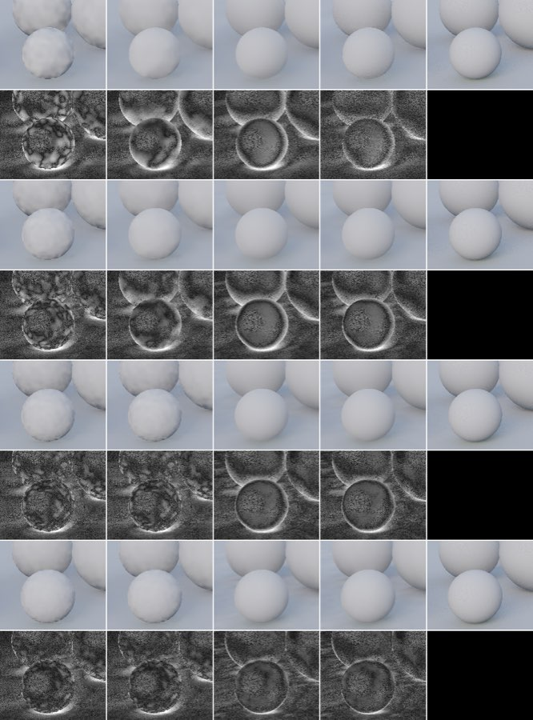
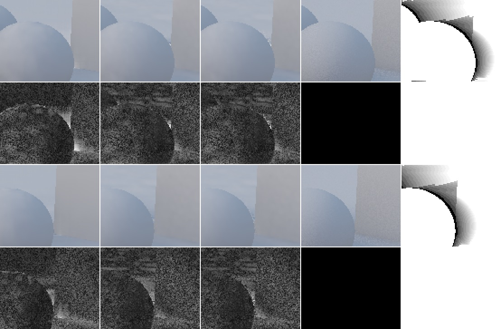
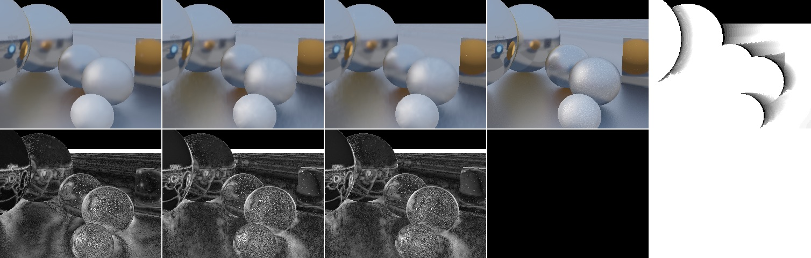
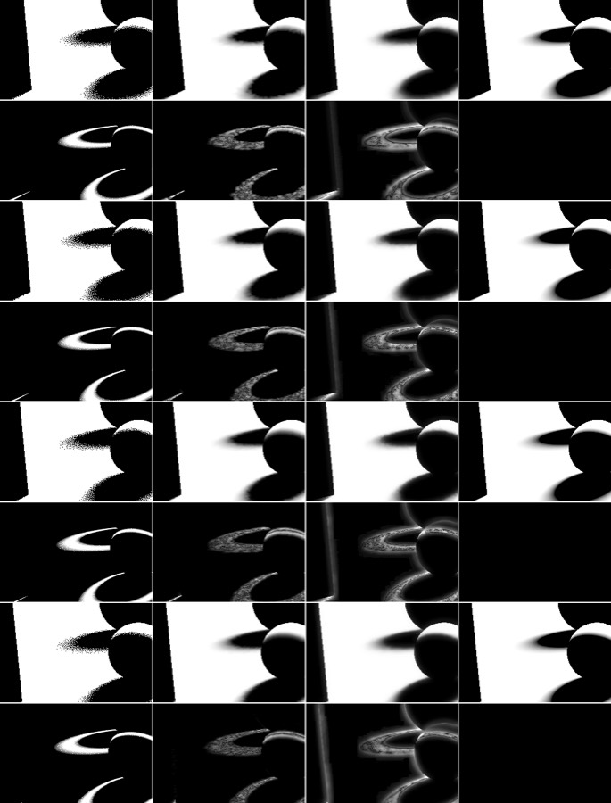

# T1: recovery after disocclusion and camera cuts

_2026-10-26, target-1 implementer (RULES.md rule 8: no NRD code, README, release notes, port, or the quarantined
review read). Brief: [sources/nrd-review-targets.md](../sources/nrd-review-targets.md) target 1 and its
evaluation agreement, [clean review](../reviews/nrd-review-targets-review.md). Everything here was measured on our
own test bed and captures. New behaviour is behind options whose defaults keep today's output byte for byte
(TASKS rule 9). **Provisional** until Dennis reviews the proposals at the end._

## Headline

- **Shipped defaults recover well by the numbers.** After a camera cut, SVGF `antiLag: 'auto'` (diffuse / specular)
  is within 0.5 dB of its settled level by frame 4 (diffuse) or frame 0 (specular), and the shadows denoiser by frame 4.
  Native NRD (v4.18.0 at its defaults, same captures) recovers to a level 3–5 dB below ours. Recurrent is
  the weak filter on newly visible regions: 1.5–2 dB under SVGF on young pixels, 3–4 dB at the revealed boundaries.
- **One visible deficiency in the shipped default:** for the first ~5 frames after a cut, SVGF's diffuse output is
  **blotchy** on curved surfaces: low-frequency mottling the size of the à-trous footprint, gone by frame ~8
  ([strip](#strips)). PSNR and FLIP barely register it; the strip shows it plainly. Specular and shadows show no
  comparable artefact (shadow penumbrae are grainy on frame 0, then clean by frame 3, and better than FFX throughout).
  The revealed strips of a pan look clean for SVGF; recurrent leaves blotches and bright halos there.
- **Candidates** (all options, default off, byte-identical default path):
  - SVGF **`youngNormalPower`** (relaxed normal edge-stopping for pixels with < 4 frames of history) removes most of the
    blotches on frames 0–2. 1080p test bed: neutral (diffuse +0.00 dB pooled, disoccluded +0.02, FLIP ±0); captures:
    test bed +0.00…+0.12 dB, **real scene +0.22…+0.32 dB diffuse, young-pixel boil −15 %**; specular untouched. Cost
    within noise. **Meets the rule-9 bar** (16 is the safer value); proposed for Dennis as a look change.
  - recurrent **`historyFix: 'spatial'`** (Dennis's lead: rebuild young pixels from guided full-resolution taps, no
    mips): the recurrent filter's young-pixel PSNR **+0.8…+1.7 dB**, boundary **+1.2…+4.6 dB**, FLIP −1…−8 %, pooled
    over 14 captures **+0.67 dB diffuse / +0.43 specular**; 1080p test bed +0.12 / +0.07 dB, AO +0.14, SO +0.06; the mips
    pass and the depth atlas go away. **Fails the rule-9 boil clause**: young-pixel boil +4…+70 % (still below
    SVGF's level and far below the reference's own boil: recurrent's mip fill was unusually still), and the frame right
    after a cut at 1080p is −1.3 dB (diffuse) before it overtakes from frame 1. Not proposed as a default; recorded
    for Dennis.
  - SVGF `spatialHistoryWeight` (young estimate weighted by neighbour history): null (±0.02 dB). SVGF
    `youngLuminanceWeight`: a loss (specular −0.6 dB after a cut) and no visual change. Shadows' existing fresh-pixel
    knobs (`youngMean`, `youngRadius`, `youngFrames`): the defaults are already the best of the sweep.

## 1. Setup

| | |
|---|---|
| GPU / browser | Apple M5 Pro (`metal-3`), HeadlessChrome 155, `--use-angle=metal`, WebGPU timestamps |
| Denoiser code | `packages/denoiser-realtime` + test bed + registry pinned in two scratch mirrors (`git archive d92a37f`): **A** = d92a37f (baselines), **B** = A + this work's package files (= **35839c5**, the default paths byte-identical to A, §6) and registry (0ffe427). Own Vite servers on 127.0.0.1:5460 / 5461, `server.hmr: false`, `RT_CAPTURE_DIR` = a private folder (captures symlinked, own outputs) |
| Registry ids | `svgf-auto` = the shipped default (SVGF `antiLag: 'auto'`); `svgf` = SVGF pinned to `'off'`; `recurrent` = both signals recurrent; `shadows` = `ShadowDenoiser` v2.2 with package defaults (`uniformSnap: 'change'`); `ffx-shadows`; `occlusion-svgf-auto` (= the `OcclusionDenoiser` default) and `occlusion-recurrent` |
| Captures | standard set (`std540-*` 960×540, `std1080-orbit`), real scene `three-pan`, `three-orbit`, `three-knot-orbit` (960×540), and three longer test-bed windows written for this work: **`t1-cut`** (cut path frames 16–79: 32 frames of history, the cut, 32 frames after), **`t1-pan`** and **`t1-object`** (frames 0–47). Live and replay agree to 0.001 dB (LESSONS), so the long windows stand in for the live paths with per-pixel age scoring |
| Live A/B | test bed `preset=full` (1920×1080), 7 paths × 96 frames, 256-spp references, FLIP every 12th frame; baseline and candidates in one page (variant syntax `id@key=v`), so they share references |
| Native | per-frame PSNR from `native/results/<capture>/compare.json` (NRD v4.18.0 defaults, ours at 7a8b980, RTX 3060 Laptop): curves only, no native images on this machine |

**Scorer** ([data/t1-score.mjs](data/t1-score.mjs), ours): scores each replay output per pixel **age** = frames of
valid history by ground truth (the test bed's `metrics.ts` definition: reproject with motion, keep history where a
2×2 tap's viewZ is within 1 % |z| + 2× the robust slope of the expected one; 0 on resets and disocclusions).
Values as compare.mjs (Reinhard per channel; visibility clamped). Regions: **young** = age < 8 (the test bed's
"disoccluded"), **settled** = age ≥ 17, **edge, young** = young pixels within 2 px of a depth edge (the revealed
boundary, where colour or shadow could spread across). Also: FLIP (test-bed ppd) on every 2nd frame, linear
energy, motion-compensated flicker, **boil** (RMS second temporal difference along the age taps / √6, with the
reference's own boil as its floor), a **mid-band** error (9×9 minus 33×33 box of the signed error: blotch-sized
structure without smooth bias). **Frames to band**: the first age (or frame after a reset) from which every later
bucket stays within 0.5 dB of the shipped default's settled level, the band fixed per capture and signal before
comparing candidates (the evaluation agreement's "common reference-based error band").

Raw: [data/t1-captures.json](data/t1-captures.json) (every capture × signal × denoiser: region scores, age curve,
per-frame PSNR), [data/t1-live.json](data/t1-live.json) (live pages). Scripts: [data/t1-score.mjs](data/t1-score.mjs),
[data/t1-summary.mjs](data/t1-summary.mjs), [data/t1-events.mjs](data/t1-events.mjs), [data/t1-strip.mjs](data/t1-strip.mjs).

## 2. Baseline: recovery after a camera cut

`t1-cut`, the 32 frames after the cut (path frame 48; `std540-cut` frames 8–23 reproduce these to 0.1 dB). PSNR per
frame after the cut, all receivers; pooled over frames 0–7; band = `svgf-auto` / `shadows` mean of the last 8 frames
− 0.5 dB.

| signal | denoiser | 0 | 1 | 2 | 3 | 4 | 5 | 6 | 7 | 8 | pooled 0–7 | FLIP 0–7 | frames to band |
|---|---|---|---|---|---|---|---|---|---|---|---|---|---|
| diffuse | **svgf-auto** | 36.1 | 37.2 | 37.3 | 37.2 | 37.9 | 38.3 | 38.5 | 38.6 | 38.6 | **37.57** | 0.0543 | 4 |
| diffuse | svgf | 36.1 | 37.2 | 37.3 | 37.2 | 37.9 | 38.3 | 38.3 | 38.4 | 38.3 | 37.52 | 0.0547 | 4 |
| diffuse | recurrent | 35.4 | 36.5 | 37.0 | 37.2 | 37.8 | 38.1 | 38.3 | 38.3 | 38.3 | 37.22 | 0.0569 | 4 |
| diffuse | native RELAX | 32.5 | 32.2 | 32.1 | 32.1 | 32.6 | 32.8 | 33.2 | 33.2 | 33.0 | | | |
| diffuse | native REBLUR | 31.7 | 31.2 | 32.5 | 32.7 | 32.8 | 33.1 | 33.4 | 33.5 | 33.5 | | | |
| specular | **svgf-auto** | 35.8 | 36.5 | 36.6 | 36.7 | 36.7 | 36.6 | 36.6 | 36.6 | 36.6 | **36.48** | 0.0534 | 0 |
| specular | svgf | 35.2 | 36.2 | 36.4 | 36.4 | 36.1 | 35.9 | 35.7 | 35.6 | 35.5 | 35.93 | 0.0552 | never (drifts down) |
| specular | recurrent | 34.8 | 36.2 | 36.2 | 36.1 | 36.1 | 36.1 | 36.1 | 36.1 | 36.0 | 35.93 | 0.0570 | never (drifts down) |
| specular | native RELAX | 30.5 | 30.7 | 30.5 | 30.3 | 30.8 | 31.0 | 31.3 | 31.4 | 31.5 | | | |
| specular | native REBLUR | 29.9 | 29.8 | 30.3 | 30.4 | 30.4 | 30.4 | 30.6 | 30.6 | 30.6 | | | |
| shadows | **shadows** | 34.8 | 36.3 | 36.9 | 37.0 | 37.4 | 37.6 | 37.8 | 38.1 | 38.2 | **36.87** | 0.0187 | 4 |
| shadows | ffx-shadows | 31.4 | 32.5 | 32.3 | 32.4 | 32.5 | 32.6 | 32.5 | 32.5 | 32.3 | 32.33 | 0.0364 | never |
| shadows | native SIGMA | 25.4 | 25.3 | 25.2 | 25.1 | 25.0 | 24.9 | 25.0 | 24.9 | 24.7 | | | |

Other resets, frames 0–7 (pooled / frames to band): `std1080-orbit` (starts at a reset, every pixel young):
diffuse svgf-auto 39.21 / 1, recurrent 37.11 / 7; specular svgf-auto 34.97 / 0, recurrent 33.44 / never; shadows
36.78 / 1, FFX 35.40 / never. Real scene `three-pan` (reset, then a fast pan): diffuse svgf-auto 39.55 / 7, recurrent
38.15 / 28; specular 46.68 vs recurrent 43.30; shadows 30.44 vs FFX 28.90. Native on `std1080-orbit` frames 0–7: RELAX
diffuse 36.6 → 38.2, specular 28.4 → 31.7; SIGMA 22.8 flat (the harness caveat of PHASE4-5 applies to SIGMA).

Occlusion (live test bed `cut`, 960×540, frame after the cut → 4 frames later): AO `occlusion-svgf-auto` 38.2 → 40.0,
recurrent 33.3 → 38.2; SO svgf-auto 37.5 → 37.8, recurrent 30.4 → 36.5. The occlusion default recovers in one frame;
recurrent needs ~4.

Reading: no filter shows a lingering image of the previous view (a ghost would show as a dip a few frames after the
cut; the curves rise monotonically except SVGF diffuse's flat frames 1–3, where the young-history spatial variance
estimate hands over to the temporal one at n = 4). Energy after the cut is within −1.4 … +0.2 % for every filter.

## 3. Baseline: newly visible regions (disocclusion)

Young = age < 8, settled = age ≥ 17 in the same capture ("–": the 16-frame capture has none). Full table for
the three signals and all captures in [data/t1-captures.json](data/t1-captures.json) (`base-*`).

| capture | signal | denoiser | young | edge, young | settled | FLIP young | energy young | flicker young | boil young (ref) |
|---|---|---|---|---|---|---|---|---|---|
| t1-pan | diffuse | **svgf-auto** | **35.80** | **32.76** | 38.39 | **0.0639** | −1.4 % | 0.0077 | 0.0053 (0.0111) |
| t1-pan | diffuse | recurrent | 34.02 | 28.95 | 38.48 | 0.0734 | −1.4 % | 0.0080 | 0.0037 (0.0111) |
| t1-pan | specular | **svgf-auto** | **34.32** | **31.45** | 32.99 | **0.0647** | −1.4 % | 0.0081 | 0.0137 (0.0194) |
| t1-pan | specular | recurrent | 32.55 | 27.46 | 32.34 | 0.0717 | −0.9 % | 0.0088 | 0.0145 (0.0194) |
| t1-pan | shadows | **shadows** | **35.27** | **33.45** | 40.13 | **0.0255** | 0.0 % | 0.0027 | 0.0163 (0.0153) |
| t1-pan | shadows | ffx-shadows | 31.73 | 28.53 | 30.07 | 0.0536 | −0.8 % | 0.0040 | 0.0162 (0.0153) |
| t1-object | diffuse | **svgf-auto** | **36.02** | **32.88** | 37.06 | 0.0649 | −1.6 % | 0.0034 | 0.0029 (0.0014) |
| t1-object | diffuse | recurrent | 33.91 | 28.35 | 36.27 | 0.0754 | −0.8 % | 0.0035 | 0.0027 (0.0014) |
| t1-object | shadows | **shadows** | **33.28** | **30.98** | 35.73 | 0.0320 | 0.2 % | 0.0041 | 0.0130 (0.0098) |
| t1-object | shadows | ffx-shadows | 31.39 | 27.83 | 27.80 | 0.0553 | −0.6 % | 0.0055 | 0.0145 (0.0098) |
| three-pan | diffuse | **svgf-auto** | **40.54** | **34.28** | 39.74 | 0.0381 | −0.6 % | 0.0050 | 0.0044 (0.0058) |
| three-pan | diffuse | recurrent | 39.30 | 33.68 | 39.20 | 0.0399 | −0.4 % | 0.0048 | 0.0012 (0.0058) |
| three-pan | specular | **svgf-auto** | **47.70** | **38.77** | 47.11 | 0.0345 | −0.3 % | 0.0008 | 0.0033 (0.0035) |
| three-pan | specular | recurrent | 43.80 | 35.44 | 44.16 | 0.0534 | −1.3 % | 0.0014 | 0.0024 (0.0035) |
| three-pan | shadows | **shadows** | **31.66** | 24.94 | 30.30 | 0.0229 | 0.1 % | 0.0035 | 0.0116 (0.0156) |
| three-pan | shadows | ffx-shadows | 29.94 | 24.61 | 26.16 | 0.0362 | −0.5 % | 0.0045 | 0.0151 (0.0156) |

PSNR by age on `t1-pan` (the revealed column at the leading edge and the strips behind the spheres; dB):

| denoiser | 0 | 1 | 2 | 3 | 4 | 6 | 8 | 12 | 16 | settled |
|---|---|---|---|---|---|---|---|---|---|---|
| diffuse svgf-auto | 34.8 | 35.4 | 35.6 | 35.8 | 36.2 | 36.6 | 36.7 | 36.8 | 37.1 | 38.4 |
| diffuse recurrent | 31.8 | 33.4 | 33.8 | 34.2 | 35.0 | 35.8 | 36.1 | 36.4 | 36.9 | 38.5 |
| specular svgf-auto | 34.5 | 35.0 | 34.6 | 34.4 | 34.2 | 33.8 | 33.5 | 33.1 | 32.5 | 33.0 |
| shadows | 33.0 | 35.1 | 35.5 | 35.9 | 36.1 | 36.3 | 36.5 | 37.1 | 38.3 | 40.1 |
| ffx-shadows | 30.6 | 32.1 | 32.0 | 32.0 | 32.0 | 31.8 | 31.4 | 29.7 | 29.3 | 30.1 |

Reading: on the test bed young pixels sit 1–5 dB under the settled level and climb for 16+ frames (the band is never
reached inside 16 frames on `t1-pan` for diffuse and shadows). Part of that is physics (a pixel with n samples of
history cannot match one with 30+) and part is content (the age buckets are different screen regions). On the real
scene the young pixels of SVGF and shadows already score **above** the settled ones. Specular young pixels beat the
settled ones everywhere (surface-motion history of a view-dependent signal lags; that is target 2, not target 1).
Boundary error (edge, young) is 2–3 dB under the young mean for SVGF and shadows, 4–6 dB for recurrent; for SVGF it is
within ~1 dB of the same band at any age (edges are hard in general, not because they are new).

## 4. Strips

**After a cut, diffuse** (`t1-cut`, frames 0, 1, 3, 5 after the cut; columns: `svgf-auto`,
`svgf-auto@youngNormalPower=8`, `recurrent`, `recurrent@historyFix=spatial`, reference; second row of each frame:
|error| × 6). The shipped default's blotches on the spheres (frames 0–5) are the one visible deficiency found;
`youngNormalPower` removes most of them on frames 0–2 (its ramp ends at n = 4, so frames 3–5 match the default).
Recurrent is smooth here but loses the contact darkening (bright rims under the spheres).

**Disocclusion behind a sphere, diffuse** (`t1-pan` frames 18 and 20, ×2; columns `svgf-auto`, `recurrent`,
`recurrent@historyFix=spatial`, reference, age map black = 0 … white ≥ 16). The young strip right of the sphere: SVGF is
clean apart from a bright wedge at the contact; recurrent leaves horizontal blotches in the young region (top left) and
a brighter halo; the spatial history fix removes most of both.

**Disocclusion, specular** (`t1-pan` frame 20, same columns): no visible deficiency for SVGF; recurrent's revealed
edges carry halos that the spatial fix reduces.

**After a cut, shadows** (`t1-cut` frames 0, 1, 3, 8 after the cut; noisy, `shadows`, `ffx-shadows`, reference;
|error| × 4): frame 0's penumbrae are grainy, clean by frame 3; FFX is smoother on frame 0 but wrong in shape
(over-wide, haloed) on every frame. No change proposed.

## 5. Candidates

Each: option (default off), source, the A/B on the 7 live paths at 1080p and on the captures (standard set, the T1
windows, the three real-scene captures), cost. Δ = candidate − baseline; FLIP / boil / flicker in %.

### 5.1 SVGF `youngNormalPower` (our design; lead ML25 p.36)

Exponent of the normal edge-stopping weight (the power form: diffuse, or specular with `specularNormalWeight:
'power'`) for a pixel on its first frame, ramping geometrically to `sigmaNormal` (128) over `varianceRampFrames` (4).
With 128, a tap 18° away on a sphere weighs 0.001, so on curved surfaces the à-trous footprint of a young pixel stops
within a few pixels and the 1-spp noise left after the 7×7 spatial pre-filter survives as blotches. Creases (n·n′ ≤ 0)
still stop at any exponent. Specular (lobe cutoff) is unaffected by construction (all specular numbers below are
byte-identical).

**Live, 1080p, 7 paths × 96 frames (diffuse; pooled over paths):**

| arm | pooled | disoccluded | frame after cut | FLIP | flicker | flicker (mc) | energy |
|---|---|---|---|---|---|---|---|
| svgf-auto | 38.500 | 37.610 | 38.35 | 0.0332 | 0.00313 | 0.00690 | −0.84 % |
| `youngNormalPower: 8` | 38.499 | 37.624 | 38.15 | 0.0332 | 0.00313 | 0.00689 | −0.84 % |
| `youngNormalPower: 16` | 38.501 | 37.634 | 38.27 | 0.0332 | 0.00313 | 0.00689 | −0.84 % |

Per path (16): orbit +0.01, pan +0.01, light 0.00, thin 0.00, glossy 0.00, cut 0.00, object 0.00 dB.

**Captures (diffuse):**

| capture | all (base) | Δ all (8 / 16) | Δ young | Δ edge, young | Δ mid-band young | FLIP all | boil young |
|---|---|---|---|---|---|---|---|
| std540-orbit | 38.21 | +0.02 / +0.04 | +0.03 / +0.05 | +0.09 / +0.13 | +0.10 / +0.13 | +0.6 / +0.3 | −0.7 / −0.6 |
| std540-pan | 38.14 | +0.12 / +0.12 | +0.18 / +0.19 | +0.67 / +0.64 | +0.38 / +0.36 | −0.1 / −0.4 | −3.6 / −3.3 |
| std540-light | 39.13 | −0.00 / +0.01 | +0.02 / +0.05 | +0.10 / +0.16 | +0.04 / +0.09 | +0.4 / +0.2 | −3.8 / −3.6 |
| std540-thin | 34.13 | −0.01 / −0.00 | −0.01 / −0.00 | −0.02 / +0.02 | −0.01 / +0.01 | +0.3 / +0.2 | −0.5 / −0.5 |
| std540-glossy | 38.46 | −0.00 / +0.02 | −0.01 / +0.03 | +0.09 / +0.21 | +0.31 / +0.31 | +0.8 / +0.5 | −6.8 / −6.2 |
| std540-cut | 38.42 | +0.00 / +0.04 | +0.01 / +0.06 | −0.05 / +0.08 | +0.15 / +0.23 | +0.5 / +0.1 | −1.0 / −1.0 |
| std540-object | 36.73 | +0.02 / +0.03 | +0.03 / +0.05 | +0.11 / +0.15 | +0.15 / +0.17 | +0.5 / +0.2 | −4.3 / −3.9 |
| std1080-orbit | 39.21 | −0.02 / −0.01 | −0.02 / −0.01 | −0.05 / −0.00 | −0.03 / +0.01 | +0.7 / +0.5 | −0.3 / −0.3 |
| t1-cut | 38.78 | +0.01 / +0.02 | +0.02 / +0.06 | −0.01 / +0.08 | +0.11 / +0.17 | +0.2 / +0.0 | −0.5 / −0.4 |
| t1-pan | 37.02 | +0.03 / +0.04 | +0.08 / +0.09 | +0.21 / +0.22 | +0.18 / +0.18 | −0.0 / −0.1 | −1.9 / −1.7 |
| t1-object | 36.87 | +0.01 / +0.02 | +0.05 / +0.07 | +0.17 / +0.22 | +0.15 / +0.17 | +0.2 / +0.1 | −5.8 / −5.3 |
| **three-pan** | 40.39 | **+0.39 / +0.32** | +0.57 / +0.50 | +1.87 / +1.46 | +0.05 / +0.10 | −0.8 / −0.7 | **−22 / −16** |
| **three-orbit** | 39.84 | **+0.25 / +0.23** | +0.49 / +0.43 | +1.67 / +1.31 | +0.03 / +0.09 | −0.5 / −0.5 | **−21 / −15** |
| **three-knot-orbit** | 39.82 | **+0.25 / +0.22** | +0.50 / +0.44 | +1.68 / +1.32 | +0.03 / +0.09 | −0.5 / −0.5 | **−21 / −15** |

Pooled over the 14 captures: 37.91 → 37.96 dB (8) / 37.96 (16). On the real scene the settled region gains too
(+0.17…+0.31 dB, boil −12…−26 %): there A-SVGF's anti-lag often pulls n under 4 on old pixels, and those pixels get the
relaxed weight as well. Energy unchanged to 0.1 %. Flicker (young) −0.0…−2 %.

**Cost:** §5.5. **Verdict:** meets the rule-9 bar on both scenes (no pooled loss beyond −0.02 dB on any capture, FLIP
within +0.8 % (8) / +0.5 % (16), boil and flicker lower in every region, cost within noise) and fixes the visible
post-cut blotches on frames 0–2. The live "frame after cut" single-frame score drops 0.08 dB (16) / 0.2 dB (8) while
the pooled cut path is level, so **16** is the safer value. It changes the look of young pixels (smoother on curved
surfaces), so the flip needs Dennis (TASKS). Not done: occlusion's SVGF (same option, untested on ĥ). A longer ramp
to reach frames 3–5: the existing `varianceRampFrames` (shared by the variance hand-over and this ramp) at 8 was tried
on `t1-cut` / `t1-pan` only: with `youngNormalPower: 8` diffuse +0.05 / +0.04 dB, alone diffuse +0.07 dB on `t1-cut`
(frames 0–7 after the cut 37.57 → 37.76, band reached at frame 2 instead of 4, FLIP −1 %), but specular −0.27 / −0.15 dB,
so as a lead it is a **diffuse-only** setting (`DiffuseSpecularDenoiser({ diffuse: { varianceRampFrames: 8 } })`),
which still needs the full A/B.

### 5.2 recurrent `historyFix: 'spatial'` (Dennis's lead; our design from SVGF §4.2–4.3 and RTG II §49.5.4 prose)

Young pixels (A < `historyFixFrames` 3) are rebuilt from their own accumulated value plus 16 disk taps (Vogel spiral,
per-pixel rotated) of this frame's full-resolution accumulated signal, weighted by the plane distance at the A = 0
geometry tolerance and the normal angle (cos 0.9 scale), radius `historyFixRadius` · 2^(3(s − 1)) px with
s = (1 − A/3)·ρ (ρ = roughness for specular, as the mips' level choice), i.e. 8 → 4 → 2 px over the first three frames.
No mips pass and no depth atlas (−1.5 B/px: the r32float atlas is 0.375 × the screen; the signal mips live in a rotation buffer that exists anyway), one dispatch fewer. The radius sweep (`t1-pan`,
young pixels, diffuse / specular): 4: 35.39 / 32.34 · 6: 35.35 / 33.77 · **8: 35.25 / 33.85** · 12: 35.00 / 33.84 ·
16: 34.79 / 33.63 · 24: 34.38 / 33.22 (mips 34.02 / 32.55); 8 is best for specular (small radii skip glossy pixels at
the 1.5 px floor) and within 0.15 dB of best for diffuse, so it is the option's default. 32 taps instead of 16: +0.1 dB,
same boil (not kept). A per-pixel fixed rotation instead of the blur's animated one: identical (not kept).

**Live, 1080p, 7 paths (pooled over paths):**

| signal | arm | pooled | disoccluded | frame after cut | FLIP | flicker | energy |
|---|---|---|---|---|---|---|---|
| diffuse | recurrent (`'mips'`) | 37.762 | 36.311 | 37.85 | 0.0407 | 0.00376 | −1.09 % |
| diffuse | `'spatial'` | **37.883** | **36.668** | 36.59 | 0.0404 | 0.00371 | −1.09 % |
| specular | recurrent (`'mips'`) | 34.030 | 33.039 | 36.64 | 0.0521 | 0.00467 | −1.60 % |
| specular | `'spatial'` | **34.095** | **33.185** | 36.23 | 0.0520 | 0.00463 | −1.61 % |
| AO | occlusion-recurrent | 37.470 | 33.100 | 36.33 | 0.0205 | 0.00444 | +0.13 % |
| AO | `o.historyFix: 'spatial'` | **37.607** | **33.530** | 36.16 | 0.0203 | 0.00444 | +0.13 % |
| SO | occlusion-recurrent | 36.729 | 33.554 | 30.81 | 0.0225 | 0.00394 | +0.03 % |
| SO | `o.historyFix: 'spatial'` | **36.786** | **33.649** | 29.39 | 0.0224 | 0.00397 | +0.03 % |

Every path gains or ties in pooled PSNR (diffuse +0.01…+0.22, specular 0.00…+0.12, AO +0.03…+0.31, SO −0.06…+0.30
(glossy, object)). After the cut at 1080p the spatial fix is worse on the cut frame itself (diffuse 36.59 vs 37.85)
and better from the next frame on (38.54 vs 38.41, 38.98 vs 38.76, …); at the path's first reset it is better from
frame 0 (36.23 vs 35.11). Radius 16 or 4 does not fix the cut frame (36.01 / 37.09).

**Captures (Δ vs `recurrent`):**

| capture | Δ all diffuse | Δ young | Δ edge, young | FLIP all | boil young | Δ all specular | Δ young | boil young |
|---|---|---|---|---|---|---|---|---|
| std540-orbit | +1.12 | +1.57 | +3.19 | −5.3 % | +18 % | +0.65 | +1.06 | +13 % |
| std540-pan | +0.57 | +0.80 | +1.26 | −4.6 % | +20 % | +0.10 | +0.18 | +1 % |
| std540-light | +0.79 | +1.73 | +4.55 | −3.3 % | +0 % | +0.71 | +1.76 | −8 % |
| std540-thin | +0.64 | +1.04 | +3.67 | −7.6 % | +45 % | +0.85 | +1.31 | +30 % |
| std540-glossy | +0.10 | +0.17 | +1.23 | −1.1 % | +4 % | +0.02 | +0.02 | +3 % |
| std540-cut | +0.66 | +0.89 | +2.28 | −2.1 % | +4 % | +0.70 | +0.85 | +11 % |
| std540-object | +1.10 | +1.65 | +3.47 | −7.2 % | +4 % | +0.19 | +0.30 | +3 % |
| std1080-orbit | +1.18 | +1.18 | +3.68 | −8.2 % | +13 % | +0.75 | +0.75 | +10 % |
| t1-cut | +0.39 | +0.89 | +2.07 | −1.4 % | +2 % | +0.27 | +0.88 | +6 % |
| t1-pan | +0.64 | +1.22 | +2.57 | −4.2 % | +38 % | +0.38 | +1.29 | +6 % |
| t1-object | +0.44 | +1.58 | +3.30 | −2.9 % | +3 % | +0.08 | +0.29 | +3 % |
| three-pan | +0.41 | +1.04 | +1.45 | −1.4 % | +64 % | +0.34 | +0.84 | +9 % |
| three-orbit | +0.36 | +1.21 | +1.82 | −1.2 % | +70 % | +0.32 | +0.96 | +11 % |
| three-knot-orbit | +0.36 | +1.21 | +1.84 | −1.2 % | +69 % | +0.33 | +0.99 | +11 % |

Pooled over the 14 captures: diffuse 36.84 → **37.51** (+0.67), specular 33.65 → **34.07** (+0.43). Settled pixels
±0.04 dB; settled boil +0.3…+2.6 % on the test bed, **+6.3…+6.7 %** (diffuse) on the real scene. Energy within 0.5 %.
Against SVGF's young-history handling (the shipped default) on the same captures: still behind on young pixels
(`t1-pan` diffuse 35.25 vs 35.80, specular 33.85 vs 34.32; after the cut, pooled frames 0–7 37.42 vs 37.57), but it
halves the gap to SVGF and reaches the band at frame 2 after the cut (SVGF 4, mips 4).

**Boil.** The young-pixel boil rises because the mip fill was a very still, low-resolution average: recurrent's
young-pixel boil was 0.0012–0.0037, a third of SVGF's (0.0044–0.0053) and of the reference's own boil
(0.0058–0.0111). The spatial fix lands at 0.0020–0.0051, still at or below SVGF. Flicker (which sees the reference)
falls in the young region on the test bed (−0.6 … −5 %) and rises +1 % on the real scene.

**Cost:** §5.5. **Verdict:** a large quality gain for the opt-in recurrent filter (PSNR, boundary error, FLIP, every
path and capture), with less memory and one dispatch fewer, but it **fails the rule-9 boil clause** (+4…+70 % young-pixel
boil, +6.6 % settled boil on the real scene) and loses 0.4–1.4 dB on the single frame after a cut at 1080p. Not proposed
as a default by the letter of rule 9. If Dennis reads boil below SVGF's as acceptable for the recurrent filter, it is
the better history fix on every other measure (TASKS question).

### 5.3 SVGF `spatialHistoryWeight` (our design; SVGF §4.2)

In the young-history spatial estimate, weight each neighbour also by its history length (capped at 16), so a young
pixel next to valid history borrows from it (inverse-variance weighting of n-sample means). `t1-pan` young diffuse
35.79 vs 35.80, specular 34.30 vs 34.32; `t1-cut` frames 0–7 37.59 vs 37.57. **Null**: the à-trous passes do the
work, the pre-filter's weights hardly matter. Kept as an option (default off); not A/B'd further.

### 5.4 SVGF `youngLuminanceWeight` and shadows' fresh-pixel mean

`youngLuminanceWeight` (luminance edge-stop of young pixels × mix(k, 1, t), lead ML25 p.36's constant-variance
assumption): k = 0 / 0.25 on `t1-cut`: diffuse frames 0–7 37.54 / 37.56 (base 37.57), **specular 35.89 / 36.15
(base 36.48)**, `t1-pan` young diffuse −0.25 / −0.14 dB; and the blotches stay exactly as they are (strip
comparison), which is how the cause was narrowed to the normal weight. **Rejected** (kept as an option, default 1).

Shadows' existing fresh-pixel treatment (`youngMean` 0.75, `youngRadius` 2, `youngFrames` 8; SPEC §7 v2.1), swept on
`t1-cut` / `t1-pan`: `youngMean: 1` 36.81 / 35.21 (base 36.87 / 35.27, frames 0–7 after the cut / young), `youngRadius:
3` 36.63 / 34.97, `youngFrames: 12` 36.85 / 35.27. The defaults are the best of the sweep; **no change**.

### 5.5 Cost

Test-bed solo bench, 1080p, `path=orbit` (and `pan` for recurrent), 200 frames after 20 warm-up, one (signal, id) per
page, 5 rounds in rotating order. **Every page was contended**: another agent's real-scene capture (GPU-bound,
`run-realtime capture`) ran for the whole window and medians of medians spread 2–13 ms. So the comparison is
**normalized within each page**: the passes an option changes (SVGF: the five à-trous passes; recurrent: mips +
history fix) over the passes it doesn't touch (prepass, temporal, variance / blur, …), median over the 5 runs.

| arm (one signal) | changed / unchanged passes | changed passes, fastest run |
|---|---|---|
| diffuse svgf-auto | 1.192 | 1.41 ms |
| diffuse `youngNormalPower: 8` | 1.161 | 1.74 ms (that run's unchanged passes also read 8 % higher) |
| diffuse recurrent, orbit (mips + history fix) | 0.228 | 0.37 ms |
| diffuse `historyFix: 'spatial'`, orbit | 0.190 | 0.42 ms |
| specular recurrent, orbit | 0.217 | 0.43 ms |
| specular `historyFix: 'spatial'`, orbit | 0.228 | 0.32 ms |
| diffuse recurrent, pan | 0.242 | 0.35 ms |
| diffuse `historyFix: 'spatial'`, pan | 0.236 | 0.36 ms |

Reading (provisional, contended): neither option moves its passes measurably (−3 % … +5 % of those passes, both
directions, i.e. within run-to-run noise; well inside rule 9's +10 % of the filter). `youngNormalPower` adds one texel
load and an `exp2`/`log2` per pixel per à-trous pass; the spatial history fix replaces the mips dispatch with 16
geometry + value taps on young pixels only. Re-measure on a quiet GPU before a flip (TASKS). Raw pages:
[data/t1-bench-1080p.jsonl](data/t1-bench-1080p.jsonl).

## 6. Default path: byte identity

- Generated WGSL of every SVGF pass variant (temporal, variance, à-trous × box / 5×5 × last) and every recurrent pass
  variant (history fix, temporal, mips) for 1- and 2-signal pipelines and the occlusion kinds: byte-identical to
  d92a37f (dump + `cmp`; the option code is compiled in only when enabled, so the default shaders are textually the old
  ones).
- Replay outputs, mirror B (this work) vs mirror A (d92a37f), `cmp` of every `.f32`: `svgf-auto` on `t1-pan` (96 files)
  and `std1080-orbit` (16), `recurrent` on `t1-pan` (96) and `std540-cut` (48), `occlusion-recurrent` and
  `occlusion-svgf-auto` on `three-pan` (64 each): all byte-identical. Shadows code is untouched. The only host-side change on the default path is an unused uniform slot (`RParams.pad7` now holds
  `historyFixRadius`).

## 7. What's left

- SVGF `youngNormalPower` for `OcclusionDenoiser`'s SVGF on ĥ (same option, unmeasured), and a longer relax ramp
  (independent of `varianceRampFrames`) to reach the blotches of frames 3–5 after a cut.
- recurrent spatial fix: the cut-frame loss at 1080p (content-dependent; better than mips at the path's first reset).
- A dedicated reveal capture (moving foreground panel over a patterned, indirectly lit background, then a still
  interval; target 1's suggested scene) was not built: the test bed's `pan` / `object` reveals and the real-scene pans
  stood in. Native images of the T1 windows need the Windows harness (only per-frame PSNR exists for the standard set).
