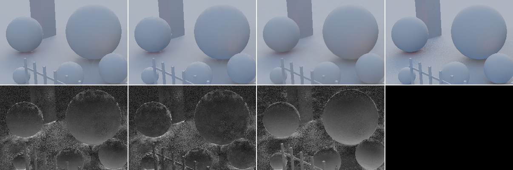

# Light changes on stationary geometry (review target 3)

_t3 agent (implementer / evaluator, RULES.md rule 8: no NRD code, README, release notes, port or quarantined file read;
the audit handoff only in its reviewed copies), 2026-10-26. Everything here was measured on our own test bed (Apple M5
Pro, HeadlessChrome 155, Metal). Package measured: a `git archive` mirror of de6596f (`server.hmr: false`) plus the two
options below, merged into HEAD as 062361a (the options touch only the anti-lag passes; T6's a7ef4a8 changes landed in
between and are orthogonal). Shipped defaults: `svgf-auto` (A-SVGF `antiLag: 'auto'` v2, `youngNormalPower: 16`),
`shadows` (the q21 defaults), `recurrent` (`historyFix: 'spatial'` + the dense repair). Provisional until Dennis reviews
the proposal at the end._

## Conclusion first

1. **The shipped default reacts to brightness changes but not to colour changes.** A-SVGF works with "only the
   luminance of the temporal gradient" (Schied et al. 2018, §3.1 p.24:6, after Eq. 2), and so does our renderer-free
   `'auto'`. A light that changes colour at constant luminance never shortens the history, and with `'auto'` on the
   history runs at α_min 0.1 instead of `'off'`'s 0.2: **the old tint lingers longer with anti-lag than without it**
   (lc-hue diffuse: 21 frames until less than 10 % of the old appearance is left, plain SVGF 10; specular 17 vs 10;
   transition-window PSNR −2.5 / −1.3 dB below plain SVGF). The recurrent filter is far worse: its detectors and
   fast-history clamp are luminance-only too and its cap is 31 frames, so **32 % of the old tint is still there 32
   frames later** (diffuse; after the return it is still above 10 % when the capture ends, 40 frames later).
2. **Brightness steps of moderate size are slow on diffuse.** λ = |δ̂| / Δ̂ is a *relative* change, so a light whose
   indirect contribution changes a pixel by 20 % only drops ~30 % of the history per frame: lc-step diffuse 8 frames to
   the new appearance (plain SVGF 9–10), lamp switch 11 / 9 (= plain SVGF). Specular, whose relative changes are larger
   and whose noise floor is k = 1, reacts in 4 frames (plain 9–11). Fades lag ~3.5 frames (diffuse; plain 3.1) and
   2.4 (specular); the off-screen emitter's glow trails by 2.2 frames (plain 3.0). Recurrent: 18 / 19 frames on the
   diffuse step, lag 5.2 frames on the fade.
3. **Constant-light regions do not stay quiet during an event.** Pixels whose reference is bit-identical through the
   whole sequence boil +38 % (step) / +25 % (lamp switch) more in the 8 frames after the event than before it with the
   shipped default (diffuse; specular +17 %): the gradient reconstruction (4 à-trous iterations, up to 24 px) and the
   3×3 max over strata carry λ into them. Still below plain SVGF's boil (which is constant, 0.0012 vs 0.0007–0.0009).
4. **Shadows switch at once** (lamp switch: < 10 % old shadow on the first frame) and re-converge from a restarted
   history (transition-window PSNR −6 dB vs held); colour and brightness are invisible to a visibility signal by
   construction. The "quality after a light stops" item stays with the shadows owner (§7).
5. **Two new options, default off, default path byte-identical** (WGSL of every gradient pass variant; 96-frame replays of
   lc540-hue / lc540-step, `cmp` of every `.f32`):
   - **`antiLagChroma`** (our design; parallel in ML25 p.34–35, below): the stratum's YCoCg chroma change goes through
     the same reconstruction and noise floor, λ takes the larger of the luminance and chroma terms. **lc-hue: 21 → 8
     frames (diffuse), 17 → 4 (specular); transition-window PSNR +3.8 / +3.3 dB, FLIP −22 / −32 %; held window +1.7 /
     +0.5 dB.** Everywhere else it is neutral: 1080p 7 paths +0.002 / +0.009 dB, FLIP ±0.0 / −0.2 %, flicker equal;
     4096-spp references −0.001 / +0.009 dB; 11 real captures +0.000 / +0.001 dB, boil within +1.1 % in every region.
     Cost +0.06…0.11 ms per signal at 1080p (+2…4 %, §6.4). **It passes every rule-9 clause on the test bed and real scenes. The
     one exception is by construction: on lc-hue's constant-light pixels boil rises +44 % in the event windows**, the
     same leak (3) the shipped default already shows on brightness events; it never rises in quiet windows.
     **Proposed to Dennis** (it changes what colour changes look like).
   - **`antiLagGain`** (per signal; λ ← min(1, g·λ)): speeds every reaction (lc-step diffuse 8 → 5 frames, specular
     4 → 1; emitter lag 2.2 → 1.6) and lifts **specular under camera motion** (1080p +0.41 dB pooled, FLIP −6.5 %;
     4096-spp glossy +0.80, orbit +0.28), but it **fails rule 9's boil clause on still views** (4096-spp `light`
     specular −0.11 dB with boil +49 %, three-knot-static +38 %, quiet-window static boil +17 % diffuse / +37 %
     specular on the lc paths) and costs diffuse on real scenes (−0.09 dB). Gain 1.5 halves both sides and still
     fails. Not proposed; it is a lead for a motion-gated gain (TASKS).
6. **The upscaler's `shadingChange` guide is not a usable input for `antiLag: 'gradient'`** (measured, nothing built,
   §5): it is luminance-only (0 % of the lc-hue change detected even on the clean reference), its floors are tuned to
   ignore 1-frame ramps (0 % on the fade), it sees the *denoised* image one frame late (with the shipped default as its
   input it fired on 11 % of the changed pixels once, at the step's first frame, and never on the return, the lamp
   switch or the hue change), and on 1-spp input it fires on 13 % of static pixels every frame. `'gradient'` needs a
   signed per-stratum luminance pair; the guide is a gated 0..1 response at half resolution. Our `'auto'` already
   reacts on the onset frame itself.

## 1. Inventory: what each filter does when the light changes

| filter (registry id) | detector | what it watches | when it fires | colour change at constant luminance | slow ramp | constant-light pixels during the event |
|---|---|---|---|---|---|---|
| **SVGF `'auto'`** (`svgf-auto`, shipped) | per 3×3 stratum: δ = mean of this frame's noisy luminance − mean of the reprojected *accumulated* luminance; var δ of the current mean; 4 à-trous iterations at stratum resolution (S2 §3.4 weights); λ = max over 3×3 strata of max(0, \|δ̂\| − k σ̂) / Δ̂ (k = 2 diffuse, 1 specular; σ̂ from the composite kernel, v2) | luminance of the demodulated signal | every frame until the history has caught up | **blind** (luminance only); α_min 0.1 with anti-lag on, so slower than `'off'` | fires once the lag exceeds the noise floor | λ leaks in through the reconstruction footprint and the 3×3 max |
| **SVGF `'gradient'`** | renderer re-shades last frame's samples with this frame's lighting and the same random numbers (S2 §3.1–3.3); denoiser only reconstructs | luminance (S2 §3.1) | only on frames where shading changed (a per-frame difference, not the lag) | blind | per-frame change only (LESSONS: `'auto'` recovered ~2× faster after a light switch on the dev page) | as `'auto'` | 
| SVGF `'off'` (`svgf`) | none | — | — | α 0.2 | α 0.2 | quiet |
| **recurrent** (`recurrent`, opt-in) | (a) current-frame detector: 3×3 mean of the pre-blurred luminance and ĥ vs the reprojected history, in standard errors (σ_cur 3) + 2 % floor → A toward A_fast = 3; (b) history fix: slow luminance clamped to the fast history (3 frames) ± 1 standard error, the clamp distance shortens A; (c) stabilization: per-channel clamp to the 3×3 range of its own output | luminance and ĥ; the clamp rescales rgb (keeps chroma) | (a) only for changes > ~6 standard errors of a 3×3 mean of 1-spp input; (b) after the fast history has moved | **blind**; A cap 31 | (b) at the fast history's speed | (a)/(b) are per pixel: quiet |
| **shadows** (`shadows`) | 5×5 clamp window (~2 standard errors) with geometry tests; history restarts (A = 0) when the clamp moved it by > 1/64; stabilization pass with its own clamp-distance anti-lag (gain 64) | visibility (0..1) | when visibility changes: light motion, resize, switch | not applicable (visibility has no colour or brightness) | clamp-distance restarts | per pixel |

Test-bed facts that matter here: the diffuse signal is one-bounce indirect light (Li at the secondary hit = the sphere
light through one shadow ray + a constant sky), so a change of the light changes 17 % of the diffuse pixels by more than
0.02 (tonemapped) and leaves ~60 % within 0.002; specular is similar. References use fixed per-pixel seeds, so a pixel
whose illumination does not change has a **bit-identical** reference in every frame (reference boil 0).

## 2. Test scenario (new paths, `examples/realtime-denoiser/src/paths-light.ts`)

Fixed camera, fixed geometry, identical event times on every path: frames 0–23 base state, **onset at 24**, held,
**return at 56**, held to 95 (96 frames, 960×540, capture set `light-change`, 31 GB).

| path | build | change |
|---|---|---|
| `lc-step` | standard (the `light` path's view) | the sphere light switches to ×2.3 luminance and a blue tint (radiance × (1.4, 2.4, 4.6)), switches back |
| `lc-hue` | standard | blue-cyan at the same Rec. 709 luminance (× (0.45, 1.05, 2.6), renormalized), back |
| `lc-fade` | standard | lc-step's change as a 16-frame linear ramp each way (24–39, 56–71) |
| `lc-jump` | standard | lamp switch: the light jumps to the other side (the `light` path's flipped position), back |
| `lc-emitter` | reflect (dark floor, dim sky) | an emissive sphere (r 0.3 m, radiance (8, 6.4, 4.4)) slides 2.4 m sideways 0.3 m above the floor, 6° below the bottom edge of the view (out of frame for any x), 16 frames each way; seen only through its light on the floor (diffuse / specular rays), 4096-spp references |

**Scorer** ([data/t3-score.mjs](data/t3-score.mjs), ours): the camera never moves, so pixel i is the same surface in
every frame. Regions from the references: **dynamic** = max over frames of the tonemapped change > 0.02; **static** =
< 0.002 (or, with `--stat 0`, bit-identical). Windows: pre [8, 24), **in** [onset, onset end + 8), **held** (to 56),
**out** [56, return end + 8), **after**. Per window: pooled PSNR (Reinhard per channel), FLIP (test-bed ppd) over each
region, boil (RMS second temporal difference / √6; static camera, so it is motion-compensated). **Old-appearance
fraction** r_t = Σ (o − n)(b − n) / Σ (b − n)² over the dynamic region (b = the reference before the event, n = after
it, all channels: colour counts), **t10** = frames after the event's end until r stays below 0.1, **old@1** = r one
frame after it; ramp paths also get the **lag** (k minimizing the error against ref_{t−k}).



## 3. Reproduction on the shipped defaults

Dynamic-region PSNR per window, FLIP in / out, frames to the new appearance, residual one frame after, static-region
boil (×10⁻⁴) before / during / after-return. Raw: [data/t3-light-changes/](data/t3-light-changes/) (`scores/base-*`,
`cand*-*`, `rec-*`, `sh-*`: t3-score JSON with per-frame curves; `sc-*`: shadingChange; `ab-*`: t1-score A/B;
`live/`: the 1080p pages; `bench/`: cost pages).

| path | signal | arm | dyn PSNR in | held | out | after | dyn FLIP in / out | t10 on / ret | old@1 on / ret | lag on / ret | static boil ×1e4 pre / in / out | static PSNR held |
|---|---|---|---|---|---|---|---|---|---|---|---|---|
| step | diffuse | svgf-auto | 33.55 | 41.74 | 33.09 | 42.28 | 0.1056 / 0.1122 | 8 / 8 | 0.49 / 0.54 | – | 7.1 / 9.4 / 9.2 | 42.03 |
| step | diffuse | svgf (off) | 32.10 | 41.61 | 31.36 | 41.93 | 0.1187 / 0.1291 | 9 / 10 | 0.61 / 0.66 | – | 12.6 / 12.6 / 12.2 | 41.49 |
| step | diffuse | recurrent | 30.65 | 39.53 | 30.09 | 39.30 | 0.1415 / 0.1516 | 18 / 19 | 0.69 / 0.73 | – | 9.8 / 6.8 / 6.1 | 41.07 |
| step | specular | svgf-auto | 28.27 | 30.74 | 27.65 | 31.43 | 0.1469 / 0.1706 | 4 / 4 | 0.26 / 0.34 | – | 11.7 / 13.7 / 14.3 | 35.92 |
| step | specular | svgf (off) | 25.38 | 30.72 | 24.06 | 31.31 | 0.2005 / 0.2446 | 9 / 11 | 0.58 / 0.70 | – | 16.0 / 15.8 / 15.9 | 35.86 |
| step | specular | recurrent | 25.91 | 30.34 | 25.69 | 29.98 | 0.1951 / 0.2001 | 9 / 10 | 0.46 / 0.43 | – | 20.6 / 17.5 / 17.5 | 34.80 |
| hue | diffuse | svgf-auto | 33.73 | 41.16 | 33.81 | 41.46 | 0.1141 / 0.1168 | **21 / 21** | 0.79 / 0.78 | – | 7.6 / 7.2 / 7.1 | 41.18 |
| hue | diffuse | svgf (off) | 36.19 | 42.61 | 35.92 | 42.55 | 0.0929 / 0.0980 | 10 / 10 | 0.62 / 0.65 | – | 13.4 / 13.4 / 13.0 | 40.65 |
| hue | diffuse | recurrent | 31.13 | 35.12 | 33.27 | 36.46 | 0.1401 / 0.1225 | **32 / 40** | 0.96 / 0.69 | – | 9.8 / 7.0 / 6.4 | 40.41 |
| hue | specular | svgf-auto | 27.22 | 31.70 | 27.06 | 31.82 | 0.1920 / 0.2037 | **17 / 18** | 0.72 / 0.73 | – | 12.4 / 12.4 / 12.1 | 35.55 |
| hue | specular | svgf (off) | 28.48 | 32.16 | 28.22 | 32.25 | 0.1703 / 0.1841 | 10 / 10 | 0.62 / 0.65 | – | 16.4 / 16.3 / 16.3 | 35.50 |
| hue | specular | recurrent | 27.15 | 29.78 | 27.11 | 29.91 | 0.1823 / 0.1853 | 16 / 19 | 0.53 / 0.53 | – | 20.5 / 17.7 / 18.1 | 34.62 |
| fade | diffuse | svgf-auto | 37.66 | 41.71 | 37.89 | 42.39 | 0.0732 / 0.0704 | 5 / 5 | 0.18 / 0.21 | 3.5 / 3.1 | 7.1 / 7.6 / 7.9 | 42.04 |
| fade | diffuse | svgf (off) | 38.33 | 41.88 | 38.14 | 42.32 | 0.0670 / 0.0674 | 4 / 5 | 0.18 / 0.22 | 3.1 / 3.0 | 12.6 / 12.4 / 12.5 | 41.48 |
| fade | diffuse | recurrent | 34.31 | 38.05 | 34.81 | 38.71 | 0.1019 / 0.0958 | 17 / 19 | 0.36 / 0.39 | 5.2 / 4.1 | 9.8 / 6.5 / 6.1 | 41.12 |
| fade | specular | svgf-auto | 29.92 | 30.77 | 30.05 | 31.45 | 0.1215 / 0.1253 | 2 / 2 | 0.11 / 0.13 | 2.4 / 2.2 | 11.7 / 12.1 / 12.6 | 35.94 |
| fade | specular | svgf (off) | 29.44 | 30.82 | 29.27 | 31.49 | 0.1316 / 0.1418 | 4 / 6 | 0.16 / 0.24 | 3.1 / 3.0 | 16.0 / 15.9 / 15.9 | 35.88 |
| fade | specular | recurrent | 28.61 | 30.27 | 28.32 | 29.99 | 0.1482 / 0.1475 | 5 / 7 | 0.18 / 0.22 | 3.2 / 3.2 | 20.6 / 19.1 / 18.7 | 34.79 |
| jump | diffuse | svgf-auto | 35.20 | 41.85 | 35.68 | 42.56 | 0.1042 / 0.1005 | 11 / 9 | 0.57 / 0.53 | – | 7.8 / 9.9 / 9.4 | 40.91 |
| jump | diffuse | svgf (off) | 34.12 | 41.74 | 34.75 | 42.36 | 0.1151 / 0.1088 | 11 / 9 | 0.66 / 0.61 | – | 13.7 / 13.7 / 13.4 | 40.41 |
| jump | diffuse | recurrent | 32.33 | 39.43 | 33.02 | 41.01 | 0.1452 / 0.1340 | 18 / 15 | 0.79 / 0.73 | – | 10.0 / 7.2 / 6.6 | 40.27 |
| jump | specular | svgf-auto | 29.07 | 32.01 | 29.70 | 32.01 | 0.1580 / 0.1428 | 4 / 4 | 0.28 / 0.26 | – | 12.4 / 15.4 / 14.3 | 35.55 |
| jump | specular | svgf (off) | 25.95 | 31.93 | 26.76 | 32.00 | 0.2487 / 0.2099 | 11 / 9 | 0.67 / 0.60 | – | 16.3 / 16.2 / 16.3 | 35.51 |
| jump | specular | recurrent | 25.93 | 29.13 | 27.30 | 30.19 | 0.2113 / 0.1921 | 12 / 8 | 0.47 / 0.43 | – | 20.4 / 17.9 / 17.9 | 34.59 |
| jump | visibility | shadows | 27.02 | 33.00 | 26.98 | 32.61 | 0.0784 / 0.0558 | 0 / 0 | 0.01 / 0.01 | – | 4.9 / 7.7 / 6.9 | 51.33 |
| emitter | diffuse | svgf-auto | 37.21 | 45.24 | 37.39 | 45.76 | 0.0792 / 0.0779 | 4 / 4 | 0.14 / 0.14 | 2.2 / 2.2 | 0.6 / 0.6 / 0.6 | 60.57 |
| emitter | diffuse | svgf (off) | 35.56 | 43.56 | 35.71 | 43.69 | 0.0907 / 0.0889 | 6 / 6 | 0.22 / 0.21 | 3.0 / 3.0 | 0.9 / 0.9 / 1.0 | 61.33 |
| emitter | diffuse | recurrent | 34.89 | 40.50 | 35.16 | 40.60 | 0.1027 / 0.0998 | 4 / 4 | 0.17 / 0.17 | 3.0 / 2.9 | 0.7 / 0.5 / 0.5 | 58.57 |
| emitter | specular | svgf-auto | 36.44 | 40.87 | 36.23 | 41.19 | 0.0812 / 0.0809 | 2 / 2 | 0.11 / 0.12 | 2.2 / 2.2 | 2.5 / 2.4 / 2.4 | 52.01 |
| emitter | specular | svgf (off) | 34.72 | 40.01 | 34.56 | 40.32 | 0.0901 / 0.0898 | 5 / 5 | 0.19 / 0.20 | 3.0 / 3.1 | 4.5 / 4.6 / 4.6 | 51.59 |
| emitter | specular | recurrent | 31.70 | 35.70 | 31.69 | 36.18 | 0.1224 / 0.1195 | 8 / 8 | 0.26 / 0.27 | 3.9 / 4.0 | 6.4 / 4.0 / 3.6 | 47.13 |

Readings:

- **Onset and return behave alike** for every filter (the return is a darkening on lc-step, a brightening on lc-jump's
  other half): no asymmetry to exploit (GI-1.0's darken-fast / brighten-slow would only slow the brightening half).
- **The "held" window is not always settled**: recurrent on lc-hue still carries 32 % of the old tint at frame 55
  (its held-window PSNR is 6 dB below `svgf-auto`'s). SVGF is settled by then.
- **Constant-light pixels, strict mask** (`--stat 0`, references bit-identical over all 96 frames): shipped
  diffuse boil 0.00068 before → 0.00094 / 0.00093 in the 8 frames after onset / return on lc-step (+38 %), 0.00084 on
  lc-jump (+25 %), unchanged on lc-hue (no detection); specular +17 % / +14 %. Plain SVGF stays at 0.00118 throughout.
- The off-screen emitter is the easy case: its glow changes by a few % per frame, `'auto'` tracks it 2.2 frames
  behind (0.8 frames better than plain SVGF), and the static floor stays quiet (boil 0.6×10⁻⁴).

## 4. Candidates

| candidate | source | built? | result |
|---|---|---|---|
| **chroma gradients for `'auto'`** (`antiLagChroma`) | S2 §3.1 restricts the gradient to luminance "thus saving resources"; ML25 p.34–35 (sources/nrd-public-2022-2026.md §ML25) computes its history confidence over all YCoCg channels (vector length of the clamp distance) | yes, option | §4.1: fixes lc-hue, neutral elsewhere; **proposed** |
| **λ gain** (`antiLagGain`) | S2 Eq. 14–15 (λ = min(1, \|δ̂\|/Δ̂), α = (1 − λ)α + λ): our scaling of that ratio | yes, option, per signal | §4.2: faster everywhere, specular +0.41 dB under camera motion, **fails boil on still views** |
| smaller λ spread (`antiLagRadius: 0`, existing) | S2 p.24:9 (3×3 max "to account for reconstruction error") | existing | lc-step diffuse leak +23 % instead of +32 %, but slower (t10 8 → 10, specular 4 → 6); trade-off, not pursued |
| renderer gradients (`antiLag: 'gradient'`, existing) with the test bed or the upscaler as producer | S2 §3.1–3.3 | contract exists; producer not built | §5: the upscaler's guide does not fit; a test-bed producer would re-measure a known result (per-frame differences under-react to ramps; LESSONS, svgf 2026-10-25) and stays luminance-only |
| PH23 optimal blend (α' = 1 − σ_Y² / E[(X − Y)²]) | Philippi et al. EGSR 2023 Eq. 4, 10–11 | no | the paper's own caveat: "works well in low noise scenarios", points to A-SVGF for high noise; at 1 spp the 3×3 E[(X − Y)²] is noise-dominated |
| GI-1.0 asymmetric hysteresis | GI22 Alg. 3 | no | slows the brightening half of every event (§3: no asymmetry to fix) |
| anti-lag v3 for shadows (clamp-distance confidence, never 0) | ML25 p.35 | existing knobs `antiLagGain` / `antiLagHistory` | §7 |

### 4.1 `antiLagChroma` (SVGF / A-SVGF, `antiLag: 'auto'`, v2)

`gradient_create` also writes, per stratum, δCo, δCg (YCoCg chroma of the current mean minus the reprojected
accumulated history's) and the standard deviation of the current means (one rg32uint, 4 halves); the à-trous passes
filter them with the luminance weights (linear, like var δ in v2); `gradient_lambda` adds max over Co, Cg of
max(0, \|δ̂_c\| − k σ̂_c) / Δ̂ (Δ̂ = the luminance normalizer, σ̂ with the same composite-kernel factor). Code:
`src/shaders/gradient.ts` (`GradientVariant.chroma`, `COCG_WGSL`, `PACK_C_WGSL`), `src/svgf.ts`. +4 B/px per signal
at 1/9 resolution (two rg32uint per signal). Structural (part of the pipeline key).

**On the light-change paths** (the rows that change; `jump` and `emitter` are within ±0.01 dB of the shipped default):

| path | signal | arm | dyn PSNR in | held | out | after | dyn FLIP in / out | t10 on / ret | old@1 on / ret | static boil ×1e4 pre / in / out |
|---|---|---|---|---|---|---|---|---|---|---|
| hue | diffuse | shipped | 33.73 | 41.16 | 33.81 | 41.46 | 0.1213 / 0.1234 | 21 / 21 | 0.79 / 0.78 | 7.6 / 7.2 / 7.1 |
| hue | diffuse | **antiLagChroma** | **37.54** | **42.84** | **37.23** | 42.78 | 0.0943 / 0.0992 | **8 / 9** | 0.50 / 0.53 | 7.6 / 10.4 / 9.8 |
| hue | specular | shipped | 27.22 | 31.70 | 27.06 | 31.82 | 0.2060 / 0.2158 | 17 / 18 | 0.72 / 0.73 | 12.4 / 12.4 / 12.1 |
| hue | specular | **antiLagChroma** | **30.56** | 32.17 | **30.53** | 32.25 | 0.1407 / 0.1509 | **4 / 4** | 0.23 / 0.25 | 12.4 / 15.7 / 15.3 |
| step | diffuse | shipped / chroma | 33.55 / 33.80 | 41.74 / 41.89 | 33.09 / 33.28 | 42.28 / 42.36 | 0.1245 / 0.1220 (in) | 8 / 7 (on) | 0.49 / 0.48 | 7.1 / 9.4 / 9.2 → 7.1 / 9.9 / 9.7 |
| fade | diffuse | shipped / chroma | 37.66 / 38.20 | 41.71 / 41.90 | 37.89 / 38.24 | 42.39 / 42.48 | 0.0726 / 0.0691 (in) | 5 / 4 (on); lag 3.5 / 3.2 | 0.18 / 0.16 | 7.1 / 7.6 / 7.9 → 7.1 / 8.1 / 8.3 |

(FLIP here at every 4th frame, so the shipped rows differ slightly from §3's every-2nd-frame values.)

With the strict static mask the chroma arm's lc-hue static boil goes 0.00068 → 0.00094 in the event windows, exactly
the shipped default's figure on lc-step: chroma makes a colour change behave like a brightness change, leak included.

### 4.2 `antiLagGain` (per signal)

λ = min(1, g · max(0, \|δ̂\| − kσ̂) / Δ̂). The value is baked into the λ pass per signal, so a joint pipeline can run
specular at 2 and diffuse at 1. On the light-change paths (g = 2): lc-step diffuse t10 8 → 5 (in-window +2.5 dB),
specular 4 → 1 (+1.3 dB), lamp switch diffuse 11 → 7 (+1.8 dB), fade lag 3.5 → 2.8 (diffuse), emitter lag 2.2 → 1.6;
lc-hue unchanged (no luminance change to amplify). The price is on still content: quiet-window static boil +17 %
(diffuse) / +37 % (specular), emitter specular held window −0.6 dB (fireflies now trigger λ). With chroma + gain 2,
lc-hue specular reaches the new colour in 1 frame. Gain 1.5 sits in between (lc-step diffuse 8 → 6 frames, specular 4 → 3; quiet-window static boil
+8 % / +18 %).

## 5. The upscaler's `shadingChange` guide as an input for `antiLag: 'gradient'` (measured, not built)

What it is (`@pmndrs/upscaler`, /Users/dex/Developer/fsr3 at 57eac72, MIT, read-only; `src/shaders/shadingChange.ts`,
PARITY.md §3): per 2×2 render block, 1 − min / max of the current vs the previous frame's block-mean luma over the
4×4 and 8×8 blocks of its 16×16 tile, each gated by smoothstep(f, 3f) with f = 0.08 / 0.04 + 0.35 × the block's
coefficient of variation; response = max of the two scales, r32float at ceil(render / 2). It runs inside the upscaler,
i.e. after the denoiser, on the image the upscaler gets, so the response from frames N − 1 → N reaches the denoiser at
frame N + 1 ("late"). Its own notes say slow ramps deliberately don't fire.

Measured with a CPU port ([data/t3-shading-change.mjs](data/t3-shading-change.mjs); our captures have a fixed camera,
no jitter and no disocclusion, so its reprojection is the identity and its exposure terms are 1) on the remodulated
diffuse (albedo × signal, what an upscaler would see), three possible input images: the clean reference (an ideal
denoiser in front of it), the noisy 1-spp input (no denoiser), and the shipped denoiser's output (the real pipeline).
Fraction of changed (dynamic) half-res texels with response > 0.5, and of constant-light texels (false positives):

| path | input to the guide | event frame | next frame | best frame in the window after onset / return | false positives (quiet / held) |
|---|---|---|---|---|---|
| step | reference | 0.42 | 0.00 | 0.42 / 0.41 | 0 / 0 |
| step | noisy 1 spp | 0.07 | 0.01 | 0.07 / 0.01 | **13.3 % / 13.0 %** |
| step | svgf-auto output | 0.11 | 0.00 | 0.11 / **0.00** | 0 / 0 |
| hue | reference | **0.00** | 0.00 | 0.00 / 0.00 | 0 / 0 |
| hue | svgf-auto output | 0.00 | 0.00 | 0.00 / 0.00 | 0 / 0 |
| fade | reference | 0.00 | 0.00 | 0.00 / 0.00 | 0 / 0 |
| jump | reference | 0.38 | 0.00 | 0.38 / 0.40 | 0 / 0 |
| jump | svgf-auto output | 0.00 | 0.00 | 0.00 / 0.01 | 0 / 0 |
| emitter | reference | 0.03 | 0.04 | 0.04 / 0.04 | 0 / 0 |
| emitter | svgf-auto output | 0.00 | 0.00 | 0.07 / 0.08 | 0 / 0 |

Verdict: **no**. (1) Luminance-only, the same blind spot as A-SVGF: it cannot help the one case we can't handle.
(2) Behind a denoiser it only sees what the denoiser already let through: our output moves by ≤ 30 % of a 20 %
change per frame, under its 4–8 % floors, so it fired once (11 % of the changed pixels, usable a frame later) on the
step and never on the return, the switch, the hue or the fade, while `'auto'` itself already acts on the onset frame.
(3) Without a denoiser (1-spp input) it is noise. (4) The `'gradient'` contract wants a signed per-stratum
(l_prev, l_cur) pair at 1/3 resolution to reconstruct; this is a gated 0..1 response at 1/2 resolution, so using it
means a new λ input mode, not a producer. Nothing was built; the TASKS item is closed with this measurement.

## 6. Rule-9 A/B (vs the shipped default `svgf-auto`)

### 6.1 Test bed, live 1080p, 7 paths × 96 frames (256-spp references, one page per path, FLIP every 12th frame)

| signal | arm | pooled PSNR | Δ | FLIP (mean) | flicker mc (mean) | worst path |
|---|---|---|---|---|---|---|
| diffuse | svgf-auto | 38.501 | | 0.0332 | 0.00689 | |
| diffuse | antiLagChroma | 38.503 | +0.002 | 0.0332 | 0.00689 | −0.001 (`light`) |
| diffuse | antiLagGain 2 | 38.518 | +0.017 | 0.0332 | 0.00690 | −0.014 (`orbit`) |
| specular | svgf-auto | 34.994 | | 0.0464 | 0.00696 | |
| specular | antiLagChroma | 35.003 | +0.009 | 0.0463 | 0.00696 | 0.000 |
| specular | antiLagGain 2 | 35.405 | **+0.411** | 0.0434 (−6.5 %) | 0.00703 (+1.0 %) | −0.009 (`light`, flicker mc 0.0010 → 0.0011) |

Per path (specular, gain 2): orbit +0.43, pan +0.76, light −0.01, thin +0.37, glossy +0.75, cut +0.47, object +0.13 dB.
Chroma: no path moves by more than 0.03 dB; FLIP within −0.7…+0.0 %. Full table: [data/t3-light-changes/live-1080p.md](data/t3-light-changes/live-1080p.md).

### 6.2 Captures: motion-compensated boil, 4096-spp references, real scenes

Replays scored with [data/t1-score.mjs](data/t1-score.mjs) (boil along the age taps, the reference's own boil as the
q20 (a) floor; young = age < 8, settled = age ≥ 17) and tabulated by [data/t3-ab-table.mjs](data/t3-ab-table.mjs).

| set | signal | antiLagChroma Δ PSNR / FLIP | antiLagChroma boil (worst region) | antiLagGain 2 Δ PSNR / FLIP | gain 2 boil flags (q20 (a)) | gain 1.5 Δ PSNR |
|---|---|---|---|---|---|---|
| std540 × 7 + std1080-orbit (256 spp) | diffuse | +0.001 / −0.01 % | ≤ +0.4 % | +0.005 / −0.11 % | std540-light (+20 % settled), std540-object (+9 %) | +0.005 |
| | specular | +0.007 / −0.14 % | ≤ +0.4 % | +0.123 / −2.35 % | **std540-light +48 %**, std540-object +15 % | +0.089 |
| orbit / light / glossy, 4096 spp (960×540, 48 frames) | diffuse | −0.001 / +0.02 % | ≤ +0.4 % | −0.025 / +0.15 % | glossy, light (+5…+24 % settled, above the reference) | −0.005 |
| | specular | +0.009 / −0.18 % | ≤ +0.4 % | +0.273 / −5.06 % (glossy +0.80, orbit +0.28, **light −0.11**) | **light: +49 % all, +59 % settled** | +0.198 (light −0.03, boil +29 %) |
| 11 real captures (three-*, bistro-*, sponza-*) | diffuse | +0.000 / 0.00 % | ≤ +0.5 % | **−0.091** / +0.84 % | bistro-move, sponza-move (young), sponza-orbit | −0.047 |
| | specular | +0.001 / −0.04 % | ≤ +1.1 % (bistro-move settled) | +0.016 / −2.04 % | three-knot-static (+38 %); knot-still +43 %, bistro-move +39 % (below the reference's boil) | +0.038 (knot-static young +11 %, flagged) |

Per-capture tables: [data/t3-light-changes/ab-testbed.md](data/t3-light-changes/ab-testbed.md),
[ab-4k.md](data/t3-light-changes/ab-4k.md), [ab-real.md](data/t3-light-changes/ab-real.md). The real captures' and
std540's worst single-capture chroma deltas: −0.003 dB (three-knot-static specular), +0.016 (sponza-pan specular).

### 6.3 Byte identity of the default path

- Generated WGSL of every v2 gradient pass (create with renderer / auto input, à-trous, λ; 1- and 2-signal) is
  byte-identical to de6596f (dump + `cmp`): the options compile in only when enabled; `structuralKey` gains a part
  only for `antiLagChroma`.
- Replays, mirror with the options vs the outputs made at de6596f: `svgf-auto` on lc540-hue and lc540-step (192
  `.f32` each), and again on lc540-hue after the per-signal gain change: all byte-identical.

### 6.4 Cost

Test-bed solo bench, 1080p `orbit`, 200 frames after 20 warm-up, one (signal, arm) per page, 5 rounds in alternating
order after a warm-up page, GPU lock held (no other headless job running). Per-pass medians:

| signal | arm | gradient passes, fastest run | median | signal total, fastest | median | gradient / other passes |
|---|---|---|---|---|---|---|
| diffuse | svgf-auto | 0.390 ms | 0.393 | 2.816 ms | 2.866 | 0.159 |
| diffuse | antiLagChroma | 0.451 | 0.477 | 2.884 | 2.973 | 0.192 |
| specular | svgf-auto | 0.380 | 0.399 | 3.196 | 3.250 | 0.139 |
| specular | antiLagChroma | 0.489 | 0.490 | 3.338 | 3.370 | 0.170 |

`antiLagChroma` adds **+0.06…0.11 ms per signal** (the create pass loads rgb instead of luminance, the à-trous and λ
passes one 8-byte tap more each): +2.4 / +4.4 % of the per-signal bench total, about +4 % on the joint diffuse +
specular pipeline, inside rule 9's +10 %. `antiLagGain` changes one multiply. Raw pages:
[data/t3-light-changes/bench/](data/t3-light-changes/bench/).

### 6.5 Verdict

| option | PSNR | FLIP | boil / flicker | cost | rule 9 |
|---|---|---|---|---|---|
| `antiLagChroma` | level everywhere (≥ −0.003 dB on any capture or path; +3.8 / +3.3 dB in lc-hue's transition) | level (−0.7…+0.02 %) | level everywhere except lc-hue's constant-light pixels during the event (+44 %, the shipped default's own brightness-event leak) | +0.06…0.11 ms per signal (+2…4 %) | **passes** (with that one, by-construction exception) → **proposed to Dennis** |
| `antiLagGain` 2 (specular only) | +0.41 dB live, +0.27 at 4096 spp, but `light` −0.11 | −6.5 % | fails: +49 % settled-pixel boil on the 4096-spp `light` window, +38 % on three-knot-static, quiet-window static boil +37 % | free | **fails** (boil) |
| `antiLagGain` 2 / 1.5 (diffuse) | −0.09 / −0.05 dB real | +0.8 / +0.4 % | fails (real `-move` captures) | free | **fails** |

## 7. Shadows and recurrent (existing options only)

Measured on the light-change captures with knobs that already exist (nothing new built):

| filter | arm | path | dyn PSNR in / held | t10 on / ret | static boil ×1e4 pre / in |
|---|---|---|---|---|---|
| shadows | shipped (restart to A = 0, gain 64) | lc-jump | 27.02 / 33.00 | 0 / 0 | 4.9 / 7.7 |
| shadows | `antiLagHistory: 2` (never below 2 frames: ML25 p.35's floor) | lc-jump | 24.61 / 32.52 | 0 / 0 | 4.8 / 9.5 |
| shadows | `antiLagGain: 16`, `antiLagHistory: 2` (proportional + floor: ML25 p.35's shape) | lc-jump | 24.13 / 31.84 | 0 / 0 | 4.7 / 9.4 |
| recurrent | shipped | lc-step diffuse | 30.65 / 39.53 | 18 / 19 | 9.8 / 6.8 |
| recurrent | `antiLagCurrentSigma: 1.5` (detector at half the threshold) | lc-step diffuse | 31.75 / 41.05 | 12 / 14 | 12.7 / 10.9 |
| recurrent | `antiLagCurrentSigma: 1.5` | lc-hue diffuse | 31.45 / 36.10 | 32 / 40 (unchanged) | 12.6 / 10.8 |
| recurrent | `antiLagCurrentSigma: 1.5` | lc-step specular | 26.90 / 29.96 | 7 / 9 (was 9 / 10) | 32.2 / 30.6 (was 20.6 / 17.5) |

- **Shadows: for a lamp switch, restart-to-0 is right.** A history floor (the anti-lag v3 idea's "never drop to 0")
  keeps 1/(n + 1) of the old shadow on screen for a few frames: −2.4…−2.9 dB in the 8 frames after the switch and more
  boil there. This agrees with LESSONS (shadows, 2026-10-25: restarting at A = 1 left a visible residue after a light
  flip). The v3 idea may still help *moving* lights (SHADOWS-MOTION's post-stop item), which these captures don't
  test; that item stays with the shadows owner.
- **Recurrent: a lower detector threshold buys speed with boil** (12 frames instead of 18, +1.5 dB held, but static
  boil +30 % diffuse / +56 % specular) and does nothing for colour. Its colour lag needs chroma in the detector or the
  fast history (TASKS).

## 8. What's left (TASKS)

- **Proposal (Dennis): `antiLagChroma: true`** as the SVGF default (§6.5).
- Leak of λ into constant-light pixels during an event (+25…38 % boil there for the shipped default): a per-pixel
  confinement of the reconstructed λ (e.g. only where the pixel's own 3×3 change agrees in sign) — open, our idea.
- Specular `antiLagGain` gated by camera motion (the gain only pays where the view moves): open lead.
- Recurrent: chroma in its current-frame detector / fast history (its colour lag is the worst measured: 32 / 40
  frames); not built (recurrent is opt-in).
- `antiLag: 'gradient'` still has no producer; the upscaler guide does not fit (§5). A test-bed producer (render the
  frame a second time with the previous frame's random numbers; static camera only) would be the only way to measure it.

## Reproduce

```sh
# captures (31 GB) and the 4096-spp A/B windows
node examples/realtime-denoiser/run-headless.mjs --serve --set=light-change
node examples/realtime-denoiser/run-headless.mjs "mode=capture&name=t3-4k-orbit&path=orbit&start=0&frames=48&w=960&h=540&signal=diffuse,specular&refspp=4096"
#   (t3-4k-light: path=light&start=24; t3-4k-glossy: path=glossy&start=0)
# replays (pinned test-bed server on $PORT)
BASE=http://127.0.0.1:$PORT/ node examples/realtime-denoiser/run-headless.mjs \
  "mode=replay&capture=lc540-hue&denoiser=svgf-auto&output=t3-alc&warm=0&signals=diffuse,specular&antiLagChroma=1"
# light-change scores / tables, shadingChange measurement
node docs/research/rt-denoiser/results/data/t3-score.mjs lc540-hue --den t3-svgf-auto,t3-alc --signals diffuse,specular --json hue.json
node docs/research/rt-denoiser/results/data/t3-table.mjs hue.json
node docs/research/rt-denoiser/results/data/t3-shading-change.mjs lc540-step --src ref,noisy,t3-svgf-auto
# rule-9 A/B: live 1080p (one page per path) and captures
BASE=... node examples/realtime-denoiser/run-headless.mjs --json=orbit.json \
  "signal=diffuse,specular&mode=eval&preset=full&path=orbit&flipEvery=12&denoiser=svgf-auto,svgf-auto@antiLagChroma=1,svgf-auto@antiLagGain=2"
node docs/research/rt-denoiser/results/data/t3-live-table.mjs <dir>
node docs/research/rt-denoiser/results/data/t1-score.mjs <capture> --den ab-base,ab-alc --signals diffuse,specular --json <out>
node docs/research/rt-denoiser/results/data/t3-ab-table.mjs <out>...
```
