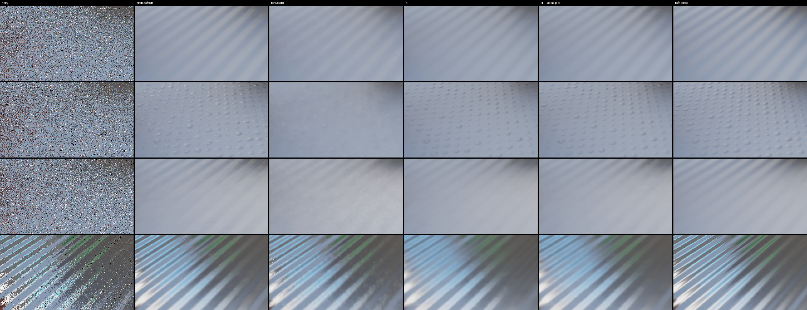

# Normal-mapped detail (review target 5)

_t5 agent (implementer / evaluator, RULES.md rule 8: no NRD code, README, release notes, port or quarantined file read;
the audit handoff only in its reviewed copies), 2026-10-26. Measured on our own test bed (Apple M5 Pro, HeadlessChrome
155, Metal) from a `git archive` mirror of 4a55458 plus the options below (merged onto 978939f, which touched only the
test bed's jitter). Shipped defaults: plain A-SVGF (`antiLag: 'auto'`, `youngNormalPower: 16`) with the shading normal
as `guides.normal`; the opt-in SH payload `svgf-sh-auto` (`payload: 'sh'`, `shSharpen` 0.75, `youngNormalPower` 0);
the opt-in recurrent filter with its 2026-10-26 defaults. Every score is against **4096-spp references**. Provisional
until Dennis reviews the proposals at the end._

## Conclusion first

1. **Reproduced, for the shipped plain filter: normal-map detail sparkles and loses contrast under camera motion.**
   With the shading normal as its guide, A-SVGF keeps 47–66 % of the reference's detail-band contrast on the four orbit
   captures (band gain, §2) and its bump-region boil is **1.2–4.5× the 4096-spp reference's own** (diffuse; specular
   1.5–3.6×): the bumps shimmer frame to frame. On a still camera it keeps 88–90 % of the contrast but still boils
   (0.0020–0.0045 against a reference that does not change). The q18 `youngNormalPower: 16` is not the cause: on bumps it
   is +0.0…+1.3 dB and calmer than 0 (contrast 0.47–0.56 vs 0.56–0.63, boil −11…−14 %).
2. **The SH payload is calm but flat, and M7's tuning does not carry to unseen normal maps.** `svgf-sh-auto` stays at or
   under the reference's boil everywhere, but keeps 62–73 % of the contrast, and on the **held-out grooves** it loses to
   the plain default: −1.43 dB / FLIP +29 % on the orbit, **−3.60 dB / FLIP +37 %** on the still view; on `bounce` −0.78
   dB (M7's finding, reproduced at 4096 spp). It wins on the M7 domes (+0.73 dB) and the fine cells (+3.76 dB), where
   the plain filter's sparkle costs most. M7's "25–50 % band energy" was partly reference noise: against 4096 spp the
   regression gain is 0.66–0.70 (§2).
3. **New option `shDetailNormalPower` (SH payload, default 0 = off, WGSL byte-identical): the fix for (2).** An extra
   spatial weight max(0, n_d·n_d')^p on the **detail** normals in the variance and à-trous passes, so a payload is
   averaged mostly with payloads sampled around similar hemispheres (the L1 extrapolation of a far-off neighbour's payload
   is what flattens the bumps). p = 16: **+0.8…+2.9 dB over SH on every normal-mapped capture (+0.5…+1.2 while the light sweeps), FLIP −8…−19 %, contrast
   +0.03…+0.15**, and it now **beats the plain default under camera motion on all four patterns** (+1.0…+4.6 dB, FLIP
   −15…+5 %) at a quarter to a half of its boil; on the still views it is +1.2 dB on the domes but −0.7 dB / FLIP +12 % on
   the held-out grooves, where the long still history lets the plain filter keep 88 % of the contrast. Smooth
   surfaces: −0.02 dB. **It fails rule 9's flicker / boil clauses against the shipped SH filter on still views** (bump
   region boil +14…+25 % at p = 8, +25…+75 % at p = 16, flicker +7…+45 %; the still reference's boil is ~0, so any rise
   counts), and p = 16 lifts moving-camera boil 10 % above the reference on `t5-fine`. A stride-gated variant
   (`shDetailNormalStride`, wide à-trous iterations only) was no calmer. Cost +0.29…+0.32 ms (+8…9 %) for one signal at
   1080p once the detail normal rides in the ping-pong's spare bits (a first build that read it per tap cost +23 %). **Proposed to Dennis
   (look change): `shDetailNormalPower: 16` for payload 'sh'.**
4. **`shSharpen: 1` for payload 'sh' passes every rule-9 clause (config level, for the orchestrator): contrast +0.06…+0.08
   on every normal-mapped capture, FLIP −0.1…−1.9 %, PSNR −0.02…+0.20, flicker −0…−6 %, boil +0…+9 % but under the
   reference's own boil everywhere** (§5). Where the detail and guide normals agree the resolve is exact at the guide
   normal whatever s is, so smooth surfaces and the 7 standard paths do not move.
5. **Specular: the plain filter with the shading normal stays the best choice on every capture**; SH specular loses
   2.8–4.5 dB (detail weight p = 32: still −1.6…−2.9 dB). Since `DiffuseSpecularDenoiser` builds separate pipelines when
   the per-signal `payload` differs, SH diffuse + plain specular costs nothing on the glossy surface beside it: a diffuse
   gain cannot worsen the specular there. Plain specular's own sparkle (bump boil up to 3.6× the reference on the fine
   cells) has no candidate yet (TASKS).
6. **Should `youngNormalPower` apply to the SH payload? Yes: neutral on normal maps, the plain flip's small young-pixel
   gain elsewhere; proposed as a config-level flip.** It was ignored by the SH passes until now (an
   explicit value was silently dropped); it now works when passed. SH filters with the smooth normal, so on flat
   normal-mapped geometry its normal weight is 1 anyway: ±0.02 dB and identical boil on all ten capture windows. On the 7 standard paths (curved surfaces, resets: T1's case) it
   behaves like the plain flip did: pooled +0.00…+0.02 dB, disoccluded +0.04…+0.10 (`cut`, `object`, `orbit`), tPSNR up
   to +0.09 (4096 spp), FLIP / flicker unchanged. Cost +0.26 ms (+8 %, within
   rule 9's +10 %). Rule 9's real-scene part cannot run for any SH option (no capture has SH inputs); the plain flip
   passed it there. For the orchestrator (TASKS).
7. **Recurrent washes the bumps out** (contrast 0.06–0.32, like the smooth-normal filter; −0.7…−4.2 dB vs the plain
   default): its diffuse normal weight is the ~61° lobe angle and its kernel plane tilts with the detail normal. No
   option built; a lead in TASKS. Under the moving light it also lags far behind (flat region −8 dB during the sweep).
8. **No directional lag of the SH anti-lag under a moving broad light** (§4): during the sweep SH and plain lose the same
   ~2.5 dB in the bump region, SH is back within 0.5 dB 3 frames after the light stops, the plain default after 10.

## 1. Inventory: which normal each filter uses for what (code at 4a55458)

The renderer gives two normals on a normal-mapped surface: the **shading (detail) normal** the rays were sampled around
(`guides.normal` in every plain capture; `normal` in CAPTURE-FORMAT v1) and the **smooth geometric normal**
(`normal_geom`, v1 only). The plain filters don't know which one they get: they use `guides.normal` for everything.

| filter (shipped config) | history test | spatial weights | young pixels | output |
|---|---|---|---|---|
| **plain SVGF / A-SVGF** (default; `guides.normal` = shading normal, M7's recommendation for bumpy glossy surfaces) | plane distance + cos 0.95 normal test on the 2×2 taps, 3×3 fallback | à-trous `max(0, n·n')^128` (diffuse, SVGF eq. 4) or the GGX lobe-angle cutoff (specular); depth gradient; luminance σ_l = 4 | `youngNormalPower: 16` (q18): for history < 4 frames the diffuse exponent ramps 16 → 128; A-SVGF's anti-lag puts many pixels there whenever λ fires | one rgb, valid for the normal it was filtered at |
| plain SVGF, `guides.normal` = smooth normal | same, flat normal | w_n ≡ 1 across bumps | — | bump shading averaged away (M7) |
| **SH payload** (`payload: 'sh'`, opt-in) | plane + normal test on the smooth normal | the same weights on the smooth normal; luminance of the payload at the smooth normal (M7-5) | `youngNormalPower` 0 for 'sh', and never read by the SH à-trous before this task | L1 payload resolved at `guides.detailNormal` (diffuse: sharpening 0.75; specular: SG ratio, λ_l 2) |
| **recurrent** (opt-in) | plane distance + backface; cos 0.95 `'relative'` normal test since f649a50 | kernel plane = tangent plane of `guides.normal` (R-4) with its screen Jacobian, plane-distance weight to it, normal weight = lobe half-angle (≈ 61° for diffuse, tightened with history) | `historyFix: 'spatial'` + the dense repair, same weights | one rgb; no SH variant (SPEC §8.5.6, not built) |

## 2. Test setup

**Captures** (new `detail` scene build = the `bumpy` build plus a selectable detail-normal pattern and an emitter seen
only by the secondary rays; paths in `examples/realtime-denoiser/src/paths-detail.ts`, capture set `t5` in
`capture-sets.mjs`): 960×540, sh-diffuse + sh-specular with **4096-spp references**, blue noise. `dt-bumpy` is
byte-identical to `bumpy` (every buffer of a test frame), and the `bumpy` build to the existing `v1-bumpy` capture.

| capture | camera | detail normals | light | frames | windows |
|---|---|---|---|---|---|
| `t5-bumpy` | `bumpy`'s slow orbit (2 cm / frame) | M7 domes (floor) + ripples (wall) | sky, sphere light, cyan panel | 64 | settled 16–63 |
| `t5-smooth` | same | none (smooth control; region mask from `t5-bumpy`) | same | 64 | settled |
| `t5-grooves` | same | **held-out**: 22 cm grooves at 35°, 12–32° tilt | same | 64 | settled |
| `t5-fine` | same | **held-out**: 3–5.5 cm cells, random 15–40° tilt (2–6 px at 540p) | same | 64 | settled |
| `t5-bounce` | `bounce` (dolly down the coloured corridor) | M7 domes | same | 64 | settled |
| `t5-light` | still (`bumpy` frame 48) | M7 domes | + a broad emitter (r 0.6 m, out of view) that holds, sweeps 4.8 m across the floor (frames 16–47), holds | 80 | pre 8–15, move 16–47, stop 48–55, hold 48–79 |
| `t5-light-smooth` / `t5-light-grooves` | same | none / held-out grooves | same | 80 | same |

**Metrics** (`results/data/t5-normal-detail/score.mjs`, values Reinhard x/(1+x) per channel, as the test bed): pooled
PSNR over all receivers, the **bump** region (angle(normal, normal_geom) > 5°) and the rest (**flat**); mean FLIP (every
4th frame, the test bed's viewing condition); motion-compensated **flicker** (|e_t − e_t−1| along the history) and
**boil** (RMS second temporal difference of the output along the history / √6, only where the reference's own second
difference is < 0.02), with the reference's boil as its floor. **Detail band** in the bump region: band = x − G_σ2px(x)
(as compare.mjs and the live test bed); besides its PSNR, the regression of the output band on the reference band,
**gain** k = Σ b_o b_r / Σ b_r² (detail contrast kept: 1 = the reference's bumps, 0 = washed out; noise is uncorrelated
with b_r and does not raise it) and **noise** Σ(b_o − k b_r)² / Σ b_r². compare.mjs's energy ratio Σb_o²/Σb_r² mixes
the two, and a noisy reference inflates its denominator: M7's 0.25–0.5 "band energy" for SH reads as a gain of 0.66–0.70
here.

**Arms** (registry ids; `svgf-plain-default` and `recurrent-plain*` are new entries in `tools/rt-capture/src/v1-entries.ts`):
`def` = `svgf-plain-default` (the shipped plain A-SVGF, shading normal); `def-y0` = the same with `youngNormalPower=0`;
`smooth` = `svgf-plain-smooth@antiLag=auto` (smooth normal); `rec` = `recurrent-plain` (recurrent defaults, shading
normal); `sh` = `svgf-sh-auto`; `sh-y16` = `@youngNormalPower=16`; `sh-s1` = `@m7.sharpen=1`; `sh-dp<p>` =
`@m7.detailPow=<p>` (`shDetailNormalPower`).

## 3. Results matrix

Every arm on every capture (`data/t5-normal-detail/summary.md`, from `summary.mjs`); diffuse and specular separately.
Each cell: pooled PSNR (dB) / bump-region detail gain / FLIP / bump-region boil; last column the 4096-spp reference's own
boil there (still views: the reference does not change, so its boil is ~0).

sh-diffuse: PSNR / bump gain / FLIP / bump boil

| capture (window) | def | def-y0 | smooth | rec | sh | sh-y16 | sh-s1 | sh-dp8 | sh-dp16 | sh-dp32 | reference boil |
|---|---|---|---|---|---|---|---|---|---|---|---|
| t5-bumpy (settled) | 39.28 / 0.56 / 0.0423 / 0.0036 | 38.29 / 0.63 / 0.0425 / 0.0042 | 36.24 / 0.22 / 0.0571 / 0.0009 | 36.76 / 0.24 / 0.0556 / 0.0008 | 40.01 / 0.70 / 0.0469 / 0.0011 | 40.01 / 0.70 / 0.0469 / 0.0011 | 40.06 / 0.76 / 0.0464 / 0.0012 | 41.12 / 0.72 / 0.0425 / 0.0011 | 41.59 / 0.73 / 0.0406 / 0.0013 | 41.82 / 0.76 / 0.0395 / 0.0018 | 0.0016 |
| t5-grooves (settled) | 38.30 / 0.53 / 0.0494 / 0.0021 | 38.29 / 0.53 / 0.0494 / 0.0021 | 32.71 / 0.13 / 0.0837 / 0.0008 | 34.09 / 0.18 / 0.0708 / 0.0008 | 36.87 / 0.62 / 0.0636 / 0.0010 | 36.87 / 0.62 / 0.0636 / 0.0010 | 37.08 / 0.68 / 0.0624 / 0.0011 | 38.43 / 0.65 / 0.0560 / 0.0010 | 39.33 / 0.68 / 0.0516 / 0.0011 | 40.15 / 0.72 / 0.0474 / 0.0013 | 0.0018 |
| t5-fine (settled) | 35.03 / 0.47 / 0.0565 / 0.0094 | 33.75 / 0.56 / 0.0572 / 0.0106 | 34.32 / 0.06 / 0.0668 / 0.0008 | 34.33 / 0.08 / 0.0679 / 0.0010 | 38.79 / 0.66 / 0.0524 / 0.0016 | 38.79 / 0.66 / 0.0524 / 0.0016 | 38.86 / 0.74 / 0.0518 / 0.0018 | 39.38 / 0.68 / 0.0496 / 0.0018 | 39.60 / 0.71 / 0.0480 / 0.0023 | 39.29 / 0.76 / 0.0471 / 0.0039 | 0.0021 |
| t5-bounce (settled) | 40.89 / 0.66 / 0.0346 / 0.0037 | 40.68 / 0.69 / 0.0346 / 0.0038 | 35.99 / 0.18 / 0.0492 / 0.0009 | 38.41 / 0.29 / 0.0490 / 0.0009 | 40.11 / 0.69 / 0.0402 / 0.0011 | 40.11 / 0.69 / 0.0402 / 0.0011 | 40.09 / 0.75 / 0.0401 / 0.0012 | 41.64 / 0.74 / 0.0346 / 0.0012 | 42.07 / 0.77 / 0.0327 / 0.0014 | 42.13 / 0.81 / 0.0318 / 0.0019 | 0.0015 |
| t5-light (hold) | 39.90 / 0.90 / 0.0466 / 0.0045 | 39.87 / 0.90 / 0.0467 / 0.0045 | 35.84 / 0.26 / 0.0621 / 0.0009 | 35.25 / 0.32 / 0.0748 / 0.0012 | 39.41 / 0.73 / 0.0522 / 0.0009 | 39.42 / 0.73 / 0.0522 / 0.0009 | 39.41 / 0.78 / 0.0517 / 0.0009 | 40.61 / 0.76 / 0.0477 / 0.0011 | 41.13 / 0.80 / 0.0455 / 0.0015 | 41.27 / 0.88 / 0.0443 / 0.0022 | 0.0003 |
| t5-light (move) | 33.79 / 0.90 / 0.0760 / 0.0056 | 33.72 / 0.90 / 0.0762 / 0.0063 | 32.41 / 0.24 / 0.0887 / 0.0018 | 26.29 / 0.29 / 0.1236 / 0.0021 | 33.54 / 0.72 / 0.0812 / 0.0017 | 33.56 / 0.72 / 0.0811 / 0.0017 | 33.52 / 0.78 / 0.0807 / 0.0017 | 33.90 / 0.75 / 0.0771 / 0.0020 | 34.04 / 0.80 / 0.0753 / 0.0024 | 34.08 / 0.87 / 0.0743 / 0.0033 | 0.0011 |
| t5-light-grooves (hold) | 40.39 / 0.88 / 0.0481 / 0.0020 | 40.38 / 0.88 / 0.0481 / 0.0021 | 32.60 / 0.18 / 0.0858 / 0.0009 | 33.38 / 0.26 / 0.0870 / 0.0011 | 36.79 / 0.64 / 0.0657 / 0.0009 | 36.80 / 0.64 / 0.0656 / 0.0009 | – | 38.63 / 0.71 / 0.0584 / 0.0010 | 39.71 / 0.79 / 0.0538 / 0.0011 | 40.53 / 0.88 / 0.0496 / 0.0013 | 0.0003 |
| t5-light-grooves (move) | 33.88 / 0.88 / 0.0773 / 0.0030 | 33.87 / 0.88 / 0.0773 / 0.0033 | 30.75 / 0.16 / 0.1063 / 0.0018 | 26.01 / 0.24 / 0.1345 / 0.0021 | 32.58 / 0.64 / 0.0923 / 0.0018 | 32.59 / 0.64 / 0.0922 / 0.0018 | – | 33.39 / 0.71 / 0.0851 / 0.0020 | 33.74 / 0.79 / 0.0812 / 0.0021 | 33.95 / 0.88 / 0.0781 / 0.0023 | 0.0012 |
| t5-smooth (settled) | 43.37 / 0.74 / 0.0315 / 0.0008 | 43.37 / 0.74 / 0.0315 / 0.0008 | 43.37 / 0.74 / 0.0315 / 0.0008 | 40.88 / 0.63 / 0.0377 / 0.0006 | 43.67 / 0.74 / 0.0296 / 0.0008 | 43.67 / 0.74 / 0.0296 / 0.0008 | – | 43.66 / 0.74 / 0.0296 / 0.0008 | 43.65 / 0.74 / 0.0296 / 0.0008 | 43.62 / 0.74 / 0.0295 / 0.0008 | 0.0018 |
| t5-light-smooth (hold) | 42.37 / 0.79 / 0.0373 / 0.0008 | 42.36 / 0.79 / 0.0374 / 0.0008 | 42.35 / 0.79 / 0.0374 / 0.0008 | 37.36 / 0.70 / 0.0607 / 0.0009 | 42.67 / 0.80 / 0.0360 / 0.0008 | 42.68 / 0.80 / 0.0360 / 0.0008 | – | 42.65 / 0.80 / 0.0360 / 0.0008 | 42.63 / 0.80 / 0.0360 / 0.0008 | 42.60 / 0.80 / 0.0360 / 0.0008 | 0.0003 |

sh-specular: PSNR / bump gain / FLIP / bump boil

| capture (window) | def | def-y0 | smooth | rec | sh | sh-y16 | sh-s1 | sh-dp8 | sh-dp16 | sh-dp32 | reference boil |
|---|---|---|---|---|---|---|---|---|---|---|---|
| t5-bumpy (settled) | 31.55 / 0.58 / 0.0841 / 0.0056 | 31.55 / 0.58 / 0.0841 / 0.0056 | 28.35 / 0.24 / 0.1075 / 0.0029 | 29.54 / 0.42 / 0.0983 / 0.0051 | 28.73 / 0.27 / 0.1021 / 0.0032 | 28.73 / 0.27 / 0.1021 / 0.0032 | 28.73 / 0.27 / 0.1021 / 0.0032 | 29.42 / 0.32 / 0.0957 / 0.0031 | 29.75 / 0.35 / 0.0928 / 0.0031 | 29.99 / 0.39 / 0.0903 / 0.0033 | 0.0029 |
| t5-grooves (settled) | 30.02 / 0.59 / 0.0926 / 0.0041 | 30.02 / 0.59 / 0.0926 / 0.0041 | 25.91 / 0.25 / 0.1334 / 0.0023 | 27.17 / 0.44 / 0.1140 / 0.0060 | 26.16 / 0.27 / 0.1273 / 0.0023 | 26.16 / 0.27 / 0.1273 / 0.0023 | 26.16 / 0.27 / 0.1273 / 0.0023 | 26.65 / 0.30 / 0.1175 / 0.0023 | 26.86 / 0.31 / 0.1125 / 0.0024 | 27.11 / 0.33 / 0.1073 / 0.0024 | 0.0027 |
| t5-fine (settled) | 26.98 / 0.60 / 0.1202 / 0.0115 | 26.98 / 0.60 / 0.1202 / 0.0115 | 22.24 / 0.10 / 0.1718 / 0.0038 | 24.78 / 0.40 / 0.1420 / 0.0100 | 22.85 / 0.17 / 0.1634 / 0.0048 | 22.85 / 0.17 / 0.1634 / 0.0048 | 22.85 / 0.17 / 0.1634 / 0.0048 | 23.70 / 0.25 / 0.1518 / 0.0053 | 24.38 / 0.32 / 0.1428 / 0.0061 | 25.18 / 0.41 / 0.1318 / 0.0074 | 0.0032 |
| t5-bounce (settled) | 32.12 / 0.60 / 0.0784 / 0.0051 | 32.12 / 0.60 / 0.0784 / 0.0051 | 28.05 / 0.22 / 0.1035 / 0.0029 | 28.80 / 0.42 / 0.1038 / 0.0047 | 28.79 / 0.31 / 0.0984 / 0.0031 | 28.79 / 0.31 / 0.0984 / 0.0031 | 28.79 / 0.31 / 0.0984 / 0.0031 | 29.79 / 0.38 / 0.0915 / 0.0030 | 30.16 / 0.44 / 0.0883 / 0.0032 | 30.44 / 0.50 / 0.0853 / 0.0035 | 0.0026 |
| t5-light (hold) | 34.98 / 0.91 / 0.0685 / 0.0039 | 34.98 / 0.91 / 0.0685 / 0.0039 | 29.97 / 0.53 / 0.0992 / 0.0027 | 32.92 / 0.77 / 0.0829 / 0.0047 | 30.64 / 0.57 / 0.0927 / 0.0026 | 30.64 / 0.57 / 0.0927 / 0.0026 | 30.64 / 0.57 / 0.0927 / 0.0026 | 32.22 / 0.65 / 0.0843 / 0.0026 | 32.81 / 0.72 / 0.0804 / 0.0027 | 32.92 / 0.79 / 0.0779 / 0.0029 | 0.0002 |
| t5-light (move) | 31.71 / 0.91 / 0.0774 / 0.0056 | 31.71 / 0.91 / 0.0774 / 0.0056 | 28.67 / 0.52 / 0.1063 / 0.0042 | 28.00 / 0.78 / 0.0971 / 0.0055 | 29.05 / 0.56 / 0.1009 / 0.0041 | 29.05 / 0.56 / 0.1009 / 0.0041 | 29.05 / 0.56 / 0.1009 / 0.0041 | 30.07 / 0.64 / 0.0928 / 0.0040 | 30.42 / 0.70 / 0.0892 / 0.0040 | 30.47 / 0.77 / 0.0870 / 0.0042 | 0.0010 |
| t5-light-grooves (hold) | 33.53 / 0.91 / 0.0785 / 0.0029 | 33.53 / 0.91 / 0.0785 / 0.0029 | 28.43 / 0.65 / 0.1236 / 0.0023 | 32.16 / 0.84 / 0.0873 / 0.0057 | 28.99 / 0.67 / 0.1165 / 0.0023 | 28.99 / 0.67 / 0.1165 / 0.0023 | – | 30.04 / 0.69 / 0.1054 / 0.0023 | 30.55 / 0.71 / 0.0998 / 0.0023 | 31.10 / 0.73 / 0.0940 / 0.0024 | 0.0002 |
| t5-light-grooves (move) | 30.59 / 0.90 / 0.0877 / 0.0042 | 30.59 / 0.90 / 0.0877 / 0.0042 | 27.27 / 0.64 / 0.1300 / 0.0036 | 27.50 / 0.85 / 0.1027 / 0.0067 | 27.65 / 0.66 / 0.1249 / 0.0035 | 27.65 / 0.66 / 0.1249 / 0.0035 | – | 28.40 / 0.68 / 0.1144 / 0.0035 | 28.74 / 0.70 / 0.1089 / 0.0035 | 29.08 / 0.72 / 0.1034 / 0.0036 | 0.0012 |
| t5-smooth (settled) | 36.53 / 0.76 / 0.0570 / 0.0019 | 36.53 / 0.76 / 0.0570 / 0.0019 | 36.54 / 0.76 / 0.0570 / 0.0019 | 35.04 / 0.78 / 0.0650 / 0.0040 | 36.60 / 0.76 / 0.0563 / 0.0019 | 36.60 / 0.76 / 0.0563 / 0.0019 | – | 36.68 / 0.76 / 0.0560 / 0.0019 | 36.73 / 0.76 / 0.0558 / 0.0019 | 36.80 / 0.76 / 0.0555 / 0.0019 | 0.0028 |
| t5-light-smooth (hold) | 37.79 / 0.78 / 0.0499 / 0.0015 | 37.79 / 0.78 / 0.0499 / 0.0015 | 37.79 / 0.78 / 0.0499 / 0.0015 | 35.09 / 0.77 / 0.0664 / 0.0042 | 37.81 / 0.78 / 0.0492 / 0.0015 | 37.81 / 0.78 / 0.0492 / 0.0015 | – | 37.92 / 0.78 / 0.0489 / 0.0015 | 38.01 / 0.78 / 0.0487 / 0.0015 | 38.12 / 0.78 / 0.0483 / 0.0015 | 0.0003 |



_Frame 40, 240×135 crops of the floor ×2; columns noisy, plain default, recurrent, SH, SH + `shDetailNormalPower` 16,
reference. Rows: held-out grooves (orbit, diffuse), held-out fine cells (orbit, diffuse), grooves under the still camera
(`t5-light-grooves`, diffuse, the emitter mid-sweep), grooves (orbit, specular)._

Reading the matrix:

- **Plain default vs plain smooth / recurrent:** filtering with the smooth normal keeps 6–26 % of the bumps; the recurrent
  filter, with the shading normal, keeps 8–32 %: its loose diffuse normal weight and tilted kernel plane average across
  bump slopes. Both are calm (boil under the reference) because there is nothing left to boil.
- **Plain default:** the most contrast on still views (0.88–0.90), 0.47–0.66 under the orbit, and the highest boil of every
  arm in the bump region (fine cells 0.0094 vs a reference 0.0021: the sparkle target 5 describes). Its flat-region
  numbers equal the smooth control's, so the loss is all in the bumps.
- **SH:** boil at or under the reference everywhere, PSNR best of the shipped options on domes / fine cells, worst of the
  shading-normal options on the grooves and in the corridor.
- **SH + detail weight:** contrast rises with p (p 32 reaches the plain default's still-view 0.88), PSNR and FLIP improve up
  to p 16–32, boil rises with p: p 8 stays under the reference on every moving-camera capture, p 16 exceeds it on the fine
  cells (0.0023 vs 0.0021), p 32 on three of the four orbits and on every still view.
- **Smooth control:** every SH variant is within 0.07 dB of SH; the plain arms are identical (no detail normals).

## 4. Under a moving broad light

`t5-light` (M7 domes) and `t5-light-grooves`: the camera and the geometry stay still, the broad emitter sweeps across the
floor in frames 16–47. Diffuse, bump region (`data/t5-normal-detail/scores/t5-light.arms-main.json`, `perFrame`):

| arm | bump PSNR pre (8–15) | move (16–47) | stop (48–55) | hold (48–79) | frames after the stop to within 0.5 dB of the late hold | gain during the sweep |
|---|---|---|---|---|---|---|
| plain default | 36.07 | 33.36 | 35.05 | 36.33 | 10 | 0.90 |
| SH | 35.33 | 32.84 | 35.28 | 35.68 | 3 | 0.72 |
| SH + detail p 8 | 37.13 | 33.80 | 36.77 | 37.36 | 4 | 0.75 |
| SH + detail p 16 | 38.08 | 34.23 | 37.44 | 38.23 | 5 | 0.80 |
| recurrent | 32.19 | 29.13 | 31.16 | 32.05 | 6 | 0.29 (flat region 25.65 dB during the sweep: −8.3 vs plain) |

- Nothing washes out *because* the light moves: every arm's detail gain is the same during the sweep as before it.
  Every arm loses 2.5–3.9 dB in the bump region while the light moves (the history lags the moving shading), and the
  plain default needs the longest to settle after it stops (10 frames vs SH's 3).
- **No directional blind spot of the SH anti-lag.** The SH gradient compares the payload's luminance at the smooth normal,
  so a light that turns the bump shading without changing the irradiance at the smooth normal would not shorten the
  history (the analogue of T3's colour finding). A sweep at constant height changes both, and SH loses no more than the
  plain filter during it; a light circling at constant elevation would isolate the case. Not built; noted in TASKS.
- Specular under the moving light: the plain default leads every SH variant in every window (§3), and its bump boil on the
  still holds (0.0029–0.0040 vs a reference ~0) is the specular sparkle left open.

## 5. Rule-9 A/B of the options

Baseline for the SH options = the shipped SH filter (`svgf-sh-auto`); for "is it better than what ships for
normal-mapped surfaces" also the plain default. Full tables per capture, signal and window:
`data/t5-normal-detail/ab-vs-sh.md`, `ab-vs-plain-default.md` (from `ab.mjs`; the boil clause column applies q20 (a):
a rise counts only if the candidate ends above both the reference's own boil and the baseline's). The SH options do not
touch the plain filters, so the real-scene captures (no SH inputs) cannot test them; rule 9's real-scene part is "not
applicable" for all of them, and the 7 standard paths are the SH regression gate (`normal_geom = normal`, M7-13).

**Normal-mapped captures, diffuse, candidate − SH** (moving-camera windows = the four orbits, still = `t5-light` /
`t5-light-grooves` pre / stop / hold; specular in the files: the detail weight is +0.3…+2.3 dB there too, plain specular
stays ahead):

| candidate | ΔPSNR moving | ΔPSNR still | contrast (gain) | FLIP moving | FLIP still | flicker (bump) | boil (bump) | boil clause | cost (§6) |
|---|---|---|---|---|---|---|---|---|---|
| `shSharpen: 1` | −0.02…+0.20 | −0.02…+0.02 | +0.06…+0.08 | −0.1…−1.9 % | −0.3…−1.1 % | −2.9…−5.6 % moving, ±0 still | +6…+9 % moving (under the reference's), ±0 still | **passes** | 0 |
| `youngNormalPower: 16` | ±0.00 (+0.02 incl. the first frames) | 0…+0.02 | ±0 | ±0 | 0…−0.2 % | ±0 | 0…−1.4 % | **passes** | +0.26 ms (+8 %) |
| `shDetailNormalPower: 8` | +0.59…+1.56 | +0.97…+1.99 | +0.02…+0.08 | −5.4…−13.8 % | −6.8…−13.0 % | −0.6…−1.8 % moving, **+7.8…+18 % still** | +3…+11 % moving, **+13…+25 % still** | **fails on still views** | +0.29 ms (+8 %) |
| `shDetailNormalPower: 16` | +0.81…+2.46 | +1.34…+3.12 | +0.03…+0.16 | −8.4…−18.8 % | −9.8…−20.5 % | −1.6…+4.9 % moving, **+14.5…+44.5 % still** | +10…+40 % moving (`t5-fine` above the reference), **+24…+75 % still** | **fails** | +0.32 ms (+9 %) |
| `shDetailNormalPower: 32` | +0.50…+3.28 | +1.35…+3.97 | +0.06…+0.25 | −10…−25 % | −11…−27 % | up to +91 % still | +24…+137 % moving, +39…+162 % still | fails | ≈ p 16 |
| `shDetailNormalStride: 4` (p 16 / 32) | +0.70…+2.41 | +1.10…+1.82 | less than the full weight | −6…−23 % | −8…−14 % | **+26…+62 % still** | **+35…+86 % still** | fails (no better than the full weight) | |
| smooth controls (`t5-smooth`, `t5-light-smooth`), any p | −0.01…−0.07 | | ±0 | ±0.3 % | | ±1.6 % (flat) | +1…+3 % (flat), under the reference's | passes | |

**Against the plain default** (`ab-vs-plain-default.md`): `shDetailNormalPower: 16` under camera motion +1.03…+4.57 dB,
FLIP −15…+4.5 %, contrast 0.47–0.66 → 0.68–0.77, bump boil −46…−76 %, flicker −32…−65 %; on the still views +1.2…+1.8 dB
(domes) and −0.15…−0.68 dB / FLIP +5…+13 % (grooves), boil −31…−48 %. SH without the option: −1.43 / −0.78 dB on grooves /
corridor, FLIP +16…+29 %.

**7 standard paths, 1080p live (SH regression, `data/t5-normal-detail/live-1080p.md`; 256-spp references on all 7,
4096 spp on orbit / light / glossy, 48 frames):** every option within ±0.01 dB pooled on diffuse (worst −0.009,
`shDetailNormalPower: 16` at 4096-spp orbit), specular +0.005…+0.09 dB, disoccluded −0.04…+0.10, FLIP 0…−0.7 %, flicker
equal (4-decimal JSON), tPSNR −0.05…+0.09. `youngNormalPower: 16`: +0.00…+0.024 pooled, disoccluded +0.04…+0.10 on
`orbit` / `cut` / `object` (diffuse), tPSNR +0.05…+0.09 at 4096 spp: the plain flip's pattern. These rows ran the first (texture-read) build of
`shDetailNormalPower`; the shipped packed build reran the seven 256-spp paths and matches them to 0.001 dB
(`live-1080p-packed.md`).

**Verdict.** `shSharpen: 1` and `youngNormalPower: 16` pass every clause that can run for payload 'sh' (config-level,
TASKS). `shDetailNormalPower` (8 or 16) is the target-5 fix (contrast, detail-region PSNR, FLIP, and the plain filter's
sparkle gone), but it fails rule 9's flicker / boil clauses against the shipped SH filter on still views, and p 16 also on
`t5-fine` under motion: residual shimmer comes back with the contrast, though at a quarter to a half of the plain
default's. A look decision: proposed to Dennis.

## 6. Cost

1080p test-bed solo bench (`data/t5-normal-detail/bench.mjs`, `mode=bench`, path `dt-bumpy`, signal sh-diffuse = one
`DiffuseDenoiser`, n = 200, 5 alternating rounds after a warm-up page, no other headless job running). **A desktop video
call (Chrome "Video Wake Lock") ran through both benches** (LESSONS: it slows medians, fastest frames move little), so the
fastest frame is the figure to trust; medians agree with it to ±3 %.

| configuration | median of run medians (ms) | fastest frame | vs SH |
|---|---|---|---|
| plain default (A-SVGF, shading normal) | 2.745 | 2.560 | |
| SH (`svgf-sh-auto`) | 3.448 | 3.235 | |
| SH + `youngNormalPower: 16` | 3.704 | 3.525 | +0.26 / +0.29 ms (+7 / +9 %) |
| SH + `shDetailNormalPower: 8` (as built: detail normal packed in the ping-pong) | 3.736 | 3.531 | +0.29 / +0.30 (+8 / +9 %) |
| SH + `shDetailNormalPower: 16` | 3.763 | 3.525 | +0.32 / +0.29 (+9 %) |
| SH + `shSharpen: 1` | 3.453 | 3.252 | ±0 |
| first build: detail normal read from its own texture per tap (`bench-1080p-texload.jsonl`) | 4.117 | 3.978 | +0.78 / +0.75 (+23 %) |

The first build read `guides.detailNormal` (rgba16float) at every à-trous tap: +23 %, over rule 9's +10 %. The shipped
build writes the detail normal, octahedral 8:8, into the unused upper half of each ping-pong texel's last word (beside σ)
in the variance pass and carries it through the iterations, so the taps read it from the payload they load anyway:
+9 %, output within 0.005 dB of the texture version on every capture (`scores/*.arms-pk.json`). `shPingPacking: 'u8'`
(no spare bits) keeps the texture read. Memory: none (no new buffer).

## 7. What was built

All options default off; with them off the generated WGSL of every SH pass variant (signal combinations, kernels,
feedback, last / not last, resolves, both ping formats, raw and encoded input) is byte-identical to 4a55458's, and GPU
replays of the defaults are byte-identical to HEAD's package (std540-orbit `svgf-auto` 32 / 32 files, v1-bumpy
`svgf-sh-auto` 64 / 64, v1-bumpy plain default 64 / 64; `cmp` of every `.f32`). The replays ran on the first (texture-read) build; the WGSL
identity check was repeated on the shipped packed build. Code: 06637b0.

- **`packages/denoiser-realtime`**: `shDetailNormalPower` (`SvgfOptions`, SH payload; variance + à-trous, detail normal
  packed into the f16 ping-pong), `shDetailNormalStride` (documented dead end), `youngNormalPower` now honoured by the SH
  à-trous (reads the centre's history length from the accumulated payload); README options.
- **Registry** (`tools/rt-capture/src/v1-entries.ts`, `denoisers.ts`): `svgf-plain-default` (plain SVGF with the package
  defaults on the sh-* samples), `recurrent-plain`, `recurrent-plain-smooth`; settings `m7.detailPow`, `m7.detailStride`.
- **Test bed** (`examples/realtime-denoiser`): `detail` scene build (`scene.ts`: `heldOutNormal` grooves / fine cells,
  `bumpKind` 1 = smooth, an emitter sphere in `incoming()` only), `src/paths-detail.ts` (`dt-*` paths), uniforms 104–111
  for the detail build (`signals.ts`), capture set `t5` (`capture-sets.mjs`, CAPTURES.md). The `standard`, `bumpy`,
  `glass` and `reflect` builds' WGSL is unchanged (the new code is behind the build flag).
- **Scoring** (`docs/research/rt-denoiser/results/data/t5-normal-detail/`): `score.mjs` (regions, band gain / noise, FLIP,
  motion-compensated flicker / boil with the reference floor, per-frame curves), `ab.mjs`, `summary.mjs`, `tables.mjs`,
  `live-table.mjs`, `bench.mjs`; JSON scores, live tables, bench data.

## 8. Repro

```sh
# captures (58 GB, ~30 min; one capture per GPU-lock hold)
node examples/realtime-denoiser/run-headless.mjs --serve --set=t5
# one arm (replay), then score; the smooth controls take their twin's region mask
node examples/realtime-denoiser/run-headless.mjs "mode=replay&capture=t5-grooves&signals=sh-diffuse,sh-specular&warm=0&output=sh-dp16&denoiser=svgf-sh-auto&m7.detailPow=16"
node docs/research/rt-denoiser/results/data/t5-normal-detail/score.mjs tools/rt-capture/captures/t5-grooves \
  --outputs tools/rt-capture/outputs --arms sh-dp16 --json out.json            # --mask-from …/t5-bumpy, --windows light
node docs/research/rt-denoiser/results/data/t5-normal-detail/ab.mjs --base sh --cands sh-dp16 <score JSONs>
# 7-path SH regression, 1080p live
node examples/realtime-denoiser/run-headless.mjs "mode=eval&preset=full&path=cut&signal=sh-diffuse,sh-specular&denoiser=svgf-sh-auto,svgf-sh-auto@m7.detailPow=16"
```

Replay outputs were deleted after scoring (≈ 0.8 GB per arm and capture); the `t5-*` captures were deleted at the end
(58 GB; the set regenerates byte for byte).
