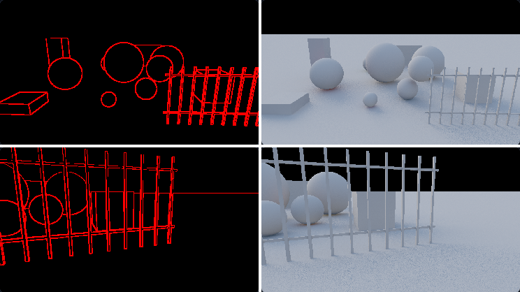

# T6: silhouettes, thin objects and surface boundaries (review target 6)

_2026-10-26, T6 implementer / evaluator (RULES.md rule 8: no NRD code, README, release notes, port or quarantined
file read; the audit handoff only in its reviewed copies). Brief: [sources/nrd-review-targets.md](../sources/nrd-review-targets.md)
target 6 and the four detection follow-ups in TASKS. Everything was measured on our own test bed and captures (Apple
M5 Pro, HeadlessChrome 155, Metal). Package: HEAD de6596f + the options below (a7ef4a8); every option defaults to
today's behaviour, byte-identical (§1)._

## 0. Conclusion

- **No default change passes rule 9, so none is proposed for the shipped filters.** The real-scene captures
  (Bistro, Sponza, the three.js corner) overturn two test-bed wins: SVGF without its 3×3 fallback, and a relaxed
  normal test. What passes is confined to the recurrent option (§6, §7: `normalThreshold: 0.95` + `normalTest:
  'relative'` and `virtualHitTest`, proposed to the orchestrator as config-level flips of that option) and a
  near-neutral shadows option (§6). One taste call goes to Dennis: recurrent with a plain normal test (+0.4 dB on the
  real scenes, with more boil).
- **Boundary region, new.** The test bed and a capture scorer now report a reference-labelled `boundary` region (≤ 2 px
  from a silhouette, crease or contact of the exact G-buffer; [figure](img/t6-boundary-mask.png)), plus `boundary-young`
  and boundary flicker. Shipped defaults at 1080p score 2.2–7.9 dB lower there than over the whole frame (shadows
  29.97 vs 37.87 dB, specular 31.06 vs 34.99). Motion-compensated flicker is 2–4× the static level for specular,
  shadows and AO. The **signed bias at boundaries is ≤ 0.003** (tonemapped) for every shipped filter, so
  foreground colour or shadow does not bleed systematically onto the background. What is left is noise and
  smoothing in a narrow band. §2.
- **Item 1: SVGF's 3×3 history fallback.** Reproduced: it is the whole of SVGF's interior misses, 16.5 ‰ → 0.04 ‰
  with `historyFallback: 'off'`. A-SVGF's own reference code has no fallback. Off is a clean win on the test bed at
  1080p: disoccluded +0.14 / +0.18 / +0.51 / +0.29 dB (diffuse / specular / AO / SO), no path loses, FLIP −0.1…−0.6 %.
  At 4096 spp: AO +0.16 dB pooled, disoccluded +1.66. **It fails on the real scenes:** diffuse −0.09 dB, AO −0.10,
  Bistro orbit −0.20 / −0.16, boil +3.4 % / +5.5 %. AO boil on `bistro-orbit` (+8.3 %) and `sponza-orbit` (+8.8 %)
  ends above both the reference's and the shipped default's boil. On dense geometry SVGF's normal test fails many
  2×2 taps, and the fallback then finds same-normal texels in the 3×3. `'strict'` (also restart below half the
  bilinear weight) loses everywhere: real diffuse −0.35 dB, boil +17 %. **Not proposed.** §4.
- **Item 2: SVGF's normal test on real geometry.** Reproduced with exact ground truth: precision 39.7 % on
  Bistro / Sponza, and on Bistro 13 % of adjacent same-surface texel pairs differ by more than 18°. Lowering the
  threshold trades the real-scene false resets against the test bed's contact catch (0.8: precision 59.6 %, but
  `object` wrong-surface misses 0.01 → 0.56 %). Our design `normalTest: 'relative'` (threshold relaxed to the pixel's
  own neighbourhood spread) gets precision 86.5 % at 0.34 % misses on `object`. **Downstream it loses:** Bistro AO
  −1.59 dB, specular −1.13, FLIP +12…+21 %. It also cuts Bistro's boil by 30–38 %. **The "needless" resets are
  not needless for normal-dependent signals.** History shaded at a different normal is the wrong history for AO
  and specular, even on the same surface. Point-visibility precision is the wrong yardstick there. Keep cos 0.95.
  Bistro's AO boil (2.6× the reference's) is filed as its own problem. §5.
- **Item 3: wrong-surface history at a moving object's contact (recurrent, shadows).** Reproduced: 3.9 % / 3.7 % of
  the wrong-surface pixels on `object` are missed. A per-tap normal test fixes it: cos 0.95 brings it to 0.03 %, and
  cos 0.95 with `'relative'` to 0.34 %. With `'relative'` it is level or better on the test bed (recurrent +0.007 /
  +0.010 dB, boundary-young +0.18…+0.20, disoccluded +0.05…+0.13; 4096 spp +0.014 / +0.015) and on the 9 real
  captures (+0.007 / +0.033), at +0.9 % cost. That is a config-level change for the recurrent option that passes rule 9 (TASKS,
  orchestrator). Shadows with it: +0.004 dB test bed, +0.010 real, +5.8 % cost; it passes, but the gain is too small
  to recommend. **A plain cos 0.8 / 0.95 helps recurrent much more on the real scenes (+0.29…+0.44 dB, FLIP −1.6…−2.8 %)
  but fails the boil clause on two captures** (resets boil like young pixels): a question for Dennis (§6.3). Plain
  thresholds lose for shadows on the test bed (−0.08 dB, `orbit` −0.25).
- **Item 4: the recurrent filter's virtual-motion leading ghost.** Reproduced: near image duplicated on 36 / 40
  frames; far image 5.6 px ahead. `virtualHitTest` (per-tap stored ĥ against this frame's) removes the near
  duplicates (36 → 0 / 40). The object trail on `rm-obj-plane` drops from 27 to 12 px, `rm-refl-turn`'s far image
  from 7.3 to 2.3 px off, the concave far image from 6.3 to 2.0 px. **It does not fix `rm-cam-plane`'s far image
  (5.3 px ahead): that one is a distance error, not a disocclusion** (§7). Seven paths at 1080p: specular +0.061 dB
  (worst `light` −0.027). At 4096 spp −0.001. Real scenes +0.023, boil +2.1 % (≤ 4.7 % per capture). It passes rule 9
  for the recurrent option (TASKS).

## 1. Setup

| | |
|---|---|
| package | HEAD de6596f + this work (a7ef4a8), served from a scratch mirror (own Vite servers 5620–5624, `server` pinned with `RT_REALTIME_SRC` where noted); default path checked **byte-identical**: generator WGSL of 83 default passes (SVGF temporal in all reflection variants, recurrent temporal for 6 kind sets, 64 shadow temporal variants) identical to HEAD, and replays of `std540-object` / `std540-thin` through `svgf-auto`, `shadows`, `occlusion-svgf-auto` (AO), `recurrent`, `occlusion-recurrent` (SO) from HEAD and from this work: 224 output files, 0 differ. The lazy form of `'relative'` (computed only where a tap failed) against the eager form: 320 files on `std540-object` and `bistro-orbit`, 0 differ |
| detection | [data/t6-boundaries/detect.ts](data/t6-boundaries/detect.ts): the exact-ground-truth harness of results/UPSCALER-GUIDES.md (test bed re-traced at t−1; Bistro / Sponza by BVH ray casts), reworked to score any number of option variants per run (`det=svgf@normalThreshold=0.8,recurrent@normalThreshold=0.95,...`). "Detected" = the filter's own history age is 0 after the frame. Wrong-surface = GT-disoccluded with no same-object texel in the 3×3 around the true reprojection |
| live A/B (rule 9) | test bed, 7 paths, 1920×1080, 96 frames, 256-spp references, FLIP every 12th frame; baseline and variants in one page (`id@key=v`); 4096-spp references (E-1 setup, `refspp=4096&ref2spp=256&ref2salt=0`) on orbit / light / glossy at 960×540. Table script [data/t6-boundaries/ab.mjs](data/t6-boundaries/ab.mjs) |
| captures | replays (`warm=0`) of `std540-object/-thin/-pan/-cut` and the real scenes `three-pan`, `three-orbit`, `three-knot-static`, `bistro-orbit`, `bistro-move`, `bistro-pan`, `sponza-orbit`, `sponza-pan`, `sponza-move` (960×540, 48 frames; SSR specular, not demodulated), scored by [data/t6-boundaries/score.mjs](data/t6-boundaries/score.mjs) (score-captures.mjs + boundary region + boundary boil), tables by [data/t6-boundaries/scenes.mjs](data/t6-boundaries/scenes.mjs). Boil is the reference-smooth masked boil of score-captures; the reference's own boil is the floor of the q20 (a) clause |
| reflection paths | 12 `rm-*` paths of results/REFLECTION-MOTION.md, 960×540, 72 frames, 256-spp references, `rm-table.mjs` |

Raw data: [data/t6-boundaries/raw/](data/t6-boundaries/raw/) (detection JSON, live and 4096-spp JSON, capture
scores, reflection tables, cost).

## 2. Inventory and the boundary region

Read from the code at HEAD (`packages/denoiser-realtime/src/shaders/{common,svgf,recurrent,shadow}.ts`):

| | SVGF / A-SVGF (`svgf-auto`; shipped for diffuse, specular, AO / SO) | recurrent (`filter: 'recurrent'`, option) | shadows (`ShadowDenoiser`, shipped) |
|---|---|---|---|
| history taps | 2×2 bilinear footprint at the motion-reprojected point (`common.ts` `reproject`) | same footprint, own cheaper reprojection (`reprojectR`) | same (`reprojFast`, affine form) |
| plane test per tap | distance of the expected previous point to the tap's plane (pairwise-averaged normal) ≤ 1 % of view distance | distance to this pixel's plane {X_p, n_p} ≤ 1 % | as recurrent |
| normal test per tap | **cos ≥ 0.95** (A-SVGF code) + backface | **backface only** | **backface only** |
| no tap valid | **3×3 fallback** (SVGF §4.1, "to help find thin geometry such as foliage"): equal-weight mean of the valid texels of the 3×3, history length kept | restart; the 'spatial' history fix rebuilds the pixel | restart |
| young pixels | 7×7 / 5×5 bilateral variance and colour, normal exponent 16 → 128 over 4 frames | 16 disk taps + dense 4 px tile, plane + normal weights | fresh-pixel radius / mean |
| spatial edge stops | à-trous depth weight on 1/z against the local slope, pow(n·n′, 128), luminance; specular: GGX-lobe normal cut, roughness weight | plane distance 2 % → 0.5 % of view distance as history grows, lobe-angle normal weight, hit-distance weight | plane distance 2 %, normal 30°; the clamp window counts only taps within 30° |
| reflections | surface motion, R-8 parallax cap (`reflectionHitTest` option) | surface + virtual candidate; virtual taps: reflector-plane test + backface; low confidence only shortens the virtual history to 3 frames | – |

**The boundary region** (new; `examples/realtime-denoiser/src/metrics.ts` `BOUNDARY_WGSL`, the same definition in
`score.mjs`): receivers within 2 px of a discontinuity of the scene's exact primary G-buffer (not a denoiser's guides).
The discontinuity is a 5×5 neighbour that is sky, or whose view depth differs by more than 2 % |z| + 2·ring × the robust
local z slope (silhouettes, thin objects and the background beside them), or whose normal differs by more than 37°
(creases, contacts). `boundary-young` = boundary ∩ age < 8, and `boundary-temporal` = the motion-compensated
temporal sums there. `&show=boundary` puts the mask in the first panel:

_`object` and `thin` at frame 40: mask (left), reference (right)._

**Shipped defaults on the boundary** (1080p, 7 paths, pooled; 4.8 % of the receivers are boundary pixels):

| signal | filter | all | boundary | boundary-young | disoccluded | mc flicker, boundary / static | signed bias, boundary (per path) |
|---|---|---|---|---|---|---|---|
| diffuse | svgf-auto | 38.50 | 36.28 | 35.17 | 37.63 | 0.0063 / 0.0066 | −0.0026 … +0.0009 |
| specular | svgf-auto | 34.99 | 31.06 | 31.13 | 34.41 | 0.0117 / 0.0060 | −0.0030 … +0.0026 |
| shadows | shadows | 37.87 | 29.97 | 30.33 | 35.43 | 0.0056 / 0.0014 | −0.0004 … +0.0018 |
| AO | occlusion-svgf-auto | 38.53 | 34.06 | 32.25 | 35.54 | 0.0088 / 0.0056 | −0.0010 … +0.0011 |
| SO | occlusion-svgf-auto | 39.30 | 34.84 | 33.14 | 36.91 | 0.0074 / 0.0034 | −0.0005 … +0.0017 |
| diffuse | recurrent (option) | 37.93 | 34.38 | 33.70 | 36.87 | 0.0062 / 0.0066 | −0.0024 … +0.0006 |
| specular | recurrent (option) | 34.10 | 29.02 | 29.62 | 33.17 | 0.0125 / 0.0063 | −0.0040 … +0.0071 |

The boundary is where these filters lose most: they have the fewest same-surface neighbours and the steepest
reference detail there, and shadows have contact detail. The signed error stays near zero, so foreground colour,
highlights and shadow are not dragged onto the background on average. Recurrent specular on `light` has the largest
bias, +0.007 (a slight bright rim). The remaining error is variance and smoothing in a narrow band. Every
candidate below was scored on it.

## 3. Detection against exact ground truth (items 1–3)

**Test bed, 1080p, 6 paths × 96 frames** (`light` has a static camera and no disocclusions), pooled. Wrong-surface
misses are the ghosting class.

| detector | recall % | precision % | wrong-surface missed | `object` wrong-surface missed | interior missed ‰ | interior false ‰ | band recall % |
|---|---|---|---|---|---|---|---|
| SVGF (cos 0.95 + 3×3 fallback; shipped geometry test) | 80.6 | 99.9 | 0.00 % | 0.01 % (28) | 16.52 | 0.00 | 41.0 |
| SVGF `historyFallback: 'off'` | 89.8 | 99.8 | 0.00 % | 0.00 % (9) | **0.04** | 0.01 | 67.2 |
| SVGF `historyFallback: 'strict'` | 97.9 | 88.2 | 0.00 % | 0.00 % (9) | 0.00 | 1.09 | 93.2 |
| SVGF `normalThreshold` 0.9 / 0.8 / 0.5 / 0 | 80.6 / 80.6 / 80.5 / 80.5 | 99.9 | 0.00 / 0.02 / 0.11 / 0.14 % | 0.08 / 0.56 / 3.47 / 4.50 % | 16.5–17.9 | 0.00 | 41.0 |
| SVGF `normalTest: 'relative'` | 80.6 | 99.9 | 0.01 % | 0.34 % (960) | 16.57 | 0.00 | 41.0 |
| recurrent (backface only) | 89.3 | 99.9 | 0.13 % | **3.92 %** (11 156) | 1.28 | 0.00 | 65.8 |
| recurrent `normalThreshold` 0.95 / 0.8 / 0.5 | 89.4 | 99.8 | 0.00 / 0.01 / 0.09 % | **0.03** / 0.20 / 2.94 % | 0.05 / 0.11 / 0.96 | 0.01 | 65.9 |
| recurrent 0.95 + `'relative'` | 89.4 | 99.9 | 0.01 % | 0.34 % (962) | 0.11 | 0.00 | 65.9 |
| shadows (backface only) | 89.4 | 99.9 | 0.12 % | **3.73 %** (10 620) | 1.26 | 0.00 | 66.0 |
| shadows `normalThreshold` 0.95 / 0.8 / 0.5 | 89.5 | 99.8 | 0.00 / 0.01 / 0.09 % | **0.03** / 0.16 / 2.72 % | 0.05 / 0.10 / 0.88 | 0.01 | 66.2 |
| shadows 0.95 + `'relative'` | 89.5 | 99.9 | 0.01 % | 0.33 % (944) | 0.12 | 0.00 | 66.1 |

**Real scenes: Bistro / Sponza, 5 captures × 48 frames, 960×540** (no object ids, so no wrong-surface class):

| detector | recall % | precision % | interior missed ‰ | interior false ‰ | resets / frame |
|---|---|---|---|---|---|
| SVGF (shipped) | 60.6 | **39.7** | 7.82 | **9.88** | 8 666 |
| SVGF `historyFallback: 'off'` | 72.3 | 37.0 | 0.12 | 13.24 | 11 104 |
| SVGF `historyFallback: 'strict'` | 91.9 | 22.5 | 0.02 | 33.84 | 23 185 |
| SVGF `normalThreshold` 0.9 / 0.8 / 0.5 / 0 | 60.1 / 59.6 / 59.1 / 58.7 | 49.4 / 59.6 / 75.0 / 90.2 | 7.9 / 8.1 / 8.2 / 8.9 | 6.55 / 4.25 / 2.00 / 0.59 | 6 909 / 5 679 / 4 472 / 3 690 |
| SVGF `normalTest: 'relative'` | 58.9 | **86.5** | 8.18 | **0.84** | 3 865 |
| SVGF `'relative'` + fallback off | 70.9 | 82.2 | 0.15 | 1.47 | 4 893 |
| recurrent / shadows (backface only) | 69.6 | 88.6 | 0.28 | 0.83 | 4 458 |
| recurrent / shadows cos 0.95 | 71.4 | 37.0 | 0.13 | 13.05 | 10 949 |
| recurrent / shadows cos 0.8 | 70.5 | 55.2 | 0.14 | 6.03 | 7 247 |
| recurrent / shadows 0.95 + `'relative'` | 69.8 | 82.7 | 0.18 | 1.39 | 4 789 |

Why the normal test misfires on real geometry: horizontally adjacent texel pairs on one surface (view depth within
1 % + 2 slopes) whose normals differ by more than 18°: **Bistro 12.3–13.3 %, Sponza 4.0–4.4 %**, three.js corner 1.0 %,
test bed 0.5 % (frame 10 of each capture; Bistro: 1.2–1.5 % differ by more than 90°). Dense tessellation and the
pages' normal-mapped `normalView` make a sub-pixel resample land on a texel with a different normal. Every fixed
threshold trades the two columns: the one that keeps `object`'s contact clean (≥ 0.8) is the one that resets Bistro.

## 4. Item 1: SVGF's 3×3 fallback (`historyFallback`)

SVGF §4.1 (p. 4): "If no taps remain consistent, we try a larger 3 × 3 filter to help find thin geometry such as
foliage." A-SVGF's BSD-3 reference code (`TemporalAccumulation.frag`) tests the 2×2 taps (normal cos 0.95, depth,
mesh id) and has no fallback. Our option: `'3x3'` (default), `'off'` (A-SVGF code's behaviour), `'strict'` (ours: no
fallback, and restart when less than half of the bilinear weight is valid).

**Test bed, 1080p, 7 paths** (Δ vs `svgf-auto` / `occlusion-svgf-auto`, same page):

| signal | variant | Δ pooled | worst path | Δ boundary | Δ boundary-young | Δ disoccluded | Δ FLIP | Δ flicker | Δ boundary flicker |
|---|---|---|---|---|---|---|---|---|---|
| diffuse | `'off'` | +0.008 | +0.000 | +0.031 | +0.217 | +0.140 | −0.1 % | 0.0 % | 0.0 % |
| specular | `'off'` | +0.007 | +0.000 | +0.027 | +0.322 | +0.176 | −0.1 % | 0.0 % | −0.1 % |
| AO | `'off'` | +0.042 | +0.000 | +0.126 | +0.734 | +0.509 | −0.6 % | −0.7 % | −0.2 % |
| SO | `'off'` | +0.022 | +0.000 | +0.062 | +0.380 | +0.290 | −0.3 % | −0.3 % | 0.0 % |
| diffuse | `'strict'` | −0.014 | −0.031 (thin) | **−0.240** | +0.287 | +0.178 | 0.0 % | +0.9 % | **+4.3 %** |
| specular | `'strict'` | +0.019 | −0.018 (thin) | +0.120 | +0.383 | +0.221 | −0.2 % | 0.0 % | +0.4 % |

4096-spp references (orbit / light / glossy, 960×540): `'off'` diffuse +0.027, specular +0.018, **AO +0.164**
(disoccluded +0.31 / +0.46 / **+1.66**), worst path −0.001. Test-bed captures (`std540-object/-thin/-pan/-cut`):
diffuse +0.010, specular +0.007, boil +0.3 %.

**Real scenes, 9 captures:**

| signal | variant | Δ pooled | worst capture | Δ boundary | Δ FLIP | Δ boil | worst boil: default / variant / reference |
|---|---|---|---|---|---|---|---|
| diffuse | `'off'` | **−0.091** | −0.195 (bistro-orbit) | −0.076 | +0.1 % | +3.4 % | 0.0078 / 0.0082 / 0.0037 (bistro-orbit, +5.5 %) |
| specular | `'off'` | +0.003 | −0.025 (bistro-orbit) | +0.019 | −0.1 % | +1.1 % | 0.0007 / 0.0007 / 0.0008 |
| AO | `'off'` | **−0.099** | −0.158 (bistro-orbit) | −0.090 | −0.1 % | +5.5 % | **0.0056 / 0.0061 / 0.0035** (sponza-orbit, +8.8 %) |
| diffuse | `'strict'` | −0.350 | −0.538 (bistro-orbit) | −0.354 | +1.3 % | +16.5 % | 0.0020 / 0.0025 / 0.0034 (three-orbit, +26 %) |

The test bed gains carry over to the three.js corner (`three-orbit` diffuse +0.09 dB, AO +0.02) but not to Bistro and
Sponza. There, SVGF's normal test fails many 2×2 taps on the same surface (§3), and the fallback rescues those pixels
with the texels of the 3×3 that pass it (same normal). Switching it off resets them, and they boil (AO +6…+9 % on
four captures, above the reference's and the default's boil). **Verdict: fails rule 9** on the real scenes' boil
clause (AO `bistro-orbit` +8.3 %, `bistro-pan` +6.6 %, `sponza-orbit` +8.8 %, `sponza-pan` +6.4 %, each above both
floors). Pooled AO −0.099 dB sits at the limit. `'strict'` fails outright. The fallback stays. The option remains
for renderers without normal-mapped or dense geometry, and as the A-SVGF code's behaviour.

## 5. Item 2: SVGF's normal test on real geometry (`normalThreshold`, `normalTest: 'relative'`)

Reproduced (§3): 39.7 % precision on Bistro / Sponza. `normalThreshold` is an existing option. Our design
`normalTest: 'relative'` relaxes the threshold to min(0.95, lowest normal cosine between the pixel and its 3×3
same-surface neighbours − 0.02). Same surface means screen-space depth continuity, so no normal enters that
decision. The relaxed threshold is computed only where a tap failed the full one; that is equal to testing with it
everywhere (byte-checked, §1). On a smooth surface it is the full test.

| signal | test bed 1080p Δ pooled (worst) | 4096 spp | real, 9 captures: Δ pooled (worst) | real Δ FLIP | real Δ boil |
|---|---|---|---|---|---|
| diffuse | +0.001 (−0.001) | +0.002 | +0.044 (bistro-pan −0.067) | +1.5 % | −18.5 % |
| specular | −0.001 (−0.004) | +0.000 | **−0.351 (bistro-orbit −1.129)** | +4.0 % | −11.4 % |
| AO | +0.000 | +0.009 | **−1.009 (bistro-orbit −1.586)** | **+8.0 %** | −20.4 % |
| SO | −0.013 (object −0.043; boundary-young −1.04) | – | – | – | – |

On `bistro-orbit` the relaxed test cuts AO boil from 0.0103 to 0.0064 (reference 0.0039) and specular boil by 31 %.
But AO loses 1.59 dB with FLIP +21 %, and specular loses 1.13 dB with FLIP +12 %. On the three.js corner and Sponza
diffuse it gains (`three-orbit` AO +0.50 dB, `sponza-orbit` diffuse +0.30). **Reading:** most of the resets that
point-visibility ground truth calls needless reject history that was shaded at a different normal (normal-mapped
bricks and cobbles, dense trim). For AO and specular, which depend on the normal, that history is wrong although
the surface is the same. Accepting it removes the boil and smears the detail. **Verdict: fails rule 9** (AO −1.0 dB,
specular −0.35 dB, FLIP +4…+8 %). Keep cos 0.95. The SVGF normal-test question in TASKS is answered: the precision is
low by design, not a defect. **Found:** shipped A-SVGF AO boils at 2.6× the reference's level on Bistro
(0.0103 vs 0.0039) and diffuse at 2.1×, from those resets. That is a separate target (TASKS) for a fix that keeps
the normal discrimination: a history weight from normal agreement rather than a hard reset, or the geometric normal
as the test's input.

## 6. Item 3: contact ghosts in recurrent and shadows (`normalThreshold`, `normalTest`)

The recurrent and shadows reprojections test the plane and backface only. On `object`, a revealed floor pixel next
to the bouncing sphere keeps the sphere's history: the sphere texel lies within 1 % of the floor plane and faces the
same way (within 37°: cos 0.8 still misses 0.16–0.20 %). Missed: 3.9 % / 3.7 % of the wrong-surface class. Fixes
measured: a per-tap cos threshold, and the threshold with `'relative'`.

### 6.1 Test bed, 1080p, 7 paths (Δ vs the same filter without a normal test)

| signal | variant | Δ pooled | worst path | Δ boundary | Δ boundary-young | Δ disoccluded | Δ FLIP | Δ boundary flicker |
|---|---|---|---|---|---|---|---|---|
| recurrent diffuse | 0.95 + `'relative'` | +0.007 | +0.000 | +0.053 | +0.202 | +0.130 | −0.1 % | −0.7 % |
| recurrent specular | 0.95 + `'relative'` | +0.010 | +0.000 | +0.067 | +0.181 | +0.053 | 0.0 % | −0.6 % |
| shadows | 0.95 + `'relative'` | +0.004 | −0.010 (glossy) | +0.007 | +0.002 | +0.021 | 0.0 % | 0.0 % |

`object` alone: recurrent diffuse boundary-young +0.26, specular +0.47; shadows disoccluded +0.21. At 4096 spp
(orbit / light / glossy) recurrent 0.95 + `'relative'`: diffuse +0.014 (disoccluded +0.35), specular +0.015.

### 6.2 Real scenes, 9 captures

| signal | variant | Δ pooled | worst capture | Δ boundary | Δ boundary-young | Δ FLIP | Δ boil | worst boil: default / variant / reference |
|---|---|---|---|---|---|---|---|---|
| recurrent diffuse | 0.95 + `'relative'` | +0.007 | −0.003 (bistro-pan) | +0.012 | +0.035 | −0.2 % | +0.6 % | 0.0018 / 0.0019 / 0.0037 (bistro-orbit, +6.8 %, below the reference) |
| recurrent specular | 0.95 + `'relative'` | +0.033 | +0.000 | +0.037 | +0.188 | −0.3 % | −0.8 % | 0.0004 / 0.0005 / 0.0012 (bistro-orbit, +2.1 %) |
| shadows | 0.95 + `'relative'` | +0.010 | −0.021 (sponza-orbit) | +0.001 | +0.084 | −0.5 % | +0.3 % | 0.0201 / 0.0203 / 0.0012 (bistro-pan, +1.0 %) |

### 6.3 Plain cos thresholds and cost

**Plain cos thresholds** (no `'relative'`). These reset more often on Bistro / Sponza (precision 37 % / 55 %, §3).

| signal | variant | test bed 1080p Δ pooled (worst) | real, 9 captures Δ pooled (worst) | real Δ FLIP | real Δ boil | captures whose boil ends above both the reference's and the default's |
|---|---|---|---|---|---|---|
| recurrent diffuse | cos 0.95 | +0.007 (+0.000) | **+0.438** (+0.009) | −2.8 % | +59.5 % | bistro-orbit (0.0018 → 0.0046, ref 0.0037), bistro-pan (0.0030 → 0.0059, ref 0.0039) |
| recurrent diffuse | cos 0.8 | +0.007 (+0.000) | **+0.393** (+0.007) | −2.4 % | +26.5 % | bistro-pan (0.0030 → 0.0045, ref 0.0039) |
| recurrent specular | cos 0.95 | +0.016 (+0.000) | **+0.396** (+0.001) | −2.4 % | +13.3 % | sponza-orbit (0.0007 → 0.0009, ref 0.0008) |
| recurrent specular | cos 0.8 | +0.015 (+0.000) | **+0.286** (+0.001) | −1.6 % | +9.2 % | sponza-orbit (0.0007 → 0.0009, ref 0.0008) |
| shadows | cos 0.95 | **−0.080** (orbit −0.252) | +0.310 (three-orbit −0.336) | −4.6 % | +4.0 % | three-orbit, bistro-orbit (+8.8 %), bistro-pan (+6.6 %) |
| shadows | cos 0.8 | **−0.080** (orbit −0.254) | +0.164 (three-orbit −0.064) | −2.5 % | +2.3 % | bistro-orbit (+6.3 %) |

This is item 2's lesson from the other side. For the recurrent filter, the extra resets on normal-mapped Bistro /
Sponza are a large PSNR gain (bistro-orbit specular +1.17 dB, bistro-pan diffuse +0.84). Its 'spatial' history fix
rebuilds a reset pixel from this frame's same-normal neighbours instead of keeping history shaded at another normal.
The price is boil: the reset pixels boil like young pixels, above the reference's own level on two captures. That
fails rule 9's boil clause as amended (q20 (a)), so **cos 0.8 / 0.95 alone is a question for Dennis, not a flip**
(TASKS). Shadows lose on the test bed with a plain threshold (`orbit` −0.25 dB, FLIP +0.9 %, flicker +1.8 %): dropping
single taps of the 2×2 footprint re-weights the sharp visibility history, and the relaxed form (§6.1) avoids that.

**Cost** (1080p `orbit`, one denoiser per page, 3 alternating rounds after a warm-up page, GPU lock held, no other
headless job; median of 100 frames per round, fastest round shown; the lazy `'relative'` form):

| filter | default | variant | Δ |
|---|---|---|---|
| A-SVGF diffuse | 2.588 ms (temporal 0.391) | `historyFallback: 'off'` 2.715 (0.392) · `'relative'` 2.737 (0.429) · both 2.612 (0.404) | within the run-to-run spread (2.59–2.81 for the default itself); temporal pass +0.04 ms with `'relative'` |
| recurrent specular | 2.660 (0.808) | 0.95 + `'relative'` 2.684 (0.839) · `virtualHitTest` 2.693 (0.830) | +0.9 % · +1.2 % (rounds 2.69–3.01) |
| shadows | 0.641 (0.419) | 0.95 + `'relative'` 0.678 (0.457) | **+5.8 %** (temporal +0.04 ms) |

The relaxed test runs only where a tap failed. On the test bed that is rare. On Bistro it runs on more pixels, so
expect a little more cost there. Shadows stay inside the +10 % clause on the test bed.

## 7. Item 4: the recurrent filter's virtual-motion ghost (`virtualHitTest`)

Our design, after the SVGF option `reflectionHitTest`. A virtual-footprint tap is dropped when its stored fast ĥ
differs from this frame's pre-blurred ĥ by more than a·(the virtual confidence's ĥ tolerance, 0.05 + 0.25 r) plus
b·(the 3×3 spread of this frame's ĥ); a = 2, b = 1 (`tune.virtHitTestA/B`; a = 1 / 4 and b = 0 / 2 measured). The
recurrent history stores no spread, so this frame's spread is the only one available. Where every tap fails there
is no virtual candidate, and the surface history with the R-8 parallax cap remains (about one frame on a mirror
under camera motion).

**Reflection paths** (marker ROI while moving; position error / lag in px; duplicate frames; recurrent, recurrent
with the test, recurrent `virtualMotion: false`):

| path, marker | recurrent | + `virtualHitTest` | no virtual motion |
|---|---|---|---|
| rm-cam-plane, near | 21.6 dB, err 0.81, dup **36/40** | 25.4 dB, err 0.46, dup **0/40** | 30.0 dB, err 0.10, 0/40 |
| rm-cam-plane, far | 19.4 dB, lag **+5.53** (ahead) | 19.5 dB, lag +5.33 | 26.8 dB, lag −0.07 |
| rm-obj-plane, near (moving object) | 20.3 dB, trail **27.3**, dup 5/40 | 24.3 dB, trail **11.6**, 0/40 | 24.9 dB, trail 6.1 |
| rm-obj-convex, near | 16.3 dB, dup **31/40** | 20.8 dB, dup **0/40** | 21.6 dB, 0/40 |
| rm-refl-turn, far | 19.4 dB, err **7.30**, ghost 0.29 | 22.8 dB, err **2.25**, ghost 0.07 | 26.9 dB, err 0.71 |
| rm-cam-concave, far (real image) | 15.3 dB, err **6.31**, dup 38/40 | 18.6 dB, err **1.99**, 29/40 | 21.3 dB, err 0.56 |
| rm-graze-plane, near | 20.0 dB, dup 17/40 | 20.7 dB, dup 10/40 | 27.0 dB, 0/40 |
| rm-cam-plane-r10 / -r20 (glossy) | 29.8 / 26.8 dB | 29.8 / 26.8 dB | 27.0 / 25.0 dB |

Full frame: reflector bin +0.3 … +4.9 dB on the mirror paths (`rm-obj-plane` 32.2 → 35.8, `rm-obj-convex` 33.5 →
38.4, `rm-refl-turn` 30.4 → 33.3), unchanged on the glossy paths. Virtual motion keeps its lead at r 0.1–0.35.
**`rm-cam-plane`'s far image still leads by 5.3 px**, and no tolerance setting moves it below 4.2 px (b = 0, which
adds duplicates instead). The taps there agree: the history at the virtual position is the marker's own image. The
leading offset is an error in the virtual distance itself. The fast ĥ that sizes R-9 is mixed from the
surface-reprojected fast history and the pre-blurred ĥ, and both blend the marker's and the background's distances
at the image's edge. That is a different defect from the disocclusion, filed in TASKS. Not tuned further (rule 8).

**Rule 9 (recurrent option):** 7 paths at 1080p, specular +0.061 dB pooled (worst `light` −0.027, penumbra +0.17),
FLIP −0.5 %, flicker −1.2 %. At 4096 spp −0.001 (`light` −0.084, within the clause). Real scenes +0.023 (worst
`three-knot-static` −0.081), boil +2.1 % (`three-orbit` +4.7 % and `three-knot-static` +3.4 %, both above the
reference's and the default's boil, both under 5 %). Diffuse untouched. Cost: §6.3. **Passes.**

## 8. What did not work, caveats

- `historyFallback: 'strict'` (restart below half the bilinear weight, the UPSCALER-GUIDES follow-up): it resets the
  silhouette band, which the 3×3 mean then fills from fewer frames. Boundary −0.24 dB diffuse, boundary flicker +4.3 %,
  real-scene boil +17 %.
- `normalTest: 'relative'` gives back 0.34 % of `object`'s wrong-surface pixels: at a contact the sphere's texels are
  depth-continuous with the floor, so they count as "same surface" and relax the threshold. On SO this shows as
  `object` boundary-young −1.04 dB.
- The detection harness counts wrong-surface pixels by object id; a self-occluding object's far side counts as the
  same object (it undercounts, never overcounts; as UPSCALER-GUIDES).
- Real-scene specular is SSR, not demodulated. The relaxed SVGF test's −1.1 dB on Bistro specular is on that signal.
- The live A/B, reflection and capture runs used the eager form of `'relative'`; cost was timed on the lazy form.
  The two are byte-identical (§1).
