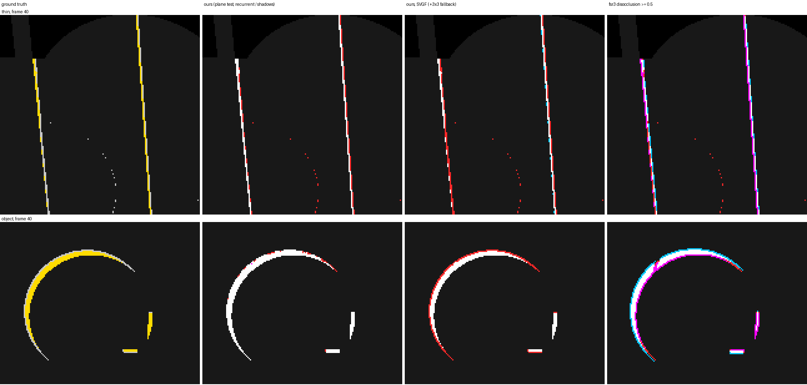

# Upscaler guides as denoiser inputs: is `@pmndrs/upscaler`'s disocclusion mask better than our own?

_upscaler-guides evaluator (implementer / evaluator, RULES.md rule 8: no NRD code, README, release notes or port read;
`@pmndrs/upscaler` is MIT, RULES §2). 2026-10-26. TASKS item "Upscaler guides as optional denoiser inputs" (Dennis:
worth assessing, must stay optional, our own detection stays the default). Package pinned at f22af56
(`git archive`), upscaler at fsr3 57eac72 (= the published 0.2.0), read-only._

## Conclusion

**No. The mask is not better than our own detection anywhere it matters, so step 2 (an optional
`guides.disocclusion` input) was not built.** Against exact ground truth:

- **Our plane test misses almost no wrong-surface pixels; the mask misses 14–21 % of them.** A pixel is
  "wrong-surface" when it was hidden at t−1 and no texel of the same object lies in the 3×3 around its true
  reprojection, so any history kept there belongs to another surface (ghosting). Our filters miss 0.00 % (SVGF) and
  0.12–0.13 % (recurrent, shadows) of these at 1080p. The upscaler's `disocclusion ≥ 0.5` misses **14.4 %**, at 960×540
  **21.2 %**, and on `thin` **41.5 %**. The cause is its design. The mask is computed from the **dilated** (nearest of
  3×3) depth and motion, which is right for an upscaler (thin foreground edges drag their own motion). But it moves the
  mask one pixel toward the foreground. Combined with the max vote over 4 taps, the revealed strip next to a silhouette
  reads "seen before" ([figure](#figure)).
- **It also over-flags.** Its precision is 84–92 % (ours 99.3–99.9 %). On the silhouette band it is 61–65 % (ours
  98–100 %). With no 2.5D motion input, it fires on objects moving away from the camera: 30 k false resets on `object`
  at 960×540, and **124 k** on `sponza-move`, where the knot spins and swings, against 0 for ours.
- **Real scenes (Bistro, Sponza, 5 captures) agree.** Ours (plane test): recall 69.6 %, precision 88.6 %, 0.28 ‰ of
  interior positives missed. Mask: 61.3 %, 38.6 %, 1.77 ‰.
- **The one place the mask beats one of our filters is SVGF's 3×3 fallback.** SVGF keeps history from the 3×3 around
  the reprojected point when the 2×2 footprint fails (SVGF paper §4.1, for thin geometry). That is the only reason its
  interior misses are 16.5 ‰ against 1.3 ‰ for the strict test. The mask has 6.4 ‰ and would close part of that gap.
  But our own strict test closes it entirely, at no cost: **SVGF with the fallback switched off** has 0.1 ‰ interior
  misses and scores better downstream, +0.07…+0.34 dB on the disoccluded region of 5 paths with no flicker change
  ([§4](#4-svgfs-3x3-fallback-the-gap-the-mask-could-fill)). That is a follow-up for our own detector (TASKS), not a
  reason to import the mask.
- **Cost is not the argument either way.** The guides stage is one compute pass: **0.16 ms at 1080p** (0.046 ms at 960×540) on the
  M5 Pro, plus a depth copy when the renderer's depth is not a depth texture. Our per-tap tests are fused into each
  filter's temporal pass and can't be split out. A shared mask would not remove them: the filters still need the
  per-tap validity for the custom bilinear (C-8), not a per-pixel yes/no.
- **Friction.** Its public API needs a three.js `WebGPURenderer` and returns three `Texture`s. A raw-WebGPU caller has
  to import non-exported internals (`RECONSTRUCT_SHADER`, `ConstantsBuffer`, `ComputePass`), as this harness does. The
  input must be a hardware depth texture (`texture_depth_2d`), so r32float device depth needs a copy pass. Motion uses
  the same convention as ours. It has no `motion_z`. The mask is at render resolution and same-frame, so both of
  those fit.

What would change the verdict: a renderer that has **no** normals or view-z (the mask needs only depth + motion,
our filters need both anyway), or an upscaler revision whose mask stops dilating. Neither applies to
`denoiser/realtime` today.

## 1. Setup

| | |
|---|---|
| GPU / browser | Apple M5 Pro (`metal-3`), HeadlessChrome 155, `--use-angle=metal` |
| Our detection | the denoisers' own history age after each frame, read from their debug textures: SVGF `accum.a` (n) = 1, recurrent packed A = 0, shadows history A (mod youngBase) = 0, i.e. exactly "history reset this frame". SVGF with `antiLag: 'off'` (a pure geometry test; `'auto'` adds shading resets, measured separately), recurrent and shadows at package defaults. All get `motion_z` unless stated |
| Upscaler mask | `@pmndrs/upscaler` guides stage run exactly as `Upscaler.dispatchGuides` runs it on the `'guides'` path: its `RECONSTRUCT_SHADER` through its `ComputePass` and `ConstantsBuffer` (no jitter, `FLAG_PERSPECTIVE`, motion scale (0.5, −0.5), the scene's near / far), dilated depth ping-pong. Inputs: the frame's device depth copied to `depth32float` by a full-screen pass, motion as is (NDC delta, current − previous, the same convention). Output `masks.r`, graded 0..1, thresholded at > 0, ≥ 0.25, 0.5, 0.75, 0.99 |
| Ground truth, test bed | the analytic scene re-traced at t−1 (scene.ts's own `trace`, patched so the moving sphere can sit at its t−1 pose). Per pixel, the surface point P moves to its t−1 position (moving sphere: minus its translation). It must be inside the t−1 frustum (\|ndc\| < 1, 0 < z < 1) and be the first hit of the ray from the t−1 eye (relative tolerance 2·10⁻⁴). Exact up to float error. Also the object id of every pixel, for the wrong-surface class |
| Ground truth, real scenes | the three-temporal captures (`bistro-pan`, `bistro-orbit`, `sponza-pan`, `sponza-orbit`, `sponza-move`; 960×540, 48 frames, no jitter). The scene is rebuilt with the pages' own loader (`assets.ts`, same cull) and three-mesh-bvh ray casts on the CPU (single-sided materials FrontSide, as the raster draws them; the torus knot at its path-frame matrices). P comes from the capture's `viewz`. Self-check: rays from the **current** eye to every 7th pixel's own P hit something in front of it for 60–188 of ~3.4 M pixels per capture (≤ 0.005 %), so the GT is about as exact as the raster |
| Scored | receivers (depth < 1), every frame except resets (frame 0, the cut). **Interior** = all 3×3 neighbours are receivers with the same GT. **Band** = the rest: the 1–2 px silhouette strip, where point visibility at the pixel centre and the pixel's footprint can disagree, so a "miss" there is often a same-surface neighbour's history. **Wrong-surface** (test bed only) = GT-disoccluded with no same-object texel in the 3×3 around the true reprojection: a detector that keeps history there certainly ghosts |
| Runs | test bed paths `orbit`, `pan`, `light`, `thin`, `glossy` (the grazing-floor view), `cut`, `object`, 96 frames, at 960×540 and 1920×1080; the 5 captures above. 1-spp signals, no references (quality only needs the masks) |

Harness: [data/upscaler-guides/](data/upscaler-guides/) (`main.ts` page, `gt-bvh.ts`, `run.mjs` driver,
`doc-table.mjs` / `hard.mjs` / `table.mjs` / `ab.mjs` summaries, `vite.config.mts`). To rerun it:
`node node_modules/vite/bin/vite.js docs/research/rt-denoiser/results/data/upscaler-guides --config docs/research/rt-denoiser/results/data/upscaler-guides/vite.config.mts --port 5490 --strictPort --host 127.0.0.1`,
then `node docs/research/rt-denoiser/results/data/upscaler-guides/run.mjs --out=<dir> "path=pan&w=1920&h=1080" "mode=capture&capture=bistro-pan&frames=48"`
(`FSR3_SRC` points at the upscaler's `src/`, `RT_REALTIME_SRC` pins the package). Raw JSON:
[data/upscaler-guides/raw/](data/upscaler-guides/raw/).

**Jitter.** The test bed and the captures have none, so no correction was needed. In a jittered page, the
upscaler subtracts the jitter delta inside its reprojection (its constants carry the current and previous jitter).
Our denoisers expect motion **without** the jitter delta: GUIDES-HANDOFF-RESPONSE report 3, `velocityUV −
jitterDeltaUV`, which the upscaler's `unjitteredProjectionMatrix` provides for three's velocity node. Feeding
three's raw velocity from a jittered camera would make every pixel "move" by the jitter delta, for both detectors.

## 2. Test bed, 1080p

Recall / precision over all receivers. Wrong-surface missed = share (count) of the wrong-surface class left
undetected. Interior missed / false = per mille of the interior positives / negatives. `light` is omitted: it has a
static camera (190 GT pixels over 95 frames at the horizon's far-plane edge; every detector reports 0). SVGF with
`antiLag: 'auto'` and the other thresholds are in the raw files.

| run | detector | recall % | precision % | wrong-surface missed | interior missed ‰ | interior false ‰ | band recall % | band precision % |
|---|---|---|---|---|---|---|---|---|
| cut (1475658 px) | ours, SVGF | 68.9 | 99.7 | 0.0 % (16) | 32.96 | 0.01 | 40.2 | 99.4 |
| cut (1475658 px) | ours, recurrent | 82.6 | 99.8 | 0.0 % (68) | 0.07 | 0.00 | 64.7 | 99.6 |
| cut (1475658 px) | ours, shadows | 82.6 | 99.9 | 0.0 % (115) | 0.18 | 0.01 | 64.7 | 99.9 |
| cut (1475658 px) | fsr3 ≥ 0.5 | 71.4 | 85.6 | 26.0 % (263907) | 3.92 | 0.00 | 42.3 | 63.4 |
| cut (1475658 px) | shadows ∪ fsr3 ≥ 0.5 | 93.6 | 88.5 | 0.0 % (59) | 0.11 | 0.01 | 87.0 | 78.0 |
| glossy (167446 px) | ours, SVGF | 46.9 | 99.7 | 0.0 % (1) | 58.55 | 0.00 | 32.7 | 99.4 |
| glossy (167446 px) | ours, recurrent | 70.1 | 99.8 | 0.4 % (352) | 4.40 | 0.00 | 61.3 | 99.7 |
| glossy (167446 px) | ours, shadows | 70.2 | 99.8 | 0.4 % (330) | 4.09 | 0.00 | 61.3 | 99.7 |
| glossy (167446 px) | fsr3 ≥ 0.5 | 47.4 | 67.8 | 49.6 % (39002) | 7.64 | 0.00 | 31.7 | 52.0 |
| glossy (167446 px) | shadows ∪ fsr3 ≥ 0.5 | 84.4 | 78.8 | 0.2 % (136) | 0.15 | 0.00 | 79.7 | 73.0 |
| object (323130 px) | ours, SVGF | 88.1 | 100.0 | 0.0 % (28) | 1.77 | 0.00 | 45.0 | 100.0 |
| object (323130 px) | ours, recurrent | 90.0 | 100.0 | 3.9 % (11156) | 37.49 | 0.00 | 66.9 | 100.0 |
| object (323130 px) | ours, shadows | 93.2 | 100.0 | 3.7 % (10620) | 35.37 | 0.00 | 81.2 | 100.0 |
| object (323130 px) | fsr3 ≥ 0.5 | 80.3 | 89.4 | 19.6 % (55654) | 97.41 | 0.00 | 43.8 | 49.8 |
| object (323130 px) | shadows ∪ fsr3 ≥ 0.5 | 95.1 | 90.9 | 3.7 % (10559) | 35.15 | 0.00 | 90.1 | 67.1 |
| orbit (1955744 px) | ours, SVGF | 65.7 | 99.8 | 0.0 % (25) | 35.86 | 0.01 | 39.3 | 99.7 |
| orbit (1955744 px) | ours, recurrent | 81.0 | 99.8 | 0.0 % (69) | 0.10 | 0.01 | 64.8 | 99.7 |
| orbit (1955744 px) | ours, shadows | 81.0 | 99.9 | 0.0 % (84) | 0.10 | 0.00 | 64.8 | 100.0 |
| orbit (1955744 px) | fsr3 ≥ 0.5 | 69.0 | 84.2 | 29.4 % (377831) | 1.21 | 0.00 | 42.5 | 63.9 |
| orbit (1955744 px) | shadows ∪ fsr3 ≥ 0.5 | 93.3 | 87.8 | 0.0 % (42) | 0.04 | 0.00 | 87.6 | 78.5 |
| pan (6514858 px) | ours, SVGF | 92.2 | 100.0 | 0.0 % (22) | 7.61 | 0.00 | 42.5 | 100.0 |
| pan (6514858 px) | ours, recurrent | 96.0 | 100.0 | 0.0 % (268) | 0.07 | 0.00 | 67.5 | 100.0 |
| pan (6514858 px) | ours, shadows | 96.0 | 100.0 | 0.0 % (302) | 0.13 | 0.00 | 67.4 | 100.0 |
| pan (6514858 px) | fsr3 ≥ 0.5 | 94.4 | 97.0 | 4.9 % (296790) | 3.43 | 0.00 | 57.4 | 70.6 |
| pan (6514858 px) | shadows ∪ fsr3 ≥ 0.5 | 99.5 | 97.1 | 0.0 % (226) | 0.09 | 0.00 | 95.7 | 80.0 |
| thin (1323856 px) | ours, SVGF | 60.8 | 99.1 | 0.0 % (13) | 66.46 | 0.01 | 43.2 | 98.5 |
| thin (1323856 px) | ours, recurrent | 78.5 | 99.2 | 0.0 % (152) | 0.29 | 0.01 | 67.0 | 98.9 |
| thin (1323856 px) | ours, shadows | 78.5 | 99.7 | 0.0 % (352) | 0.29 | 0.01 | 66.9 | 99.8 |
| thin (1323856 px) | fsr3 ≥ 0.5 | 64.4 | 80.4 | 41.5 % (333918) | 7.75 | 0.00 | 45.6 | 65.3 |
| thin (1323856 px) | shadows ∪ fsr3 ≥ 0.5 | 94.6 | 85.6 | 0.0 % (207) | 0.23 | 0.01 | 91.7 | 79.0 |
| **pooled** | ours, SVGF | 80.6 | 99.9 | 0.0 % (105) | 16.52 | 0.00 | 41.0 | 99.4 |
| **pooled** | ours, recurrent | 89.3 | 99.9 | 0.1 % (12065) | 1.28 | 0.00 | 65.8 | 99.6 |
| **pooled** | ours, shadows | 89.4 | 99.9 | 0.1 % (11803) | 1.26 | 0.00 | 66.0 | 99.9 |
| **pooled** | fsr3 ≥ 0.5 | 82.9 | 91.5 | 14.4 % (1367102) | 6.44 | 0.00 | 46.1 | 65.1 |
| **pooled** | shadows ∪ fsr3 ≥ 0.5 | 96.8 | 92.6 | 0.1 % (11229) | 1.19 | 0.00 | 90.0 | 78.4 |

### 960×540, pooled over the 6 paths (more thresholds and combinations)

| run | detector | recall % | precision % | wrong-surface missed | interior missed ‰ | interior false ‰ | band recall % | band precision % |
|---|---|---|---|---|---|---|---|---|
| **pooled** | ours, SVGF | 66.9 | 99.3 | 0.0 % (21) | 20.74 | 0.01 | 32.6 | 97.6 |
| **pooled** | ours, recurrent | 81.0 | 99.3 | 0.1 % (2423) | 1.29 | 0.01 | 60.1 | 98.3 |
| **pooled** | ours, shadows | 81.1 | 99.6 | 0.1 % (2229) | 1.16 | 0.01 | 60.4 | 99.1 |
| **pooled** | ours, SVGF without motion_z | 66.9 | 94.9 | 0.0 % (21) | 20.74 | 0.45 | 32.6 | 97.5 |
| **pooled** | fsr3 > 0 | 71.7 | 81.6 | 21.0 % (412402) | 4.74 | 0.54 | 41.0 | 61.3 |
| **pooled** | fsr3 ≥ 0.5 | 71.5 | 84.4 | 21.2 % (415953) | 6.69 | 0.14 | 40.9 | 61.4 |
| **pooled** | fsr3 ≥ 0.75 | 71.2 | 85.4 | 21.5 % (421438) | 9.82 | 0.00 | 40.6 | 61.4 |
| **pooled** | fsr3 ≥ 0.99 | 14.6 | 99.6 | 84.2 % (1651992) | 801.02 | 0.00 | 8.8 | 98.8 |
| **pooled** | shadows ∪ fsr3 ≥ 0.5 | 91.8 | 87.1 | 0.1 % (1946) | 0.90 | 0.15 | 82.9 | 75.9 |
| **pooled** | SVGF ∪ fsr3 ≥ 0.5 | 85.8 | 86.2 | 0.0 % (14) | 0.21 | 0.15 | 70.1 | 72.6 |

Reading:

- **Thresholds hardly matter between 0.25 and 0.75.** The graded value is a tolerance ratio, so real disocclusions
  sit near 1 and quiet pixels near 0. Only ≥ 0.99 changes the picture: it drops 84 % of the wrong-surface class,
  because the max vote seldom reaches exactly 1 except off-screen. Any value > 0 adds 113 k interior false alarms at
  960×540 (low grades on the receding sphere). The upscaler itself consumes the grade as a weight, not a threshold.
- **Resolution.** The upscaler's tolerance scales with the viewport diagonal (AMD's `1.37e-5 · |size/2| · depth`), so
  it is twice as loose at 1080p. That is why its `object` false alarms fall from 29.9 k (960×540) to 8 (1080p). Ours
  are resolution-independent (1 % of the view distance).
- **Where our plane test misses wrong-surface pixels: `object` (3.7–3.9 %) and `glossy` (0.4 %).** These are revealed
  floor pixels next to the bouncing sphere's contact, where a sphere texel lies within 1 % of the floor plane
  (averaged-normal plane distance) and faces the same way. SVGF's extra normal test (cos 0.95) rejects them, so SVGF
  misses 0.0 %. **The mask does not fix these.** Union with it: 10 620 → 10 559 wrong-surface misses on `object` at
  1080p. A follow-up for our own test (TASKS): the normal-agreement test for recurrent / shadows, measured on `object`.
- **The union `shadows ∪ fsr3 ≥ 0.5`** raises band recall 66 → 90 % and drops band precision 99.9 → 78 %. Its
  wrong-surface misses barely move (11 803 → 11 229). So what it adds is resets of same-surface band pixels and of
  visible pixels. Whether resetting same-surface band pixels pays is a question about our own test (§4 suggests it might for SVGF's fallback). It can be answered without the mask: reset when less than half the bilinear footprint is valid. A scratch run of that was queued but did not get the GPU lock within an hour and was dropped (TASKS follow-up).
- `svgf-off-nomz` (SVGF without `motion_z`, what a renderer without 2.5D motion gives) has the same recall but 92 k
  interior false alarms on `object` (the sphere moving in depth). The mask has the same blind spot, by construction.

## 3. Real scenes (Bistro, Sponza captures, 960×540)

The wrong-surface class needs object ids and is not computed here.

| run | detector | recall % | precision % | wrong-surface missed | interior missed ‰ | interior false ‰ | band recall % | band precision % |
|---|---|---|---|---|---|---|---|---|
| bistro-orbit (89819 px) | ours, SVGF | 28.9 | 4.6 | – | 124.31 | 22.41 | 24.9 | 44.2 |
| bistro-orbit (89819 px) | ours, recurrent | 40.0 | 46.1 | – | 2.94 | 1.57 | 35.8 | 83.7 |
| bistro-orbit (89819 px) | ours, shadows | 40.0 | 46.1 | – | 2.94 | 1.57 | 35.8 | 83.7 |
| bistro-orbit (89819 px) | ours, SVGF without motion_z | 28.9 | 4.6 | – | 124.31 | 22.41 | 24.9 | 44.2 |
| bistro-orbit (89819 px) | fsr3 ≥ 0.5 | 22.3 | 49.1 | – | 1.90 | 0.19 | 17.0 | 46.4 |
| bistro-orbit (89819 px) | shadows ∪ fsr3 ≥ 0.5 | 49.5 | 41.5 | – | 0.00 | 1.75 | 46.1 | 63.5 |
| bistro-pan (747608 px) | ours, SVGF | 70.2 | 46.1 | – | 2.97 | 24.44 | 22.8 | 51.8 |
| bistro-pan (747608 px) | ours, recurrent | 76.7 | 90.0 | – | 0.13 | 2.13 | 39.2 | 87.7 |
| bistro-pan (747608 px) | ours, shadows | 76.7 | 90.0 | – | 0.13 | 2.13 | 39.2 | 87.7 |
| bistro-pan (747608 px) | ours, SVGF without motion_z | 70.2 | 46.1 | – | 2.97 | 24.44 | 22.8 | 51.8 |
| bistro-pan (747608 px) | fsr3 ≥ 0.5 | 71.6 | 34.9 | – | 0.90 | 41.24 | 25.9 | 53.1 |
| bistro-pan (747608 px) | shadows ∪ fsr3 ≥ 0.5 | 82.1 | 36.7 | – | 0.01 | 43.37 | 53.4 | 65.3 |
| sponza-move (21475 px) | ours, SVGF | 20.1 | 96.5 | – | 230.22 | 0.00 | 19.7 | 98.4 |
| sponza-move (21475 px) | ours, recurrent | 49.3 | 100.0 | – | 7.19 | 0.00 | 49.0 | 100.0 |
| sponza-move (21475 px) | ours, shadows | 61.6 | 100.0 | – | 7.19 | 0.00 | 61.4 | 100.0 |
| sponza-move (21475 px) | ours, SVGF without motion_z | 31.2 | 3.3 | – | 201.44 | 7.93 | 30.9 | 67.6 |
| sponza-move (21475 px) | fsr3 ≥ 0.5 | 12.1 | 1.9 | – | 223.02 | 5.10 | 11.7 | 15.3 |
| sponza-move (21475 px) | shadows ∪ fsr3 ≥ 0.5 | 67.0 | 9.5 | – | 7.19 | 5.10 | 66.8 | 50.8 |
| sponza-orbit (141668 px) | ours, SVGF | 19.4 | 32.2 | – | 19.59 | 2.20 | 13.5 | 75.7 |
| sponza-orbit (141668 px) | ours, recurrent | 35.8 | 84.3 | – | 0.51 | 0.32 | 31.0 | 95.8 |
| sponza-orbit (141668 px) | ours, shadows | 35.8 | 84.4 | – | 0.51 | 0.32 | 31.0 | 95.9 |
| sponza-orbit (141668 px) | ours, SVGF without motion_z | 19.4 | 32.2 | – | 19.59 | 2.20 | 13.5 | 75.7 |
| sponza-orbit (141668 px) | fsr3 ≥ 0.5 | 23.5 | 61.5 | – | 2.33 | 0.03 | 17.7 | 53.9 |
| sponza-orbit (141668 px) | shadows ∪ fsr3 ≥ 0.5 | 46.8 | 68.7 | – | 0.20 | 0.36 | 42.8 | 72.2 |
| sponza-pan (361458 px) | ours, SVGF | 67.0 | 85.4 | – | 15.10 | 1.58 | 30.4 | 92.7 |
| sponza-pan (361458 px) | ours, recurrent | 76.8 | 97.7 | – | 0.55 | 0.23 | 49.9 | 98.7 |
| sponza-pan (361458 px) | ours, shadows | 76.8 | 97.7 | – | 0.55 | 0.23 | 49.9 | 98.7 |
| sponza-pan (361458 px) | ours, SVGF without motion_z | 67.0 | 85.4 | – | 15.10 | 1.58 | 30.4 | 92.7 |
| sponza-pan (361458 px) | fsr3 ≥ 0.5 | 67.7 | 62.0 | – | 3.63 | 5.11 | 30.6 | 63.4 |
| sponza-pan (361458 px) | shadows ∪ fsr3 ≥ 0.5 | 84.9 | 66.2 | – | 0.21 | 5.34 | 67.3 | 78.6 |
| **pooled** | ours, SVGF | 60.6 | 39.7 | – | 7.82 | 9.88 | 23.0 | 62.1 |
| **pooled** | ours, recurrent | 69.6 | 88.6 | – | 0.28 | 0.83 | 40.1 | 91.9 |
| **pooled** | ours, shadows | 69.8 | 88.6 | – | 0.28 | 0.83 | 40.5 | 92.0 |
| **pooled** | ours, SVGF without motion_z | 60.7 | 36.3 | – | 7.81 | 11.52 | 23.3 | 61.7 |
| **pooled** | fsr3 ≥ 0.5 | 61.3 | 38.6 | – | 1.77 | 10.07 | 24.0 | 53.2 |
| **pooled** | shadows ∪ fsr3 ≥ 0.5 | 76.8 | 41.9 | – | 0.07 | 10.90 | 54.3 | 68.8 |

Reading: the same ranking. Interior misses for ours (plane test) are 17 / 60 / 1 / 5 / 107 pixels over 48 frames
per capture. On `bistro-orbit` the mask has 11 and the union 0, a fraction of a pixel per frame. The mask's
false-alarm rate is 10 ‰ against 0.8 ‰ for ours. **SVGF's normal test (cos 0.95) is the outlier on real geometry:**
its precision is 39.7 % pooled (Bistro 4.6–46 %), so most of its resets on Bistro are needless (dense, finely
tessellated geometry: adjacent texels differ by more than 18° of normal while lying on the same surface). That is a
finding about our default filter, recorded in TASKS. `sponza-move` (a spinning torus knot, static camera) shows the
missing `motion_z` again: 124 k false resets for the mask, 0 for ours with `motion_z`, 193 k for SVGF without it.

## 4. SVGF's 3×3 fallback: the gap the mask could fill

The only pooled number where the mask beats one of our filters is SVGF's interior misses (16.5 ‰ against the mask's
6.4 ‰ at 1080p). All of it is the paper's 3×3 fallback: with the fallback off (scratch copy, `if (false && …)`
around it), SVGF's detection has **0.1 ‰** interior misses at 960×540, 155 pixels pooled against 31 976, and 3
wrong-surface misses. Better than the mask, and at the strict test's level. Is the fallback's history harmful
downstream? Test bed eval, 960×540, 256-spp references, `svgf-auto` (shipped default), A = package, B = fallback off,
everything else identical:

| path | signal | all A | all B | Δ | disoccluded A | disoccluded B | Δ | flicker (mc) A | B |
|---|---|---|---|---|---|---|---|---|---|
| cut | diffuse | 38.558 | 38.589 | +0.031 | 36.341 | 36.617 | +0.275 | 0.0079 | 0.0079 |
| cut | specular | 33.213 | 33.237 | +0.025 | 30.367 | 30.550 | +0.183 | 0.0097 | 0.0097 |
| object | diffuse | 37.101 | 37.105 | +0.004 | 34.554 | 34.620 | +0.066 | 0.0016 | 0.0016 |
| object | specular | 34.068 | 34.074 | +0.006 | 32.600 | 32.808 | +0.208 | 0.002 | 0.002 |
| orbit | diffuse | 39.529 | 39.558 | +0.028 | 36.386 | 36.586 | +0.200 | 0.0066 | 0.0066 |
| orbit | specular | 32.116 | 32.139 | +0.024 | 29.918 | 30.099 | +0.181 | 0.0108 | 0.0108 |
| pan | diffuse | 38.209 | 38.244 | +0.035 | 36.995 | 37.098 | +0.103 | 0.008 | 0.008 |
| pan | specular | 34.527 | 34.538 | +0.011 | 36.920 | 36.989 | +0.069 | 0.0087 | 0.0087 |
| thin | diffuse | 34.063 | 34.070 | +0.007 | 36.865 | 37.060 | +0.195 | 0.0151 | 0.0151 |
| thin | specular | 34.590 | 34.605 | +0.015 | 35.385 | 35.724 | +0.339 | 0.0089 | 0.0089 |

**The fallback costs 0.07–0.34 dB on newly visible pixels, on every path including `thin`, which it exists for.**
Flicker is unchanged and the total moves +0.004…+0.035 dB. Keeping long history from a texel up to 1.5 px away,
averaged with equal weights, marks the pixel as settled, so it skips the young-pixel variance and kernel treatment.
Resetting is better. So the gain a forced reset from the mask could bring to SVGF is available from our own
detector, without the mask's false alarms. It is recorded as a follow-up option in TASKS: rule 9 needs 1080p ×
7 paths, the captures and the 4096-spp references before it can become a default.

## 5. Cost and integration

GPU timestamps, M5 Pro, 200 dispatches per round, 3 rounds. The warm-up runs in its own submit before each timed
dispatch: a timestamped pass placed right behind the warm-up passes in the same command buffer read up to 1.3 ms
median, which was their tail (LESSONS). One orphaned headless `realtime-gi` page of another agent kept the GPU
partly busy throughout, so treat the p90s and our 1080p rows as contended.

| pass | 960×540 | 1920×1080 |
|---|---|---|
| **fsr3 guides stage** (`reconstruct`: dilate + depth clip + mask), median (min) of 3 × 200 | **0.046** (0.037) | **0.158** (0.142); p90 2.5 = contention |
| + depth copy r32float → depth32float (only without a hardware depth texture) | one full-screen pass, not timed | |
| ours, SVGF temporal pass (per-tap tests + history fetch + blend), median | 0.18–0.20 | 1.28–1.34 (contended; ~0.5 uncontended, first round) |
| ours, recurrent temporal pass | 0.28–0.30 | 1.35–1.45 (contended) |
| ours, shadows temporal pass | 0.34–0.37 | 1.46–1.56 (contended) |
| ours, shared guide prepass (geometry packing + depth slope) | 0.17–0.20 | 0.70–1.04 (contended) |

The upscaler's own figure is 0.035 ms for the fused pass (TEMPORAL-GUIDES-SPEC, its bench). Ours is 0.046 ms at
960×540 and 0.16 ms at 1080p. Either way, as an **extra** input it would add about 0.16 ms at 1080p to every frame,
and it removes nothing: our per-tap tests stay in the temporal passes, because they produce the per-tap weights.
Raw: [data/upscaler-guides/raw/timing/](data/upscaler-guides/raw/timing/).

- **One mask for four filters?** Each of our temporal passes needs the **per-tap** validity (C-7) to weight the
  bilinear / Catmull-Rom history fetch (C-8), not a per-pixel flag. A shared mask could only gate them (force a
  reset), on top of the per-tap tests that stay. The tests themselves are a few loads and a dot product per tap
  inside passes that load those taps anyway.
- **Needs a three.js renderer.** `new Upscaler({ renderer })` takes a `WebGPURenderer`, inputs and outputs are three
  `Texture`s, and raw `GPUTexture`s come back through `renderer.backend.get(tex).texture`. Fine on the three-temporal
  pages. For raw WebGPU (the test bed, captures, `denoiser/realtime`'s own API) the guides stage is reachable only
  through internals that the package doesn't export (`src/shaders/reconstruct.ts`, `src/internal/ConstantsBuffer.ts`,
  `ComputePass.ts`).
- **Formats.** Depth must be a depth texture (`texture_depth_2d`), so CAPTURE-FORMAT's r32float device depth needs a
  copy (a full-screen pass writing `frag_depth`). Velocity is read through `textureLoad`, so rg32float works.
  The mask is rgba8unorm with `.r` meaning disocclusion; the other channels are reserved by the upscaler.
- **Resolution / timing.** The mask is at render resolution, the same as ours, and same-frame after
  `dispatchGuides`. Upscaler `shadingChange` (for `antiLag: 'gradient'`) is late, frame N−1, and was not assessed:
  without a better disocclusion mask there is no guides integration for it to ride on, and TASKS keeps it as its own
  question.
- **The depth convention can bite.** The mask linearizes depth with near / far (perspective, or reversed with a flag).
  It ignores FLAG_RESET, which only matters to the upscaler's own accumulate pass, so a consumer must handle cuts
  itself.

## Figure

960×540, columns: ground truth (grey = disoccluded, yellow = wrong-surface class), our plane test (shadows; recurrent
is identical here), SVGF, the mask ≥ 0.5. White = detected, red = missed, magenta = missed wrong-surface, cyan =
false alarm. Top: `thin` frame 40 (fence slats in front of a sphere). Bottom: `object` frame 40 (the moving sphere's
revealed crescent). The mask's one-pixel shift from the dilation is plain: it marks the occluder's edge (cyan) and
leaves the revealed strip (magenta).

## 6. What did not work / caveats

- First Bistro GT pass: 1.35 % of pixels "self-occluded", because the BVH ray casts were double-sided while the raster
  draws single-sided materials FrontSide. Fixed by splitting the BVH by material side (Sponza was unaffected). The
  numbers above are from the fixed GT.
- The wrong-surface class uses object ids, so a box's other face or a sphere's far side counts as "same object". The
  class undercounts ghosting on self-occluding objects. It never overcounts.
- The fallback A/B ran the live test bed with the pinned package. Another agent had uncommitted edits in
  `examples/realtime-denoiser/src/paths.ts` at the time (two new paths appended, the 7 used here unchanged).
