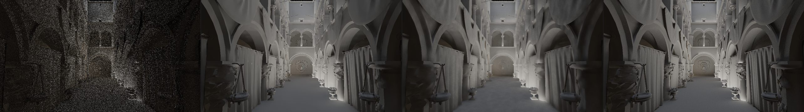
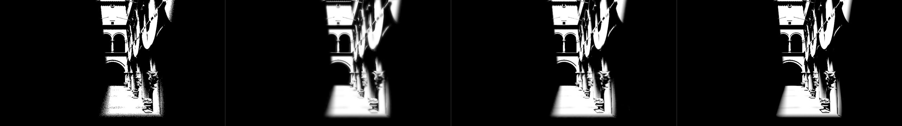
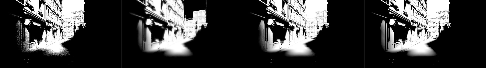
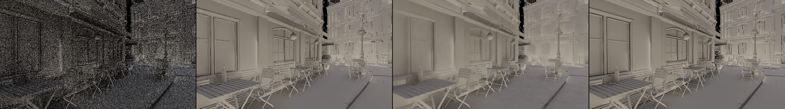

# Bistro and Sponza: two real asset scenes as scoring scenes

_bistro-sponza agent (implementer / evaluator, RULES.md rule 8: no NRD code, README, release notes or port read;
the brief file and the review snapshot were not opened). 2026-10-26. Quality runs only: no cost numbers. Everything
here is **provisional**, like the defaults it scores (SPEC §12)._

SPEC §12 item 7 (Dennis): defaults are judged on more than the analytic test bed. This adds Crytek Sponza (interior,
sun through a roof opening) and the Amazon Lumberyard Bistro exterior (street, 2.8 M triangles) to the three.js
realtime pages, writes six moving captures with per-pose converged references, replays every registry candidate on
them at one pinned commit, and asks whether the rankings agree with the test bed and the corner scene.

## Setup

| | |
|---|---|
| pages | `examples/three-temporal/realtime-gi.html?scene=sponza\|bistro` (`src/realtime-scenes.ts`; `realtime-shadows.html?scene=…` forwards there with the shadow view). The corner pages are untouched: re-capturing `three-orbit` frames 0–1 with HEAD's page and with this branch's page gave byte-identical files (all 18 buffers), so every corner capture and its replays stand |
| models | served by `scene-assets-plugin.ts` (`$RT_SCENE_ASSETS`; at capture time from `../vsm/bench/public/assets`, since 2026-10-26 committed under Git LFS in `examples/three-temporal/scene-assets/`, same files). Sponza: Khronos glTF-Sample-Assets, **Cryengine Limited License Agreement** (© 2016 Crytek; not CC BY 3.0 as the brief guessed). Bistro: ORCA, **CC BY 4.0** (© 2017 Amazon Lumberyard; glTF by Cody Bennett), modified (geometry only, flat colours, the one BLEND decal removed). Details and attributions: [CAPTURES.md "Bistro and Sponza"](../../../../examples/three-temporal/CAPTURES.md) |
| geometry | Sponza 262,267 triangles; Bistro 2,827,910 (full model, no subset needed: 201 MB GLB parsed in ~0.3 s, SAH BVH ~8 s, fits the headless tab). Traced with `three-mesh-bvh/webgpu` like the corner, one merged BVH geometry (+ the moving knot) |
| lights | a sun (directional, angular radius 0.02 rad = 4.3× the real sun) and one local sphere light per scene; each path names its shadow light (`lights[0]`) |
| signals | as the corner: blue-noise 1-ray visibility + occluder distance; 1 cosine diffuse ray (sky on a miss; sun + local light bounced off grey 0.5 at a hit, **sun-shadowed at the hit point**, the local light unshadowed there); three's stochastic SSR (not demodulated, same caveat as the corner); AO = ĥ of the diffuse ray |
| references, per pose | visibility **1024** rays (2×2 stratified × 256 frames); diffuse + AO **2048** rays on Sponza, **1024** on Bistro ("GI at what's feasible": Bistro's rays cost ~2.4× Sponza's, 2048 would have been ~80 s per frame); specular = 256 SSR frames lit by the converged references |
| captures | 6 × 48 frames, 960×540, CAPTURE-FORMAT v0 + `ao_ref`, 3.28 GB each (19.7 GB), all pass `validate.mjs` (warnings: `ao_ref` unknown, specular demodulation "none") |
| replay | registry entries on the test bed's replay page, **pinned at ab3f4d7** (a `git archive` snapshot of packages, the test bed, `examples/_shared` and `tools/rt-capture`, served with `RT_REALTIME_SRC` and HMR off). The corner captures (`three-orbit`, `three-pan`, `three-knot-static`, `three-knot-orbit`) and the test bed's standard 540p captures (`std540-*`, 7 paths) were replayed on the same snapshot, so all three scoring scenes share one commit |
| denoisers | diffuse / specular `svgf` (antiLag `'off'`, pinned), `svgf-auto` (the package default), `recurrent`, `recurrent-svgfspec` (= recurrent diffuse + A-SVGF specular, the `filter: 'recurrent'` default), `ffx-reflections`; shadows `shadows`, `ffx-shadows`; AO `occlusion-svgf` (`'off'`), `occlusion-svgf-auto` (the shipped occlusion default), `occlusion-recurrent`; baselines `accumulate-32` / `occlusion-accumulate-32`. Class defaults, no settings |
| metrics | `score-captures.mjs`: pooled PSNR (rank on this) on x/(1+x) rgb or clamped scalars, penumbra pooled, LDR-FLIP every 4th frame (20.7 ppd), and **boil** (new: RMS of the output's second temporal difference along the reprojected history / √6, counted where the reference's own second difference is < 0.02, with the reference's boil as floor). `compare.mjs`: the shadow dynamic / static split (dynamic = reference range over t−4..t > 0.05) with dynamic and static-penumbra boil. Boil rewards frozen outputs: read it with PSNR |






## Do the rankings agree? (plainly)

**Yes, on every signal, in order. The margins and the temporal behaviour do not all carry over.** Mean pooled PSNR
over each scene's captures, same pinned commit everywhere:

| signal | Sponza (3 captures) | Bistro (3) | corner (4) | test bed (std540, 7 paths) | order agrees? |
|---|---|---|---|---|---|
| diffuse | `svgf-auto` 33.05 > `svgf` 32.79 > `recurrent` 32.46 | 31.32 > 31.20 > 30.25 | 40.54 > 40.46 > 38.77 | 37.60 > 37.48 > 36.62 | **yes**; recurrent's gap −0.6 / −1.1 / −1.8 / −1.0 dB |
| specular | `svgf-auto` (= `recurrent-svgfspec`) 51.13 > `svgf` 50.42 > `recurrent` 48.50 > FFX 46.40 | 46.72 > 46.46 > 44.40 > 42.31 | 46.03 > 45.09 > 43.18 > 39.64 | 34.13 > 33.46 > 32.97 > (accumulate 23.27) > FFX 21.21 | **yes** (see note 1) |
| shadows | `shadows` 28.74 > `accumulate-32` 25.14 > `ffx-shadows` 24.69 | 22.58 > FFX 19.33 > accumulate 18.67 | 31.34 > 27.30 > 26.71 | 35.49 > 30.85 > 23.59 | **yes** for ours > FFX (+4.0 / +3.3 / +4.0 / +4.6 dB); FFX falls below plain accumulation on Sponza |
| AO | `occlusion-svgf` 32.60 ≈ `-auto` 32.59 > `recurrent` 28.34 | 27.80 ≈ 27.80 > 22.59 | 35.09 > 35.03 > 33.32 | (no AO in std540; REMEASURE 1080p: 38.93 / 39.03 / 38.02) | **yes**; recurrent's gap −4.3 / −5.2 dB here vs −1.8 corner, −1.0 test bed |

FLIP ranks the same way as PSNR on every signal and scene (`svgf-auto` lowest FLIP for diffuse and specular,
`shadows` for visibility, SVGF for AO), with one exception: `bistro-move` shadows (below).

Notes:

1. Specular: at this commit and at 960×540 the test bed's captures also put plain SVGF above recurrent (33.46 vs
   32.97), so the corner's "SVGF and recurrent swap" (results/M6-real-scene.md) is no longer a disagreement; the
   1080p REMEASURE run of the older commit had recurrent ahead on the test bed. The test bed's specular is traced
   and demodulated; on the three.js scenes it is three's SSR (not demodulated, SSR's own reference), as before.
2. These scenes are harder: diffuse is heavy-tailed (the sun reaches the bounce through gaps; Sponza's noisy diffuse
   peaks at ~5 against a mean of 0.21) and Bistro's façades carry fine detail everywhere, so every filter scores
   7–9 dB below the corner on diffuse and 2.5–7 dB on AO. The reference floors (below) stay 9–17 dB above the best
   scores, so gaps are compressed by ≤ 0.3 dB.

## What the scenes add (things the test bed and the corner don't show)

- **SVGF boils on heavy-tailed GI.** Diffuse boil (where the reference is temporally smooth): `svgf-auto` 0.0055
  Sponza / 0.0085 Bistro against the references' own 0.0032 / 0.0037, i.e. 1.7× / 2.3× the floor; on the corner
  (0.0021 vs 0.0034) and the test bed (0.0019 vs 0.0025) SVGF stays *below* the floor. AO the same: `occlusion-svgf`
  0.0065 / 0.0107 vs floors 0.0034 / 0.0039 (corner 0.0043 vs 0.0038). Recurrent sits at or under the floor everywhere
  (0.0015 / 0.0018 diffuse) but loses 0.6–1.1 dB diffuse and 4–5 dB AO, and its FLIP is worse (diffuse 0.115 /
  0.129 vs 0.105 / 0.111). This is the kind of temporal noise pooled numbers hide; it only shows on scenes whose GI is
  spiky. Not a default question by itself (PSNR and FLIP both prefer SVGF), but it is the first evidence that A-SVGF's temporal stability on real GI is worth work.
- **Ours boils a little more than FFX in static penumbrae on the real scenes.** Static-penumbra boil `shadows` vs
  `ffx-shadows`: Sponza 0.0212 / 0.0244 / 0.0161 vs 0.0195 / 0.0198 / 0.0147 (orbit / pan / move), Bistro 0.0228 /
  0.0340 vs 0.0211 / 0.0286 (orbit / pan); on the corner and the test bed ours is lower or level (knot-static 0.0085
  vs 0.0094, test bed mixed within ±15 %). FFX buys its calm with 3–5 dB of penumbra PSNR (blur), so ours is still the
  better shadow; the wide sun penumbrae (0.02 rad from 5–20 m occluders) are where ours keeps the most per-frame noise.
  The dynamic region on the moving-camera captures (5–17 k px/frame) is mostly resampling at hard edges (its
  reference boil, 0.12–0.27, is far above the outputs'), so only the `-move` captures' dynamic numbers mean "moving
  shadow".
- **A small moving local light (`bistro-move`): both shadow denoisers lose to the raw signal.** Pooled PSNR noisy
  24.42, `shadows` 22.69, `ffx-shadows` 19.65, `accumulate-32` 17.96; FLIP 0.017 / 0.050 / 0.109 / 0.074. The lantern
  (r 0.12 m, 2–10 m from receivers) casts mostly hard shadows, so the 1-ray signal is already exact on most pixels,
  and both filters blur and lag the moving edges (bias +0.058 ours, +0.106 FFX: light leaks into the shadows they
  trail). Ours already loses at frame 0 (23.1 vs 25.0 dB: spatial blur of near-hard edges, no history yet) and keeps
  a steady ~23 dB while FFX drifts down to 18.5. Ours still wins where the denoising matters: penumbra 13.72 vs noisy
  8.07 (FFX 11.13), dynamic region 13.30 vs 9.75 (FFX 9.58). The test bed's `light` path (a large light moving and
  resizing) doesn't show this. Filed in TASKS for the shadows owner.
- **Moving occluder (`sponza-move`):** ours 27.93 vs FFX 24.73 pooled, dynamic region 17.61 vs 14.74 dB (5.6 k
  px/frame). FFX is only 0.6 dB above `accumulate-32` here (and below it on Sponza's orbit and pan), and only because
  accumulation ghosts the knot's shadow (dynamic 8.37 dB).
- **Bistro is the hardest real scene so far for shadows** (ours 22.6 dB mean, corner 31.3): fine façade detail,
  balcony railings and signs make most penumbrae thin and the occluder distances short; FFX overblurs them into soft
  blobs (image above).

## Reference noise floors

Estimated per capture from the one-sample variance of the 1-ray signal (through the metric's tonemap) divided by the
reference's rays; for visibility an upper bound (the reference is stratified):

| capture | diffuse | specular | visibility | AO | rays (diffuse / vis) |
|---|---|---|---|---|---|
| sponza-orbit / pan / move | 44.2 / 45.2 / 42.1 | 61.6 / 62.7 / 60.9 | 51.5 / 52.3 / 48.1 | 46.5 / 46.9 / 46.5 | 2048 / 1024 |
| bistro-orbit / pan / move | 43.6 / 41.6 / 44.6 | 56.2 / 55.2 / 56.8 | 49.2 / 47.3 / 54.6 | 42.5 / 42.2 / 42.6 | 1024 / 1024 |
| three-orbit (corner, for scale) | 48.2 | 58.9 | 46.1 | 45.6 | 2048 / 1024 |

Best scores are ≥ 9 dB below every floor (diffuse 28.9–34.1, AO 25.4–35.0), so the floors add at most ~6 % to any
MSE (≤ 0.3 dB, the same for every arm). Bistro's 1024-ray diffuse floor (41.6–44.6) is as good as Sponza's 2048 one
because its diffuse signal is less spiky.

## Tables

All rows: `score-captures.mjs` (pooled PSNR, penumbra pooled, FLIP, boil) and `compare.mjs` (dynamic / static), raw
numbers in [data/scenes-bistro-sponza.json](data/scenes-bistro-sponza.json). "corner" = `three-orbit`, `three-pan`,
`three-knot-static`, `three-knot-orbit`; "testbed" = the 7 `std540-*` captures (no AO reference). The corner and
test-bed rows replace older numbers only as a same-commit reference for this comparison (M6-real-scene.md's corner
rows were an older package).


### sponza


**diffuse** (pooled PSNR per capture; FLIP, boil = means over the captures)

| denoiser | orbit | pan | move | **mean** | FLIP | boil |
|---|---|---|---|---|---|---|
| noisy | 16.56 | 17.68 | 13.68 | **15.97** | 0.5755 | 0.1392 |
| accumulate-32 | 26.39 | 27.24 | 21.99 | **25.21** | 0.2198 | 0.0180 |
| svgf | 32.07 | 33.71 | 32.58 | **32.79** | 0.1074 | 0.0062 |
| svgf-auto | 32.30 | 33.84 | 33.02 | **33.05** | 0.1046 | 0.0055 |
| recurrent | 32.30 | 33.32 | 31.74 | **32.46** | 0.1154 | 0.0015 |
| recurrent-svgfspec | 32.30 | 33.32 | 31.74 | **32.46** | 0.1154 | 0.0015 |
| reference (own boil) |  |  |  | | | 0.0035 |

**specular** (pooled PSNR per capture; FLIP, boil = means over the captures)

| denoiser | orbit | pan | move | **mean** | FLIP | boil |
|---|---|---|---|---|---|---|
| noisy | 37.99 | 39.20 | 37.27 | **38.15** | 0.1673 | 0.0119 |
| accumulate-32 | 46.45 | 47.43 | 42.54 | **45.47** | 0.0762 | 0.0012 |
| ffx-reflections | 44.64 | 48.09 | 46.47 | **46.40** | 0.0629 | 0.0007 |
| svgf | 50.10 | 51.16 | 50.01 | **50.42** | 0.0411 | 0.0005 |
| svgf-auto | 50.40 | 52.04 | 50.95 | **51.13** | 0.0408 | 0.0005 |
| recurrent | 47.56 | 49.76 | 48.17 | **48.50** | 0.0464 | 0.0005 |
| recurrent-svgfspec | 50.40 | 52.04 | 50.95 | **51.13** | 0.0408 | 0.0005 |
| reference (own boil) |  |  |  | | | 0.0007 |

**visibility** (pooled PSNR per capture, penumbra pooled in brackets; FLIP, boil = means over the captures)

| denoiser | orbit | pan | move | **mean** | FLIP | boil |
|---|---|---|---|---|---|---|
| noisy | 21.34 (8.10) | 22.16 (8.12) | 17.99 (8.30) | **20.50** | 0.0464 | 0.0745 |
| accumulate-32 | 25.10 (18.03) | 26.18 (18.31) | 24.15 (18.79) | **25.14** | 0.0352 | 0.0069 |
| ffx-shadows | 24.14 (16.55) | 25.19 (16.73) | 24.73 (18.84) | **24.69** | 0.0581 | 0.0050 |
| shadows | 28.45 (20.22) | 29.84 (20.65) | 27.93 (22.37) | **28.74** | 0.0275 | 0.0065 |
| reference (own boil) |  |  |  | | | 0.0008 |

Shadows, dynamic vs static region (compare.mjs: dynamic = reference range over t-4..t > 0.05, reprojected):

| capture | denoiser | dynamic px/frame | dynamic PSNR | dynamic boil | static penumbra PSNR | static penumbra boil |
|---|---|---|---|---|---|---|
| orbit | noisy | 7762 | 7.88 | (ref 0.1242) | 8.37 | (ref 0.0300) |
| orbit | accumulate-32 | 7762 | 12.66 | 0.0390 | 19.66 | 0.0402 |
| orbit | ffx-shadows | 7762 | 12.73 | 0.0650 | 18.35 | 0.0195 |
| orbit | shadows | 7762 | 14.97 | 0.0719 | 23.36 | 0.0212 |
| pan | noisy | 6002 | 7.80 | (ref 0.1358) | 8.39 | (ref 0.0343) |
| pan | accumulate-32 | 6002 | 13.12 | 0.0499 | 19.67 | 0.0360 |
| pan | ffx-shadows | 6002 | 13.02 | 0.0611 | 18.36 | 0.0198 |
| pan | shadows | 6002 | 15.28 | 0.0770 | 23.52 | 0.0244 |
| move | noisy | 5639 | 8.83 | (ref 0.1201) | 8.40 | (ref 0.0115) |
| move | accumulate-32 | 5639 | 8.37 | 0.0295 | 20.43 | 0.0337 |
| move | ffx-shadows | 5639 | 14.74 | 0.0530 | 19.25 | 0.0147 |
| move | shadows | 5639 | 17.61 | 0.0801 | 22.99 | 0.0161 |

**ao** (pooled PSNR per capture; FLIP, boil = means over the captures)

| denoiser | orbit | pan | move | **mean** | FLIP | boil |
|---|---|---|---|---|---|---|
| noisy | 13.38 | 13.76 | 13.37 | **13.50** | 0.3683 | 0.2154 |
| occlusion-accumulate-32 | 24.65 | 24.85 | 25.96 | **25.15** | 0.0902 | 0.0202 |
| occlusion-svgf | 30.91 | 32.42 | 34.47 | **32.60** | 0.0490 | 0.0065 |
| occlusion-svgf-auto | 30.66 | 32.09 | 35.00 | **32.59** | 0.0496 | 0.0048 |
| occlusion-recurrent | 27.19 | 28.40 | 29.44 | **28.34** | 0.0627 | 0.0024 |
| reference (own boil) |  |  |  | | | 0.0034 |

### bistro


**diffuse** (pooled PSNR per capture; FLIP, boil = means over the captures)

| denoiser | orbit | pan | move | **mean** | FLIP | boil |
|---|---|---|---|---|---|---|
| noisy | 16.29 | 13.55 | 17.10 | **15.65** | 0.6432 | 0.1559 |
| accumulate-32 | 26.90 | 22.53 | 26.64 | **25.36** | 0.2062 | 0.0194 |
| svgf | 30.82 | 28.88 | 33.91 | **31.20** | 0.1120 | 0.0089 |
| svgf-auto | 30.86 | 28.97 | 34.14 | **31.32** | 0.1107 | 0.0085 |
| recurrent | 30.30 | 28.01 | 32.44 | **30.25** | 0.1291 | 0.0018 |
| recurrent-svgfspec | 30.30 | 28.01 | 32.44 | **30.25** | 0.1291 | 0.0018 |
| reference (own boil) |  |  |  | | | 0.0037 |

**specular** (pooled PSNR per capture; FLIP, boil = means over the captures)

| denoiser | orbit | pan | move | **mean** | FLIP | boil |
|---|---|---|---|---|---|---|
| noisy | 33.43 | 31.74 | 33.95 | **33.04** | 0.1736 | 0.0206 |
| accumulate-32 | 41.52 | 38.20 | 41.12 | **40.28** | 0.0925 | 0.0021 |
| ffx-reflections | 42.52 | 40.14 | 44.26 | **42.31** | 0.0753 | 0.0012 |
| svgf | 46.50 | 43.26 | 49.61 | **46.46** | 0.0501 | 0.0009 |
| svgf-auto | 46.69 | 43.87 | 49.61 | **46.72** | 0.0480 | 0.0009 |
| recurrent | 44.13 | 42.16 | 46.89 | **44.40** | 0.0608 | 0.0006 |
| recurrent-svgfspec | 46.69 | 43.87 | 49.61 | **46.72** | 0.0480 | 0.0009 |
| reference (own boil) |  |  |  | | | 0.0011 |

**visibility** (pooled PSNR per capture, penumbra pooled in brackets; FLIP, boil = means over the captures)

| denoiser | orbit | pan | move | **mean** | FLIP | boil |
|---|---|---|---|---|---|---|
| noisy | 19.06 (8.09) | 17.15 (8.26) | 24.42 (8.07) | **20.21** | 0.0581 | 0.0729 |
| accumulate-32 | 20.04 (18.56) | 18.02 (16.80) | 17.96 (7.95) | **18.67** | 0.1001 | 0.0088 |
| ffx-shadows | 19.92 (17.47) | 18.43 (17.35) | 19.65 (11.13) | **19.33** | 0.1282 | 0.0110 |
| shadows | 23.38 (20.64) | 21.66 (20.28) | 22.69 (13.72) | **22.58** | 0.0649 | 0.0147 |
| reference (own boil) |  |  |  | | | 0.0009 |

Shadows, dynamic vs static region (compare.mjs: dynamic = reference range over t-4..t > 0.05, reprojected):

| capture | denoiser | dynamic px/frame | dynamic PSNR | dynamic boil | static penumbra PSNR | static penumbra boil |
|---|---|---|---|---|---|---|
| orbit | noisy | 10059 | 9.69 | (ref 0.2558) | 8.19 | (ref 0.0423) |
| orbit | accumulate-32 | 10059 | 7.34 | 0.0388 | 21.01 | 0.0327 |
| orbit | ffx-shadows | 10059 | 8.06 | 0.1094 | 19.91 | 0.0211 |
| orbit | shadows | 10059 | 9.84 | 0.1223 | 24.89 | 0.0228 |
| pan | noisy | 17149 | 9.27 | (ref 0.2675) | 8.42 | (ref 0.0445) |
| pan | accumulate-32 | 17149 | 8.18 | 0.0558 | 17.82 | 0.0516 |
| pan | ffx-shadows | 17149 | 9.61 | 0.1362 | 19.44 | 0.0286 |
| pan | shadows | 17149 | 11.28 | 0.1583 | 23.46 | 0.0340 |
| move | noisy | 14911 | 9.75 | (ref 0.0442) | 9.73 | (ref 0.0100) |
| move | accumulate-32 | 14911 | 5.48 | 0.0278 | 15.05 | 0.0298 |
| move | ffx-shadows | 14911 | 9.58 | 0.0490 | 12.98 | 0.0592 |
| move | shadows | 14911 | 13.30 | 0.0605 | 13.88 | 0.0483 |

**ao** (pooled PSNR per capture; FLIP, boil = means over the captures)

| denoiser | orbit | pan | move | **mean** | FLIP | boil |
|---|---|---|---|---|---|---|
| noisy | 12.45 | 12.08 | 12.49 | **12.34** | 0.4055 | 0.2368 |
| occlusion-accumulate-32 | 21.44 | 19.75 | 25.83 | **22.34** | 0.1268 | 0.0243 |
| occlusion-svgf | 26.50 | 25.54 | 31.35 | **27.80** | 0.0750 | 0.0107 |
| occlusion-svgf-auto | 26.20 | 25.40 | 31.80 | **27.80** | 0.0760 | 0.0091 |
| occlusion-recurrent | 22.16 | 21.01 | 24.59 | **22.59** | 0.1194 | 0.0031 |
| reference (own boil) |  |  |  | | | 0.0039 |

### corner


**diffuse** (pooled PSNR per capture; FLIP, boil = means over the captures)

| denoiser | orbit | pan | knot-static | knot-orbit | **mean** | FLIP | boil |
|---|---|---|---|---|---|---|---|
| noisy | 16.88 | 17.09 | 15.12 | 16.88 | **16.49** | 0.4614 | 0.1536 |
| accumulate-32 | 28.54 | 26.48 | 26.61 | 28.54 | **27.54** | 0.1119 | 0.0182 |
| svgf | 39.89 | 40.27 | 41.81 | 39.88 | **40.46** | 0.0368 | 0.0025 |
| svgf-auto | 39.84 | 40.39 | 42.08 | 39.82 | **40.54** | 0.0361 | 0.0021 |
| recurrent | 38.78 | 39.56 | 37.94 | 38.79 | **38.77** | 0.0385 | 0.0006 |
| recurrent-svgfspec | 38.78 | 39.56 | 37.94 | 38.79 | **38.77** | 0.0385 | 0.0006 |
| reference (own boil) |  |  |  |  | | | 0.0034 |

**specular** (pooled PSNR per capture; FLIP, boil = means over the captures)

| denoiser | orbit | pan | knot-static | knot-orbit | **mean** | FLIP | boil |
|---|---|---|---|---|---|---|---|
| noisy | 34.79 | 35.87 | 32.92 | 34.81 | **34.60** | 0.1298 | 0.0175 |
| accumulate-32 | 39.31 | 37.22 | 40.94 | 39.25 | **39.18** | 0.0662 | 0.0019 |
| ffx-reflections | 39.12 | 40.86 | 39.52 | 39.07 | **39.64** | 0.0622 | 0.0024 |
| svgf | 44.33 | 46.11 | 45.65 | 44.26 | **45.09** | 0.0356 | 0.0011 |
| svgf-auto | 45.32 | 47.58 | 45.97 | 45.26 | **46.03** | 0.0334 | 0.0013 |
| recurrent | 43.02 | 44.29 | 42.46 | 42.95 | **43.18** | 0.0411 | 0.0012 |
| recurrent-svgfspec | 45.32 | 47.58 | 45.97 | 45.26 | **46.03** | 0.0334 | 0.0013 |
| reference (own boil) |  |  |  |  | | | 0.0009 |

**visibility** (pooled PSNR per capture, penumbra pooled in brackets; FLIP, boil = means over the captures)

| denoiser | orbit | pan | knot-static | knot-orbit | **mean** | FLIP | boil |
|---|---|---|---|---|---|---|---|
| noisy | 16.05 (7.79) | 16.79 (7.84) | 16.85 (7.84) | 16.06 (7.80) | **16.44** | 0.0975 | 0.1380 |
| accumulate-32 | 26.03 (19.99) | 25.76 (18.10) | 29.03 (20.08) | 26.03 (19.97) | **26.71** | 0.0350 | 0.0151 |
| ffx-shadows | 26.32 (22.61) | 27.87 (23.19) | 28.68 (23.06) | 26.34 (22.67) | **27.30** | 0.0493 | 0.0056 |
| shadows | 30.91 (27.04) | 31.10 (26.96) | 32.41 (26.65) | 30.92 (27.03) | **31.34** | 0.0241 | 0.0064 |
| reference (own boil) |  |  |  |  | | | 0.0014 |

Shadows, dynamic vs static region (compare.mjs: dynamic = reference range over t-4..t > 0.05, reprojected):

| capture | denoiser | dynamic px/frame | dynamic PSNR | dynamic boil | static penumbra PSNR | static penumbra boil |
|---|---|---|---|---|---|---|
| orbit | noisy | 6484 | 7.77 | (ref 0.0753) | 7.80 | (ref 0.0117) |
| orbit | accumulate-32 | 6484 | 15.61 | 0.0440 | 20.17 | 0.0449 |
| orbit | ffx-shadows | 6484 | 14.80 | 0.0476 | 23.94 | 0.0123 |
| orbit | shadows | 6484 | 17.61 | 0.0472 | 29.68 | 0.0101 |
| pan | noisy | 4301 | 7.79 | (ref 0.1016) | 7.86 | (ref 0.0128) |
| pan | accumulate-32 | 4301 | 15.29 | 0.0583 | 18.12 | 0.0592 |
| pan | ffx-shadows | 4301 | 15.14 | 0.0698 | 24.47 | 0.0142 |
| pan | shadows | 4301 | 16.82 | 0.0601 | 29.36 | 0.0114 |
| knot-static | noisy | 761 | 7.45 | (ref 0.0211) | 7.85 | (ref 0.0049) |
| knot-static | accumulate-32 | 761 | 18.71 | 0.0339 | 20.09 | 0.0314 |
| knot-static | ffx-shadows | 761 | 16.59 | 0.0395 | 23.23 | 0.0094 |
| knot-static | shadows | 761 | 19.64 | 0.0203 | 26.85 | 0.0085 |
| knot-orbit | noisy | 6912 | 7.76 | (ref 0.0729) | 7.82 | (ref 0.0107) |
| knot-orbit | accumulate-32 | 6912 | 15.82 | 0.0441 | 20.13 | 0.0449 |
| knot-orbit | ffx-shadows | 6912 | 15.03 | 0.0463 | 24.04 | 0.0123 |
| knot-orbit | shadows | 6912 | 17.85 | 0.0459 | 29.71 | 0.0101 |

**ao** (pooled PSNR per capture; FLIP, boil = means over the captures)

| denoiser | orbit | pan | knot-static | knot-orbit | **mean** | FLIP | boil |
|---|---|---|---|---|---|---|---|
| noisy | 12.52 | 12.74 | 11.99 | 12.52 | **12.45** | 0.4250 | 0.2499 |
| occlusion-accumulate-32 | 24.44 | 22.72 | 25.71 | 24.44 | **24.33** | 0.0827 | 0.0271 |
| occlusion-svgf | 33.43 | 33.55 | 39.96 | 33.43 | **35.09** | 0.0306 | 0.0043 |
| occlusion-svgf-auto | 33.10 | 33.48 | 40.42 | 33.11 | **35.03** | 0.0308 | 0.0033 |
| occlusion-recurrent | 32.54 | 32.59 | 35.60 | 32.54 | **33.32** | 0.0321 | 0.0014 |
| reference (own boil) |  |  |  |  | | | 0.0038 |

### testbed


**diffuse** (pooled PSNR per capture; FLIP, boil = means over the captures)

| denoiser | orbit | pan | light | thin | glossy | cut | object | **mean** | FLIP | boil |
|---|---|---|---|---|---|---|---|---|---|---|
| noisy | 16.42 | 15.34 | 16.31 | 16.69 | 16.65 | 14.16 | 16.26 | **15.97** | 0.4325 | 0.1389 |
| accumulate-32 | 22.52 | 21.62 | 22.17 | 22.81 | 23.44 | 20.45 | 20.73 | **21.96** | 0.1996 | 0.0321 |
| svgf | 38.09 | 38.04 | 38.84 | 34.10 | 38.36 | 38.30 | 36.63 | **37.48** | 0.0575 | 0.0022 |
| svgf-auto | 38.21 | 38.14 | 39.13 | 34.13 | 38.46 | 38.42 | 36.73 | **37.60** | 0.0564 | 0.0019 |
| recurrent | 36.46 | 37.74 | 37.74 | 33.25 | 38.67 | 37.39 | 35.07 | **36.62** | 0.0613 | 0.0019 |
| recurrent-svgfspec | 36.46 | 37.74 | 37.74 | 33.25 | 38.67 | 37.39 | 35.07 | **36.62** | 0.0613 | 0.0019 |
| reference (own boil) |  |  |  |  |  |  |  | | | 0.0025 |

**specular** (pooled PSNR per capture; FLIP, boil = means over the captures)

| denoiser | orbit | pan | light | thin | glossy | cut | object | **mean** | FLIP | boil |
|---|---|---|---|---|---|---|---|---|---|---|
| noisy | 13.66 | 17.97 | 13.75 | 16.74 | 18.82 | 16.54 | 14.40 | **15.98** | 0.3059 | 0.1312 |
| accumulate-32 | 22.53 | 23.06 | 22.59 | 24.37 | 26.18 | 22.61 | 21.54 | **23.27** | 0.1295 | 0.0229 |
| ffx-reflections | 18.49 | 24.03 | 18.00 | 21.35 | 25.73 | 21.47 | 19.40 | **21.21** | 0.1611 | 0.0053 |
| svgf | 32.28 | 33.83 | 32.81 | 34.18 | 34.97 | 33.37 | 32.76 | **33.46** | 0.0658 | 0.0024 |
| svgf-auto | 32.94 | 35.02 | 33.32 | 34.23 | 35.65 | 34.08 | 33.66 | **34.13** | 0.0632 | 0.0025 |
| recurrent | 31.85 | 33.89 | 31.76 | 33.43 | 35.31 | 33.02 | 31.55 | **32.97** | 0.0684 | 0.0038 |
| recurrent-svgfspec | 32.94 | 35.02 | 33.32 | 34.23 | 35.65 | 34.08 | 33.66 | **34.13** | 0.0632 | 0.0025 |
| reference (own boil) |  |  |  |  |  |  |  | | | 0.0020 |

**visibility** (pooled PSNR per capture, penumbra pooled in brackets; FLIP, boil = means over the captures)

| denoiser | orbit | pan | light | thin | glossy | cut | object | **mean** | FLIP | boil |
|---|---|---|---|---|---|---|---|---|---|---|
| noisy | 18.81 (8.29) | 17.82 (8.43) | 17.67 (8.31) | 15.98 (8.35) | 19.28 (7.96) | 18.03 (7.94) | 16.61 (8.45) | **17.74** | 0.0763 | 0.1214 |
| accumulate-32 | 25.79 (16.07) | 25.96 (17.15) | 13.77 (12.09) | 23.89 (16.63) | 28.48 (17.32) | 25.44 (15.65) | 21.83 (14.92) | **23.59** | 0.0535 | 0.0186 |
| ffx-shadows | 31.08 (23.12) | 31.41 (24.20) | 29.48 (23.33) | 30.04 (24.20) | 31.60 (22.32) | 31.87 (23.54) | 30.51 (23.73) | **30.85** | 0.0521 | 0.0059 |
| shadows | 34.97 (25.11) | 36.73 (28.33) | 33.68 (25.51) | 34.93 (27.67) | 38.12 (27.83) | 36.17 (27.08) | 33.85 (25.98) | **35.49** | 0.0207 | 0.0049 |
| reference (own boil) |  |  |  |  |  |  |  | | | 0.0010 |

Shadows, dynamic vs static region (compare.mjs: dynamic = reference range over t-4..t > 0.05, reprojected):

| capture | denoiser | dynamic px/frame | dynamic PSNR | dynamic boil | static penumbra PSNR | static penumbra boil |
|---|---|---|---|---|---|---|
| orbit | noisy | 5981 | 7.51 | (ref 0.0611) | 8.48 | (ref 0.0315) |
| orbit | accumulate-32 | 5981 | 16.64 | 0.0732 | 15.90 | 0.0744 |
| orbit | ffx-shadows | 5981 | 18.91 | 0.0581 | 24.66 | 0.0337 |
| orbit | shadows | 5981 | 20.60 | 0.0597 | 26.90 | 0.0349 |
| pan | noisy | 6015 | 7.45 | (ref 0.0354) | 8.64 | (ref 0.0197) |
| pan | accumulate-32 | 6015 | 19.36 | 0.0767 | 16.79 | 0.0689 |
| pan | ffx-shadows | 6015 | 21.30 | 0.0383 | 24.97 | 0.0226 |
| pan | shadows | 6015 | 25.88 | 0.0377 | 28.95 | 0.0220 |
| light | noisy | 29432 | 11.40 | (ref 0.2000) | 8.40 | (ref 0.0024) |
| light | accumulate-32 | 29432 | 5.31 | 0.0387 | 13.21 | 0.0350 |
| light | ffx-shadows | 29432 | 23.66 | 0.1950 | 23.73 | 0.0127 |
| light | shadows | 29432 | 24.77 | 0.1928 | 27.64 | 0.0108 |
| thin | noisy | 6093 | 7.39 | (ref 0.0709) | 8.46 | (ref 0.0286) |
| thin | accumulate-32 | 6093 | 16.76 | 0.0676 | 16.60 | 0.0684 |
| thin | ffx-shadows | 6093 | 18.30 | 0.0540 | 25.51 | 0.0246 |
| thin | shadows | 6093 | 21.85 | 0.0621 | 28.88 | 0.0282 |
| glossy | noisy | 3816 | 7.42 | (ref 0.0292) | 8.06 | (ref 0.0080) |
| glossy | accumulate-32 | 3816 | 19.30 | 0.0652 | 16.99 | 0.0742 |
| glossy | ffx-shadows | 3816 | 19.61 | 0.0350 | 22.89 | 0.0174 |
| glossy | shadows | 3816 | 25.53 | 0.0367 | 28.32 | 0.0131 |
| cut | noisy | 3877 | 7.35 | (ref 0.0371) | 8.02 | (ref 0.0252) |
| cut | accumulate-32 | 3877 | 18.78 | 0.0775 | 15.38 | 0.0812 |
| cut | ffx-shadows | 3877 | 18.61 | 0.0469 | 24.73 | 0.0288 |
| cut | shadows | 3877 | 21.75 | 0.0380 | 28.42 | 0.0273 |
| object | noisy | 7616 | 9.15 | (ref 0.0448) | 8.53 | (ref 0.0026) |
| object | accumulate-32 | 7616 | 7.93 | 0.0386 | 16.61 | 0.0556 |
| object | ffx-shadows | 7616 | 19.76 | 0.0461 | 24.82 | 0.0193 |
| object | shadows | 7616 | 22.20 | 0.0497 | 27.10 | 0.0172 |

### Rankings by mean pooled PSNR (all denoisers)

| signal | Sponza | Bistro | corner (three-*) | test bed (std540, 7 paths) |
|---|---|---|---|---|
| diffuse | svgf-auto 33.05 > svgf 32.79 > recurrent 32.46 > recurrent-svgfspec 32.46 > accumulate-32 25.21 | svgf-auto 31.32 > svgf 31.20 > recurrent 30.25 > recurrent-svgfspec 30.25 > accumulate-32 25.36 | svgf-auto 40.54 > svgf 40.46 > recurrent 38.77 > recurrent-svgfspec 38.77 > accumulate-32 27.54 | svgf-auto 37.60 > svgf 37.48 > recurrent 36.62 > recurrent-svgfspec 36.62 > accumulate-32 21.96 |
| specular | svgf-auto 51.13 > recurrent-svgfspec 51.13 > svgf 50.42 > recurrent 48.50 > ffx-reflections 46.40 > accumulate-32 45.47 | svgf-auto 46.72 > recurrent-svgfspec 46.72 > svgf 46.46 > recurrent 44.40 > ffx-reflections 42.31 > accumulate-32 40.28 | svgf-auto 46.03 > recurrent-svgfspec 46.03 > svgf 45.09 > recurrent 43.18 > ffx-reflections 39.64 > accumulate-32 39.18 | svgf-auto 34.13 > recurrent-svgfspec 34.13 > svgf 33.46 > recurrent 32.97 > accumulate-32 23.27 > ffx-reflections 21.21 |
| visibility | shadows 28.74 > accumulate-32 25.14 > ffx-shadows 24.69 | shadows 22.58 > ffx-shadows 19.33 > accumulate-32 18.67 | shadows 31.34 > ffx-shadows 27.30 > accumulate-32 26.71 | shadows 35.49 > ffx-shadows 30.85 > accumulate-32 23.59 |
| ao | occlusion-svgf 32.60 > occlusion-svgf-auto 32.59 > occlusion-recurrent 28.34 > occlusion-accumulate-32 25.15 | occlusion-svgf-auto 27.80 > occlusion-svgf 27.80 > occlusion-recurrent 22.59 > occlusion-accumulate-32 22.34 | occlusion-svgf 35.09 > occlusion-svgf-auto 35.03 > occlusion-recurrent 33.32 > occlusion-accumulate-32 24.33 | – |


## Limits

- One commit (ab3f4d7), class defaults, no tuning on these scenes; quality only (replays idle the GPU, so no costs).
- Specular is three's SSR on both new scenes (the same caveat as the corner: SSR's own expectation is the reference,
  not demodulated); the BVH-traced specular item in TASKS still applies.
- The GI is one bounce, sun-shadowed at the hit, the local light unshadowed there, no sky light at the hit; textures
  are dropped (flat albedo per material), which makes the albedo guide easier than a textured scene's.
- Bistro's diffuse / AO reference is 1024 rays (Sponza 2048); the floors above show it is enough.
- 48 frames per capture, 960×540, no jitter. Captures were written while other agents ran GPU jobs (and the Mac
  slept between dark wakes until `caffeinate -s` held it; LESSONS): neither changes a capture (the references are
  per pose), only the wall time (Sponza ~26 min, Bistro ~36–40 min per capture once awake).

## For SPEC §12 and rule 9

No default moves on this evidence: every order the defaults rest on (SVGF-family diffuse and specular with `'auto'`,
SVGF occlusion, our shadow denoiser over FFX) holds on Sponza and Bistro too, with larger margins for SVGF occlusion
over recurrent. Three things are new and filed in TASKS: SVGF's diffuse / AO boil on heavy-tailed GI (1.7–2.7× the
reference's own), our shadow denoiser losing to the raw signal under a small moving local light (`bistro-move`), and
our slightly higher static-penumbra boil than FFX under the wide sun penumbrae. The six captures are in the shared
capture folder for any A/B under rule 9 and for the Windows harness (TASKS).

## Reproduce

```sh
# capture (CAPTURES.md "Bistro and Sponza"), then replay on a pinned test bed and score
git archive ab3f4d7 packages examples/realtime-denoiser examples/_shared tools/rt-capture package.json | tar -x -C /tmp/pin
ln -s $PWD/node_modules /tmp/pin/node_modules
RT_REALTIME_SRC=/tmp/pin/packages/denoiser-realtime/src node node_modules/vite/bin/vite.js /tmp/pin/examples/realtime-denoiser --port 5411 --strictPort --host 127.0.0.1
BASE=http://127.0.0.1:5411/ node examples/three-temporal/replay-captures.mjs --preset=scenes --no-score
for c in sponza-orbit sponza-pan sponza-move bistro-orbit bistro-pan bistro-move; do
  node examples/three-temporal/score-captures.mjs $c --json score-$c.json; node tools/rt-capture/compare.mjs $c --quiet; done
# same-commit corner / test-bed rows: --captures=three-orbit,... / std540-* with --prefix=bs- (keeps other runs' folders)
```
