# Scorecard (latest)

_Generated 2026-11-07T15:25:14.975Z by `node tools/scorecard/run.mjs` (repo 6fcb5d7, packages ae853ef). GPU: n/a. Details: [tools/scorecard/README.md](../../../../tools/scorecard/README.md)._

Five numbers per scene and signal (TRACKS.md): **calm** = motion-compensated boil per region (value, and ×the clean reference's own boil in the same pixels) plus still-camera σ of luma where the camera is static; **detail** = FLIP vs the capture's reference (PSNR secondary); **lag** = frames until the error is within 10 % of its settled level after the event; **bias** = mean display luma minus the reference, 8-bit levels; **cost** = GPU ms and wall ms at 1080p on this Mac.

## G3-golden-orbit (G3): G3 Sponza orbit: diffuse + AO

960x540, 64 frames, reference 4096 spp, moving camera, events: start@0. _golden capture (T0-scenes, 4096 spp): Sponza orbit_

| gate | ours | bar | result |
|---|---|---|---|
| calm: static boil <= native | 0.0111 | – | n/a (no best native value on this capture) |
| lag <= native | 3.0000 | – | n/a (no best native value on this capture) |

### G3-golden-orbit / diffuse

| row | boil static (smooth) | boil dense geometry | boil moving | boil disoccluded | tail p99 / pop % (smooth · dense · moving) | still σ | FLIP ↓ | PSNR dB ↑ | lag (frames) ↓ | bias (8-bit levels) | GPU ms 1080p | wall ms 1080p |
|---|---|---|---|---|---|---|---|---|---|---|---|---|
| reference floor (its own noise) | 0.0139 | 0.0190 | 0.0394 | 0.0126 |  | – | 0 | ∞ | – | 0 | – | – |
| raw 1-ray input | 0.1293 | 0.1590 | 0.1865 | 0.0963 | 0.500/31.1% · 0.512/36.2% · 0.512/46.1% | – | 0.6116 | 16.23 | start 0 | -59.88 | 0.000 | 0.00 |
| accumulate-32 | 0.0117 | 0.0137 | 0.0166 | 0.0313 | 0.056/2.1% · 0.062/2.7% · 0.068/2.8% | – | 0.2377 | 26.86 | start 17 | -0.37 | – | – |
| ours (shipped defaults) | 0.0028 | 0.0181 | 0.0341 | 0.0113 | 0.011/0.0% · 0.080/2.2% · 0.160/5.1% | – | 0.1803 | 31.27 | start 3 | -0.47 | – | – |

_crop strip, frame 38: raw | accumulate | ours | reference_

### G3-golden-orbit / ao

| row | boil static (smooth) | boil dense geometry | boil moving | boil disoccluded | tail p99 / pop % (smooth · dense · moving) | still σ | FLIP ↓ | PSNR dB ↑ | lag (frames) ↓ | bias (8-bit levels) | GPU ms 1080p | wall ms 1080p |
|---|---|---|---|---|---|---|---|---|---|---|---|---|
| reference floor (its own noise) | 0.0063 | 0.0159 | 0.0554 | 0.0082 |  | – | 0 | ∞ | – | 0 | – | – |
| raw 1-ray input | 0.1373 | 0.1581 | 0.2257 | 0.1414 | 0.432/68.3% · 0.481/71.5% · 0.512/76.9% | – | 0.3703 | 13.44 | start 0 | -6.09 | 0.000 | 0.00 |
| accumulate-32 | 0.0049 | 0.0062 | 0.0089 | 0.0237 | 0.020/0.0% · 0.024/0.1% · 0.031/0.2% | – | 0.0942 | 25.03 | start 8 | -0.36 | – | – |
| ours (shipped defaults) | 0.0027 | 0.0152 | 0.0504 | 0.0079 | 0.008/0.0% · 0.066/0.9% · 0.226/8.7% | – | 0.0608 | 30.67 | start 3 | +0.11 | – | – |

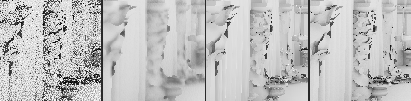
_crop strip, frame 38: raw | accumulate | ours | reference_

## G4-golden-pan-light-on (G4): G4 Bistro pan + light switching on

960x540, 64 frames, reference 4096 spp, moving camera, events: start@0, light@32. _golden capture (T0-scenes, 4096 spp, fixed reference seeds): Bistro pan, lantern switches on at frame 32_

| gate | ours | bar | result |
|---|---|---|---|
| calm: static boil <= native | 0.0186 | – | n/a (no best native value on this capture) |
| lag after light-on <= native | 16.0000 | – | n/a (no best native value on this capture) |

### G4-golden-pan-light-on / diffuse

| row | boil static (smooth) | boil dense geometry | boil moving | boil disoccluded | tail p99 / pop % (smooth · dense · moving) | still σ | FLIP ↓ | PSNR dB ↑ | lag (frames) ↓ | bias (8-bit levels) | GPU ms 1080p | wall ms 1080p |
|---|---|---|---|---|---|---|---|---|---|---|---|---|
| reference floor (its own noise) | 0.0134 | 0.0284 | 0.0861 | 0.0364 |  | – | 0 | ∞ | – | 0 | – | – |
| raw 1-ray input | 0.2218 | 0.2254 | 0.2358 | 0.2242 | 0.512/85.6% · 0.512/79.7% · 0.512/70.0% | – | 0.7353 | 12.76 | start 0, light 0 | -71.22 | 0.000 | 0.00 |
| accumulate-32 | 0.0144 | 0.0147 | 0.0200 | 0.0579 | 0.054/2.7% · 0.057/2.6% · 0.074/3.0% | – | 0.3131 | 19.99 | start 4, light 22 | -11.41 | – | – |
| ours (shipped defaults) | 0.0037 | 0.0292 | 0.0625 | 0.0271 | 0.011/0.0% · 0.132/4.6% · 0.253/11.5% | – | 0.1532 | 26.87 | start 1, light 16 | -1.76 | – | – |

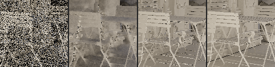
_crop strip, frame 38: raw | accumulate | ours | reference_

### G4-golden-pan-light-on / visibility

| row | boil static (smooth) | boil dense geometry | boil moving | boil disoccluded | tail p99 / pop % (smooth · dense · moving) | still σ | FLIP ↓ | PSNR dB ↑ | lag (frames) ↓ | bias (8-bit levels) | GPU ms 1080p | wall ms 1080p |
|---|---|---|---|---|---|---|---|---|---|---|---|---|
| reference floor (its own noise) | 0.0122 | 0.0632 | 0.1760 | 0.0383 |  | – | 0 | ∞ | – | 0 | – | – |
| raw 1-ray input | 0.0993 | 0.0952 | 0.3133 | 0.0984 | 0.512/9.7% · 0.482/5.8% · 0.512/62.2% | – | 0.0892 | 17.25 | start 0, light 4 | -5.85 | 0.000 | 0.00 |
| accumulate-32 | 0.0048 | 0.0078 | 0.0157 | 0.0199 | 0.022/0.2% · 0.026/0.2% · 0.049/0.9% | – | 0.1313 | 18.47 | start 0, light 15 | +6.82 | – | – |
| ours (shipped defaults) | 0.0078 | 0.0493 | 0.1360 | 0.0329 | 0.015/0.1% · 0.249/1.9% · 0.512/9.3% | – | 0.0567 | 24.13 | start 0, light 13 | +1.25 | – | – |
| FFX (MIT port) | 0.0048 | 0.0245 | 0.0637 | 0.0298 | 0.009/0.2% · 0.110/1.9% · 0.325/3.6% | – | 0.1590 | 18.80 | start 0, light 12 | +5.93 | – | – |

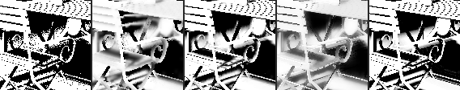
_crop strip, frame 38: raw | accumulate | ours | ffx | reference_

## G2-knot-static (G2): Knot over a floor, moving occluder (static camera, knot rotating)

960x540, 48 frames, reference 2048 spp, static camera, events: start@0. _provisional (kept capture three-knot-static; golden G2 pending T0-scenes)_

| gate | ours | bar | result |
|---|---|---|---|
| calm: moving boil <= FFX | 0.0134 | <= 0.0223 (FFX) | PASS |
| calm: static boil <= FFX | 0.0010 | <= 0.0007 (FFX) | FAIL |
| calm tail: moving p99 <= FFX | 0.0630 | <= 0.1070 (FFX) | PASS |
| calm: still-camera sigma <= FFX | 0.0007 | <= 0.0017 (FFX) | PASS |
| detail: FLIP < FFX | 0.0174 | < 0.0470 (FFX) | PASS |
| cost: <= 0.6 ms GPU at 1080p | – | <= 0.6000 (0.6) | n/a (no value for ours) |

### G2-knot-static / visibility

| row | boil static (smooth) | boil dense geometry | boil moving | boil disoccluded | tail p99 / pop % (smooth · dense · moving) | still σ | FLIP ↓ | PSNR dB ↑ | lag (frames) ↓ | bias (8-bit levels) | GPU ms 1080p | wall ms 1080p |
|---|---|---|---|---|---|---|---|---|---|---|---|---|
| reference floor (its own noise) | 0.0017 | 0.0021 | 0.0075 | 0.0003 |  | 0.0006 | 0 | ∞ | – | 0 | – | – |
| raw 1-ray input | 0.1440 | 0.1737 | 0.3564 | 0.0224 | 0.512/6.8% · 0.512/12.0% · 0.512/81.2% | 0.0409 | 0.0907 | 16.85 | start 0 | -5.98 | 0.000 | 0.00 |
| accumulate-32 | 0.0046 | 0.0058 | 0.0122 | 0.0047 | 0.025/0.5% · 0.031/0.8% · 0.043/2.7% | 0.0036 | 0.0261 | 29.03 | start 35 | -0.15 | – | – |
| ours (shipped defaults) | 0.0010 | 0.0057 | 0.0134 | 0.0007 | 0.003/0.0% · 0.019/0.5% · 0.063/2.6% | 0.0007 | 0.0174 | 37.13 | start 2 | -0.21 | – | – |
| FFX (MIT port) | 0.0007 | 0.0056 | 0.0223 | 0.0045 | 0.003/0.0% · 0.012/0.2% · 0.107/3.8% | 0.0017 | 0.0470 | 28.68 | start 0 | +0.01 | – | – |
| native sigma (imported) | – | – | – | – | – · – · – | – | 0.0496 | 21.50 | start 0 | – | 1.115 † | 1.41 † |

_crop strip, frame 28: raw | accumulate | ours | ffx | reference_

## G2-knot-orbit (G2): Knot over a floor, moving occluder (camera orbit)

960x540, 40 frames, reference 2048 spp, moving camera, events: start@0. _provisional (kept capture three-knot-orbit)_

| gate | ours | bar | result |
|---|---|---|---|
| calm: moving boil <= FFX | 0.0515 | <= 0.0241 (FFX) | FAIL |
| calm: static boil <= FFX | 0.0011 | <= 0.0010 (FFX) | FAIL |
| calm tail: moving p99 <= FFX | 0.2550 | <= 0.1110 (FFX) | FAIL |
| detail: FLIP < FFX | 0.0193 | < 0.0545 (FFX) | PASS |

### G2-knot-orbit / visibility

| row | boil static (smooth) | boil dense geometry | boil moving | boil disoccluded | tail p99 / pop % (smooth · dense · moving) | still σ | FLIP ↓ | PSNR dB ↑ | lag (frames) ↓ | bias (8-bit levels) | GPU ms 1080p | wall ms 1080p |
|---|---|---|---|---|---|---|---|---|---|---|---|---|
| reference floor (its own noise) | 0.0015 | 0.0341 | 0.0613 | 0.0061 |  | – | 0 | ∞ | – | 0 | – | – |
| raw 1-ray input | 0.0968 | 0.1386 | 0.2741 | 0.0996 | 0.510/10.0% · 0.512/18.3% · 0.512/77.0% | – | 0.1062 | 16.06 | start 0 | -6.84 | 0.000 | 0.00 |
| accumulate-32 | 0.0040 | 0.0061 | 0.0123 | 0.0172 | 0.021/0.3% · 0.029/0.6% · 0.041/2.1% | – | 0.0398 | 26.03 | start 4 | +0.95 | – | – |
| ours (shipped defaults) | 0.0011 | 0.0261 | 0.0515 | 0.0088 | 0.004/0.0% · 0.138/2.0% · 0.255/5.6% | – | 0.0193 | 33.62 | start 0 | +0.16 | – | – |
| FFX (MIT port) | 0.0010 | 0.0130 | 0.0241 | 0.0090 | 0.004/0.0% · 0.055/1.2% · 0.111/2.8% | – | 0.0545 | 26.34 | start 0 | +0.22 | – | – |
| native sigma (imported) | – | – | – | – | – · – · – | – | 0.0495 | 24.93 | start 0 | – | 1.115 † | 1.41 † |

_crop strip, frame 24: raw | accumulate | ours | ffx | reference_

## G3-sponza-orbit (G3): Sponza orbit: diffuse GI + AO

960x540, 48 frames, reference 1024 spp, moving camera, events: start@0. _provisional (kept capture sponza-orbit)_

| gate | ours | bar | result |
|---|---|---|---|
| calm: static boil <= native | 0.0071 | – | n/a (no best native value on this capture) |
| lag <= native | 4.0000 | – | n/a (no best native value on this capture) |

### G3-sponza-orbit / diffuse

| row | boil static (smooth) | boil dense geometry | boil moving | boil disoccluded | tail p99 / pop % (smooth · dense · moving) | still σ | FLIP ↓ | PSNR dB ↑ | lag (frames) ↓ | bias (8-bit levels) | GPU ms 1080p | wall ms 1080p |
|---|---|---|---|---|---|---|---|---|---|---|---|---|
| reference floor (its own noise) | 0.0042 | 0.0087 | 0.0506 | 0.0046 |  | – | 0 | ∞ | – | 0 | – | – |
| raw 1-ray input | 0.0863 | 0.1162 | 0.1713 | 0.0702 | 0.355/26.9% · 0.454/33.4% · 0.507/51.4% | – | 0.5455 | 16.56 | start 0 | -43.50 | 0.000 | 0.00 |
| accumulate-32 | 0.0060 | 0.0078 | 0.0118 | 0.0176 | 0.029/0.6% · 0.037/1.1% · 0.053/0.9% | – | 0.1848 | 26.39 | start 20 | -0.93 | – | – |
| ours (shipped defaults) | 0.0014 | 0.0109 | 0.0550 | 0.0065 | 0.006/0.0% · 0.048/1.1% · 0.213/15.4% | – | 0.1134 | 32.07 | start 4 | -0.40 | – | – |

_crop strip, frame 28: raw | accumulate | ours | reference_

### G3-sponza-orbit / ao

| row | boil static (smooth) | boil dense geometry | boil moving | boil disoccluded | tail p99 / pop % (smooth · dense · moving) | still σ | FLIP ↓ | PSNR dB ↑ | lag (frames) ↓ | bias (8-bit levels) | GPU ms 1080p | wall ms 1080p |
|---|---|---|---|---|---|---|---|---|---|---|---|---|
| reference floor (its own noise) | 0.0041 | 0.0151 | 0.0562 | 0.0067 |  | – | 0 | ∞ | – | 0 | – | – |
| raw 1-ray input | 0.1408 | 0.1630 | 0.2260 | 0.1464 | 0.439/69.9% · 0.491/73.2% · 0.512/77.4% | – | 0.3755 | 13.38 | start 0 | -6.22 | 0.000 | 0.00 |
| accumulate-32 | 0.0055 | 0.0069 | 0.0095 | 0.0242 | 0.021/0.1% · 0.026/0.1% · 0.032/0.3% | – | 0.0937 | 24.65 | start 7 | -0.20 | – | – |
| ours (shipped defaults) | 0.0027 | 0.0155 | 0.0513 | 0.0085 | 0.008/0.0% · 0.067/1.0% · 0.232/9.1% | – | 0.0552 | 30.91 | start 3 | +0.15 | – | – |

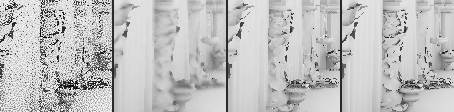
_crop strip, frame 28: raw | accumulate | ours | reference_

## G3-sponza-move (G3): Sponza, static camera, moving knot: shadows + diffuse

960x540, 48 frames, reference 1024 spp, static camera, events: start@0. _provisional (kept capture sponza-move: moving occluder in the sun shaft)_

| gate | ours | bar | result |
|---|---|---|---|
| calm: moving boil <= FFX | 0.0811 | <= 0.0426 (FFX) | FAIL |
| detail: FLIP < FFX | 0.0264 | < 0.0682 (FFX) | PASS |

### G3-sponza-move / visibility

| row | boil static (smooth) | boil dense geometry | boil moving | boil disoccluded | tail p99 / pop % (smooth · dense · moving) | still σ | FLIP ↓ | PSNR dB ↑ | lag (frames) ↓ | bias (8-bit levels) | GPU ms 1080p | wall ms 1080p |
|---|---|---|---|---|---|---|---|---|---|---|---|---|
| reference floor (its own noise) | 0.0037 | 0.0047 | 0.1120 | 0.0203 |  | 0.0004 | 0 | ∞ | – | 0 | – | – |
| raw 1-ray input | 0.1573 | 0.1340 | 0.4488 | 0.0994 | 0.512/5.7% · 0.512/4.3% · 0.512/57.7% | 0.0136 | 0.0754 | 17.99 | start 0 | -4.78 | 0.000 | 0.00 |
| accumulate-32 | 0.0047 | 0.0040 | 0.0140 | 0.0182 | 0.025/0.4% · 0.021/0.3% · 0.047/1.2% | 0.0013 | 0.0310 | 24.15 | start 38 | -0.15 | – | – |
| ours (shipped defaults) | 0.0031 | 0.0076 | 0.0811 | 0.0166 | 0.009/0.1% · 0.033/0.8% · 0.316/11.1% | 0.0010 | 0.0264 | 29.88 | start 1 | +0.09 | – | – |
| FFX (MIT port) | 0.0017 | 0.0045 | 0.0426 | 0.0154 | 0.006/0.0% · 0.013/0.2% · 0.165/6.9% | 0.0022 | 0.0682 | 24.73 | start 0 | +1.23 | – | – |

_crop strip, frame 28: raw | accumulate | ours | ffx | reference_

### G3-sponza-move / diffuse

| row | boil static (smooth) | boil dense geometry | boil moving | boil disoccluded | tail p99 / pop % (smooth · dense · moving) | still σ | FLIP ↓ | PSNR dB ↑ | lag (frames) ↓ | bias (8-bit levels) | GPU ms 1080p | wall ms 1080p |
|---|---|---|---|---|---|---|---|---|---|---|---|---|
| reference floor (its own noise) | 0.0076 | 0.0080 | 0.0192 | 0.0080 |  | 0.0067 | 0 | ∞ | – | 0 | – | – |
| raw 1-ray input | 0.1799 | 0.2184 | 0.2271 | 0.1802 | 0.512/36.7% · 0.512/41.3% · 0.512/43.6% | 0.1509 | 0.7209 | 13.68 | start 0 | -62.21 | 0.000 | 0.00 |
| accumulate-32 | 0.0111 | 0.0121 | 0.0144 | 0.0535 | 0.051/2.3% · 0.054/2.7% · 0.061/2.7% | 0.0271 | 0.2926 | 21.99 | start 35 | -5.27 | – | – |
| ours (shipped defaults) | 0.0018 | 0.0090 | 0.0098 | 0.0154 | 0.007/0.0% · 0.037/1.1% · 0.044/1.2% | 0.0064 | 0.1071 | 32.58 | start 5 | -0.42 | – | – |

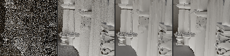
_crop strip, frame 28: raw | accumulate | ours | reference_

## G4-bistro-pan (G4): Bistro pan: diffuse + AO, thin geometry

960x540, 48 frames, reference 1024 spp, moving camera, events: start@0. _provisional (kept capture bistro-pan)_

| gate | ours | bar | result |
|---|---|---|---|
| calm: static boil <= native | 0.0124 | – | n/a (no best native value on this capture) |
| lag <= native | 37.0000 | – | n/a (no best native value on this capture) |

### G4-bistro-pan / diffuse

| row | boil static (smooth) | boil dense geometry | boil moving | boil disoccluded | tail p99 / pop % (smooth · dense · moving) | still σ | FLIP ↓ | PSNR dB ↑ | lag (frames) ↓ | bias (8-bit levels) | GPU ms 1080p | wall ms 1080p |
|---|---|---|---|---|---|---|---|---|---|---|---|---|
| reference floor (its own noise) | 0.0063 | 0.0161 | 0.0572 | 0.0122 |  | – | 0 | ∞ | – | 0 | – | – |
| raw 1-ray input | 0.1360 | 0.1430 | 0.1530 | 0.1465 | 0.371/71.9% · 0.387/66.3% · 0.398/56.7% | – | 0.7731 | 13.55 | start 0 | -65.16 | 0.000 | 0.00 |
| accumulate-32 | 0.0081 | 0.0085 | 0.0090 | 0.0364 | 0.031/0.5% · 0.032/0.6% · 0.033/0.2% | – | 0.2419 | 22.53 | start 4 | -2.78 | – | – |
| ours (shipped defaults) | 0.0025 | 0.0203 | 0.0604 | 0.0162 | 0.007/0.0% · 0.089/3.5% · 0.197/18.1% | – | 0.1292 | 28.88 | start 37 | -0.12 | – | – |

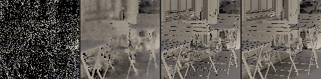
_crop strip, frame 28: raw | accumulate | ours | reference_

### G4-bistro-pan / ao

| row | boil static (smooth) | boil dense geometry | boil moving | boil disoccluded | tail p99 / pop % (smooth · dense · moving) | still σ | FLIP ↓ | PSNR dB ↑ | lag (frames) ↓ | bias (8-bit levels) | GPU ms 1080p | wall ms 1080p |
|---|---|---|---|---|---|---|---|---|---|---|---|---|
| reference floor (its own noise) | 0.0070 | 0.0349 | 0.1038 | 0.0265 |  | – | 0 | ∞ | – | 0 | – | – |
| raw 1-ray input | 0.1398 | 0.1842 | 0.2422 | 0.1865 | 0.441/71.9% · 0.512/74.4% · 0.512/69.1% | – | 0.4266 | 12.08 | start 0 | -8.06 | 0.000 | 0.00 |
| accumulate-32 | 0.0067 | 0.0092 | 0.0130 | 0.0384 | 0.027/0.3% · 0.033/0.5% · 0.042/0.5% | – | 0.1663 | 19.75 | start 15 | +0.18 | – | – |
| ours (shipped defaults) | 0.0051 | 0.0367 | 0.1057 | 0.0301 | 0.009/0.0% · 0.170/3.7% · 0.366/21.5% | – | 0.0892 | 25.54 | start 37 | +0.23 | – | – |

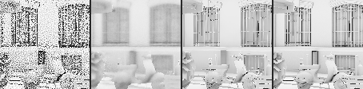
_crop strip, frame 28: raw | accumulate | ours | reference_

## G4-bistro-move (G4): Bistro, static camera, moving local light: shadows + diffuse

960x540, 48 frames, reference 1024 spp, static camera, events: start@0. _provisional (kept capture bistro-move: moving lantern; the golden 'light switching on' event is pending T0-scenes)_

| gate | ours | bar | result |
|---|---|---|---|
| calm: moving boil <= FFX | 0.0619 | <= 0.0417 (FFX) | FAIL |
| detail: FLIP < FFX | 0.0285 | < 0.1089 (FFX) | PASS |

### G4-bistro-move / visibility

| row | boil static (smooth) | boil dense geometry | boil moving | boil disoccluded | tail p99 / pop % (smooth · dense · moving) | still σ | FLIP ↓ | PSNR dB ↑ | lag (frames) ↓ | bias (8-bit levels) | GPU ms 1080p | wall ms 1080p |
|---|---|---|---|---|---|---|---|---|---|---|---|---|
| reference floor (its own noise) | 0.0004 | 0.0008 | 0.0435 | – |  | 0.0000 | 0 | ∞ | – | 0 | – | – |
| raw 1-ray input | 0.0079 | 0.0308 | 0.4022 | – | 0.001/0.0% · 0.001/0.2% · 0.512/44.7% | 0.0001 | 0.0174 | 24.42 | start 45 | -1.05 | 0.000 | 0.00 |
| accumulate-32 | 0.0003 | 0.0010 | 0.0132 | – | 0.001/0.0% · 0.002/0.0% · 0.047/1.5% | 0.0022 | 0.0744 | 17.96 | start – | +9.80 | – | – |
| ours (shipped defaults) | 0.0020 | 0.0072 | 0.0619 | – | 0.001/0.1% · 0.024/0.8% · 0.201/22.2% | 0.0015 | 0.0285 | 24.38 | start 0 | +1.53 | – | – |
| FFX (MIT port) | 0.0010 | 0.0055 | 0.0417 | – | 0.003/0.0% · 0.014/0.3% · 0.153/7.2% | 0.0061 | 0.1089 | 19.65 | start 0 | +6.77 | – | – |

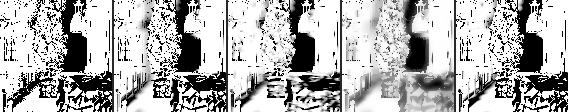
_crop strip, frame 28: raw | accumulate | ours | ffx | reference_

### G4-bistro-move / diffuse

| row | boil static (smooth) | boil dense geometry | boil moving | boil disoccluded | tail p99 / pop % (smooth · dense · moving) | still σ | FLIP ↓ | PSNR dB ↑ | lag (frames) ↓ | bias (8-bit levels) | GPU ms 1080p | wall ms 1080p |
|---|---|---|---|---|---|---|---|---|---|---|---|---|
| reference floor (its own noise) | 0.0053 | 0.0064 | 0.0202 | – |  | 0.0070 | 0 | ∞ | – | 0 | – | – |
| raw 1-ray input | 0.1198 | 0.1568 | 0.2195 | – | 0.401/62.5% · 0.458/64.7% · 0.464/62.0% | 0.1294 | 0.5500 | 17.10 | start 0 | -30.77 | 0.000 | 0.00 |
| accumulate-32 | 0.0052 | 0.0066 | 0.0099 | – | 0.023/0.2% · 0.028/0.4% · 0.037/0.7% | 0.0173 | 0.2018 | 26.64 | start 33 | +0.33 | – | – |
| ours (shipped defaults) | 0.0007 | 0.0071 | 0.0106 | – | 0.003/0.0% · 0.036/1.0% · 0.053/1.8% | 0.0072 | 0.0931 | 33.91 | start 5 | +0.35 | – | – |

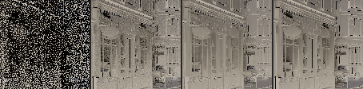
_crop strip, frame 28: raw | accumulate | ours | reference_

## G4-bistro-hold (G4): Bistro, nothing moves: still-camera calm

960x540, 32 frames, reference 128 spp, static camera, events: start@0. _provisional (kept capture bistro-hold: static camera, 128-spp reference; still-camera sigma)_

### G4-bistro-hold / diffuse

| row | boil static (smooth) | boil dense geometry | boil moving | boil disoccluded | tail p99 / pop % (smooth · dense · moving) | still σ | FLIP ↓ | PSNR dB ↑ | lag (frames) ↓ | bias (8-bit levels) | GPU ms 1080p | wall ms 1080p |
|---|---|---|---|---|---|---|---|---|---|---|---|---|
| reference floor (its own noise) | 0.0131 | 0.0136 | 0.0271 | – |  | 0.0067 | 0 | ∞ | – | 0 | – | – |
| raw 1-ray input | 0.1272 | 0.1653 | 0.1940 | – | 0.440/52.3% · 0.459/53.0% · 0.462/61.5% | 0.0427 | 0.6040 | 15.84 | start 0 | -37.53 | 0.000 | 0.00 |
| accumulate-32 | 0.0068 | 0.0081 | 0.0099 | – | 0.029/0.3% · 0.033/0.4% · 0.037/0.4% | 0.0062 | 0.2497 | 23.91 | start 22 | -2.08 | – | – |
| ours (shipped defaults) | 0.0007 | 0.0069 | 0.0073 | – | 0.003/0.0% · 0.035/0.7% · 0.038/0.6% | 0.0020 | 0.1533 | 30.42 | start 4 | +0.49 | – | – |

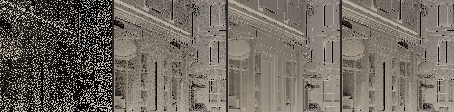
_crop strip, frame 19: raw | accumulate | ours | reference_

## corner-orbit: Corner scene, slow orbit

960x540, 40 frames, reference 1024 spp, moving camera, events: start@0. _kept capture three-orbit (the corner scene); native imported_

### corner-orbit / diffuse

| row | boil static (smooth) | boil dense geometry | boil moving | boil disoccluded | tail p99 / pop % (smooth · dense · moving) | still σ | FLIP ↓ | PSNR dB ↑ | lag (frames) ↓ | bias (8-bit levels) | GPU ms 1080p | wall ms 1080p |
|---|---|---|---|---|---|---|---|---|---|---|---|---|
| reference floor (its own noise) | 0.0028 | 0.0093 | 0.0658 | 0.0030 |  | – | 0 | ∞ | – | 0 | – | – |
| raw 1-ray input | 0.0941 | 0.1063 | 0.1297 | 0.0915 | 0.273/66.9% · 0.306/67.8% · 0.344/57.5% | – | 0.4461 | 16.88 | start 0 | -18.95 | 0.000 | 0.00 |
| accumulate-32 | 0.0048 | 0.0050 | 0.0062 | 0.0179 | 0.019/0.1% · 0.019/0.1% · 0.021/0.0% | – | 0.0960 | 28.54 | start 20 | -0.34 | – | – |
| ours (shipped defaults) | 0.0006 | 0.0078 | 0.0406 | 0.0024 | 0.002/0.0% · 0.032/0.4% · 0.146/6.5% | – | 0.0372 | 39.89 | start 2 | -0.24 | – | – |
| native reblur (imported) | – | – | – | – | – · – · – | – | 0.0780 | 32.93 | start 3 | – | 5.664 † | 5.85 † |
| native relax (imported) | – | – | – | – | – · – · – | – | 0.0563 | 37.59 | start 10 | – | 5.664 † | 5.85 † |

_crop strip, frame 24: raw | accumulate | ours | reference_

### corner-orbit / specular

| row | boil static (smooth) | boil dense geometry | boil moving | boil disoccluded | tail p99 / pop % (smooth · dense · moving) | still σ | FLIP ↓ | PSNR dB ↑ | lag (frames) ↓ | bias (8-bit levels) | GPU ms 1080p | wall ms 1080p |
|---|---|---|---|---|---|---|---|---|---|---|---|---|
| reference floor (its own noise) | 0.0007 | 0.0059 | 0.0389 | 0.0029 |  | – | 0 | ∞ | – | 0 | – | – |
| raw 1-ray input | 0.0119 | 0.0196 | 0.0830 | 0.0133 | 0.055/3.6% · 0.089/4.6% · 0.300/30.7% | – | 0.1378 | 34.79 | start 10 | -2.31 | 0.000 | 0.00 |
| accumulate-32 | 0.0005 | 0.0009 | 0.0042 | 0.0022 | 0.003/0.0% · 0.004/0.0% · 0.017/0.0% | – | 0.0708 | 39.31 | start 1 | +1.33 | – | – |
| ours (shipped defaults) | 0.0004 | 0.0055 | 0.0266 | 0.0023 | 0.001/0.0% · 0.025/0.1% · 0.130/3.1% | – | 0.0407 | 44.33 | start 24 | +0.83 | – | – |
| FFX (MIT port) | 0.0019 | 0.0037 | 0.0141 | 0.0035 | 0.009/0.0% · 0.016/0.0% · 0.057/0.7% | – | 0.0707 | 39.12 | start 0 | +0.73 | – | – |
| native reblur (imported) | – | – | – | – | – · – · – | – | 0.0625 | 39.91 | start 0 | – | 5.664 † | 5.85 † |
| native relax (imported) | – | – | – | – | – · – · – | – | 0.0583 | 41.41 | start 4 | – | 5.664 † | 5.85 † |

_crop strip, frame 24: raw | accumulate | ours | ffx | reference_

### corner-orbit / visibility

| row | boil static (smooth) | boil dense geometry | boil moving | boil disoccluded | tail p99 / pop % (smooth · dense · moving) | still σ | FLIP ↓ | PSNR dB ↑ | lag (frames) ↓ | bias (8-bit levels) | GPU ms 1080p | wall ms 1080p |
|---|---|---|---|---|---|---|---|---|---|---|---|---|
| reference floor (its own noise) | 0.0020 | 0.0340 | 0.0634 | 0.0062 |  | – | 0 | ∞ | – | 0 | – | – |
| raw 1-ray input | 0.0972 | 0.1393 | 0.2753 | 0.0992 | 0.512/10.0% · 0.512/18.3% · 0.512/76.6% | – | 0.1063 | 16.05 | start 0 | -6.86 | 0.000 | 0.00 |
| accumulate-32 | 0.0040 | 0.0061 | 0.0124 | 0.0172 | 0.021/0.2% · 0.029/0.5% · 0.041/1.9% | – | 0.0398 | 26.03 | start 4 | +0.92 | – | – |
| ours (shipped defaults) | 0.0011 | 0.0261 | 0.0531 | 0.0089 | 0.004/0.0% · 0.138/2.0% · 0.263/5.8% | – | 0.0195 | 33.63 | start 0 | +0.14 | – | – |
| FFX (MIT port) | 0.0010 | 0.0130 | 0.0249 | 0.0091 | 0.004/0.0% · 0.056/1.2% · 0.117/3.0% | – | 0.0550 | 26.32 | start 0 | +0.18 | – | – |
| native sigma (imported) | – | – | – | – | – · – · – | – | 0.0493 | 24.93 | start 0 | – | 1.115 † | 1.41 † |

_crop strip, frame 24: raw | accumulate | ours | ffx | reference_

### corner-orbit / ao

| row | boil static (smooth) | boil dense geometry | boil moving | boil disoccluded | tail p99 / pop % (smooth · dense · moving) | still σ | FLIP ↓ | PSNR dB ↑ | lag (frames) ↓ | bias (8-bit levels) | GPU ms 1080p | wall ms 1080p |
|---|---|---|---|---|---|---|---|---|---|---|---|---|
| reference floor (its own noise) | 0.0035 | 0.0177 | 0.0983 | 0.0064 |  | – | 0 | ∞ | – | 0 | – | – |
| raw 1-ray input | 0.1452 | 0.2155 | 0.2733 | 0.1725 | 0.411/79.2% · 0.512/83.8% · 0.512/79.5% | – | 0.4222 | 12.52 | start 0 | -4.46 | 0.000 | 0.00 |
| accumulate-32 | 0.0063 | 0.0094 | 0.0115 | 0.0316 | 0.022/0.1% · 0.032/0.7% · 0.038/0.7% | – | 0.0778 | 24.44 | start 14 | -0.42 | – | – |
| ours (shipped defaults) | 0.0017 | 0.0131 | 0.0572 | 0.0063 | 0.006/0.0% · 0.053/1.7% · 0.228/14.8% | – | 0.0317 | 33.43 | start 1 | -0.12 | – | – |
| native reblur-occlusion (imported) | – | – | – | – | – · – · – | – | 0.1266 | 23.01 | start 6 | – | 5.664 † | 5.85 † |

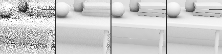
_crop strip, frame 24: raw | accumulate | ours | reference_

## corner-pan: Corner scene, pan

960x540, 32 frames, reference 1024 spp, moving camera, events: start@0. _kept capture three-pan (the corner scene); native imported_

### corner-pan / diffuse

| row | boil static (smooth) | boil dense geometry | boil moving | boil disoccluded | tail p99 / pop % (smooth · dense · moving) | still σ | FLIP ↓ | PSNR dB ↑ | lag (frames) ↓ | bias (8-bit levels) | GPU ms 1080p | wall ms 1080p |
|---|---|---|---|---|---|---|---|---|---|---|---|---|
| reference floor (its own noise) | 0.0028 | 0.0096 | 0.0714 | 0.0030 |  | – | 0 | ∞ | – | 0 | – | – |
| raw 1-ray input | 0.0934 | 0.1002 | 0.1307 | 0.0865 | 0.269/67.3% · 0.291/66.9% · 0.348/57.4% | – | 0.4394 | 17.09 | start 0 | -18.33 | 0.000 | 0.00 |
| accumulate-32 | 0.0058 | 0.0054 | 0.0068 | 0.0206 | 0.023/0.2% · 0.020/0.1% · 0.023/0.1% | – | 0.1264 | 26.48 | start 6 | -0.92 | – | – |
| ours (shipped defaults) | 0.0006 | 0.0081 | 0.0515 | 0.0018 | 0.002/0.0% · 0.034/0.5% · 0.191/10.4% | – | 0.0368 | 40.27 | start 3 | -0.28 | – | – |
| native reblur (imported) | – | – | – | – | – · – · – | – | 0.0714 | 33.18 | start 24 | – | 5.664 † | 5.85 † |
| native relax (imported) | – | – | – | – | – · – · – | – | 0.0510 | 38.73 | start 9 | – | 5.664 † | 5.85 † |

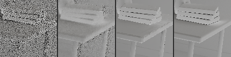
_crop strip, frame 19: raw | accumulate | ours | reference_

### corner-pan / specular

| row | boil static (smooth) | boil dense geometry | boil moving | boil disoccluded | tail p99 / pop % (smooth · dense · moving) | still σ | FLIP ↓ | PSNR dB ↑ | lag (frames) ↓ | bias (8-bit levels) | GPU ms 1080p | wall ms 1080p |
|---|---|---|---|---|---|---|---|---|---|---|---|---|
| reference floor (its own noise) | 0.0009 | 0.0052 | 0.0205 | 0.0023 |  | – | 0 | ∞ | – | 0 | – | – |
| raw 1-ray input | 0.0115 | 0.0141 | 0.0399 | 0.0090 | 0.053/3.9% · 0.065/3.4% · 0.150/15.2% | – | 0.1338 | 35.87 | start 4 | -1.99 | 0.000 | 0.00 |
| accumulate-32 | 0.0006 | 0.0007 | 0.0020 | 0.0017 | 0.003/0.0% · 0.004/0.0% · 0.009/0.0% | – | 0.0800 | 37.22 | start 0 | +0.95 | – | – |
| ours (shipped defaults) | 0.0006 | 0.0057 | 0.0182 | 0.0017 | 0.002/0.0% · 0.026/0.2% · 0.093/1.6% | – | 0.0399 | 46.11 | start 11 | +0.69 | – | – |
| FFX (MIT port) | 0.0019 | 0.0034 | 0.0106 | 0.0022 | 0.009/0.0% · 0.016/0.0% · 0.039/0.9% | – | 0.0692 | 40.86 | start 0 | +0.59 | – | – |
| native reblur (imported) | – | – | – | – | – · – · – | – | 0.0596 | 41.65 | start 5 | – | 5.664 † | 5.85 † |
| native relax (imported) | – | – | – | – | – · – · – | – | 0.0566 | 42.67 | start 4 | – | 5.664 † | 5.85 † |

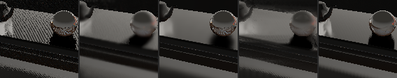
_crop strip, frame 19: raw | accumulate | ours | ffx | reference_

### corner-pan / visibility

| row | boil static (smooth) | boil dense geometry | boil moving | boil disoccluded | tail p99 / pop % (smooth · dense · moving) | still σ | FLIP ↓ | PSNR dB ↑ | lag (frames) ↓ | bias (8-bit levels) | GPU ms 1080p | wall ms 1080p |
|---|---|---|---|---|---|---|---|---|---|---|---|---|
| reference floor (its own noise) | 0.0018 | 0.0310 | 0.0597 | 0.0044 |  | – | 0 | ∞ | – | 0 | – | – |
| raw 1-ray input | 0.0913 | 0.1310 | 0.2786 | 0.0573 | 0.500/8.5% · 0.512/17.3% · 0.512/76.4% | – | 0.0867 | 16.79 | start 19 | -5.17 | 0.000 | 0.00 |
| accumulate-32 | 0.0045 | 0.0067 | 0.0139 | 0.0116 | 0.025/0.4% · 0.033/0.8% · 0.044/2.7% | – | 0.0343 | 25.76 | start 6 | +0.51 | – | – |
| ours (shipped defaults) | 0.0010 | 0.0217 | 0.0524 | 0.0058 | 0.004/0.0% · 0.106/2.0% · 0.220/9.4% | – | 0.0166 | 33.91 | start 0 | +0.17 | – | – |
| FFX (MIT port) | 0.0013 | 0.0165 | 0.0331 | 0.0057 | 0.004/0.0% · 0.070/1.3% · 0.153/4.0% | – | 0.0407 | 27.87 | start 0 | -0.10 | – | – |
| native sigma (imported) | – | – | – | – | – · – · – | – | 0.0403 | 25.79 | start 9 | – | 1.115 † | 1.41 † |

_crop strip, frame 19: raw | accumulate | ours | ffx | reference_

### corner-pan / ao

| row | boil static (smooth) | boil dense geometry | boil moving | boil disoccluded | tail p99 / pop % (smooth · dense · moving) | still σ | FLIP ↓ | PSNR dB ↑ | lag (frames) ↓ | bias (8-bit levels) | GPU ms 1080p | wall ms 1080p |
|---|---|---|---|---|---|---|---|---|---|---|---|---|
| reference floor (its own noise) | 0.0035 | 0.0167 | 0.0812 | 0.0048 |  | – | 0 | ∞ | – | 0 | – | – |
| raw 1-ray input | 0.1468 | 0.2098 | 0.2474 | 0.1518 | 0.410/80.1% · 0.512/83.4% · 0.512/79.1% | – | 0.4135 | 12.74 | start 0 | -4.14 | 0.000 | 0.00 |
| accumulate-32 | 0.0075 | 0.0108 | 0.0120 | 0.0314 | 0.025/0.2% · 0.036/1.1% · 0.039/0.7% | – | 0.0995 | 22.72 | start 5 | -0.42 | – | – |
| ours (shipped defaults) | 0.0017 | 0.0137 | 0.0582 | 0.0048 | 0.006/0.0% · 0.056/1.6% · 0.240/16.1% | – | 0.0308 | 33.55 | start 15 | -0.11 | – | – |
| native reblur-occlusion (imported) | – | – | – | – | – · – · – | – | 0.1461 | 21.74 | start 2 | – | 5.664 † | 5.85 † |

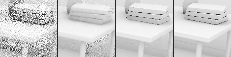
_crop strip, frame 19: raw | accumulate | ours | reference_

## Notes

- Boil: RMS of the second temporal difference x_t − 2x_(t−1) + x_(t−2) along the reprojected history, / √6, on tonemapped values (Reinhard per channel for rgb, clamp for visibility / AO). Regions (per pixel and frame, ≥ 8 frames after a reset): **moving** = the reference changed by > 0.05 along its history within 4 frames; **disoccluded** = history age 2..6 frames; **dense geometry** = static pixels within 1 px of a crease (normal > 10° off a neighbour within 2 px) or silhouette (view-z jump > 2 %); **static (smooth)** = the rest. Boil is shown absolute; the reference row is its own boil in the same pixels, context only (the 1024–2048-spp references boil more than most denoisers, so a ratio to it means nothing). Read calm together with FLIP: a filter can buy calm by smearing detail.
- Tail numbers (next to the mean boil): p99 of the per-pixel boil and the pop fraction (pixels whose boil exceeds the reference's own at that pixel by 0.03), per region; the means can be level while the tail differs. Motion compensation samples the reprojected history bilinearly (two hops, valid taps only), not the nearest tap.
- Native rows are **imported** from `docs/research/rt-denoiser/native/results/*/score-captures.json` (default settings, RTX 3060 Laptop): FLIP, PSNR and lag (from per-frame PSNR) are comparable; boil regions, σ and bias need the native outputs (set `RT_NATIVE_OUTPUTS`). † = timed on the Windows RTX, not this GPU.
- Cost "GPU ms" for `ours diffuse+specular` is the joint dispatch; the same figure is shown on both signals.
