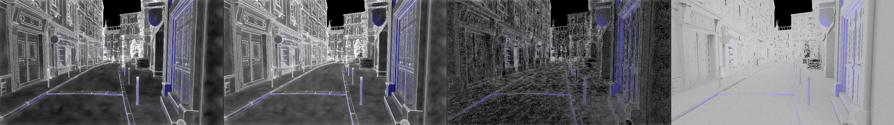
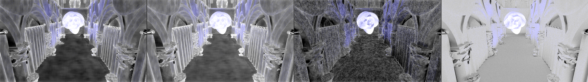
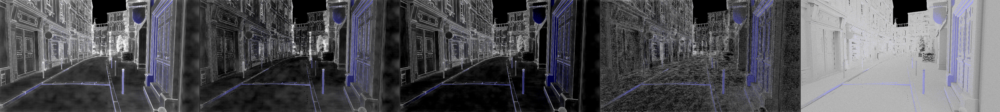
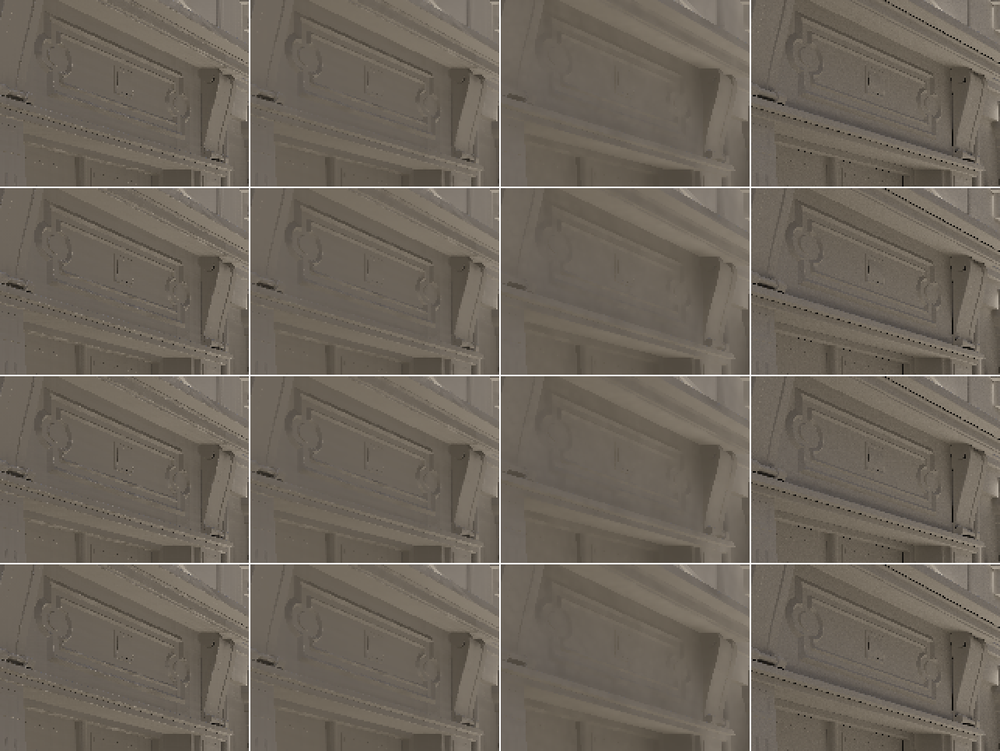

# Track D (diffuse + AO + cost), phase 1: diagnosis

_Agent D, implementer (RULES.md rule 8: no NRD / NRD-Sample code, README, fork or port opened), 2026-11-07. Branch
`track/d-diffuse`, worktree `Denoiser-track-d`. Measured on the M5 Pro (HeadlessChrome, Metal) from the kept captures
and the test bed. **No default changed in `packages/denoiser-realtime`.** The calm and lag metrics below are ours and
not yet calibrated with Dennis (T1): read every "calm" number as provisional until they are._

## 0. Summary

1. **There is no like-for-like native comparison on G3 / G4 yet.** Native NRD has never been run on the Sponza or Bistro
   captures, and on the captures it was run on (test bed, corner scene) the only temporal outputs we have are
   screen-space flicker and per-frame PSNR, not motion-compensated boil. What can be compared honestly is in §3; the rest
   needs T0-native (§8).
2. **Calm: our shipped default boils 3–6× more than our own recurrent filter** (the closest thing to REBLUR we have)
   in static regions, 2–3× at silhouettes and in disocclusions, on both scenes and for both diffuse and AO. It sits at
   roughly the 1–2 k-spp reference's own per-frame noise level. The boil is **concentrated on geometric detail**: on a
   still camera, flat surfaces are as calm as the recurrent filter, while dense geometry (moldings, window frames,
   railings) boils 6–12× more (boil maps, §2.3). Recurrent buys its calm by smearing that detail (strip, §2.3), so it is a calm bar, not a target. Pooled PSNR hid this completely: SVGF is +1.1–1.5 dB above recurrent
   on the same captures.
3. **Lag:** after a reset 2–11 frames to settle (orbit / move / hold); after a light change 7–12 frames (brightness and
   colour steps, lamp switch), 3–5 on a 16-frame fade. On the one like-for-like capture, `three-orbit`, ours settles in
   6 frames after the reset, the same as REBLUR at its tuned setting (A = 0.01) and faster than RELAX (14).
4. **Ranked causes** (§4), each measured one change at a time:
   1. **No temporal stabilization of the output**: under camera motion the à-trous grid moves over the content every
      frame and nothing re-accumulates the filtered result. A stabilization pass (built as the experiment option
      `stabilize`, default off) cuts static boil −40 % (orbit) to −70 % (still camera), edges −25…−63 %, disocclusions
      −30…−51 %, **and raises PSNR** (+0.2…+0.4 dB); with 4 à-trous iterations instead of 5 it keeps that calm at
      +0.3…+1.1 dB over the shipped default and pays for itself. It adds 1–6 frames of light-change lag as built.
   2. **Anti-lag fires on noise**: on a still camera and a static scene, λ > 0 on 41–72 % of pixel-frames (heavy-tailed
      sun-through-gaps GI), keeping most histories at 4–15 frames. With anti-lag off and α 0.03, still-view
      boil drops −57 % (but light changes then lag).
   3. **Short temporal window where the spatial filter cannot help** (α_min 0.1 ≈ a 19-frame window; the edge-stopping
      weights leave detail pixels to the temporal filter alone).
   4. Minor: the 'soft' normal test is already the right call (the hard test is +16 % boil on Bistro); feedback, Catmull-Rom,
      σ_l, fewer iterations, `luminanceVariance: 'mean'` move boil by < 10 % and trade it against PSNR.
5. **Cost:** the shipped joint default is **4.04 ms** at 1080p on the M5 Pro (1 % over target), 14 passes, no idle gaps on Metal. Fusing the variance pass into à-trous 0 and merging the six-pass anti-lag chain should bring it to ≈ 3.6 ms with identical output, and stabilization + 4 à-trous iterations is ≈ cost-neutral (−0.45 + 0.45 as built; ≈ 3.6 ms with an optimized stabilization, ≈ 3.2 ms with the byte-identical levers too) (§6.1–6.2).
6. **Wall overhead:** on the Mac wall − GPU is only ≈ 0.6 ms (encode 0.1, submit round trip 0.1–0.2, per-pass timestamps 0.2–0.3); the RTX's 2–3.5 ms is therefore not our encode work and needs the same decomposition run on Windows (§6.3, §8). Free cuts: timestamps off by default, one compute pass per frame, cached bind groups / views (139 views + 14 bind groups per frame today).
7. **Phase 2 estimate:** 3–5 working days for D (§7), gated by T1 calibration and native G3 / G4 runs.

## 1. Setup

| | |
|---|---|
| code | `track/d-diffuse` at 1c24a8d (= `feat/rt-denoiser-cleanroom` head), served frozen (`git archive` → `RT_REALTIME_SRC`) on port 5305; experiment option `stabilize` added in b8f0f8b, default off |
| shipped default | joint diffuse + specular A-SVGF (`svgf-auto`: `antiLag: 'auto'` v2 + `antiLagChroma`, `youngNormalPower: 16`, `normalTest: 'soft'`, `f16Rounding: 'nearest'`, `outputAliasing`); AO = `occlusion-svgf-auto` |
| anchors | `svgf` (plain SVGF, pinned to the M1 settings), `recurrent` (our ReBLUR-style filter: the calm reference we own), `accumulate-32`, `occlusion-recurrent` |
| G3 / G4 | the kept captures (`Denoiser-nrd-cleanroom/tools/rt-capture/captures`, symlinked read-only): `sponza-orbit / -pan / -move`, `bistro-orbit / -pan / -move` (48 frames, 960×540, diffuse refs 2048 spp Sponza / 1024 Bistro), `bistro-hold` (still camera and scene, 32 frames, 128-spp refs); `-move` = still camera, moving knot. Scenes are geometry only (no textures, no normal maps: results/SVGF-FOLLOWUPS.md §3.1), so "detail" here is dense tessellation, not normal maps |
| light changes | T3's fixed-camera paths re-captured at HEAD (`lc540-step / -hue / -jump / -fade`, 96 frames, 256-spp refs with fixed per-pixel seeds), scored with `results/data/t3-score.mjs` (`--stat 0`) |
| corner | `three-orbit`, `three-pan`: the only kept captures native NRD was also run on |
| scorers (new, ours) | [`results/data/d/calm.mjs`](../results/data/d/calm.mjs): motion-compensated boil per region (§2.1); [`boilmap.mjs`](../results/data/d/boilmap.mjs): per-pixel boil on still cameras, binned by geometric detail; [`lambda.mjs`](../results/data/d/lambda.mjs): anti-lag statistics from a debug replay; [`flicker.mjs`](../results/data/d/flicker.mjs): the screen-space flicker native has; [`calm-table.mjs`](../results/data/d/calm-table.mjs) |
| scripts | [`replay.sh`](../results/data/d/replay.sh), [`exp1.sh`](../results/data/d/exp1.sh)–[`exp3.sh`](../results/data/d/exp3.sh), [`lc.sh`](../results/data/d/lc.sh), [`tools/bench.mjs`](../results/data/d/tools/bench.mjs), [`tools/wrap.ts`](../results/data/d/tools/wrap.ts) (scratch registry: cost variants, `dbg-n`, `x-auto`), [`cost-pages.json`](../results/data/d/cost-pages.json); scores in [`results/data/d/scores/`](../results/data/d/scores/) |
| GPU lock | every batch under `RT_GPU_LOCK` (shared with R and S, who held it in between) |

### 1.1 What "calm" and "lag" mean here (provisional, for T0-scorecard / T1)

- **Regions** (pixels with a two-step reprojection chain, nearest valid tap of the 2×2 motion footprint, plane test as
  t1-score): *disocc* = history < 8 frames; *edge* = ≥ 8 frames, within 2 px of a depth edge; *dynamic* = the 3×3
  median of the reference changes by > 0.02 (tonemapped) along the chain (moving shadows; on moving-camera captures
  of static scenes it is mostly resampled sub-pixel detail, read it only on `-move`); *static* = the rest.
- **Boil** = RMS of the second temporal difference along the chain / √6 (compare.mjs), of the output; the
  reference's own boil in the same pixels is its per-frame noise floor.
- **Lag** = frames after a reset (or a light event) until the per-frame MSE stays within 10 % of its settled level
  (mean of the last 16 frames). Meaningless on pans (the error never settles: new content every frame, all arms ≈ 37),
  so lag is quoted on orbit / move / hold only. It is relative to each filter's own settled level: a blurrier filter
  settles at a worse level, sooner.
- **Two caveats for calibration (T1).** (a) The G3 / G4 references are independent 1–2 k-spp renders per frame
  (128 on `bistro-hold`) of heavy-tailed GI, so their own boil (5–17 ×10⁻³) is **above every denoiser's**: under rule
  9's q20 (a) floor nothing on these scenes would ever count as boil, yet the boil maps (§2.3) show clearly structured
  temporal noise. A reference with fixed per-pixel seeds (as the test bed's light-change paths have: reference boil 0)
  or ≥ 16 k spp is needed before boil-vs-reference can gate diffuse. Until then the comparisons below are **between
  denoisers** (ours vs recurrent; native when it exists). (b) On moving cameras over dense geometry (Bistro orbit /
  pan) the chain's nearest-tap resampling itself boils (reference 11–16 ×10⁻³ there), so static-region boil there
  measures detail as much as noise; the still-camera captures (`-move`, `bistro-hold`) are the clean test.

## 2. Measurements on G3 / G4 (shipped defaults)

### 2.1 Calm, per region (diffuse; boil ×10⁻³, lower is calmer)

Means over the captures (boil RMS over captures; [scores](../results/data/d/scores/), `calm-table.mjs --mean`):

| scene | denoiser | static | dynamic (err) | edge | disocc | static PSNR | pooled PSNR |
|---|---|---|---|---|---|---|---|
| Sponza (orbit, pan, move) | **svgf-auto (shipped)** | **4.1** | 31.4 | **17.4** | **10.2** | 35.94 | 33.44 |
| | svgf (plain) | 5.7 | 35.5 | 21.0 | 11.7 | 35.36 | 32.79 |
| | recurrent | 1.2 | 33.9 | 6.4 | 4.3 | 34.88 | 32.83 |
| | accumulate-32 | 10.5 | 39.1 | 13.5 | 44.2 | 29.79 | 25.21 |
| | reference (its own) | 7.1 | – | 15.4 | 9.1 | | |
| Bistro (orbit, pan, move, hold) | **svgf-auto (shipped)** | **8.7** | 32.4 | **22.8** | **14.7** | 33.80 | 31.66 |
| | svgf (plain) | 11.9 | 38.0 | 28.5 | 18.0 | 33.19 | 31.01 |
| | recurrent | 2.4 | 35.5 | 9.9 | 6.6 | 32.26 | 30.42 |
| | accumulate-32 | 9.1 | 36.8 | 10.0 | 41.8 | 29.71 | 25.00 |
| | reference (its own) | 13.5 | – | 23.0 | 16.4 | | |

AO (`occlusion-svgf-auto` vs `occlusion-recurrent`, reference): Sponza static 4.9 / 2.2 / 7.3, edge 26.4 / 16.4 / 28.2;
Bistro static 19.0 / 8.3 / 22.9, edge 44.0 / 21.5 / 47.4. Same pattern, with recurrent AO 3–5 dB lower PSNR.

Per capture (diffuse static / edge / disocc ×10⁻³, still σ in 8-bit levels on still cameras):

| capture | svgf-auto | recurrent | reference | svgf-auto still σ | recurrent still σ |
|---|---|---|---|---|---|
| sponza-orbit | 4.81 / 20.0 / 11.7 | 1.33 / 7.5 / 5.0 | 6.99 / 17.3 / 10.0 | | |
| sponza-pan | 4.46 / 20.3 / 10.7 | 1.39 / 7.8 / 4.3 | 6.43 / 18.6 / 9.2 | | |
| sponza-move | 2.93 / 9.5 / 7.9 | 0.91 / 2.5 / 3.4 | 7.77 / 8.1 / 7.9 | 1.92 | 1.64 |
| bistro-orbit | 10.40 / 27.9 / 18.2 | 2.12 / 11.0 / 7.5 | 11.58 / 26.5 / 16.8 | | |
| bistro-pan | 13.56 / 33.7 / 20.6 | 4.25 / 16.1 / 9.7 | 16.11 / 30.8 / 20.2 | | |
| bistro-move | 2.70 / 9.8 / 7.1 | 0.68 / 2.3 / 3.1 | 5.70 / 6.8 / 5.8 | 1.84 | 1.50 |
| bistro-hold | 2.40 / 8.9 / 7.8 | 0.69 / 2.5 / 3.7 | 17.4 / 20.4 / 18.9 | 0.97 | 0.76 |

The moving knot's region on the `-move` captures (dynamic, error boil): svgf-auto 15.5 / 13.9, recurrent 12.7 / 10.9,
reference 12.8 / 10.7 (Sponza / Bistro): our moving shadows in the bounce light undulate ~20–30 % more than recurrent's.

### 2.2 Lag

After a reset (frame 0; frames to within 10 % / 25 % of the settled MSE):

| capture | svgf-auto | svgf | recurrent | native (same capture) |
|---|---|---|---|---|
| sponza-orbit | 6 / 4 | 5 / 4 | 3 / 1 | – |
| sponza-move | 9 / 6 | 6 / 5 | 7 / 4 | – |
| bistro-orbit | 2 / 1 | 2 / 1 | 0 / 0 | – |
| bistro-move | 11 / 6 | 7 / 5 | 2 / 1 | – |
| bistro-hold | 8 / 4 | 6 / 4 | 2 / 1 | – |
| three-orbit (corner) | 6 / 1 | 5 / 2 | 11 / 6 | REBLUR A = 0.01: 6; REBLUR default: 24; RELAX: 14 |
| std540-cut (test bed, cut at frame 8; older commit, from native/results) | ≈ 5 | ≈ 5 | ≈ 4 | REBLUR A = 0.01 ≈ 5; RELAX ≈ 4 (settling 5 dB below ours) |

After a light change (test-bed `lc540-*`, fixed camera, references with fixed per-pixel seeds; `t10` = frames after the
event until < 10 % of the old appearance is left, onset / return; static-region boil ×10⁻⁴ before / during the event):

| path | svgf-auto (shipped) | svgf | recurrent | static boil pre → in (shipped) |
|---|---|---|---|---|
| step (×2.3 brighter + blue) | **7 / 8** | 9 / 10 | 16 / 23 | 6.8 → 9.7 (+43 %) |
| hue (colour only) | **7 / 9** | 10 / 10 | 32 / 40 | 6.8 → 9.4 |
| jump (lamp switch) | **12 / 9** | 11 / 9 | 20 / 15 | 6.8 → 8.4 |
| fade (16-frame ramp) | 3 / 5, lag 3.0 / 3.2 frames | 4 / 5, 3.1 / 3.0 | 17 / 24, 5.0 / 4.3 | 6.8 → 7.8 |

This reproduces T3 / SVGF-FOLLOWUPS at HEAD (chroma gradients now on). **No native light-change data exists**: the
native harness never ran a light-change capture (§8).

### 2.3 Where it boils: dense geometry, creases, silhouettes

On still cameras (no reprojection involved) the per-pixel boil, binned by the largest normal angle to a same-surface
4-neighbour (`boilmap.mjs`; ×10⁻³, RMS over the bin, moving knot excluded):

| capture | bin | px | svgf-auto | plain svgf | recurrent | reference |
|---|---|---|---|---|---|---|
| bistro-move | flat (< 2°) | 325 666 | 0.77 | 1.06 | 0.51 | 5.62 |
| | dense (10–30°) | 22 849 | **5.81** | 7.47 | 0.72 | 6.30 |
| | creases (> 30°) | 88 852 | **6.96** | 9.80 | 1.20 | 6.54 |
| | depth edges | 18 235 | **12.10** | 11.63 | 3.39 | 6.86 |
| sponza-move | flat | 323 934 | 1.09 | 1.87 | 0.80 | 7.32 |
| | dense | 20 931 | **8.48** | 13.52 | 1.17 | 7.78 |
| | creases | 25 638 | 7.61 | 12.55 | 1.31 | 6.96 |
| | depth edges | 11 490 | 8.80 | 11.83 | 2.32 | 7.02 |
| bistro-hold | flat | 75 390 | 0.45 | 0.70 | 0.39 | 9.79 |
| | dense | 4 751 | 3.02 | 3.79 | 0.46 | 9.50 |
| | depth edges | 3 692 | 5.44 | 5.42 | 1.78 | 8.93 |

AO on `bistro-move`: flat 1.22 vs 0.36, dense 5.33 vs 0.49, creases 7.73 vs 0.96, edges 8.89 vs 3.06 (shipped vs
recurrent).

**Reading.** On flat surfaces the à-trous filter averages the residual temporal noise over a wide footprint and we are as
calm as recurrent. Wherever the depth / normal edge-stopping weights shrink the footprint (moldings, window frames,
signs, railings, creases, silhouettes) a pixel is left with its temporal history alone, and A-SVGF's history there is
short (§4). Images (log boil, black 10⁻⁴ … white 3·10⁻²):

Frame strip (bistro-move, still camera, frames 30–33, a molded façade; columns shipped | stabilize | recurrent |
reference): the shipped default's sparkle sits on the ledge and molding lines and changes frame to frame; recurrent is
calm but **visibly smears the moldings** (the trade the pooled PSNR rewards us for and the eye may not):

**What pooled PSNR hid:** SVGF is +1.1–1.5 dB over recurrent on these captures and yet boils 3–6× more on every
non-flat surface. Recurrent's calm costs detail (smeared moldings; −1.5 dB static PSNR; AO −3…−5 dB). Neither is
what Dennis asked for; the target is SVGF's detail with recurrent's calm.

## 3. Comparison with native: what is like-for-like and what isn't

| claim | like-for-like? | why |
|---|---|---|
| "SVGF beats RELAX / REBLUR by 2–4 dB" | **no** | pooled PSNR against our own references; REBLUR moved +4.6 dB on one setting; native flattens detail the references keep (ROUND3 P6). Not a calm or lag measure |
| calm (boil per region) vs native on G3 / G4 | **not measurable yet** | native has never been run on Sponza / Bistro |
| calm vs native anywhere | **no data** | native outputs were scored only with pooled / per-frame PSNR and screen-space flicker; the outputs themselves stay on the Windows machine |
| screen-space flicker, `three-orbit` / `three-pan` (same captures, same metric) | yes, but **uninformative** | ours at HEAD 0.0053 / 0.0055, RELAX 0.0054 / 0.0061, REBLUR A = 0.01 0.0061 / 0.0071; our recurrent 0.0054 / 0.0059 although its motion-compensated boil is 2–5× lower than svgf-auto's. Screen-space flicker is dominated by motion, so it cannot rank calm |
| lag after a reset, `three-orbit` | **yes** (same capture, same per-frame MSE definition; ours re-run at HEAD, `svgf` reproduces the stored 39.89 dB exactly, so the capture is identical) | ours 6 frames = REBLUR at A = 0.01 (6); RELAX 14; REBLUR default 24 |
| lag after a cut, `std540-cut` | roughly (ours from native/results at an older commit; defaults since then don't touch resets) | all ≈ 4–5 frames; ours settles 2.5 dB above REBLUR A = 0.01 and 5 dB above RELAX |
| lag after a light change | **no data** | native never ran a light-change capture |
| cost ratio to native (RTX, locked clocks) | yes for GPU ms, **no for wall** | same GPU and capture; but native's wall is fence-to-fence in-process, ours is `onSubmittedWorkDone` in Chrome (§6) |

**Bottom line:** today we cannot say whether our diffuse / AO calm is above or below native's. We can say it is 3–6×
above our own recurrent filter's in static regions, and that native REBLUR flattens detail the way our recurrent does
(ROUND3 P6: band energy 0.14–0.34 vs our 0.44), so native is likely calmer than the shipped default and blurrier.
The gate needs T0-native's G3 / G4 runs (§8).

## 4. Causes, ranked (each measured one change at a time)

Levers on the shipped default (diffuse; static / edge / disocc boil ×10⁻³, pooled PSNR). Batches
[`exp1.sh`](../results/data/d/exp1.sh), [`exp2.sh`](../results/data/d/exp2.sh); scores `scores/exp1-*.json`,
`scores/exp2-*.json`:

| arm | sponza-orbit | sponza-move (still) | bistro-orbit | bistro-move (still) | bistro-hold (still) |
|---|---|---|---|---|---|
| shipped | 4.81 / 20.0 / 11.7, 32.77 | 2.93 / 9.5 / 7.9, 33.23 | 10.40 / 27.9 / 18.2, 31.66 | 2.70 / 9.8 / 7.1, 34.34 | 2.40 / 8.9 / 7.8, 30.70 |
| **`stabilize` (α 0.1, clip 1σ)** | **2.95 / 14.9 / 8.2, 33.20** | **0.88 / 3.5 / 3.9, 33.61** | 9.10 / 24.4 / 15.8, 31.68 | **0.77 / 4.6 / 3.5, 34.47** | **0.64 / 3.4 / 3.7, 30.78** |
| `stabilize` (α 0.05, clip 1.5σ) | 3.03 / 15.5 / 8.3, 33.13 | 0.74 / 3.2 / 3.5, 33.60 | 9.28 / 24.8 / 16.0, 31.64 | 0.65 / 4.3 / 3.1, 34.63 | 0.53 / 3.1 / 3.3, 30.84 |
| antiLag off, α 0.1 | 4.31 / 17.8 / 11.3, 33.00 | 2.36 / 6.2 / 7.4, 33.32 | 10.22 / 26.3 / 18.0, 31.70 | | |
| antiLag off, α 0.05 | 3.83 / 16.8 / 11.3, 33.02 | 1.45 / 4.2 / 7.4, 33.35 | 9.96 / 26.0 / 18.0, 31.64 | 1.24 / 2.8 / 6.4, 34.35 | 1.32 / 3.2 / 7.2, 30.85 |
| **antiLag off, α 0.03** | 3.75 / 16.7 / 11.3, 32.97 | **1.27 / 3.9 / 7.4, 33.30** | 9.92 / 25.9 / 18.0, 31.60 | **1.08 / 2.4 / 6.4, 34.19** | **1.25 / 3.0 / 7.2, 30.85** |
| noise floor k 3 (diffuse) | 4.44 / 18.7 / 11.5, 32.92 | 2.53 / 7.7 / 7.6, 33.32 | 10.27 / 27.2 / 18.1, 31.68 | | |
| noise floor k 4 | 4.35 / 18.2 / 11.4, 32.96 | 2.42 / 7.0 / 7.5, 33.34 | | | |
| k 3 + α 0.03 | 4.02 / 18.1 / 11.5, 32.92 | 1.77 / 6.8 / 7.6, 33.44 | | | |
| λ gain 0.5 | 4.50 / 18.8 / 11.5, 32.91 | 2.60 / 7.9 / 7.6, 33.31 | | | |
| α 0.05 / 0.03 (anti-lag on) | 4.65 / 19.9 / 11.7, 32.78 | 2.58 / 9.2 / 7.9, 33.29 | 10.25 / 27.8 / 18.2, 31.64 | | |
| feedback | 4.66 / 19.4 / 11.1, 32.79 | 3.13 / 9.7 / 7.8, 33.03 | 10.12 / 27.2 / 17.2, 31.76 | | |
| `luminanceVariance: 'mean'` | 4.97 / 20.4 / 12.0, 33.28 | 3.45 / 10.2 / 8.8, 33.96 | 10.50 / 28.3 / 18.3, 31.97 | | |
| σ_l 8 / 2 | 4.80 / 4.88 … ±3 % | 2.84 / 3.16 | 10.38 / 10.49 | | |
| Catmull-Rom history | 5.19 (+8 %) | 2.93 | 10.93 (+5 %) | | |
| `normalTest: 'center'` (the old hard test) | 5.18 (+8 %) | 2.93 | **12.04 (+16 %)**, 31.35 | | |
| `youngNormalPower: 0` | 4.90, disocc 13.0 | 2.95, disocc 9.1 | 10.71, disocc 19.4 | | |
| `historyFallback: 'off'` | 4.87 | 2.93 | 10.78 | | |
| `atrousIterations: 4` | 4.91, 33.17 | 3.16, 33.78 | 10.49, 31.95 | | |
| recurrent (anchor) | 1.33 / 7.5 / 5.0, 32.64 | 0.91 / 2.5 / 3.4, 32.14 | 2.12 / 11.0 / 7.5, 30.54 | 0.68 / 2.3 / 3.1, 32.81 | 0.69 / 2.5 / 3.7, 29.69 |

Mechanism statistics from a debug replay (`dbg-n`: history length n and λ per pixel; `lambda.mjs`, frames ≥ 8):

| capture | λ > 0 (pixel-frames) | mean λ | n 4–7 | n 8–15 | n 16–31 | n ≥ 32 |
|---|---|---|---|---|---|---|
| sponza-orbit | 45.0 % | 0.017 | 29 % | 49 % | 16 % | 0.5 % |
| sponza-move (still) | 40.6 % | 0.009 | 15 % | 54 % | 28 % | 2.2 % |
| bistro-orbit | 46.6 % | 0.010 | 15 % | 48 % | 29 % | 1.1 % |
| bistro-move (still) | 72.2 % | 0.018 | 36 % | 46 % | 14 % | 0.4 % |
| bistro-hold (still, static scene) | 43.6 % | 0.008 | 13 % | 58 % | 27 % | 0.0 % |

**C1. No temporal stabilization of the filtered output (largest, everywhere).** The à-trous output is never
re-accumulated: under motion the stride-8 / 16 taps land on different surface points every frame, and on detail pixels
the per-frame residual of the temporal window passes straight to the screen. A reprojected, variance-clipped
re-accumulation of the output (`stabilize`, our design after Karis 2014 / Salvi 2016, §5.1) removes 40–76 % of the static
boil, 25–65 % at edges and 30–55 % in disocclusions, and **improves** pooled PSNR (+0.0…+0.4 dB). It is the one lever
that also helps under camera motion (Sponza orbit −39 %). On Bistro under motion it helps least (−12 %), where the
measure is dominated by resampled sub-pixel geometry (caveat 1.1 (b)). Its light-change lag is in §5.1.

**C2. Anti-lag fires on noise (second; the dominant cause on still views).** On a still camera over a static scene
the true temporal gradient is zero, yet λ > 0 on 41–72 % of pixel-frames and histories stay at 4–31 frames. The GI is
heavy-tailed (sun paths through gaps: single samples 20× the mean), so a 3×3 stratum's mean jumps far beyond the
Gaussian noise floor k·σ̂ (k = 2), and the 3×3 max over strata spreads each false trigger over 9×9 px. With anti-lag off
and a long window (α 0.03) still-view boil falls −57 % (Sponza), −60 % (Bistro), edges −59…−75 %, PSNR level. Raising
the floor only partly helps (k = 4: −17 %): heavy tails are not a threshold problem. But anti-lag is also what gives us
the light-change lag of §2.2 (plain SVGF needs 9–11 frames, α 0.03 without it far more, §5.1), so the fix is a
noise-robust gradient, not removing it.

**C3. Short temporal window on detail (part of C2).** Where the edge-stopping weights leave a pixel alone, its noise
is the temporal window's: α_min 0.1 ≈ 19 frames (EMA variance α / (2 − α)). Lowering α_min with anti-lag on does
almost nothing (−3…−12 %: λ caps n first, the table's "α 0.05 / 0.03" row); it only pays once the false triggers are
gone (C2 row with α 0.03).

**C4. Minor or already handled.** The 'soft' normal test (q31) is worth −16 % boil on Bistro orbit versus the hard
test; youngNormalPower 16 helps disocclusions (−7…−14 %); feedback, Catmull-Rom, σ_l and the history fallback move
boil by < 10 % either way. `luminanceVariance: 'mean'` and 4 à-trous iterations buy +0.3–0.7 dB PSNR for +1…+18 %
boil (sharper edges, more residual noise): a trade, not a fix.

**AO** follows the same mechanism (`occlusion-svgf-auto`; the occlusion filter inherits the SVGF core): anti-lag off
+ α 0.05 (`o.antiLag=off&o.temporalAlpha=0.05`) still views −36…−42 % static boil, −36…−51 % edges; noise floor 4 no
effect. Stabilization for AO was not run (OcclusionDenoiser does not expose the option yet).

## 5. The two calm levers in more detail

### 5.1 `stabilize` (experiment option, default off; commit b8f0f8b)

After the last à-trous iteration, per signal: reproject the previous *stabilized* output through the same 2×2 plane /
normal test as the temporal pass, clip it in YCoCg to this frame's 3×3 mean ± 1σ of the filtered output (Salvi 2016's
variance clipping; Karis 2014 for the reprojected-and-clamped history), blend with max(0.1, 1 / n) (n its own history,
cap 32), and let the anti-lag λ raise the blend toward 1 exactly as in the temporal pass. A-SVGF's own history is never
fed from it (no feedback loop, so no compounding blur). One full-resolution pass, both signals per thread; +16 B/px per
signal (two rgba16float). Code: `stabilizePass` in `src/shaders/svgf.ts`, wiring in `src/svgf.ts`
(`stabilize`, `stabilizeAlpha`, `stabilizeClip`, `stabilizeMaxHistory`); PROVENANCE row to add when it leaves
experiment status.

Light-change lag with `stabilize` (same `lc540-*` captures, `t10` onset / return, static boil ×10⁻⁴ before → during):

| path | shipped | `stabilize` | antiLag off, α 0.03 |
|---|---|---|---|
| step | 7 / 8, 6.8 → 9.7 | 7 / **11**, **2.9 → 3.5** | 32 / 40 |
| hue | 7 / 9, 6.8 → 9.4 | 8 / **12**, 2.9 → 3.3 | 32 / 40 |
| jump (lamp switch) | 12 / 9, 6.8 → 8.4 | **18 / 12**, 2.8 → 3.1 | 32 / 40 |
| fade | 3 / 5, lag 3.0 / 3.2 | 3 / 8, lag 3.2 / 3.7 | 17 / 25 |

So stabilization keeps the onset reaction where λ is large, but adds 1–6 frames where λ is small (the return halves and
the lamp switch, whose per-pixel change is a modest fraction): the variance clip at 1σ of the *filtered* neighbourhood is
too wide to reject a stale history whose difference is small relative to the filtered image's local contrast. Phase-2
tuning: tighten the clip where λ > 0 (or scale it by 1 − λ) and test a min / max box. Static boil in the same light-change
scenes drops −57 % and the in-event leak of §2.2 (+43 %) shrinks to +11…+21 %. Anti-lag off with a long window is not an
option on its own (17–40 frames).

**Stabilization with 4 à-trous iterations** (`exp3.sh`, `f8-stab-it4`): calm as with 5 iterations (static 3.01 / 1.00 /
9.20 / 0.84 on sponza-orbit / -move / bistro-orbit / -move vs 2.95 / 0.88 / 9.10 / 0.77) and **+0.3…+1.1 dB pooled
PSNR** over the shipped default (sponza-orbit 33.69 vs 32.77, sponza-move 34.28 vs 33.23, bistro-orbit 31.98 vs 31.66,
bistro-move 34.96 vs 34.34): the stabilizer does the averaging the fifth (stride 16) iteration did, with less blur. Lag
after a reset on the still captures +1…+4 frames (12–13). This drops a 0.45 ms pass. On the corner captures
stabilization gives −22 % static / −24 % edge boil at −0.2 dB.

### 5.2 Anti-lag false triggers

`'auto'` estimates the gradient per 3×3 stratum against a Gaussian noise floor (k σ̂ of the 9 samples' mean). With
heavy-tailed 1-spp GI the stratum mean's distribution has a long tail, so 41–72 % of pixel-frames on still views get
λ > 0, and the 3×3 max spreads each one over 9×9 px. Raising k barely helps (§4: k 4 → −17 %). Directions for phase 2
(none built yet; all would be options first):

- **robust stratum statistics**: compare a clamped or median-of-means estimate instead of the mean (e.g. clamp each
  sample's luminance to the history's mean + c σ before summing: removes the spike's leverage, keeps real steps, which
  move every sample);
- **persistence**: require the same stratum's sign-consistent gradient in two consecutive frames before λ > 0 at full
  strength (a real light change persists; a spike does not), at the cost of one frame of reaction;
- **temporal noise floor**: estimate σ̂ from the history moments (the temporal variance the pixel actually has) instead of
  the 9 samples of one frame.

Each one is judged by the same two numbers: still-view static boil toward the anti-lag-off figure (−57…−60 %), and
light-change t10 staying at 7–12 frames.

## 6. Cost

### 6.1 Per pass, joint default at 1080p (M5 Pro)

Test-bed solo bench, `orbit` 1080p, 200 timed frames after 20 warm-up, one configuration per page, 6 alternating rounds
led by a throwaway page, quiet check before every page (other agents' headless jobs paused the bench many times; the
GPU lock was held throughout). Configurations come from frozen copies of the package with **local patches that are not
committed** (`$S/cost/<variant>`, made by [`tools/wrap.ts`](../results/data/d/tools/wrap.ts)'s header): every variant
reports `span` (first pass begin → last pass end) and the time of the `dispatchBoth()` call itself. Raw:
[`cost-1080p.jsonl`](../results/data/d/cost-1080p.jsonl), summary `node cost-sum.mjs cost-1080p.jsonl`.

| pass | ms | share |
|---|---|---|
| prepass (geometry pack) | 0.151 | 4 % |
| gradient create (strata, luminance + chroma) | 0.293 | 7 % |
| gradient à-trous × 4 (1/3 res) | 0.060 + 0.057 + 0.057 + 0.061 | 6 % |
| gradient λ | 0.126 | 3 % |
| temporal | 0.623 | 15 % |
| variance | 0.457 | 11 % |
| à-trous 0 / 1 / 2 (tiled) | 0.404 / 0.405 / 0.420 | 30 % |
| à-trous 3 / 4 (strides 8, 16, untiled) | 0.474 / 0.452 | 23 % |
| **sum (= span: no idle gaps between passes on Metal)** | **4.040** (span 4.042) | |

- **The shipped joint default is 4.04 ms, 1 % over the 4 ms target** (SVGF-COST read 3.97 with chroma on 10-27; same
  code, bench-day spread). Anti-lag as a whole costs 0.55 ms (antiLag off: 3.49), its chroma part 0.07 (3.97).
- The **anti-lag chain is 0.65 ms in six passes at 1/9 of the pixels**: each 1/3-res à-trous costs 0.06 ms, about 1/7
  of a full-res one rather than 1/9, and λ (a 3×3 max) costs twice an à-trous: these passes are dominated by fixed
  per-pass cost.
- **`stabilize` as built costs +0.45–0.49 ms** (its own pass time; wall +0.4–0.6): it repeats the temporal pass's four
  geometry tap tests and loads a 3×3 neighbourhood per signal untiled.

### 6.2 Concrete ways to ≤ 4 ms (estimates; D4 in §7)

| lever | expected | output | basis |
|---|---|---|---|
| fuse the variance pass into à-trous 0 (its tile already loads the 3×3; add accum + moments and the young-history window for flagged tiles) | −0.25…−0.35 | byte-identical possible | variance 0.457 is one full-res write + read of a ping texture plus a loop that is ALU-bound only in young tiles (SVGF-COST §3) |
| merge the gradient chain: à-trous iterations in pairs (strides 1+2 in one tile, 4+8 in another) and λ folded into the last; chroma packed with the luminance gradient | −0.12…−0.2 | byte-identical possible | six passes at 0.06–0.13 ms each are mostly fixed cost |
| `stabilize` reusing the temporal pass's reprojection (the temporal pass writes the reprojected stabilized history while its taps are live) and a tiled 3×3 | 0.45 → ~0.25 | identical to the option as built | the extra pass is ~70 % geometry tests and untiled loads |
| with stabilization, 4 à-trous iterations instead of 5 | −0.45 | changes output: measured **+0.3…+1.1 dB** and the stabilized calm (rule 9 A/B still to run) | exp3 `f8-stab-it4`, §5.1 |

Budget arithmetic: 4.04 − 0.3 − 0.15 = **≈ 3.6 ms** for today's output (byte-identical levers only). With the calm fix:
4.04 − 0.45 (fifth iteration) + 0.45 (stabilization as built) ≈ **4.0 ms** with no other work, **≈ 3.6 ms** with an
optimized stabilization, **≈ 3.2 ms** with the byte-identical levers on top. Specular is half of every joint pass, so
track R's changes to the specular paths move this budget too.

### 6.3 Wall time beyond GPU time

Same bench (wall = the `dispatchBoth()` call until `onSubmittedWorkDone` resolves; 0.1 ms timer resolution in headless
Chrome, so these are coarse):

| configuration | GPU span | wall | wall − span | `dispatchBoth()` CPU |
|---|---|---|---|---|
| default (per-pass timestamps) | 4.04 | 4.70 | 0.66 | 0.10 |
| default, timestamps off | – | 4.50 | (≈ 0.46) | 0.10 |
| bind-group / view cache | 4.05 | 4.70 | 0.65 | 0.10 |
| bind-group cache, timestamps off | – | 4.40 | (≈ 0.36) | 0.10 |
| one compute pass for the frame (one timestamp pair) | 4.01 | 4.60 | 0.59 | 0.10 |
| one pass + cache, timestamps off | – | 4.50 | (≈ 0.46) | 0.10 |
| empty `submit()` | – | 0.10 | | 0.00 |
| one 1-workgroup dispatch | – | 0.20 | | 0.00 |

What a frame does on the host today (counted from the generated pass definitions): **14 compute passes, 28 timestamp
writes, 14 `createBindGroup` and 139 `createView` calls, one uniform write, a query resolve + copy and a `mapAsync`
per frame**.

- **On the Mac the overhead is small: ≈ 0.6 ms**, of which ≈ 0.1 is the encode call, ≈ 0.1–0.2 the
  submit-to-callback round trip (empty submit / tiny dispatch), and ≈ 0.2–0.3 the per-pass timestamps (wall drops by
  that much with them off, the GPU sum does not move). Bind-group caching and one compute pass are within the 0.1 ms
  timer resolution here: Metal's per-pass cost is low and Chrome's encode of 14 passes is ~0.1 ms.
- **So the 2–3.5 ms on the RTX is not explained by our encode work**, which is the same code. The candidates are
  D3D12-specific: per-pass timestamp queries and their resolve (each pass with `timestampWrites` gets its own query
  pair; on D3D12 Dawn also inserts resource-state transitions between passes), UAV barriers between dispatches,
  and Chrome's GPU-process scheduling / `onSubmittedWorkDone` latency on Windows. Native REBLUR's 5.4 vs 5.5 is measured
  fence to fence inside one process, so the comparison is also not like-for-like: ours includes Chrome's
  IPC round trip. **Needed:** the same bench on the RTX (§8).
- **Reductions to make regardless** (D5): timestamps off by default (they are a profiling aid; today
  `timestamps: true` is the default, so every user pays them), one compute pass per frame when timestamps are off
  (byte-identical: dispatches in a pass are ordered and synchronized), bind groups and views cached per ping-pong parity
  (139 views and 14 bind groups per frame become 0 after the first two frames; no measurable effect on the Mac, likely
  more on Windows where object creation crosses Chrome's wire and D3D12 descriptor heaps).

## 7. Fix plan for phase 2 (after the metrics are calibrated with Dennis)

Each fix goes in as an option first (TASKS rule 9), gets a review-bench toggle (rule 12) and is judged on G3 / G4 with
the calibrated calm / lag / FLIP numbers and native's tuned rows.

| # | fix | gate measure it moves | expected size (from §4–§6) | cost | risk |
|---|---|---|---|---|---|
| D1 | **Output stabilization** (`stabilize`, built as an experiment) with 4 à-trous iterations: tune the clip under λ (light-change lag), α / history cap, AO through `OcclusionDenoiser`, specular left to R | calm (static, edge, disocc) | still views −70…−75 % static, −50…−65 % edges, −50 % disocc; Sponza orbit −39 %; Bistro under motion −12 % | +0.45 ms as built, ≈ +0.25 optimized (§6.2) | light-change lag +1…+6 frames as built (§5.1: must come back to ≤ shipped); moving shadows in the bounce light (clip 1σ held the `-move` dynamic region level or better: 15.5 → 12.8 / 13.9 → 10.9) |
| D2 | **Noise-robust anti-lag** (robust stratum statistics, persistence, temporal noise floor: §5.2) | calm (still views), lag unchanged | toward the anti-lag-off figure: still views −57…−60 % static, −59…−75 % edges on its own; with D1, toward recurrent's calm with SVGF's detail | ±0 (same passes) | slower reaction to real but small changes; must keep t10 ≤ 12 on `lc540-*` |
| D3 | **Longer temporal window once D2 holds** (α_min 0.05–0.03 with anti-lag on) | calm on detail | adds the "α 0.03" step of §4 (only pays once false triggers are gone) | ±0 | light-change lag depends on D2's λ being reliable |
| D4 | GPU: fuse the variance pass into à-trous iteration 0 (tile with the young-history window), merge the gradient à-trous chain, chroma into the luminance gradient texture | cost ≤ 4 ms joint | −0.4…−0.5 ms GPU (§6.2): 4.04 → ≈ 3.6 ms; ≈ 3.85 with an optimized stabilization | − | byte identity is reachable (same arithmetic, as SVGF-COST did) |
| D5 | Host: cache bind groups and views, one compute pass per frame (timestamps only when asked), timestamps off by default | wall overhead | Mac: wall − GPU 0.66 → ≈ 0.4 ms (timestamps off; cache and one pass within timer resolution); RTX: to be measured (§8), the 2–3.5 ms is not our encode work | − | none for output (byte-identical); per-pass timings become opt-in |
| D6 | AO: same D1–D3 through `OcclusionDenoiser` (expose `stabilize`; it pins `antiLagChroma` off already) | AO calm | as diffuse (§4 AO paragraph: −36…−51 % from the anti-lag lever alone) | as D1 | none new |

Order: D5 (free, byte-identical) → D4 (byte-identical, buys the budget D1 needs) → D2 → D1 → D3 → D6. Stop rule: if
D1 + D2 don't bring still-view static boil within 1.5× recurrent's while keeping ≥ +0.5 dB over it, reassess with
Dennis (e.g. a recurrent-style rotated sparse kernel for the wide iterations instead).

**Estimate:** about 3–5 working days of agent time for D1–D6 including the rule-9 A/Bs, if the calibrated metrics land
roughly where ours are; D4 alone ≈ 1 day (byte checks), D1 + D2 ≈ 2 days (two design iterations each), D5 ≈ ½ day.
Not counting waiting for native G3 / G4 runs and Dennis's review.

## 8. Needs from other tracks

**T0-native (Windows):**
- REBLUR (A = 0.01, the tuned setting) and RELAX on `sponza-*`, `bistro-*` (incl. `bistro-hold`) and the four
  `lc540-*` captures (test bed paths `lc-step / -hue / -jump / -fade`, 96 frames, 960×540, diffuse + specular,
  256 spp: regenerate with [`lc.sh`](../results/data/d/lc.sh), 5.4 GB each). Return the **output frames** (or run `calm.mjs` / `t3-score.mjs` there), not only
  PSNR: calm and light-change lag need the images.
- The wall-time decomposition of §6 on the RTX in Chrome: the same `cost-pages.json` through `tools/bench.mjs` (empty
  submit, one tiny dispatch, timestamps off, bind-group cache, one compute pass), so we know how much of the 2–3.5 ms is
  Chrome / Dawn's floor versus ours.

**T0-scenes / T0-scorecard:**
- References whose own boil is a floor: fixed per-pixel seeds across frames on still views (as the test bed's light
  paths), or ≥ 16 k spp, for G3 / G4. With today's 1–2 k-spp independent references, every denoiser sits below the
  reference's boil and rule 9's q20 (a) clause can never fire (§1.1 a).
- Calm on moving cameras over dense geometry needs a resampling-aware measure (the reference's own nearest-tap boil is
  11–16 ×10⁻³ on Bistro orbit / pan): e.g. error boil against a temporally smoothed reference, or score calm on still /
  slow views only. Our `calm.mjs` regions are offered as a starting point.
- A G4 light-switch path on Bistro (today's light-change lag is from the test bed's paths only).

**Track R (shares the SVGF core):**
- The anti-lag false-trigger finding applies to specular at least as much (its noise floor is k = 1). Any D2 change
  touches `shaders/gradient.ts`, shared by both signals: D will make it per signal and tell R before it lands.
- `stabilize` is structural for a joint pipeline (both signals get the pass, each with its own α / clip); R may want a
  different clip for low roughness. D keeps the option per signal.
- `debugTexture('gradient')` returned the last chroma texture instead of λ since `antiLagChroma` became the default:
  fixed in 140b385.
- D5 (bind-group caching in `gpu.ts`, one compute pass) changes `runPass` / `makeBindGroup`, which the recurrent filter and
  shadows also use: byte-identical outputs, but S and R should rebase after it lands.

**Track S:** D5 applies to `shadow.ts` too (it builds its bind groups per frame through `gpu.ts`); same rebase note.

## 9. Commits on `track/d-diffuse`

| commit | what |
|---|---|
| 140b385 | calm / lag scorer, replay + bench scripts; `debugTexture('gradient')` returns λ again with `antiLagChroma` |
| b8f0f8b | experiment option `stabilize` (default off; default pipeline unchanged: the pass, its textures and `s.final` exist only when on), boil map / λ / flicker / cost scripts, scratch registry wrapper |
| 346245f | the `stabilize` pass counted in the timestamp capacity; scores, images, bench data |
| (this file) | report |

Not committed (local patches for the cost bench, in the scratchpad): per-pass `span` in `PassTimer`, bind-group / view
cache in `gpu.ts` / `guides.ts`, one compute pass per frame in `denoisers.ts` (`tools/wrap.ts` names the variants).
Outputs and the re-captured `lc540-*` captures were deleted at the end of the phase (regenerate with
[`lc.sh`](../results/data/d/lc.sh), ≈ 30 s per capture).

